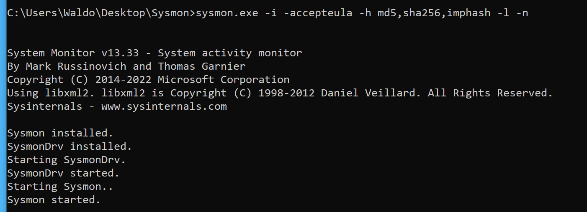
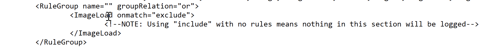
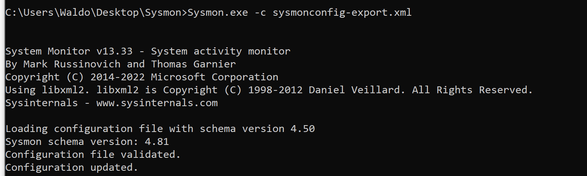
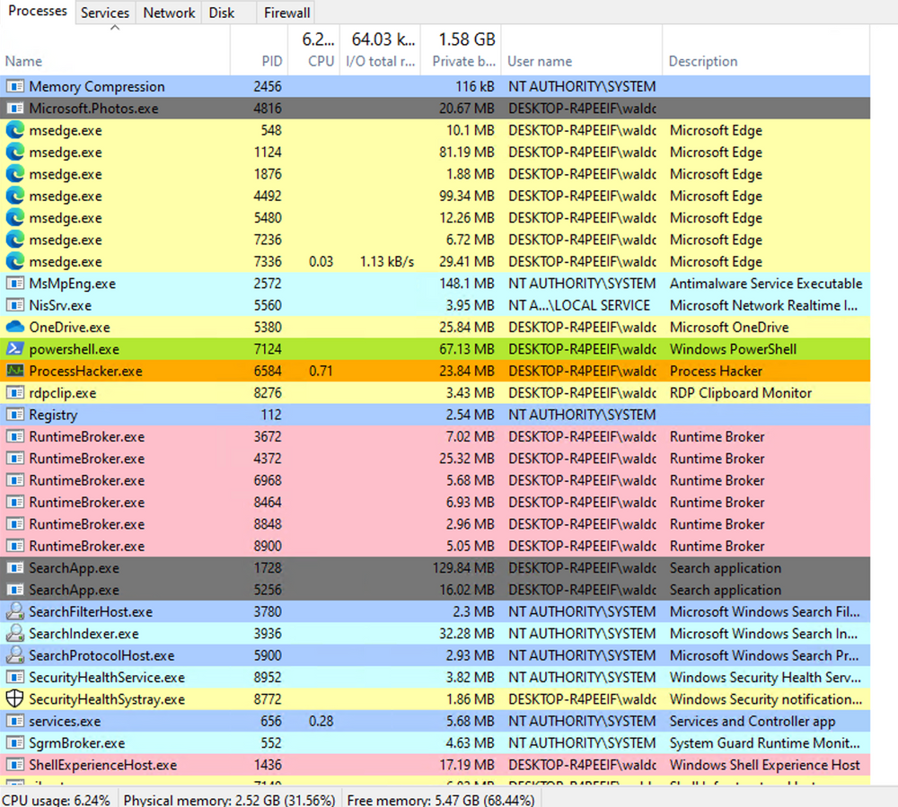
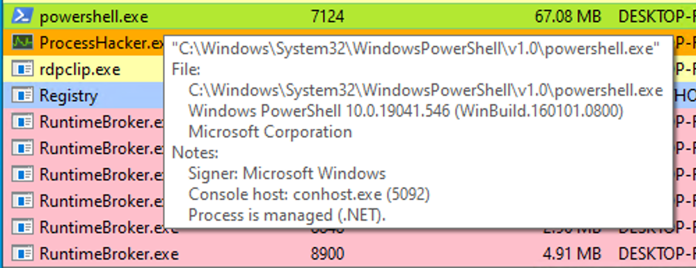
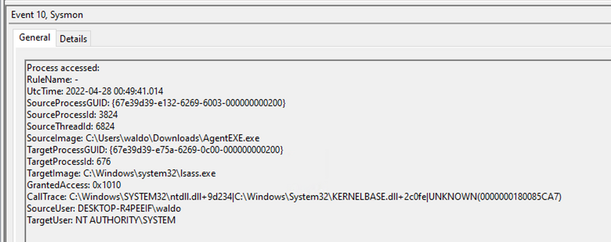
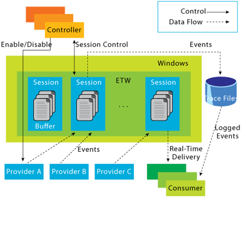
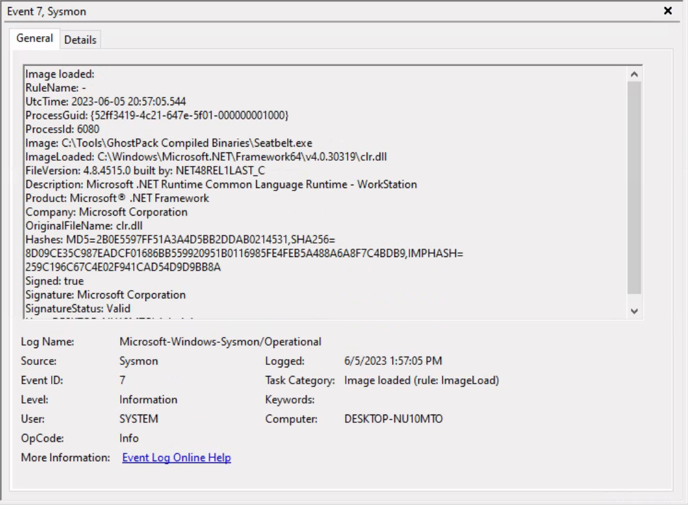
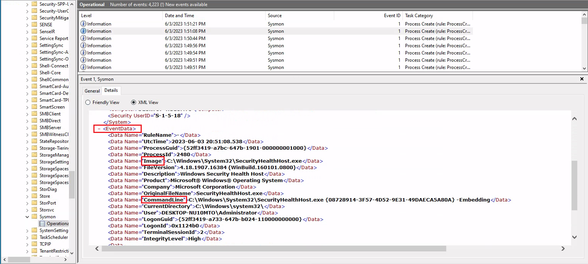

# Module 03: Windows Event Logs & Finding Evil

## Mục lục

- [Section 1/6 — Windows Event Logs](#section-01)
- [Section 2/6 — Phân tích hoạt động độc hại với Sysmon và Event Logs](#section-02)
- [Section 3/6 — Event Tracing for Windows (ETW)](#section-03)
- [Section 4/6 — Khai thác dữ liệu từ ETW](#section-04)
- [Section 5/6 — Get-WinEvent](#section-05)
- [Section 6/6 — Đánh giá kỹ năng](#section-06)

<a id="section-01"></a>

## Section 1/6 — Windows Event Logs

### Kiến thức cơ bản về ghi sự kiện Windows

Windows Event Logs (nhật ký sự kiện Windows) là một phần vốn có của hệ điều hành Windows, lưu trữ log từ nhiều thành phần của hệ thống, bao gồm chính hệ thống, các ứng dụng chạy trên đó, ETW provider, dịch vụ và những thành phần khác.

Cơ chế ghi sự kiện Windows cung cấp khả năng ghi log toàn diện về lỗi ứng dụng, sự kiện bảo mật và thông tin chẩn đoán. Là chuyên gia an ninh mạng, chúng ta sử dụng rộng rãi những log này để phân tích và phát hiện xâm nhập.

Log được phân loại vào các nhật ký sự kiện khác nhau, như "Application", "System", "Security" và những nhật ký khác, để tổ chức sự kiện theo nguồn hoặc mục đích.

Có thể truy cập nhật ký sự kiện bằng ứng dụng Event Viewer hoặc thông qua lập trình với các API như Windows Event Log API.

Truy cập Windows Event Viewer bằng người dùng có quyền quản trị cho phép chúng ta khám phá các log khác nhau đang có.


Những nhật ký sự kiện mặc định của Windows gồm Application, Security, Setup, System và Forwarded Events. Bốn nhật ký đầu bao quát lỗi ứng dụng, sự kiện bảo mật, hoạt động thiết lập hệ thống và thông tin hệ thống nói chung; còn "Forwarded Events" có điểm riêng là hiển thị dữ liệu nhật ký sự kiện được chuyển tiếp từ các máy khác. Tính năng ghi log tập trung này hữu ích cho quản trị viên hệ thống muốn có một góc nhìn tổng hợp. Trong quá trình phân tích hiện tại, chúng ta tập trung vào nhật ký sự kiện từ một máy duy nhất.

Cần lưu ý rằng Windows Event Viewer có thể mở và hiển thị các tệp .evtx đã lưu trước đó; sau khi mở, chúng xuất hiện trong mục "Saved Logs".


### Cấu trúc của một nhật ký sự kiện

Khi kiểm tra log Application, chúng ta gặp hai mức sự kiện riêng biệt: thông tin và lỗi.


Sự kiện thông tin cung cấp chi tiết chung về việc sử dụng ứng dụng, chẳng hạn sự kiện khởi động hoặc dừng. Ngược lại, sự kiện lỗi chỉ ra các lỗi cụ thể và thường cung cấp thông tin chi tiết về vấn đề gặp phải.


Mỗi bản ghi trong Windows Event Log là một “Event” và chứa những thành phần chính sau:

- Log Name: Tên nhật ký sự kiện (ví dụ: Application, System, Security, v.v.).
- Source: Phần mềm đã ghi sự kiện.
- Event ID: Mã định danh duy nhất của sự kiện.
- Task Category: Thường chứa một giá trị hoặc tên có thể giúp hiểu mục đích hay cách sử dụng sự kiện.
- Level: Mức độ nghiêm trọng của sự kiện (Information, Warning, Error, Critical và Verbose).
- Keywords: Các cờ cho phép phân loại sự kiện theo những cách ngoài các tùy chọn phân loại khác. Chúng thường là những nhóm rộng, như "Audit Success" hoặc "Audit Failure" trong log Security.
- User: Tài khoản người dùng đã đăng nhập khi sự kiện xảy ra.
- OpCode: Trường này có thể xác định thao tác cụ thể mà sự kiện báo cáo.
- Logged: Ngày và giờ sự kiện được ghi lại.
- Computer: Tên máy tính nơi sự kiện xảy ra.
- XML Data: Tất cả thông tin trên cũng được chứa trong định dạng XML cùng dữ liệu sự kiện bổ sung.

Trường Keywords đặc biệt hữu ích khi lọc nhật ký theo những loại sự kiện cụ thể. Nó có thể cải thiện đáng kể độ chính xác của truy vấn tìm kiếm bằng cách cho phép chỉ định các sự kiện cần quan tâm, nhờ đó quản lý log hiệu quả và chính xác hơn.

Xem kỹ nhật ký sự kiện phía trên, chúng ta nhận thấy một số thành phần quan trọng. Event ID ở góc trên bên trái đóng vai trò mã định danh duy nhất; có thể tra cứu thêm trên website Microsoft để thu thập thông tin bổ sung. Nhãn "SideBySide" bên cạnh Event ID biểu thị nguồn sự kiện. Phía dưới là mô tả lỗi tổng quát, thường chứa nhiều chi tiết. Khi nhấp vào phần chi tiết, chúng ta có thể phân tích thêm tác động của sự kiện bằng XML hoặc dạng xem được định dạng dễ đọc.


Ngoài ra, có thể trích xuất thông tin bổ sung từ nhật ký sự kiện, chẳng hạn ID của tiến trình xảy ra lỗi, để phân tích chính xác hơn.


Chuyển trọng tâm sang log bảo mật, hãy xét Event ID 4624, một sự kiện thường gặp (chi tiết tại https://docs.microsoft.com/en-us/windows/security/threat-protection/auditing/event-4624).


Theo tài liệu Microsoft, sự kiện này biểu thị việc tạo một phiên đăng nhập trên máy đích, được phát sinh từ máy tính được truy cập, nơi phiên được thiết lập. Trong log này, chúng ta tìm thấy những chi tiết quan trọng, bao gồm "Logon ID", cho phép tương quan lần đăng nhập này với các sự kiện khác có cùng "Logon ID". Một chi tiết quan trọng khác là "Logon Type", cho biết loại đăng nhập. Trong trường hợp này, nó chỉ ra loại đăng nhập Service, gợi ý rằng "SYSTEM" đã khởi tạo một dịch vụ mới. Tuy nhiên, cần điều tra thêm để xác định dịch vụ cụ thể, sử dụng kỹ thuật tương quan với dữ liệu bổ sung như "Logon ID".

### Sử dụng truy vấn XML tùy chỉnh

Để quá trình phân tích tập trung và thuận tiện hơn, chúng ta có thể tạo truy vấn XML tùy chỉnh nhằm xác định các sự kiện liên quan, lấy "Logon ID" làm điểm bắt đầu. Đi theo "Filter Current Log" -> "XML" -> "Edit Query Manually", chúng ta có thể sử dụng ngôn ngữ truy vấn XML tùy chỉnh để tìm kiếm log chi tiết hơn.


Trong truy vấn ví dụ, chúng ta tập trung vào những sự kiện chứa trường "SubjectLogonId" có giá trị "0x3E7". Việc chọn giá trị này xuất phát từ nhu cầu tương quan các sự kiện gắn với một "Logon ID" cụ thể và hiểu những chi tiết liên quan trong chúng.


Cần lưu ý rằng nếu cần hỗ trợ xây dựng truy vấn, có thể bật các bộ lọc tự động để xem tác động của chúng lên biểu diễn XML. Để được hướng dẫn thêm, Microsoft cung cấp các bài viết hữu ích về lọc XML nâng cao trong Windows Event Viewer.

Bằng cách xây dựng những truy vấn như vậy, chúng ta có thể thu hẹp trọng tâm vào tài khoản chịu trách nhiệm khởi tạo dịch vụ và loại bỏ chi tiết không cần thiết. Cách tiếp cận này giúp làm rõ hơn các hoạt động đăng nhập gần đây liên quan đến Logon ID đã chỉ định. Tuy nhiên, ngay cả sau khi tinh chỉnh như vậy, lượng dữ liệu vẫn đáng kể.

Đi sâu dần vào chi tiết log sẽ làm lộ ra diễn biến của sự việc. Ví dụ, quá trình phân tích bắt đầu với Event ID 4907, biểu thị một thay đổi chính sách kiểm toán.


Trong mô tả sự kiện, chúng ta tìm thấy thông tin hữu ích như: “Sự kiện này được tạo khi SACL của một đối tượng (ví dụ: khóa registry hoặc tệp) bị thay đổi.”

Nếu chưa quen với SACL, tham khảo liên kết được cung cấp (https://docs.microsoft.com/en-us/windows/win32/secauthz/access-control-lists) sẽ giúp hiểu về access control list (ACL — danh sách kiểm soát truy cập). Chữ “S” trong SACL biểu thị system access control list (danh sách kiểm soát truy cập hệ thống), cho phép quản trị viên ghi lại các lần thử truy cập vào đối tượng được bảo vệ. Mỗi Access Control Entry (ACE — mục kiểm soát truy cập) trong SACL chỉ định những loại truy cập do một chủ thể được chỉ định thực hiện sẽ kích hoạt việc tạo bản ghi trong nhật ký sự kiện bảo mật. Các ACE trong SACL có thể tạo bản ghi kiểm toán khi truy cập thất bại, thành công hoặc cả hai. Để biết thêm về SACL, xem các tài liệu về tạo bản ghi kiểm toán và quyền truy cập SACL.

Dựa trên thông tin này, có thể thấy quyền của một tệp đã được thay đổi để điều chỉnh việc ghi log hoặc kiểm toán các lần truy cập. Tìm hiểu thêm chi tiết sự kiện cho thấy những khía cạnh đáng chú ý khác.


Ví dụ, tiến trình chịu trách nhiệm thay đổi được xác định là "SetupHost.exe", cho thấy có thể đây là một quá trình cài đặt (dù cần lưu ý mã độc đôi khi có thể ngụy trang bằng tên hợp pháp). Tên đối tượng bị tác động dường như là "bootmanager"; chúng ta có thể kiểm tra security descriptor (bộ mô tả bảo mật) mới và cũ ("NewSd" và "OldSd") để xác định thay đổi. Có thể hiểu ý nghĩa của từng trường trong security descriptor thông qua các tài liệu tham khảo như bài viết về chuỗi ACE và cách hiểu cú pháp SDDL.

Từ những sự kiện quan sát được, chúng ta có thể suy ra đã diễn ra một quá trình cài đặt, bao gồm tạo tệp mới và cấu hình ban đầu các quyền bảo mật để phục vụ kiểm toán. Sau đó, chúng ta gặp sự kiện đăng nhập, tiếp theo là sự kiện “đăng nhập đặc biệt”.


Phân tích sự kiện đăng nhập đặc biệt giúp hiểu các quyền trong token được cấp cho người dùng khi đăng nhập thành công.


Danh sách đầy đủ các đặc quyền có thể được tìm thấy trong tài liệu về hằng số đặc quyền. Ví dụ, đặc quyền "SeDebugPrivilege" cho biết người dùng có khả năng can thiệp vào vùng nhớ không thuộc về mình.

### Các Windows Event Log hữu ích

Dưới đây là danh sách minh họa, không bao quát hết, về các Windows event log hữu ích.

#### Log System của Windows

- Event ID 1074 (tắt/khởi động lại hệ thống): Nhật ký sự kiện này cho biết khi nào và vì sao hệ thống bị tắt hoặc khởi động lại. Giám sát các sự kiện này cho phép xác định những lần tắt hoặc khởi động lại bất ngờ, có thể làm lộ hoạt động độc hại như nhiễm mã độc hoặc người dùng truy cập trái phép.
- Event ID 6005 (dịch vụ Event Log đã khởi động): Nhật ký sự kiện này đánh dấu thời điểm dịch vụ Event Log được khởi động. Đây là bản ghi quan trọng vì có thể biểu thị hệ thống khởi động, cung cấp điểm bắt đầu để điều tra hiệu năng hệ thống hoặc sự cố bảo mật tiềm ẩn quanh thời điểm đó. Cũng có thể dùng nó để phát hiện các lần khởi động lại hệ thống trái phép.
- Event ID 6006 (dịch vụ Event Log đã dừng): Nhật ký sự kiện này biểu thị thời điểm dịch vụ Event Log dừng. Nó thường xuất hiện khi hệ thống đang tắt. Những lần xuất hiện bất thường hoặc ngoài dự kiến có thể cho thấy hành vi cố ý làm gián đoạn dịch vụ nhằm che giấu hoạt động bất hợp pháp.
- Event ID 6013 (thời gian hoạt động của Windows): Sự kiện này xảy ra mỗi ngày một lần và cho biết thời gian hệ thống đã hoạt động tính bằng giây. Thời gian hoạt động ngắn hơn dự kiến có thể có nghĩa hệ thống đã được khởi động lại, điều có thể biểu thị một vụ xâm nhập tiềm ẩn hoặc hoạt động trái phép trên hệ thống.
- Event ID 7040 (thay đổi trạng thái dịch vụ): Sự kiện này cho biết kiểu khởi động của dịch vụ đã thay đổi, có thể từ thủ công sang tự động hoặc ngược lại. Nếu kiểu khởi động của một dịch vụ quan trọng bị thay đổi, đó có thể là dấu hiệu hệ thống bị can thiệp.

#### Log Security của Windows

- Event ID 1102 (nhật ký kiểm toán đã bị xóa): Xóa nhật ký kiểm toán thường là dấu hiệu của nỗ lực loại bỏ bằng chứng về xâm nhập hoặc hoạt động độc hại.
- Event ID 1116 (antivirus phát hiện mã độc): Sự kiện này đặc biệt quan trọng vì ghi lại thời điểm Defender phát hiện mã độc. Số lượng sự kiện tăng đột biến có thể cho thấy một cuộc tấn công có chủ đích hoặc lây nhiễm mã độc trên diện rộng.
- Event ID 1118 (hoạt động khắc phục của antivirus đã bắt đầu): Sự kiện này biểu thị Defender đã bắt đầu loại bỏ hoặc cách ly mã độc được phát hiện. Cần giám sát các sự kiện này để bảo đảm hoạt động khắc phục thành công.
- Event ID 1119 (hoạt động khắc phục của antivirus đã thành công): Sự kiện này cho biết quá trình khắc phục mã độc được phát hiện đã thành công. Giám sát thường xuyên sẽ giúp bảo đảm các mối đe dọa đã nhận diện được vô hiệu hóa hiệu quả.
- Event ID 1120 (hoạt động khắc phục của antivirus đã thất bại): Đây là sự kiện đối ứng với 1119, cho biết quá trình khắc phục thất bại. Cần giám sát chặt chẽ và xử lý ngay các sự kiện này để bảo đảm vô hiệu hóa mối đe dọa hiệu quả.
- Event ID 4624 (đăng nhập thành công): Sự kiện này ghi lại những lần đăng nhập thành công. Thông tin này thiết yếu để xác lập hành vi bình thường của người dùng. Hành vi bất thường, như đăng nhập vào giờ lạ hoặc từ địa điểm khác, có thể biểu thị mối đe dọa bảo mật tiềm ẩn.
- Event ID 4625 (đăng nhập thất bại): Sự kiện này ghi lại các lần đăng nhập thất bại. Nhiều lần đăng nhập thất bại có thể biểu thị một cuộc tấn công brute force đang diễn ra.
- Event ID 4648 (một lần đăng nhập được thử bằng thông tin xác thực chỉ định tường minh): Sự kiện này được kích hoạt khi người dùng đăng nhập với thông tin xác thực được chỉ định tường minh để chạy chương trình. Bất thường trong các sự kiện đăng nhập này có thể cho thấy lateral movement (di chuyển ngang) trong mạng, một kỹ thuật kẻ tấn công thường sử dụng.
- Event ID 4656 (yêu cầu handle đến một đối tượng): Sự kiện này được kích hoạt khi có yêu cầu handle đến một đối tượng, như tệp, khóa registry hoặc tiến trình. Nó có thể hữu ích để phát hiện những nỗ lực truy cập tài nguyên nhạy cảm.
- Event ID 4672 (đặc quyền đặc biệt được cấp cho một lần đăng nhập mới): Sự kiện này được ghi mỗi khi một tài khoản đăng nhập với quyền siêu người dùng. Theo dõi những sự kiện này giúp bảo đảm quyền siêu người dùng không bị lạm dụng hoặc sử dụng với mục đích độc hại.
- Event ID 4698 (một scheduled task được tạo): Sự kiện này được kích hoạt khi một tác vụ theo lịch được tạo. Giám sát nó có thể giúp phát hiện cơ chế persistence (duy trì hiện diện), vì kẻ tấn công thường sử dụng scheduled task để duy trì truy cập và chạy mã độc.
- Event ID 4700 và Event ID 4701 (một scheduled task được bật/tắt): Ghi lại việc bật hoặc tắt một tác vụ theo lịch. Kẻ tấn công thường thao túng scheduled task để duy trì hiện diện hoặc chạy mã độc, vì vậy những log này có thể cung cấp thông tin hữu ích về hoạt động đáng ngờ.
- Event ID 4702 (một scheduled task được cập nhật): Tương tự 4698, sự kiện này được kích hoạt khi tác vụ theo lịch được cập nhật. Giám sát những cập nhật này có thể giúp phát hiện các thay đổi biểu thị ý đồ độc hại.
- Event ID 4719 (chính sách kiểm toán hệ thống bị thay đổi): Sự kiện này ghi lại thay đổi đối với chính sách kiểm toán trên máy tính. Nó có thể là dấu hiệu ai đó đang cố che giấu dấu vết bằng cách tắt kiểm toán hoặc thay đổi những sự kiện được kiểm toán.
- Event ID 4738 (một tài khoản người dùng bị thay đổi): Sự kiện này ghi lại mọi thay đổi đối với tài khoản người dùng, bao gồm đặc quyền, tư cách thành viên nhóm và thiết lập tài khoản. Thay đổi tài khoản ngoài dự kiến có thể là dấu hiệu tài khoản bị chiếm quyền hoặc mối đe dọa nội bộ.
- Event ID 4771 (tiền xác thực Kerberos thất bại): Sự kiện này tương tự 4625 (đăng nhập thất bại) nhưng dành riêng cho xác thực Kerberos. Số lượng log này nhiều bất thường có thể cho thấy kẻ tấn công đang cố brute force dịch vụ Kerberos.
- Event ID 4776 (domain controller cố xác thực thông tin đăng nhập của một tài khoản): Sự kiện này giúp theo dõi cả những lần domain controller kiểm tra thông tin xác thực thành công và thất bại. Nhiều lần thất bại có thể gợi ý tấn công brute force.
- Event ID 5001 (cấu hình bảo vệ thời gian thực của antivirus đã thay đổi): Sự kiện này cho biết các thiết lập bảo vệ thời gian thực của Defender đã bị sửa đổi. Thay đổi trái phép có thể biểu thị nỗ lực tắt hoặc làm suy yếu chức năng của Defender.
- Event ID 5140 (một đối tượng chia sẻ mạng được truy cập): Sự kiện này được ghi mỗi khi có truy cập vào tài nguyên chia sẻ mạng. Nó có thể đóng vai trò quan trọng trong nhận diện truy cập trái phép vào các tài nguyên chia sẻ mạng.
- Event ID 5142 (một đối tượng chia sẻ mạng được thêm): Sự kiện này biểu thị việc tạo một tài nguyên chia sẻ mạng mới. Tài nguyên chia sẻ trái phép có thể được dùng để đưa dữ liệu ra ngoài hoặc phát tán mã độc trong mạng.
- Event ID 5145 (kiểm tra một đối tượng chia sẻ mạng để xác định có thể cấp quyền truy cập mong muốn cho client hay không): Sự kiện này cho biết có người đã cố truy cập tài nguyên chia sẻ mạng. Những lần kiểm tra như vậy diễn ra thường xuyên có thể cho thấy người dùng hoặc mã độc đang cố lập bản đồ tài nguyên chia sẻ để khai thác về sau.
- Event ID 5157 (Windows Filtering Platform đã chặn một kết nối): Sự kiện được ghi khi Windows Filtering Platform chặn một lần thử kết nối. Nó có thể hữu ích để nhận diện lưu lượng độc hại trong mạng.
- Event ID 7045 (một dịch vụ được cài vào hệ thống): Sự xuất hiện đột ngột của dịch vụ không rõ nguồn gốc có thể gợi ý cài đặt mã độc, vì nhiều loại mã độc tự cài dưới dạng dịch vụ.

Hãy nhớ rằng một trong những yếu tố then chốt của phát hiện mối đe dọa là hiểu rõ thế nào là “bình thường” trong môi trường của mình. Những bất thường có thể chỉ ra mối đe dọa trong môi trường này lại có thể là hành vi bình thường trong môi trường khác. Cần tinh chỉnh hệ thống giám sát và cảnh báo phù hợp với môi trường để giảm thiểu false positive (dương tính giả) và giúp nhận ra mối đe dọa thực sự dễ hơn. Ngoài ra, cần có giải pháp quản lý log tập trung có thể thu thập, phân tích cú pháp và cảnh báo về những sự kiện này theo thời gian thực. Giám sát và xem xét các log thường xuyên có thể giúp phát hiện sớm, giảm thiểu mối đe dọa. Cuối cùng, cần bảo đảm tương quan những log này với các log hệ thống, bảo mật khác để có góc nhìn toàn diện hơn về sự kiện bảo mật trong môi trường.

### Bài tập thực hành

Di chuyển xuống cuối section này và nhấp Click here to spawn the target system! (nhấp vào đây để khởi tạo hệ thống mục tiêu).

Bây giờ, kết nối RDP đến [Target IP] bằng thông tin xác thực được cung cấp, mở Windows Event Viewer và trả lời các câu hỏi bên dưới.

```shellsession
lnkhangg1706@htb[/htb]$ xfreerdp /u:Administrator /p:'HTB_@cad3my_lab_W1n10_r00t!@0' /v:[Target IP] /dynamic-resolution
```

<a id="section-02"></a>

## Section 2/6 — Phân tích hoạt động độc hại với Sysmon và Event Logs

Trong quá trình xây dựng năng lực an ninh mạng vững chắc, điều thiết yếu là hiểu cách nhận diện và phân tích hiệu quả các sự kiện độc hại. Tiếp nối phần khám phá các sự kiện lành tính trước đó, giờ chúng ta sẽ tìm hiểu hoạt động độc hại và các kỹ thuật phát hiện.

### Kiến thức cơ bản về Sysmon

Khi điều tra sự kiện độc hại, một số Event ID đóng vai trò chỉ báo xâm nhập phổ biến. Ví dụ, Event ID 4624 cung cấp thông tin về các sự kiện đăng nhập mới, cho phép giám sát và phát hiện truy cập người dùng cùng mẫu đăng nhập đáng ngờ. Tương tự, Event ID 4688 cung cấp thông tin về tiến trình mới được tạo, hỗ trợ nhận diện các lần khởi chạy tiến trình bất thường hoặc độc hại. Để mở rộng phạm vi ghi nhận nhật ký sự kiện, chúng ta có thể bổ sung Sysmon với các khả năng ghi sự kiện bổ sung.

System Monitor (Sysmon) là một dịch vụ hệ thống Windows và driver thiết bị duy trì hoạt động qua các lần khởi động lại để giám sát, ghi hoạt động hệ thống vào Windows event log. Sysmon cung cấp thông tin chi tiết về việc tạo tiến trình, kết nối mạng, thay đổi thời gian tạo tệp và nhiều nội dung khác.

Các thành phần chính của Sysmon gồm:

- Một dịch vụ Windows để giám sát hoạt động hệ thống.
- Một driver thiết bị hỗ trợ thu thập dữ liệu hoạt động hệ thống.
- Một nhật ký sự kiện để hiển thị dữ liệu hoạt động đã thu thập.

Khả năng riêng biệt của Sysmon nằm ở việc ghi những thông tin thường không xuất hiện trong Security Event log; điều này khiến nó trở thành công cụ mạnh để giám sát hệ thống chuyên sâu và phân tích điều tra số an ninh mạng.

Sysmon phân loại các hoạt động hệ thống bằng Event ID, trong đó mỗi ID tương ứng một loại sự kiện cụ thể. Ví dụ, Event ID 1 tương ứng sự kiện "Process Creation" (tạo tiến trình), còn Event ID 3 chỉ các sự kiện "Network Connection" (kết nối mạng). Có thể tìm danh sách đầy đủ Sysmon Event ID tại đây.

Để kiểm soát chi tiết hơn những sự kiện được ghi, Sysmon sử dụng tệp cấu hình dựa trên XML. Tệp này cho phép đưa vào hoặc loại trừ một số loại sự kiện dựa trên các thuộc tính như tên tiến trình, địa chỉ IP, v.v. Có thể tham khảo những ví dụ phổ biến về tệp cấu hình Sysmon hữu ích:

- Để có cấu hình toàn diện, truy cập: https://github.com/SwiftOnSecurity/sysmon-config. <-- Chúng ta sẽ dùng cấu hình này trong section này!
- Một lựa chọn khác là: https://github.com/olafhartong/sysmon-modular, cung cấp cách tiếp cận theo mô-đun.

Để bắt đầu, bạn có thể cài Sysmon bằng cách tải nó từ tài liệu chính thức của Microsoft (https://docs.microsoft.com/en-us/sysinternals/downloads/sysmon). Sau khi tải xuống, mở command prompt với quyền quản trị và thực thi lệnh sau để cài Sysmon.

```cmd
C:\Tools\Sysmon> sysmon.exe -i -accepteula -h md5,sha256,imphash -l -n
```



Để sử dụng cấu hình Sysmon tùy chỉnh, thực thi lệnh sau sau khi cài Sysmon.

```shellsession
C:\Tools\Sysmon> sysmon.exe -c filename.xml
```

Lưu ý: Sysmon cũng có phiên bản dành cho Linux.

### Ví dụ phát hiện 1: Phát hiện DLL Hijacking

Trong use case cụ thể này, mục tiêu là phát hiện DLL hijacking (chiếm dụng quá trình nạp DLL). Các Sysmon Event ID liên quan đến DLL hijacking có trong tài liệu Sysmon (https://docs.microsoft.com/en-us/sysinternals/downloads/sysmon). Để phát hiện DLL hijacking, cần tập trung vào Event Type 7, tương ứng các sự kiện nạp mô-đun. Để thực hiện, cần sửa tệp cấu hình Sysmon sysmonconfig-export.xml đã tải từ https://github.com/SwiftOnSecurity/sysmon-config.

Khi kiểm tra cấu hình đã sửa, có thể thấy chú thích "include" biểu thị những sự kiện cần được đưa vào.


Trong trường hợp phát hiện DLL hijacking, chúng ta đổi "include" thành "exclude" để bảo đảm không có gì bị loại trừ, cho phép thu thập dữ liệu cần thiết.



Để sử dụng cấu hình Sysmon đã cập nhật, thực thi lệnh sau.

```cmd
C:\Tools\Sysmon> sysmon.exe -c sysmonconfig-export.xml
```



Với cấu hình Sysmon đã sửa, có thể bắt đầu quan sát sự kiện nạp image. Để xem các sự kiện này, mở Event Viewer và truy cập "Applications and Services" -> "Microsoft" -> "Windows" -> "Sysmon". Kiểm tra nhanh sẽ thấy Event ID mục tiêu xuất hiện.


Bây giờ, hãy xem một Sysmon Event ID 7 trông như thế nào.


Nhật ký sự kiện chứa trạng thái ký số của DLL (trong trường hợp này là do Microsoft ký), tiến trình hoặc image chịu trách nhiệm nạp DLL và DLL cụ thể được nạp. Trong ví dụ này, chúng ta thấy "MMC.exe" nạp "psapi.dll", cũng được Microsoft ký. Cả hai tệp đều nằm trong thư mục System32.

Bây giờ, hãy tiếp tục xây dựng cơ chế phát hiện. Để hiểu sâu hơn về DLL hijacking, việc nghiên cứu là hết sức quan trọng. Chúng ta tìm thấy một bài blog hữu ích cung cấp danh sách đầy đủ nhiều kỹ thuật DLL hijacking. Cho mục đích phát hiện này, chúng ta sẽ tập trung vào một trường hợp chiếm dụng liên quan đến tệp thực thi dễ bị khai thác calc.exe và danh sách những DLL có thể bị chiếm dụng.


Hãy thử thực hiện với "calc.exe" và "WININET.dll". Để đơn giản hóa, có thể sử dụng reflective DLL “hello world” của Stephen Fewer. Cần lưu ý DLL hijacking không đòi hỏi phải sử dụng reflective DLL.

Thực hiện các bước cần thiết, bao gồm đổi tên reflective_dll.x64.dll thành WININET.dll, di chuyển calc.exe từ C:\Windows\System32 cùng WININET.dll đến một thư mục có thể ghi (chẳng hạn Desktop), rồi chạy calc.exe, chúng ta sẽ thành công. Một MessageBox xuất hiện thay cho ứng dụng Calculator.


Tiếp theo, chúng ta phân tích tác động của việc chiếm dụng. Trước tiên, lọc nhật ký sự kiện để tập trung vào Event ID 7, biểu thị sự kiện nạp mô-đun, bằng cách nhấp "Filter Current Log...".


Sau đó, tìm các lần xuất hiện của "calc.exe" bằng cách nhấp "Find..." để xác định lần nạp DLL liên quan đến hoạt động chiếm dụng.


Đầu ra Sysmon cung cấp thông tin hữu ích. Giờ có thể quan sát một số Indicator of Compromise (IOC — chỉ báo xâm nhập) để tạo quy tắc phát hiện hiệu quả. Tuy nhiên, trước khi tiếp tục, hãy so sánh với một lần "calc.exe" nạp "wininet.dll" hợp lệ.


Hãy tìm hiểu những IOC này:

- "calc.exe", vốn nằm trong System32, không nên xuất hiện ở một thư mục có thể ghi. Vì vậy, bản sao "calc.exe" trong thư mục có thể ghi là một IOC, vì nó luôn phải nằm trong System32 hoặc có thể là Syswow64.
- "WININET.dll", vốn nằm trong System32, không nên được calc.exe nạp từ ngoài System32. Nếu có các lần nạp "WININET.dll" bên ngoài System32 với "calc.exe" là tiến trình cha, điều đó cho thấy DLL hijacking trong calc.exe. Dù cần thận trọng khi cảnh báo mọi trường hợp "WININET.dll" được nạp ngoài System32 (vì một số ứng dụng có thể đóng gói phiên bản DLL cụ thể để bảo đảm ổn định), với "calc.exe", có thể tự tin khẳng định đã có chiếm dụng do tên DLL không thay đổi, và kẻ tấn công không thể đổi tên này để né phát hiện.
- "WININET.dll" gốc được Microsoft ký, trong khi DLL được chèn vào của chúng ta không có chữ ký.

Ba IOC mạnh này cung cấp cách hiệu quả để phát hiện DLL hijacking liên quan đến calc.exe. Cần lưu ý rằng dù Sysmon và event log cung cấp telemetry (dữ liệu ghi nhận hoạt động) hữu ích cho săn tìm mối đe dọa và xây dựng quy tắc cảnh báo, chúng không phải nguồn thông tin duy nhất.

### Ví dụ phát hiện 2: Phát hiện chèn PowerShell/C-Sharp theo cách unmanaged

Trước khi tìm hiểu các kỹ thuật phát hiện, hãy nắm ngắn gọn về C# và môi trường runtime của nó. C# được xem là ngôn ngữ “managed” (được quản lý), nghĩa là cần một runtime phía sau để thực thi mã. Common Language Runtime (CLR) đóng vai trò môi trường runtime này. Managed code không chạy trực tiếp dưới dạng mã assembly; thay vào đó, nó được biên dịch sang định dạng bytecode mà runtime xử lý và thực thi. Vì vậy, một managed process dựa vào CLR để thực thi mã C#.

Với vai trò phòng thủ, có thể sử dụng kiến thức này để phát hiện những lần chèn hoặc thực thi C# bất thường trong môi trường. Để thực hiện, có thể dùng một tiện ích hữu ích tên Process Hacker.



Với Process Hacker, chúng ta có thể quan sát nhiều tiến trình trong môi trường. Sắp xếp tiến trình theo tên giúp nhận ra những khác biệt đáng chú ý được đánh dấu bằng màu. Đặc biệt, "powershell.exe", một managed process, được tô màu xanh lá so với các tiến trình khác. Di chuột lên powershell.exe sẽ thấy nhãn "Process is managed (.NET)", xác nhận trạng thái managed của nó.



Kiểm tra các mô-đun được powershell.exe nạp bằng cách nhấp chuột phải vào powershell.exe, chọn "Properties" và chuyển đến "Modules", chúng ta có thể tìm thấy thông tin liên quan.


Sự hiện diện của "Microsoft .NET Runtime...", clr.dll và clrjit.dll là điều cần chú ý. Hai DLL này được sử dụng khi mã C# chạy, như một phần của runtime để thực thi bytecode. Nếu thấy chúng được nạp trong những tiến trình thông thường không cần đến, điều đó gợi ý khả năng có cuộc tấn công execute-assembly hoặc chèn PowerShell theo cách unmanaged.

Để minh họa unmanaged PowerShell injection, có thể chèn một DLL kiểu PowerShell theo cách unmanaged vào tiến trình bất kỳ, chẳng hạn spoolsv.exe. Có thể thực hiện bằng dự án PSInject như sau.

```powershell
 powershell -ep bypass
 Import-Module .\Invoke-PSInject.ps1
 Invoke-PSInject -ProcId [Process ID of spoolsv.exe] -PoshCode "V3JpdGUtSG9zdCAiSGVsbG8sIEd1cnU5OSEi"
```


Sau khi chèn, chúng ta thấy "spoolsv.exe" chuyển từ trạng thái unmanaged sang managed.


Ngoài ra, tham khảo cả tab "Modules" tương ứng của Process Hacker và Sysmon Event ID 7 cho phép kiểm tra thông tin nạp DLL để xác nhận sự hiện diện của những DLL nêu trên.


### Ví dụ phát hiện 3: Phát hiện Credential Dumping

Một khía cạnh quan trọng khác của an ninh mạng là phát hiện hoạt động credential dumping (trích xuất thông tin xác thực). Mimikatz là công cụ được sử dụng rộng rãi cho hoạt động này, cung cấp nhiều phương pháp trích xuất thông tin xác thực Windows. Một lệnh cụ thể, "sekurlsa::logonpasswords", cho phép trích xuất hash mật khẩu hoặc mật khẩu dạng rõ bằng cách truy cập Local Security Authority Subsystem Service (LSASS). LSASS chịu trách nhiệm quản lý thông tin xác thực người dùng và là mục tiêu chính của các công cụ credential dumping như Mimikatz.

Cuộc tấn công có thể được thực hiện như sau.

```cmd
C:\Tools\Mimikatz> mimikatz.exe

  .#####.   mimikatz 2.2.0 (x64) #18362 Feb 29 2020 11:13:36
 .## ^ ##.  "A La Vie, A L'Amour" - (oe.eo)
 ## / \ ##  /*** Benjamin DELPY `gentilkiwi` ( benjamin@gentilkiwi.com )
 ## \ / ##       > http://blog.gentilkiwi.com/mimikatz
 '## v ##'       Vincent LE TOUX             ( vincent.letoux@gmail.com )
  '#####'        > http://pingcastle.com / http://mysmartlogon.com   ***/

mimikatz # privilege::debug
Privilege '20' OK

mimikatz # sekurlsa::logonpasswords

Authentication Id : 0 ; 1128191 (00000000:001136ff)
Session           : RemoteInteractive from 2
User Name         : Administrator
Domain            : DESKTOP-NU10MTO
Logon Server      : DESKTOP-NU10MTO
Logon Time        : 5/31/2023 4:14:41 PM
SID               : S-1-5-21-2712802632-2324259492-1677155984-500
        msv :
         [00000003] Primary
         * Username : Administrator
         * Domain   : DESKTOP-NU10MTO
         * NTLM     : XXXXXXXXXXXXXXXXXXXXXXXXXXXXXXXX
         * SHA1     : XXXXXXXXXXXXXXXXXXXXXXXXXXXXXXXX0812156b
        tspkg :
        wdigest :
         * Username : Administrator
         * Domain   : DESKTOP-NU10MTO
         * Password : (null)
        kerberos :
         * Username : Administrator
         * Domain   : DESKTOP-NU10MTO
         * Password : (null)
        ssp :   KO
        credman :
```

Như có thể thấy, đầu ra của lệnh "sekurlsa::logonpasswords" cung cấp thông tin quan trọng về thông tin xác thực bị lộ.

Để phát hiện hoạt động này, chúng ta có thể dựa vào một sự kiện Sysmon khác. Thay vì tập trung vào nạp DLL, chúng ta chuyển sang các sự kiện truy cập tiến trình. Kiểm tra Sysmon Event ID 10, biểu thị sự kiện "ProcessAccess", cho phép nhận diện những nỗ lực đáng ngờ nhằm truy cập LSASS.




Ví dụ, nếu thấy một tệp bất kỳ ("AgentEXE" trong trường hợp này) từ một thư mục bất kỳ ("Downloads" trong trường hợp này) cố truy cập LSASS, đó là hành vi bất thường. Ngoài ra, SourceUser khác TargetUser (ví dụ "waldo" là SourceUser và "SYSTEM" là TargetUser) càng làm rõ sự bất thường. Cũng cần lưu ý rằng trong quá trình credential dumping dựa trên mimikatz, người dùng phải yêu cầu SeDebugPrivileges. Như tên gọi, quyền này chủ yếu dùng để gỡ lỗi. Đây có thể là một IOC khác.

Lưu ý rằng một số tiến trình hợp pháp có thể truy cập LSASS, chẳng hạn tiến trình liên quan đến xác thực hoặc các công cụ bảo mật như AV hay EDR.

### Bài tập thực hành

Di chuyển xuống cuối section này và nhấp Click here to spawn the target system! (nhấp vào đây để khởi tạo hệ thống mục tiêu).

Sau đó, kết nối RDP đến [Target IP] bằng thông tin xác thực được cung cấp và trả lời các câu hỏi bên dưới. Đừng quên cấu hình Sysmon phù hợp trước khi tái hiện các cuộc tấn công.

```shellsession
lnkhangg1706@htb[/htb]$ xfreerdp /u:Administrator /p:'HTB_@cad3my_lab_W1n10_r00t!@0' /v:[Target IP] /dynamic-resolution
```

<a id="section-03"></a>

## Section 3/6 — Event Tracing for Windows (ETW)

Trong phát hiện mối đe dọa và ứng phó sự cố hiệu quả, chúng ta thường dựa vào lượng dữ liệu log hạn chế sẵn có. Tuy nhiên, cách tiếp cận này chưa khai thác hết nguồn thông tin khổng lồ có thể thu được từ tài nguyên mạnh mẽ mang tên Event Tracing for Windows (ETW). Đáng tiếc, sự bỏ sót này có thể bắt nguồn từ việc chưa nhận thức và đánh giá đầy đủ những hiểu biết toàn diện, chi tiết mà ETW cung cấp.

### ETW là gì?

Theo Microsoft, Event Tracing For Windows (ETW) là cơ chế tracing (theo dõi vết sự kiện) đa dụng, tốc độ cao do hệ điều hành cung cấp. Thông qua cơ chế bộ đệm và ghi log được triển khai trong kernel, ETW cung cấp khả năng theo dõi các sự kiện phát sinh từ cả ứng dụng user mode lẫn driver thiết bị kernel mode.

Là cơ chế theo dõi sự kiện hiệu năng cao được tích hợp sâu trong hệ điều hành Windows, ETW đem lại cơ hội rất lớn để củng cố năng lực phòng thủ. Kiến trúc của nó hỗ trợ tạo, thu thập và phân tích động nhiều loại sự kiện xảy ra trong hệ thống, từ đó tạo các log chi tiết theo thời gian thực bao quát rất nhiều hoạt động.

Sử dụng ETW hiệu quả cho phép khai thác một tập hợp rộng lớn các nguồn telemetry vượt qua giới hạn của dữ liệu log truyền thống. ETW thu thập nhiều loại sự kiện, từ lời gọi hệ thống, tạo và kết thúc tiến trình, hoạt động mạng, thay đổi tệp và registry đến nhiều khía cạnh khác. Kết hợp lại, các sự kiện tạo nên bức tranh chi tiết về hoạt động hệ thống, cung cấp ngữ cảnh vô giá để nhận diện hành vi bất thường, phát hiện sự cố bảo mật tiềm ẩn và hỗ trợ điều tra số.

Tính linh hoạt và khả năng mở rộng của ETW còn được tăng cường nhờ tích hợp liền mạch với Event Provider (thành phần cung cấp sự kiện). Những thành phần chuyên biệt này tạo ra các loại sự kiện cụ thể và có thể được tích hợp thuận tiện vào ứng dụng, thành phần hệ điều hành hoặc phần mềm bên thứ ba. Sự tích hợp này bảo đảm bao phủ rộng các nguồn sự kiện có thể có. Ngoài ra, khả năng mở rộng của ETW cho phép tạo provider tùy chỉnh đáp ứng yêu cầu riêng của tổ chức, qua đó hỗ trợ cách ghi log và giám sát có trọng tâm, hướng tới mục tiêu cụ thể.

Đáng chú ý, đặc tính gọn nhẹ và tác động tối thiểu đến hiệu năng khiến ETW trở thành một giải pháp telemetry tối ưu cho giám sát thời gian thực và đánh giá bảo mật liên tục. Bằng cách chọn bật và cấu hình các event provider liên quan, có thể tinh chỉnh phạm vi thu thập dữ liệu theo mục tiêu bảo mật cụ thể, cân bằng giữa độ phong phú của thông tin và hiệu năng hệ thống.

Hơn nữa, các công cụ, tiện ích mạnh như Message Analyzer của Microsoft và cmdlet Get-WinEvent của PowerShell đơn giản hóa đáng kể việc truy xuất, phân tích cú pháp và phân tích log ETW. Chúng cung cấp khả năng lọc nâng cao, cơ chế tương quan sự kiện và tính năng giám sát thời gian thực, giúp thành viên blue team rút ra thông tin có thể dùng làm cơ sở hành động từ lượng dữ liệu khổng lồ ETW thu thập.

### Kiến trúc và các thành phần ETW

Kiến trúc nền tảng và những thành phần chính của ETW được minh họa trong sơ đồ sau của Microsoft.



Controllers: Đúng như tên gọi, thành phần Controller kiểm soát mọi khía cạnh liên quan đến hoạt động ETW. Nó bao gồm những chức năng như khởi tạo, kết thúc trace session (phiên theo dõi vết), cũng như bật hoặc tắt provider trong một trace cụ thể. Trace session có thể đăng ký nhận dữ liệu từ một hoặc nhiều provider, nhờ đó cho phép các provider bắt đầu ghi log. Ví dụ về controller được dùng rộng rãi là tiện ích có sẵn "logman.exe", hỗ trợ quản lý hoạt động ETW.

Cốt lõi kiến trúc ETW là mô hình publish-subscribe (phát hành–đăng ký nhận). Mô hình này gồm hai thành phần chính:

- Providers: Đóng vai trò then chốt trong việc tạo sự kiện và ghi chúng vào các phiên ETW được chỉ định. Ứng dụng có thể đăng ký ETW provider, cho phép tạo và truyền nhiều sự kiện. ETW sử dụng bốn loại provider riêng biệt.
  - MOF Providers: Dựa trên Managed Object Format (MOF), có thể tạo sự kiện theo các schema MOF định trước. Chúng cung cấp cách tạo sự kiện linh hoạt và được dùng rộng rãi trong nhiều tình huống.
  - WPP Providers: WPP viết tắt của "Windows Software Trace Preprocessor". Những provider này sử dụng macro và chú thích chuyên biệt trong mã nguồn ứng dụng để tạo sự kiện. Loại provider này thường dùng để tracing và gỡ lỗi ở mức thấp trong kernel mode.
  - Manifest-based Providers: Là dạng provider hiện đại hơn của ETW, dựa vào tệp manifest XML định nghĩa cấu trúc và đặc điểm sự kiện. Cách tiếp cận này tăng tính linh hoạt, dễ quản lý, cho phép tạo và tùy chỉnh sự kiện một cách động.
  - TraceLogging Providers: Cung cấp cách tạo sự kiện đơn giản, hiệu quả. Chúng sử dụng TraceLogging API, được giới thiệu trong những phiên bản Windows gần đây, giúp đơn giản hóa quá trình tạo sự kiện với lượng mã bổ sung tối thiểu.
- Consumers: Đăng ký nhận những sự kiện cụ thể cần quan tâm và tiếp nhận chúng để tiếp tục xử lý hoặc phân tích. Theo mặc định, sự kiện thường được đưa vào tệp .ETL (Event Trace Log) để xử lý. Tuy nhiên, một kịch bản consumer khác là sử dụng khả năng của Windows API để xử lý và tiếp nhận sự kiện.
- Channels: Để thu thập và tiếp nhận sự kiện hiệu quả, ETW dựa vào các kênh sự kiện. Chúng đóng vai trò vùng chứa logic để tổ chức, lọc sự kiện theo đặc điểm và mức độ quan trọng. ETW hỗ trợ nhiều kênh, mỗi kênh có mục đích và đối tượng sử dụng riêng. Consumer có thể chọn đăng ký những kênh cụ thể để nhận sự kiện liên quan đến use case của mình.
- ETL files: ETW hỗ trợ chuyên biệt việc ghi sự kiện xuống đĩa bằng event trace log file, thường gọi là “tệp ETL”. Chúng lưu trữ sự kiện bền vững, phục vụ phân tích ngoại tuyến, lưu trữ dài hạn và điều tra số. ETW cho phép luân phiên và quản lý tệp ETL thuận tiện để sử dụng dung lượng lưu trữ hiệu quả.

Lưu ý:

- ETW hỗ trợ event provider ở cả kernel mode và user mode.
- Một số provider tạo lượng sự kiện rất lớn, có thể làm quá tải tài nguyên hệ thống nếu hoạt động liên tục. Vì vậy, để tránh tiêu thụ tài nguyên không cần thiết, chúng thường bị tắt theo mặc định và chỉ được bật khi một tracing session yêu cầu rõ ràng.
- Ngoài các khả năng vốn có, ETW có thể được mở rộng thông qua event provider tùy chỉnh.
- Chỉ những sự kiện của ETW provider được áp dụng thuộc tính Channel mới có thể được event log tiếp nhận.

### Tương tác với ETW

Logman là tiện ích cài sẵn để quản lý ETW và Event Tracing Session. Công cụ này rất hữu ích cho việc tạo, khởi động, dừng và tìm hiểu các tracing session. Nó đặc biệt hữu ích khi xác định những phiên nào được thiết lập để thu thập dữ liệu hoặc khi bắt đầu thu thập dữ liệu của riêng mình.

Tham số -ets cho phép kiểm tra trực tiếp các event tracing session, cung cấp thông tin về những phiên tracing trên toàn hệ thống. Ví dụ, có thể tìm các Sysmon Event Tracing Session ở gần cuối thông tin hiển thị.

```cmd
C:\Tools> logman.exe query -ets

Data Collector Set                      Type                          Status
-------------------------------------------------------------------------------
Circular Kernel Context Logger          Trace                         Running
Eventlog-Security                       Trace                         Running
DiagLog                                 Trace                         Running
Diagtrack-Listener                      Trace                         Running
EventLog-Application                    Trace                         Running
EventLog-Microsoft-Windows-Sysmon-Operational Trace                         Running
EventLog-System                         Trace                         Running
LwtNetLog                               Trace                         Running
Microsoft-Windows-Rdp-Graphics-RdpIdd-Trace Trace                         Running
NetCore                                 Trace                         Running
NtfsLog                                 Trace                         Running
RadioMgr                                Trace                         Running
UBPM                                    Trace                         Running
WdiContextLog                           Trace                         Running
WiFiSession                             Trace                         Running
SHS-06012023-115154-7-7f                Trace                         Running
UserNotPresentTraceSession              Trace                         Running
8696EAC4-1288-4288-A4EE-49EE431B0AD9    Trace                         Running
ScreenOnPowerStudyTraceSession          Trace                         Running
SYSMON TRACE                            Trace                         Running
MSDTC_TRACE_SESSION                     Trace                         Running
SysmonDnsEtwSession                     Trace                         Running
MpWppTracing-20230601-115025-00000003-ffffffff Trace                         Running
WindowsUpdate_trace_log                 Trace                         Running
Admin_PS_Provider                       Trace                         Running
Terminal-Services-LSM-ApplicationLag-3764 Trace                         Running
Microsoft.Windows.Remediation           Trace                         Running
SgrmEtwSession                          Trace                         Running

The command completed successfully.
```

Khi trực tiếp kiểm tra một Event Tracing Session, chúng ta thấy những chi tiết cụ thể của phiên, bao gồm Name, Max Log Size, Log Location và các provider được đăng ký. Thông tin này rất có giá trị với người ứng phó sự cố. Phát hiện một phiên ghi dữ liệu từ provider liên quan đến mối quan tâm của bạn có thể đem lại các log quan trọng cho điều tra.

Lưu ý tham số “-ets” rất quan trọng đối với lệnh. Nếu thiếu nó, Logman sẽ không nhận diện Event Tracing Session.

Với mỗi provider được đăng ký trong phiên, có thể thu được những dữ liệu quan trọng:

- Name / Provider GUID: Mã định danh riêng của provider.
- Level: Mô tả mức sự kiện, cho biết đang lọc sự kiện warning, informational, critical hay tất cả.
- Keywords Any: Các keyword tạo bộ lọc dựa trên loại sự kiện mà provider sinh ra.

```cmd
C:\Tools> logman.exe query "EventLog-System" -ets


Name:                 EventLog-System
Status:               Running
Root Path:            %systemdrive%\PerfLogs\Admin
Segment:              Off
Schedules:            On
Segment Max Size:     100 MB

Name:                 EventLog-System\EventLog-System
Type:                 Trace
Append:               Off
Circular:             Off
Overwrite:            Off
Buffer Size:          64
Buffers Lost:         0
Buffers Written:      47
Buffer Flush Timer:   1
Clock Type:           System
File Mode:            Real-time

Provider:
Name:                 Microsoft-Windows-FunctionDiscoveryHost
Provider Guid:        {538CBBAD-4877-4EB2-B26E-7CAEE8F0F8CB}
Level:                255
KeywordsAll:          0x0
KeywordsAny:          0x8000000000000000 (System)
Properties:           65
Filter Type:          0

Provider:
Name:                 Microsoft-Windows-Subsys-SMSS
Provider Guid:        {43E63DA5-41D1-4FBF-ADED-1BBED98FDD1D}
Level:                255
KeywordsAll:          0x0
KeywordsAny:          0x4000000000000000 (System)
Properties:           65
Filter Type:          0

Provider:
Name:                 Microsoft-Windows-Kernel-General
Provider Guid:        {A68CA8B7-004F-D7B6-A698-07E2DE0F1F5D}
Level:                255
KeywordsAll:          0x0
KeywordsAny:          0x8000000000000000 (System)
Properties:           65
Filter Type:          0

Provider:
Name:                 Microsoft-Windows-FilterManager
Provider Guid:        {F3C5E28E-63F6-49C7-A204-E48A1BC4B09D}
Level:                255
KeywordsAll:          0x0
KeywordsAny:          0x8000000000000000 (System)
Properties:           65
Filter Type:          0

--- SNIP ---

The command completed successfully.
```

Sử dụng lệnh logman query providers cho phép liệt kê mọi provider sẵn có trên hệ thống, cùng GUID tương ứng.

```cmd
C:\Tools> logman.exe query providers

Provider                                 GUID
-------------------------------------------------------------------------------
ACPI Driver Trace Provider               {DAB01D4D-2D48-477D-B1C3-DAAD0CE6F06B}
Active Directory Domain Services: SAM    {8E598056-8993-11D2-819E-0000F875A064}
Active Directory: Kerberos Client        {BBA3ADD2-C229-4CDB-AE2B-57EB6966B0C4}
Active Directory: NetLogon               {F33959B4-DBEC-11D2-895B-00C04F79AB69}
ADODB.1                                  {04C8A86F-3369-12F8-4769-24E484A9E725}
ADOMD.1                                  {7EA56435-3F2F-3F63-A829-F0B35B5CAD41}
Application Popup                        {47BFA2B7-BD54-4FAC-B70B-29021084CA8F}
Application-Addon-Event-Provider         {A83FA99F-C356-4DED-9FD6-5A5EB8546D68}
ATA Port Driver Tracing Provider         {D08BD885-501E-489A-BAC6-B7D24BFE6BBF}
AuthFw NetShell Plugin                   {935F4AE6-845D-41C6-97FA-380DAD429B72}
BCP.1                                    {24722B88-DF97-4FF6-E395-DB533AC42A1E}
BFE Trace Provider                       {106B464A-8043-46B1-8CB8-E92A0CD7A560}
BITS Service Trace                       {4A8AAA94-CFC4-46A7-8E4E-17BC45608F0A}
Certificate Services Client CredentialRoaming Trace {EF4109DC-68FC-45AF-B329-CA2825437209}
Certificate Services Client Trace        {F01B7774-7ED7-401E-8088-B576793D7841}
Circular Kernel Session Provider         {54DEA73A-ED1F-42A4-AF71-3E63D056F174}
Classpnp Driver Tracing Provider         {FA8DE7C4-ACDE-4443-9994-C4E2359A9EDB}
Critical Section Trace Provider          {3AC66736-CC59-4CFF-8115-8DF50E39816B}
DBNETLIB.1                               {BD568F20-FCCD-B948-054E-DB3421115D61}
Deduplication Tracing Provider           {5EBB59D1-4739-4E45-872D-B8703956D84B}
Disk Class Driver Tracing Provider       {945186BF-3DD6-4F3F-9C8E-9EDD3FC9D558}
Downlevel IPsec API                      {94335EB3-79EA-44D5-8EA9-306F49B3A041}
Downlevel IPsec NetShell Plugin          {E4FF10D8-8A88-4FC6-82C8-8C23E9462FE5}
Downlevel IPsec Policy Store             {94335EB3-79EA-44D5-8EA9-306F49B3A070}
Downlevel IPsec Service                  {94335EB3-79EA-44D5-8EA9-306F49B3A040}
EA IME API                               {E2A24A32-00DC-4025-9689-C108C01991C5}
Error Instrument                         {CD7CF0D0-02CC-4872-9B65-0DBA0A90EFE8}
FD Core Trace                            {480217A9-F824-4BD4-BBE8-F371CAAF9A0D}
FD Publication Trace                     {649E3596-2620-4D58-A01F-17AEFE8185DB}
FD SSDP Trace                            {DB1D0418-105A-4C77-9A25-8F96A19716A4}
FD WNet Trace                            {8B20D3E4-581F-4A27-8109-DF01643A7A93}
FD WSDAPI Trace                          {7E2DBFC7-41E8-4987-BCA7-76CADFAD765F}
FDPHost Service Trace                    {F1C521CA-DA82-4D79-9EE4-D7A375723B68}
File Kernel Trace; Operation Set 1       {D75D8303-6C21-4BDE-9C98-ECC6320F9291}
File Kernel Trace; Operation Set 2       {058DD951-7604-414D-A5D6-A56D35367A46}
File Kernel Trace; Optional Data         {7DA1385C-F8F5-414D-B9D0-02FCA090F1EC}
File Kernel Trace; Volume To Log         {127D46AF-4AD3-489F-9165-F00BA64D5467}
FWPKCLNT Trace Provider                  {AD33FA19-F2D2-46D1-8F4C-E3C3087E45AD}
FWPUCLNT Trace Provider                  {5A1600D2-68E5-4DE7-BCF4-1C2D215FE0FE}
Heap Trace Provider                      {222962AB-6180-4B88-A825-346B75F2A24A}
IKEEXT Trace Provider                    {106B464D-8043-46B1-8CB8-E92A0CD7A560}
IMAPI1 Shim                              {1FF10429-99AE-45BB-8A67-C9E945B9FB6C}
IMAPI2 Concatenate Stream                {0E85A5A5-4D5C-44B7-8BDA-5B7AB54F7E9D}
IMAPI2 Disc Master                       {0E85A5A5-4D5C-44B7-8BDA-5B7AB54F7E91}
IMAPI2 Disc Recorder                     {0E85A5A5-4D5C-44B7-8BDA-5B7AB54F7E93}
IMAPI2 Disc Recorder Enumerator          {0E85A5A5-4D5C-44B7-8BDA-5B7AB54F7E92}
IMAPI2 dll                               {0E85A5A5-4D5C-44B7-8BDA-5B7AB54F7E90}
IMAPI2 Interleave Stream                 {0E85A5A5-4D5C-44B7-8BDA-5B7AB54F7E9E}
IMAPI2 Media Eraser                      {0E85A5A5-4D5C-44B7-8BDA-5B7AB54F7E97}
IMAPI2 MSF                               {0E85A5A5-4D5C-44B7-8BDA-5B7AB54F7E9F}
IMAPI2 Multisession Sequential           {0E85A5A5-4D5C-44B7-8BDA-5B7AB54F7EA0}
IMAPI2 Pseudo-Random Stream              {0E85A5A5-4D5C-44B7-8BDA-5B7AB54F7E9C}
IMAPI2 Raw CD Writer                     {0E85A5A5-4D5C-44B7-8BDA-5B7AB54F7E9A}
IMAPI2 Raw Image Writer                  {07E397EC-C240-4ED7-8A2A-B9FF0FE5D581}
IMAPI2 Standard Data Writer              {0E85A5A5-4D5C-44B7-8BDA-5B7AB54F7E98}
IMAPI2 Track-at-Once CD Writer           {0E85A5A5-4D5C-44B7-8BDA-5B7AB54F7E99}
IMAPI2 Utilities                         {0E85A5A5-4D5C-44B7-8BDA-5B7AB54F7E94}
IMAPI2 Write Engine                      {0E85A5A5-4D5C-44B7-8BDA-5B7AB54F7E96}
IMAPI2 Zero Stream                       {0E85A5A5-4D5C-44B7-8BDA-5B7AB54F7E9B}
IMAPI2FS Tracing                         {F8036571-42D9-480A-BABB-DE7833CB059C}
Intel-iaLPSS-GPIO                        {D386CC7A-620A-41C1-ABF5-55018C6C699A}
Intel-iaLPSS-I2C                         {D4AEAC44-AD44-456E-9C90-33F8CDCED6AF}
Intel-iaLPSS2-GPIO2                      {63848CFF-3EC7-4DDF-8072-5F95E8C8EB98}
Intel-iaLPSS2-I2C                        {C2F86198-03CA-4771-8D4C-CE6E15CBCA56}
IPMI Driver Trace                        {D5C6A3E9-FA9C-434E-9653-165B4FC869E4}
IPMI Provider Trace                      {651D672B-E11F-41B7-ADD3-C2F6A4023672}
KMDFv1 Trace Provider                    {544D4C9D-942C-46D5-BF50-DF5CD9524A50}
Layer2 Security HC Diagnostics Trace     {2E8D9EC5-A712-48C4-8CE0-631EB0C1CD65}
Local Security Authority (LSA)           {CC85922F-DB41-11D2-9244-006008269001}
LsaSrv                                   {199FE037-2B82-40A9-82AC-E1D46C792B99}
Microsoft-Antimalware-AMFilter           {CFEB0608-330E-4410-B00D-56D8DA9986E6}
Microsoft-Antimalware-Engine             {0A002690-3839-4E3A-B3B6-96D8DF868D99}
Microsoft-Antimalware-Engine-Instrumentation {68621C25-DF8D-4A6B-AABC-19A22E296A7C}
Microsoft-Antimalware-NIS                {102AAB0A-9D9C-4887-A860-55DE33B96595}
Microsoft-Antimalware-Protection         {E4B70372-261F-4C54-8FA6-A5A7914D73DA}
Microsoft-Antimalware-RTP                {8E92DEEF-5E17-413B-B927-59B2F06A3CFC}
Microsoft-Antimalware-Scan-Interface     {2A576B87-09A7-520E-C21A-4942F0271D67}
Microsoft-Antimalware-Service            {751EF305-6C6E-4FED-B847-02EF79D26AEF}
Microsoft-Antimalware-ShieldProvider     {928F7D29-0577-5BE5-3BD3-B6BDAB9AB307}
Microsoft-Antimalware-UacScan            {D37E7910-79C8-57C4-DA77-52BB646364CD}
Microsoft-AppV-Client                    {E4F68870-5AE8-4E5B-9CE7-CA9ED75B0245}
Microsoft-AppV-Client-StreamingUX        {28CB46C7-4003-4E50-8BD9-442086762D12}
Microsoft-AppV-ServiceLog                {9CC69D1C-7917-4ACD-8066-6BF8B63E551B}
Microsoft-AppV-SharedPerformance         {FB4A19EE-EB5A-47A4-BC52-E71AAC6D0859}
Microsoft-Client-Licensing-Platform      {B6CC0D55-9ECC-49A8-B929-2B9022426F2A}
Microsoft-Gaming-Services                {BC1BDB57-71A2-581A-147B-E0B49474A2D4}
Microsoft-IE                             {9E3B3947-CA5D-4614-91A2-7B624E0E7244}
Microsoft-IE-JSDumpHeap                  {7F8E35CA-68E8-41B9-86FE-D6ADC5B327E7}
Microsoft-IEFRAME                        {5C8BB950-959E-4309-8908-67961A1205D5}
Microsoft-JScript                        {57277741-3638-4A4B-BDBA-0AC6E45DA56C}
Microsoft-OneCore-OnlineSetup            {41862974-DA3B-4F0B-97D5-BB29FBB9B71E}
Microsoft-PerfTrack-IEFRAME              {B2A40F1F-A05A-4DFD-886A-4C4F18C4334C}
Microsoft-PerfTrack-MSHTML               {FFDB9886-80F3-4540-AA8B-B85192217DDF}
Microsoft-User Experience Virtualization-Admin {61BC445E-7A8D-420E-AB36-9C7143881B98}
Microsoft-User Experience Virtualization-Agent Driver {DE29CF61-5EE6-43FF-9AAC-959C4E13CC6C}
Microsoft-User Experience Virtualization-App Agent {1ED6976A-4171-4764-B415-7EA08BC46C51}
Microsoft-User Experience Virtualization-IPC {21D79DB0-8E03-41CD-9589-F3EF7001A92A}
Microsoft-User Experience Virtualization-SQM Uploader {57003E21-269B-4BDC-8434-B3BF8D57D2D5}
Microsoft-Windows Networking VPN Plugin Platform {E5FC4A0F-7198-492F-9B0F-88FDCBFDED48}
Microsoft-Windows-AAD                    {4DE9BC9C-B27A-43C9-8994-0915F1A5E24F}
Microsoft-Windows-ACL-UI                 {EA4CC8B8-A150-47A3-AFB9-C8D194B19452}

The command completed successfully.
```

Windows 10 có hơn 1,000 provider tích hợp sẵn. Ngoài ra, phần mềm bên thứ ba thường có ETW provider riêng, đặc biệt những phần mềm hoạt động trong Kernel mode.

Do số lượng provider lớn, lọc chúng bằng findstr thường có lợi. Ví dụ, bạn sẽ thấy nhiều kết quả cho "Winlogon" trong ví dụ dưới đây.

```cmd
C:\Tools> logman.exe query providers | findstr "Winlogon"
Microsoft-Windows-Winlogon               {DBE9B383-7CF3-4331-91CC-A3CB16A3B538}
Windows Winlogon Trace                   {D451642C-63A6-11D7-9720-00B0D03E0347}
```

Chỉ định một provider với Logman giúp hiểu sâu hơn về chức năng của nó. Kết quả cho biết những Keywords có thể dùng để lọc, các mức sự kiện sẵn có và những tiến trình hiện đang sử dụng provider.

```cmd
C:\Tools> logman.exe query providers Microsoft-Windows-Winlogon

Provider                                 GUID
-------------------------------------------------------------------------------
Microsoft-Windows-Winlogon               {DBE9B383-7CF3-4331-91CC-A3CB16A3B538}

Value               Keyword              Description
-------------------------------------------------------------------------------
0x0000000000010000  PerfInstrumentation
0x0000000000020000  PerfDiagnostics
0x0000000000040000  NotificationEvents
0x0000000000080000  PerfTrackContext
0x0000100000000000  ms:ReservedKeyword44
0x0000200000000000  ms:Telemetry
0x0000400000000000  ms:Measures
0x0000800000000000  ms:CriticalData
0x0001000000000000  win:ResponseTime     Response Time
0x0080000000000000  win:EventlogClassic  Classic
0x8000000000000000  Microsoft-Windows-Winlogon/Diagnostic
0x4000000000000000  Microsoft-Windows-Winlogon/Operational
0x2000000000000000  System               System

Value               Level                Description
-------------------------------------------------------------------------------
0x02                win:Error            Error
0x03                win:Warning          Warning
0x04                win:Informational    Information

PID                 Image
-------------------------------------------------------------------------------
0x00001710
0x0000025c


The command completed successfully.
```

Các keyword Microsoft-Windows-Winlogon/Diagnostic và Microsoft-Windows-Winlogon/Operational tham chiếu đến event log được provider này tạo ra.

Cũng có những lựa chọn thay thế dùng giao diện đồ họa. Bao gồm:

Sử dụng giao diện đồ họa của Performance Monitor, chúng ta có thể xem trực quan nhiều trace session đang chạy. Chỉ cần nhấp đúp vào một trace là có thể xem tổng quan chi tiết. Thao tác này hiển thị mọi dữ liệu liên quan, từ các provider tham gia và tính năng đã bật của chúng đến bản chất của trace. Ngoài ra, có thể sửa các phiên này theo nhu cầu bằng cách thêm hoặc loại bỏ provider. Cuối cùng, có thể tạo phiên mới bằng cách chọn mục "User Defined".


Metadata của ETW Provider cũng có thể được xem qua dự án EtwExplorer.


### Những provider hữu ích

- Microsoft-Windows-Kernel-Process: ETW provider này đóng vai trò quan trọng trong giám sát hoạt động liên quan đến tiến trình trong Windows kernel. Nó có thể hỗ trợ phát hiện hành vi tiến trình bất thường như process injection, process hollowing và các thủ thuật khác thường được mã độc và mối đe dọa dai dẳng nâng cao (APT) sử dụng.
- Microsoft-Windows-Kernel-File: Như tên gọi, provider này tập trung vào thao tác liên quan đến tệp. Có thể dùng cho các tình huống phát hiện truy cập tệp trái phép, thay đổi tệp hệ thống trọng yếu hoặc thao tác tệp đáng ngờ cho thấy hoạt động đưa dữ liệu ra ngoài hay ransomware.
- Microsoft-Windows-Kernel-Network: ETW provider này cung cấp khả năng quan sát hoạt động mạng ở cấp kernel. Nó đặc biệt hữu ích trong phát hiện tấn công qua mạng như đưa dữ liệu ra ngoài, kết nối mạng trái phép và dấu hiệu tiềm ẩn của liên lạc Command and Control (C2 — chỉ huy và điều khiển).
- Microsoft-Windows-SMBClient/SMBServer: Các provider này giám sát hoạt động client và server của Server Message Block (SMB), cung cấp thông tin về chia sẻ tệp và giao tiếp mạng. Có thể dùng để phát hiện mẫu lưu lượng SMB bất thường, có khả năng biểu thị di chuyển ngang hoặc đưa dữ liệu ra ngoài.
- Microsoft-Windows-DotNETRuntime: Provider này tập trung vào các sự kiện .NET runtime, phù hợp để nhận diện bất thường trong thực thi ứng dụng .NET, khả năng khai thác lỗ hổng .NET hoặc nạp .NET assembly độc hại.
- OpenSSH: Giám sát ETW provider OpenSSH có thể cung cấp thông tin quan trọng về các lần thử kết nối Secure Shell (SSH), xác thực thành công và thất bại, cùng khả năng có tấn công brute force.
- Microsoft-Windows-VPN-Client: Provider này cho phép theo dõi sự kiện của client Virtual Private Network (VPN). Nó có thể hữu ích trong nhận diện kết nối VPN trái phép hoặc đáng ngờ.
- Microsoft-Windows-PowerShell: ETW provider này theo dõi hoạt động thực thi và lệnh PowerShell, rất hữu ích để phát hiện việc sử dụng PowerShell đáng ngờ, ghi log script block và khả năng lạm dụng hoặc khai thác.
- Microsoft-Windows-Kernel-Registry: Provider này giám sát thao tác registry, hữu ích cho tình huống phát hiện thay đổi khóa registry, thường liên quan đến cơ chế duy trì hiện diện, cài mã độc hoặc thay đổi cấu hình hệ thống.
- Microsoft-Windows-CodeIntegrity: Provider này giám sát các lần kiểm tra tính toàn vẹn của mã và driver, có thể giữ vai trò then chốt trong nhận diện nỗ lực nạp driver hoặc mã không có chữ ký hay độc hại.
- Microsoft-Antimalware-Service: ETW provider này có thể được dùng để phát hiện vấn đề tiềm ẩn với dịch vụ chống mã độc, bao gồm dịch vụ bị tắt, thay đổi cấu hình hoặc các kỹ thuật né tránh có thể được mã độc sử dụng.
- WinRM: Giám sát provider Windows Remote Management (WinRM) có thể làm lộ hoạt động quản trị từ xa trái phép hoặc đáng ngờ, thường biểu thị di chuyển ngang hoặc thực thi lệnh từ xa.
- Microsoft-Windows-TerminalServices-LocalSessionManager: Provider này theo dõi các phiên Terminal Services cục bộ, hữu ích để phát hiện hoạt động remote desktop trái phép hoặc đáng ngờ.
- Microsoft-Windows-Security-Mitigations: Provider này theo dõi hiệu quả và hoạt động của các biện pháp giảm thiểu rủi ro bảo mật đang có. Nó cần thiết để nhận diện những nỗ lực có thể nhằm vượt qua các biện pháp kiểm soát đó.
- Microsoft-Windows-DNS-Client: ETW provider này cung cấp khả năng quan sát hoạt động DNS client, rất quan trọng để phát hiện tấn công dựa trên DNS, bao gồm DNS tunneling hoặc yêu cầu DNS bất thường có thể cho thấy liên lạc C2.
- Microsoft-Antimalware-Protection: Provider này giám sát hoạt động của các cơ chế bảo vệ chống mã độc. Có thể dùng để phát hiện vấn đề với các cơ chế này, như tính năng bảo vệ bị tắt, thay đổi cấu hình hoặc dấu hiệu của kỹ thuật né tránh do tác nhân độc hại sử dụng.

### Các provider bị hạn chế truy cập

Trong bảo mật hệ điều hành Windows, một số ETW provider được xem là “bị hạn chế”. Chúng cung cấp telemetry giá trị nhưng chỉ những tiến trình có quyền cần thiết mới được truy cập. Giới hạn này được thiết kế để bảo vệ dữ liệu hệ thống nhạy cảm khỏi các mối đe dọa tiềm ẩn.

Một trong những provider giá trị cao và bị hạn chế đó là Microsoft-Windows-Threat-Intelligence. Nó cung cấp thông tin quan trọng về mối đe dọa bảo mật tiềm ẩn và thường được sử dụng trong Digital Forensics and Incident Response (DFIR — điều tra số và ứng phó sự cố). Tuy nhiên, để truy cập provider này, tiến trình phải có một quyền đặc biệt được gọi là Protected Process Light (PPL).

Theo Elastic: Để có thể chạy dưới dạng PPL, nhà cung cấp phần mềm chống mã độc phải đăng ký với Microsoft, chứng minh danh tính, ký các văn bản pháp lý có tính ràng buộc, triển khai driver Early Launch Anti-Malware (ELAM), chạy nó qua bộ kiểm thử và gửi cho Microsoft để được cấp chữ ký Authenticode đặc biệt. Đây không phải quá trình đơn giản. Sau khi hoàn thành, nhà cung cấp có thể dùng driver ELAM này để Windows bảo vệ dịch vụ chống mã độc bằng cách chạy nó dưới dạng PPL. Dù vậy, vẫn tồn tại các cách khác để truy cập provider Microsoft-Windows-Threat-Intelligence.

Đối với Microsoft-Windows-Threat-Intelligence, quyền truy cập đặc biệt này đem lại nhiều lợi ích. Provider có thể ghi dữ liệu rất chi tiết về mối đe dọa tiềm ẩn, cho phép chuyên gia bảo mật phát hiện và phân tích những cuộc tấn công tinh vi có thể đã vượt qua các lớp phòng thủ khác. Telemetry của nó có thể trở thành bằng chứng quan trọng trong điều tra số, làm rõ nguồn gốc mối đe dọa, các hệ thống và dữ liệu mà nó tương tác, cùng những thay đổi nó thực hiện. Hơn nữa, giám sát provider này theo thời gian thực có thể giúp đội bảo mật nhận diện mối đe dọa đang diễn ra và can thiệp để giảm thiệt hại.

Trong section tiếp theo, chúng ta sẽ dùng ETW để điều tra những cuộc tấn công có thể không bị phát hiện nếu chỉ dựa vào Sysmon để giám sát và phân tích, do những giới hạn vốn có của Sysmon trong việc ghi nhận một số sự kiện.

### Tài liệu tham khảo

https://nasbench.medium.com/a-primer-on-event-tracing-for-windows-etw-997725c082bf
https://bmcder.com/blog/a-begginers-all-inclusive-guide-to-etw

<a id="section-04"></a>

## Section 4/6 — Khai thác dữ liệu từ ETW

### Ví dụ phát hiện 1: Phát hiện quan hệ cha–con bất thường

Quan hệ cha–con bất thường giữa các tiến trình có thể là dấu hiệu hoạt động độc hại. Trong môi trường Windows thông thường, một số tiến trình không bao giờ gọi hoặc tạo một số tiến trình khác. Ví dụ, rất khó có chuyện "calc.exe" tạo "cmd.exe" trong một môi trường Windows bình thường. Hiểu những quan hệ cha–con điển hình này có thể hỗ trợ phát hiện bất thường. Samir Bousseaden đã chia sẻ một sơ đồ tư duy hữu ích giới thiệu các quan hệ cha–con phổ biến, có thể tham khảo tại đây.

Sử dụng Process Hacker, chúng ta có thể khám phá quan hệ cha–con trong Windows. Sắp xếp tiến trình bằng các mục có thể mở rộng/thu gọn trong chế độ xem Processes sẽ hiển thị cấu trúc phân cấp của những quan hệ này.


Phân tích các quan hệ này trong môi trường tiêu chuẩn và môi trường tùy chỉnh cho phép nhận diện sai lệch khỏi mẫu hoạt động bình thường. Ví dụ, nếu thấy tiến trình "spoolsv.exe" tạo "whoami.exe" thay vì hành vi mong đợi là tạo "conhost", điều đó làm dấy lên nghi ngờ.


Để minh họa một quan hệ cha–con bất thường, trong đó "cmd.exe" có vẻ được "spoolsv.exe" tạo mà không có đối số đi kèm, chúng ta sẽ dùng kỹ thuật tấn công Parent PID Spoofing (giả mạo PID tiến trình cha). Có thể thực hiện kỹ thuật này qua dự án psgetsystem như sau.

```powershell
PS C:\Tools\psgetsystem> powershell -ep bypass
PS C:\Tools\psgetsystem> Import-Module .\psgetsys.ps1
PS C:\Tools\psgetsystem> [MyProcess]::CreateProcessFromParent([Process ID of spoolsv.exe],"C:\Windows\System32\cmd.exe","")
```


Do kỹ thuật giả mạo PID tiến trình cha đã sử dụng, Sysmon Event 1 hiển thị sai rằng spoolsv.exe là tiến trình cha của cmd.exe. Tuy nhiên, thực tế powershell.exe mới là tiến trình tạo cmd.exe.

Như đã thảo luận, dù Sysmon và event log cung cấp telemetry hữu ích cho săn tìm mối đe dọa và tạo quy tắc cảnh báo, chúng không phải nguồn thông tin duy nhất. Hãy bắt đầu thu thập dữ liệu từ provider Microsoft-Windows-Kernel-Process bằng SilkETW (có thể xác định provider bằng logman như đã mô tả trước đó: logman.exe query providers | findstr "Process"). Sau đó, chúng ta có thể mô phỏng lại cuộc tấn công để đánh giá ETW có cung cấp thông tin chính xác hơn về việc thực thi cmd.exe hay không.

```cmd
c:\Tools\SilkETW_SilkService_v8\v8\SilkETW>SilkETW.exe -t user -pn Microsoft-Windows-Kernel-Process -ot file -p C:\windows\temp\etw.json
```


Tệp etw.json (chứa dữ liệu từ provider Microsoft-Windows-Kernel-Process) dường như có thông tin cho thấy powershell.exe mới là tiến trình tạo cmd.exe.


Cần lưu ý rằng log sự kiện SilkETW có thể được tiếp nhận và xem trong Windows Event Viewer thông qua SilkService, giúp quan sát sâu và rộng hơn những hành động được thực hiện trên hệ thống.

### Ví dụ phát hiện 2: Phát hiện nạp .NET Assembly độc hại

Theo cách truyền thống, đối phương sử dụng chiến lược mang tên "Living off the Land" (LotL), lợi dụng công cụ hệ thống hợp pháp như PowerShell để thực hiện hoạt động độc hại. Cách này giảm rủi ro bị phát hiện vì sử dụng các công cụ vốn có của hệ thống, nên ít gây nghi ngờ hơn.

Tuy nhiên, cộng đồng an ninh mạng đã thích ứng và phát triển các biện pháp đối phó với chiến lược này.

Để phản ứng trước những tiến bộ trong phòng thủ, kẻ tấn công phát triển một cách tiếp cận mới mà Mandiant gọi là "Bring Your Own Land" (BYOL). Thay vì dựa vào công cụ đã có trên hệ thống nạn nhân, các tác nhân đe dọa và người kiểm thử xâm nhập mô phỏng những chiến thuật này hiện sử dụng .NET assembly được thực thi hoàn toàn trong bộ nhớ. Cách này bao gồm tạo công cụ tự xây dựng bằng ngôn ngữ như C#, khiến chúng độc lập với các công cụ sẵn có trên hệ thống mục tiêu. "Bring Your Own Land" khá hiệu quả vì các lý do sau:

- Mỗi hệ thống Windows mặc định được cài sẵn một phiên bản .NET nhất định.
- Một đặc điểm nổi bật của .NET là tính managed, giúp lập trình viên không phải tự quản lý bộ nhớ. Thuộc tính này thuộc quá trình thực thi mã được quản lý của framework, trong đó CLR đảm nhiệm các thao tác quan trọng ở cấp hệ thống như garbage collection (thu gom rác), loại bỏ rò rỉ bộ nhớ và bảo đảm sử dụng tài nguyên hiệu quả hơn.
- Một lợi ích đáng chú ý của .NET assembly là khả năng được nạp trực tiếp vào bộ nhớ. Nghĩa là không cần ghi tệp thực thi hoặc DLL xuống đĩa; thay vào đó, nó được thực thi trực tiếp trong bộ nhớ. Hành vi này giảm dấu vết để lại trên hệ thống và có thể giúp vượt qua một số cách phát hiện dựa vào kiểm tra tệp được ghi xuống đĩa.
- Microsoft đã tích hợp nhiều thư viện vào .NET framework để giải quyết nhiều bài toán lập trình phổ biến. Chúng bao gồm chức năng thiết lập kết nối HTTP, thực hiện thao tác mật mã và hỗ trợ inter-process communication (IPC — giao tiếp liên tiến trình), chẳng hạn named pipe. Những công cụ có sẵn này đơn giản hóa quá trình phát triển, giảm khả năng mắc lỗi và giúp xây dựng ứng dụng ổn định, hiệu quả dễ hơn. Hơn nữa, với tác nhân đe dọa, những tính năng phong phú này cung cấp bộ công cụ để tạo phương pháp tấn công tinh vi và kín đáo hơn.

Một minh họa rõ nét cho chiến lược BYOL là lệnh "execute-assembly" được triển khai trong CobaltStrike, nền tảng phần mềm được sử dụng rộng rãi cho mô phỏng đối phương và hoạt động red team. Lệnh 'execute-assembly' của CobaltStrike cho phép thực thi .NET assembly trực tiếp từ bộ nhớ, khiến nó trở thành công cụ lý tưởng để triển khai chiến lược BYOL.

Tương tự cách phát hiện thực thi script PowerShell theo cách unmanaged bằng việc quan sát hoạt động nạp clr.dll và clrjit.dll bất thường trong những tiến trình thông thường không cần chúng, chúng ta có thể dùng cách tiếp cận tương tự để nhận diện việc nạp .NET assembly độc hại. Điều này được thực hiện bằng cách xem xét kỹ hoạt động nạp DLL liên quan đến .NET, cụ thể là clr.dll và mscoree.dll.

Giám sát việc nạp những thư viện này có thể làm lộ các nỗ lực thực thi .NET assembly trong ngữ cảnh bất thường hoặc ngoài dự kiến, có thể là dấu hiệu hoạt động độc hại. Kiểu hành vi nạp DLL này thường có thể được phát hiện bằng Sysmon Event ID 7, tương ứng sự kiện "Image Loaded".

Để minh họa, hãy mô phỏng nạp .NET assembly độc hại bằng cách chạy một phiên bản Seatbelt đã biên dịch nằm trên đĩa. Seatbelt là một .NET assembly nổi tiếng, thường được đối phương nạp và thực thi trong bộ nhớ để nắm tình hình trên hệ thống đã xâm nhập.

```powershell
PS C:\Tools\GhostPack Compiled Binaries>.\Seatbelt.exe TokenPrivileges

                        %&&@@@&&
                        &&&&&&&%%%,                       #&&@@@@@@%%%%%%###############%
                        &%&   %&%%                        &////(((&%%%%%#%################//((((###%%%%%%%%%%%%%%%
%%%%%%%%%%%######%%%#%%####%  &%%**#                      @////(((&%%%%%%######################(((((((((((((((((((
#%#%%%%%%%#######%#%%#######  %&%,,,,,,,,,,,,,,,,         @////(((&%%%%%#%#####################(((((((((((((((((((
#%#%%%%%%#####%%#%#%%#######  %%%,,,,,,  ,,.   ,,         @////(((&%%%%%%%######################(#(((#(#((((((((((
#####%%%####################  &%%......  ...   ..         @////(((&%%%%%%%###############%######((#(#(####((((((((
#######%##########%#########  %%%......  ...   ..         @////(((&%%%%%#########################(#(#######((#####
###%##%%####################  &%%...............          @////(((&%%%%%%%%##############%#######(#########((#####
#####%######################  %%%..                       @////(((&%%%%%%%################
                        &%&   %%%%%      Seatbelt         %////(((&%%%%%%%%#############*
                        &%%&&&%%%%%        v1.2.1         ,(((&%%%%%%%%%%%%%%%%%,
                         #%%%%##,


====== TokenPrivileges ======

Current Token's Privileges

                     SeIncreaseQuotaPrivilege:  DISABLED
                          SeSecurityPrivilege:  DISABLED
                     SeTakeOwnershipPrivilege:  DISABLED
                        SeLoadDriverPrivilege:  DISABLED
                     SeSystemProfilePrivilege:  DISABLED
                        SeSystemtimePrivilege:  DISABLED
              SeProfileSingleProcessPrivilege:  DISABLED
              SeIncreaseBasePriorityPrivilege:  DISABLED
                    SeCreatePagefilePrivilege:  DISABLED
                            SeBackupPrivilege:  DISABLED
                           SeRestorePrivilege:  DISABLED
                          SeShutdownPrivilege:  DISABLED
                             SeDebugPrivilege:  SE_PRIVILEGE_ENABLED
                 SeSystemEnvironmentPrivilege:  DISABLED
                      SeChangeNotifyPrivilege:  SE_PRIVILEGE_ENABLED_BY_DEFAULT, SE_PRIVILEGE_ENABLED
                    SeRemoteShutdownPrivilege:  DISABLED
                            SeUndockPrivilege:  DISABLED
                      SeManageVolumePrivilege:  DISABLED
                       SeImpersonatePrivilege:  SE_PRIVILEGE_ENABLED_BY_DEFAULT, SE_PRIVILEGE_ENABLED
                      SeCreateGlobalPrivilege:  SE_PRIVILEGE_ENABLED_BY_DEFAULT, SE_PRIVILEGE_ENABLED
                SeIncreaseWorkingSetPrivilege:  DISABLED
                          SeTimeZonePrivilege:  DISABLED
                SeCreateSymbolicLinkPrivilege:  DISABLED
    SeDelegateSessionUserImpersonatePrivilege:  DISABLED
```

Giả sử Sysmon đã được cấu hình phù hợp để ghi các sự kiện nạp image (Event ID 7), thực thi 'Seatbelt.exe' sẽ kích hoạt nạp những DLL quan trọng liên quan đến .NET như 'clr.dll' và 'mscoree.dll'. Sysmon theo dõi hoạt động hệ thống sẽ ghi các thao tác nạp DLL này thành bản ghi Event ID 7.




Như đã đề cập, chỉ dựa vào Sysmon Event ID 7 để phát hiện tấn công có thể gặp khó khăn do lượng sự kiện lớn được tạo ra (đặc biệt nếu cấu hình không phù hợp). Ngoài ra, dù cho biết những DLL được nạp, nó không cung cấp chi tiết cụ thể về nội dung thực tế của .NET assembly đã nạp.

Để tăng khả năng quan sát và hiểu sâu hơn assembly thực tế đang được nạp, chúng ta có thể tiếp tục sử dụng ETW, cụ thể là provider Microsoft-Windows-DotNETRuntime.

Hãy dùng SilkETW để thu thập dữ liệu từ provider Microsoft-Windows-DotNETRuntime. Sau đó, mô phỏng lại cuộc tấn công để đánh giá ETW có cung cấp thông tin chi tiết hơn, có thể dùng làm cơ sở hành động về việc nạp và thực thi .NET assembly 'Seatbelt' hay không.

```cmd
c:\Tools\SilkETW_SilkService_v8\v8\SilkETW>SilkETW.exe -t user -pn Microsoft-Windows-DotNETRuntime -uk 0x2038 -ot file -p C:\windows\temp\etw.json
```

Tệp etw.json (chứa dữ liệu từ provider Microsoft-Windows-DotNETRuntime) dường như chứa lượng thông tin phong phú về assembly được nạp, bao gồm tên phương thức.


Cần lưu ý rằng với cấu hình SilkETW hiện tại, chúng ta không thu thập toàn bộ sự kiện từ provider "Microsoft-Windows-DotNETRuntime". Thay vào đó, chỉ chọn một tập con cụ thể (được chỉ định bằng 0x2038), bao gồm JitKeyword, InteropKeyword, LoaderKeyword và NGenKeyword.

- JitKeyword liên quan đến sự kiện biên dịch Just-In-Time (JIT), cung cấp thông tin về các phương thức được biên dịch khi chạy. Điều này có thể đặc biệt hữu ích để hiểu luồng thực thi của .NET assembly.
- InteropKeyword chỉ các sự kiện tương tác liên thông, xuất hiện khi managed code tương tác với unmanaged code. Chúng có thể cung cấp thông tin về những tương tác có thể có với native API hoặc các thành phần unmanaged khác.
- Sự kiện LoaderKeyword cung cấp chi tiết về quá trình nạp assembly trong .NET runtime, có thể rất quan trọng để hiểu những .NET assembly nào đang được nạp và có khả năng được thực thi.
- Cuối cùng, NGenKeyword tương ứng các sự kiện Native Image Generator (NGen), liên quan đến việc tạo và sử dụng .NET assembly đã biên dịch trước. Giám sát chúng có thể giúp phát hiện tình huống kẻ tấn công sử dụng assembly biên dịch trước để né những cách phát hiện liên quan đến JIT.

Bài blog này cung cấp góc nhìn hữu ích về SilkETW cũng như việc nhận diện mã độc dựa trên .NET.

### Bài tập thực hành

Di chuyển xuống cuối section này và nhấp Click here to spawn the target system! (nhấp vào đây để khởi tạo hệ thống mục tiêu).

Sau đó, kết nối RDP đến [Target IP] bằng thông tin xác thực được cung cấp và trả lời câu hỏi bên dưới.

```shellsession
lnkhangg1706@htb[/htb]$ xfreerdp /u:Administrator /p:'HTB_@cad3my_lab_W1n10_r00t!@0' /v:[Target IP] /dynamic-resolution
```

<a id="section-05"></a>

## Section 5/6 — Get-WinEvent

Hiểu tầm quan trọng của việc phân tích hàng loạt Windows Event Log và log Sysmon là điều then chốt trong an ninh mạng, đặc biệt đối với Incident Response (IR — ứng phó sự cố) và threat hunting (săn tìm mối đe dọa). Những log này chứa thông tin vô giá về trạng thái hệ thống, hoạt động người dùng, mối đe dọa tiềm ẩn, thay đổi hệ thống và thông tin xử lý sự cố kỹ thuật. Tuy nhiên, chúng cũng có thể rất lớn và khó quản lý. Với tổ chức quy mô lớn, việc tạo hàng triệu log mỗi ngày không phải hiếm. Vì vậy, để rút ra thông tin hữu ích, cần công cụ và kỹ thuật hiệu quả để phân tích hàng loạt log.

Một trong những công cụ đó là cmdlet Get-WinEvent trong PowerShell.

### Sử dụng Get-WinEvent

Cmdlet Get-WinEvent là công cụ không thể thiếu trong PowerShell để truy vấn hàng loạt Windows Event Log. Nó cho phép truy xuất nhiều loại nhật ký sự kiện, bao gồm log Windows cổ điển như System và Application, log được tạo bằng công nghệ Windows Event Log và log ETW.

Để nhanh chóng xác định các log sẵn có, có thể sử dụng tham số -ListLog kết hợp với Get-WinEvent. Chỉ định * làm giá trị tham số sẽ lấy tất cả log mà không áp dụng tiêu chí lọc. Nhờ đó, chúng ta có danh sách đầy đủ các log và thuộc tính liên quan. Thực thi lệnh sau sẽ lấy danh sách log và hiển thị các thuộc tính quan trọng như LogName, RecordCount, IsClassicLog, IsEnabled, LogMode và LogType. Ký tự | là pipe operator (toán tử đường ống), được dùng để chuyển đầu ra của một lệnh (ở đây là Get-WinEvent) sang lệnh khác (ở đây là Select-Object).

```powershell
PS C:\Users\Administrator> Get-WinEvent -ListLog * | Select-Object LogName, RecordCount, IsClassicLog, IsEnabled, LogMode, LogType | Format-Table -AutoSize

LogName                                                                                RecordCount IsClassicLog IsEnabled  LogMode        LogType
-------                                                                                ----------- ------------ ---------  -------        -------
Windows PowerShell                                                                            2916         True      True Circular Administrative
System                                                                                        1786         True      True Circular Administrative
Security                                                                                      8968         True      True Circular Administrative
Key Management Service                                                                           0         True      True Circular Administrative
Internet Explorer                                                                                0         True      True Circular Administrative
HardwareEvents                                                                                   0         True      True Circular Administrative
Application                                                                                   2079         True      True Circular Administrative
Windows Networking Vpn Plugin Platform/OperationalVerbose                                                 False     False Circular    Operational
Windows Networking Vpn Plugin Platform/Operational                                                        False     False Circular    Operational
SMSApi                                                                                           0        False      True Circular    Operational
Setup                                                                                           16        False      True Circular    Operational
OpenSSH/Operational                                                                              0        False      True Circular    Operational
OpenSSH/Admin                                                                                    0        False      True Circular Administrative
Network Isolation Operational                                                                             False     False Circular    Operational
Microsoft-WindowsPhone-Connectivity-WiFiConnSvc-Channel                                          0        False      True Circular    Operational
Microsoft-Windows-WWAN-SVC-Events/Operational                                                    0        False      True Circular    Operational
Microsoft-Windows-WPD-MTPClassDriver/Operational                                                 0        False      True Circular    Operational
Microsoft-Windows-WPD-CompositeClassDriver/Operational                                           0        False      True Circular    Operational
Microsoft-Windows-WPD-ClassInstaller/Operational                                                 0        False      True Circular    Operational
Microsoft-Windows-Workplace Join/Admin                                                           0        False      True Circular Administrative
Microsoft-Windows-WorkFolders/WHC                                                                0        False      True Circular    Operational
Microsoft-Windows-WorkFolders/Operational                                                        0        False      True Circular    Operational
Microsoft-Windows-Wordpad/Admin                                                                           False     False Circular    Operational
Microsoft-Windows-WMPNSS-Service/Operational                                                     0        False      True Circular    Operational
Microsoft-Windows-WMI-Activity/Operational                                                     895        False      True Circular    Operational
Microsoft-Windows-wmbclass/Trace                                                                          False     False Circular    Operational
Microsoft-Windows-WLAN-AutoConfig/Operational                                                    0        False      True Circular    Operational
Microsoft-Windows-Wired-AutoConfig/Operational                                                   0        False      True Circular    Operational
Microsoft-Windows-Winsock-WS2HELP/Operational                                                    0        False      True Circular    Operational
Microsoft-Windows-Winsock-NameResolution/Operational                                                      False     False Circular    Operational
Microsoft-Windows-Winsock-AFD/Operational                                                                 False     False Circular    Operational
Microsoft-Windows-WinRM/Operational                                                            230        False      True Circular    Operational
Microsoft-Windows-WinNat/Oper                                                                             False     False Circular    Operational
Microsoft-Windows-Winlogon/Operational                                                         648        False      True Circular    Operational
Microsoft-Windows-WinINet-Config/ProxyConfigChanged                                              2        False      True Circular    Operational
--- SNIP ---
```

Lệnh này cung cấp thông tin hữu ích về mỗi log, gồm tên, số bản ghi hiện có, log ở định dạng .evt cổ điển hay .evtx mới hơn, trạng thái bật, chế độ ghi log (Circular, Retain hoặc AutoBackup) và loại log (Administrative, Analytical, Debug hoặc Operational).

Ngoài ra, có thể khám phá những event log provider liên quan đến từng log bằng tham số -ListProvider. Event log provider đóng vai trò nguồn sự kiện trong log. Thực thi lệnh sau cho phép lấy danh sách provider và các log được liên kết tương ứng.

```powershell
PS C:\Users\Administrator> Get-WinEvent -ListProvider * | Format-Table -AutoSize

Name                                                                       LogLinks
----                                                                       --------
PowerShell                                                                 {Windows PowerShell}
Workstation                                                                {System}
WMIxWDM                                                                    {System}
WinNat                                                                     {System}
Windows Script Host                                                        {System}
Microsoft-Windows-IME-OEDCompiler                                          {Microsoft-Windows-IME-OEDCompiler/Analytic}
Microsoft-Windows-DeviceSetupManager                                       {Microsoft-Windows-DeviceSetupManager/Operat...
Microsoft-Windows-Search-ProfileNotify                                     {Application}
Microsoft-Windows-Eventlog                                                 {System, Security, Setup, Microsoft-Windows-...
Microsoft-Windows-Containers-BindFlt                                       {Microsoft-Windows-Containers-BindFlt/Operat...
Microsoft-Windows-NDF-HelperClassDiscovery                                 {Microsoft-Windows-NDF-HelperClassDiscovery/...
Microsoft-Windows-FirstUX-PerfInstrumentation                              {FirstUXPerf-Analytic}
--- SNIP ---
```

Lệnh này cho cái nhìn tổng quan về các provider sẵn có và mối liên hệ với những log cụ thể. Nó cho phép xác định provider cần quan tâm để phục vụ lọc.

Bây giờ, hãy tập trung vào truy xuất các nhật ký sự kiện cụ thể bằng Get-WinEvent. Ở mức cơ bản nhất, Get-WinEvent truy xuất nhật ký sự kiện từ máy cục bộ hoặc từ xa. Các ví dụ dưới đây minh họa cách lấy sự kiện từ nhiều log.

#### Truy xuất sự kiện từ log System

```powershell
PS C:\Users\Administrator> Get-WinEvent -LogName 'System' -MaxEvents 50 | Select-Object TimeCreated, ID, ProviderName, LevelDisplayName, Message | Format-Table -AutoSize

TimeCreated            Id ProviderName                             LevelDisplayName Message
-----------            -- ------------                             ---------------- -------
6/2/2023 9:41:42 AM    16 Microsoft-Windows-Kernel-General         Information      The access history in hive \??\C:\Users\Administrator\AppData\Local\Packages\MicrosoftWindows.Client.CBS_cw5...
6/2/2023 9:38:32 AM    16 Microsoft-Windows-Kernel-General         Information      The access history in hive \??\C:\Users\Administrator\AppData\Local\Packages\Microsoft.Windows.ShellExperien...
6/2/2023 9:38:32 AM 10016 Microsoft-Windows-DistributedCOM         Warning          The machine-default permission settings do not grant Local Activation permission for the COM Server applicat...
6/2/2023 9:37:31 AM    16 Microsoft-Windows-Kernel-General         Information      The access history in hive \??\C:\Users\Administrator\AppData\Local\Packages\Microsoft.WindowsAlarms_8wekyb3...
6/2/2023 9:37:31 AM    16 Microsoft-Windows-Kernel-General         Information      The access history in hive \??\C:\Users\Administrator\AppData\Local\Packages\microsoft.windowscommunications...
6/2/2023 9:37:31 AM    16 Microsoft-Windows-Kernel-General         Information      The access history in hive \??\C:\Users\Administrator\AppData\Local\Packages\Microsoft.Windows.ContentDelive...
6/2/2023 9:36:35 AM    16 Microsoft-Windows-Kernel-General         Information      The access history in hive \??\C:\Users\Administrator\AppData\Local\Packages\Microsoft.YourPhone_8wekyb3d8bb...
6/2/2023 9:36:32 AM    16 Microsoft-Windows-Kernel-General         Information      The access history in hive \??\C:\Users\Administrator\AppData\Local\Packages\Microsoft.AAD.BrokerPlugin_cw5n...
6/2/2023 9:36:30 AM    16 Microsoft-Windows-Kernel-General         Information      The access history in hive \??\C:\Users\Administrator\AppData\Local\Packages\Microsoft.Windows.Search_cw5n1h...
6/2/2023 9:36:29 AM    16 Microsoft-Windows-Kernel-General         Information      The access history in hive \??\C:\Users\Administrator\AppData\Local\Packages\Microsoft.Windows.StartMenuExpe...
6/2/2023 9:36:14 AM    16 Microsoft-Windows-Kernel-General         Information      The access history in hive \??\C:\Users\Administrator\AppData\Local\Microsoft\Windows\UsrClass.dat was clear...
6/2/2023 9:36:14 AM    16 Microsoft-Windows-Kernel-General         Information      The access history in hive \??\C:\Users\Administrator\ntuser.dat was cleared updating 2366 keys and creating...
6/2/2023 9:36:14 AM  7001 Microsoft-Windows-Winlogon               Information      User Logon Notification for Customer Experience Improvement Program
6/2/2023 9:33:04 AM    16 Microsoft-Windows-Kernel-General         Information      The access history in hive \??\C:\Windows\AppCompat\Programs\Amcache.hve was cleared updating 920 keys and c...
6/2/2023 9:31:54 AM    16 Microsoft-Windows-Kernel-General         Information      The access history in hive \??\C:\Windows\ServiceProfiles\NetworkService\AppData\Local\Microsoft\Windows\Del...
6/2/2023 9:30:23 AM    16 Microsoft-Windows-Kernel-General         Information      The access history in hive \??\C:\Windows\System32\config\COMPONENTS was cleared updating 54860 keys and cre...
6/2/2023 9:30:16 AM    15 Microsoft-Windows-Kernel-General         Information      Hive \SystemRoot\System32\config\DRIVERS was reorganized with a starting size of 3956736 bytes and an ending...
6/2/2023 9:30:10 AM  1014 Microsoft-Windows-DNS-Client             Warning          Name resolution for the name settings-win.data.microsoft.com timed out after none of the configured DNS serv...
6/2/2023 9:29:54 AM  7026 Service Control Manager                  Information      The following boot-start or system-start driver(s) did not load: ...
6/2/2023 9:29:54 AM 10148 Microsoft-Windows-WinRM                  Information      The WinRM service is listening for WS-Management requests. ...
6/2/2023 9:29:51 AM 51046 Microsoft-Windows-DHCPv6-Client          Information      DHCPv6 client service is started
--- SNIP ---
```

Ví dụ này lấy 50 sự kiện đầu tiên từ log System. Nó chọn các thuộc tính cụ thể, bao gồm thời gian tạo sự kiện, ID, tên provider, tên hiển thị mức sự kiện và thông điệp. Điều này giúp phân tích và xử lý sự cố kỹ thuật dễ hơn.

#### Truy xuất sự kiện từ Microsoft-Windows-WinRM/Operational

```powershell
PS C:\Users\Administrator> Get-WinEvent -LogName 'Microsoft-Windows-WinRM/Operational' -MaxEvents 30 | Select-Object TimeCreated, ID, ProviderName, LevelDisplayName, Message | Format-Table -AutoSize

TimeCreated            Id ProviderName            LevelDisplayName Message
-----------            -- ------------            ---------------- -------
6/2/2023 9:30:15 AM   132 Microsoft-Windows-WinRM Information      WSMan operation Enumeration completed successfully
6/2/2023 9:30:15 AM   145 Microsoft-Windows-WinRM Information      WSMan operation Enumeration started with resourceUri...
6/2/2023 9:30:15 AM   132 Microsoft-Windows-WinRM Information      WSMan operation Enumeration completed successfully
6/2/2023 9:30:15 AM   145 Microsoft-Windows-WinRM Information      WSMan operation Enumeration started with resourceUri...
6/2/2023 9:29:54 AM   209 Microsoft-Windows-WinRM Information      The Winrm service started successfully
--- SNIP ---
```

Trong ví dụ này, sự kiện được lấy từ log Microsoft-Windows-WinRM/Operational. Lệnh lấy 30 sự kiện đầu tiên và chọn các thuộc tính liên quan để hiển thị, gồm thời gian tạo sự kiện, ID, tên provider, tên hiển thị mức sự kiện và thông điệp.

Để lấy các sự kiện cũ nhất, thay vì tự sắp xếp kết quả, có thể dùng tham số -Oldest với Get-WinEvent. Tham số này cho phép lấy những sự kiện đầu tiên theo thứ tự thời gian. Lệnh sau minh họa cách lấy 30 sự kiện cũ nhất từ log 'Microsoft-Windows-WinRM/Operational'.

```powershell
PS C:\Users\Administrator> Get-WinEvent -LogName 'Microsoft-Windows-WinRM/Operational' -Oldest -MaxEvents 30 | Select-Object TimeCreated, ID, ProviderName, LevelDisplayName, Message | Format-Table -AutoSize

TimeCreated           Id ProviderName            LevelDisplayName Message
-----------            -- ------------            ---------------- -------
8/3/2022 4:41:38 PM  145 Microsoft-Windows-WinRM Information      WSMan operation Enumeration started with resourceUri ...
8/3/2022 4:41:42 PM  254 Microsoft-Windows-WinRM Information      Activity Transfer
8/3/2022 4:41:42 PM  161 Microsoft-Windows-WinRM Error            The client cannot connect to the destination specifie...
8/3/2022 4:41:42 PM  142 Microsoft-Windows-WinRM Error            WSMan operation Enumeration failed, error code 215085...
8/3/2022 9:51:03 AM  145 Microsoft-Windows-WinRM Information      WSMan operation Enumeration started with resourceUri ...
8/3/2022 9:51:07 AM  254 Microsoft-Windows-WinRM Information      Activity Transfer
```

#### Truy xuất sự kiện từ tệp .evtx

Nếu có một tệp .evtx được xuất từ máy khác hoặc đã sao lưu một log hiện có, bạn có thể dùng Get-WinEvent để đọc và truy vấn chúng. Khả năng này đặc biệt hữu ích cho kiểm toán hoặc khi cần phân tích log trong script.

Để lấy bản ghi từ tệp .evtx, cần cung cấp đường dẫn tệp log qua tham số -Path. Ví dụ dưới đây minh họa cách đọc sự kiện từ tệp 'C:\Tools\chainsaw\EVTX-ATTACK-SAMPLES\Execution\exec_sysmon_1_lolbin_pcalua.evtx', đại diện cho một log Windows PowerShell đã xuất.

```powershell
PS C:\Users\Administrator> Get-WinEvent -Path 'C:\Tools\chainsaw\EVTX-ATTACK-SAMPLES\Execution\exec_sysmon_1_lolbin_pcalua.evtx' -MaxEvents 5 | Select-Object TimeCreated, ID, ProviderName, LevelDisplayName, Message | Format-Table -AutoSize

TimeCreated           Id ProviderName             LevelDisplayName Message
-----------           -- ------------             ---------------- -------
5/12/2019 10:01:51 AM  1 Microsoft-Windows-Sysmon Information      Process Create:...
5/12/2019 10:01:50 AM  1 Microsoft-Windows-Sysmon Information      Process Create:...
5/12/2019 10:01:43 AM  1 Microsoft-Windows-Sysmon Information      Process Create:...
```

Bằng cách chỉ định đường dẫn tệp log qua -Path, chúng ta có thể lấy sự kiện từ đúng tệp đó. Lệnh chọn các thuộc tính liên quan và định dạng đầu ra để phân tích dễ hơn, hiển thị thời gian tạo sự kiện, ID, tên provider, tên hiển thị mức sự kiện và thông điệp.

#### Lọc sự kiện bằng FilterHashtable

Để lọc Windows event log, có thể sử dụng tham số -FilterHashtable, cho phép định nghĩa điều kiện cụ thể cho những log muốn lấy.

```powershell
PS C:\Users\Administrator> Get-WinEvent -FilterHashtable @{LogName='Microsoft-Windows-Sysmon/Operational'; ID=1,3} | Select-Object TimeCreated, ID, ProviderName, LevelDisplayName, Message | Format-Table -AutoSize

TimeCreated           Id ProviderName             LevelDisplayName Message
-----------           -- ------------             ---------------- -------
6/2/2023 10:40:09 AM   1 Microsoft-Windows-Sysmon Information      Process Create:...
6/2/2023 10:39:01 AM   1 Microsoft-Windows-Sysmon Information      Process Create:...
6/2/2023 10:34:12 AM   1 Microsoft-Windows-Sysmon Information      Process Create:...
6/2/2023 10:33:26 AM   1 Microsoft-Windows-Sysmon Information      Process Create:...
6/2/2023 10:33:16 AM   1 Microsoft-Windows-Sysmon Information      Process Create:...
6/2/2023 9:36:10 AM    3 Microsoft-Windows-Sysmon Information      Network connection detected:...
5/29/2023 6:30:26 PM   1 Microsoft-Windows-Sysmon Information      Process Create:...
5/29/2023 6:30:24 PM   3 Microsoft-Windows-Sysmon Information      Network connection detected:...
```

Lệnh trên lấy các sự kiện có ID 1 và 3 từ nhật ký Microsoft-Windows-Sysmon/Operational, chọn những thuộc tính cụ thể rồi hiển thị dạng bảng. Lưu ý: Nếu quan sát thấy Sysmon Event ID 1 và 3 (liên quan đến tệp nhị phân “nguy hiểm” hoặc ít gặp) xảy ra trong một khoảng thời gian ngắn, có thể đó là dấu hiệu của tiến trình đang giao tiếp với máy chủ Command and Control (C2).

Đối với sự kiện đã xuất ra tệp, lệnh tương đương như sau.

```powershell
PS C:\Users\Administrator> Get-WinEvent -FilterHashtable @{Path='C:\Tools\chainsaw\EVTX-ATTACK-SAMPLES\Execution\sysmon_mshta_sharpshooter_stageless_meterpreter.evtx'; ID=1,3} | Select-Object TimeCreated, ID, ProviderName, LevelDisplayName, Message | Format-Table -AutoSize

TimeCreated           Id ProviderName             LevelDisplayName Message
-----------           -- ------------             ---------------- -------
6/15/2019 12:14:32 AM  1 Microsoft-Windows-Sysmon Information      Process Create:...
6/15/2019 12:13:44 AM  3 Microsoft-Windows-Sysmon Information      Network connection detected:...
6/15/2019 12:13:42 AM  1 Microsoft-Windows-Sysmon Information      Process Create:...
```

Lưu ý: Các log này liên quan đến một tiến trình giao tiếp với máy chủ C2 ngay sau khi được tạo.

Nếu muốn lấy event log theo khoảng ngày (5/28/23 - 6/2/2023), có thể thực hiện như sau.

```powershell
 PS C:\Users\Administrator> $startDate = (Get-Date -Year 2023 -Month 5 -Day 28).Date
 PS C:\Users\Administrator> $endDate   = (Get-Date -Year 2023 -Month 6 -Day 3).Date
 PS C:\Users\Administrator> Get-WinEvent -FilterHashtable @{LogName='Microsoft-Windows-Sysmon/Operational'; ID=1,3; StartTime=$startDate; EndTime=$endDate} | Select-Object TimeCreated, ID, ProviderName, LevelDisplayName, Message | Format-Table -AutoSize

 TimeCreated           Id ProviderName             LevelDisplayName Message
-----------           -- ------------             ---------------- -------
6/2/2023 3:26:56 PM    1 Microsoft-Windows-Sysmon Information      Process Create:...
6/2/2023 3:25:20 PM    1 Microsoft-Windows-Sysmon Information      Process Create:...
6/2/2023 3:25:20 PM    1 Microsoft-Windows-Sysmon Information      Process Create:...
6/2/2023 3:24:13 PM    1 Microsoft-Windows-Sysmon Information      Process Create:...
6/2/2023 3:24:13 PM    1 Microsoft-Windows-Sysmon Information      Process Create:...
6/2/2023 3:23:41 PM    1 Microsoft-Windows-Sysmon Information      Process Create:...
6/2/2023 3:20:27 PM    1 Microsoft-Windows-Sysmon Information      Process Create:...
6/2/2023 3:20:26 PM    1 Microsoft-Windows-Sysmon Information      Process Create:...
--- SNIP ---
```

Lưu ý: Cách trên lọc bao gồm ngày bắt đầu nhưng không bao gồm ngày kết thúc. Đó là lý do chúng ta chỉ định ngày 3 tháng 6 thay vì ngày 2.

#### Lọc sự kiện bằng FilterHashtable và XML

Xét tình huống phát hiện xâm nhập khi đã nhận diện một kết nối mạng đáng ngờ đến IP cụ thể (52.113.194.132). Khi có Sysmon, bạn có thể sử dụng log Event ID 3 (Network Connection) để điều tra mối đe dọa tiềm ẩn.

```powershell
PS C:\Users\Administrator> Get-WinEvent -FilterHashtable @{LogName='Microsoft-Windows-Sysmon/Operational'; ID=3} |
`ForEach-Object {
$xml = [xml]$_.ToXml()
$eventData = $xml.Event.EventData.Data
New-Object PSObject -Property @{
    SourceIP = $eventData | Where-Object {$_.Name -eq "SourceIp"} | Select-Object -ExpandProperty '#text'
    DestinationIP = $eventData | Where-Object {$_.Name -eq "DestinationIp"} | Select-Object -ExpandProperty '#text'
    ProcessGuid = $eventData | Where-Object {$_.Name -eq "ProcessGuid"} | Select-Object -ExpandProperty '#text'
    ProcessId = $eventData | Where-Object {$_.Name -eq "ProcessId"} | Select-Object -ExpandProperty '#text'
}
}  | Where-Object {$_.DestinationIP -eq "52.113.194.132"}

DestinationIP  ProcessId SourceIP       ProcessGuid
-------------  --------- --------       -----------
52.113.194.132 9196      10.129.205.123 {52ff3419-51ad-6475-1201-000000000e00}
52.113.194.132 5996      10.129.203.180 {52ff3419-54f3-6474-3d03-000000000c00}
```

Script này lấy tất cả sự kiện kết nối mạng Sysmon (ID 3), phân tích dữ liệu XML của từng sự kiện để lấy những chi tiết cụ thể (IP nguồn, IP đích, Process GUID và Process ID), rồi lọc kết quả để chỉ bao gồm sự kiện có IP đích khớp IP nghi ngờ.

Ngoài ra, có thể dùng ProcessGuid để truy ngược tiến trình ban đầu tạo kết nối, giúp hiểu cây tiến trình và nhận diện tệp thực thi hoặc script độc hại.

Bạn có thể thắc mắc làm thế nào chúng ta biết đến Event.EventData.Data. Có thể tìm định dạng Windows XML EventLog (EVTX) tại đây.

Trong section “Khai thác dữ liệu từ ETW”, chúng ta tìm hoạt động nạp clr.dll và mscoree.dll bất thường trong những tiến trình thông thường không cần chúng. Lệnh dưới đây sử dụng Sysmon Event ID 7 để phát hiện việc nạp các DLL đó.

```powershell
PS C:\Users\Administrator> $Query = @"
    <QueryList>
        <Query Id="0">
            <Select Path="Microsoft-Windows-Sysmon/Operational">*[System[(EventID=7)]] and *[EventData[Data='mscoree.dll']] or *[EventData[Data='clr.dll']]
            </Select>
        </Query>
    </QueryList>
"@
PS C:\Users\Administrator> Get-WinEvent -FilterXml $Query | ForEach-Object {Write-Host $_.Message `n}
Image loaded:
RuleName: -
UtcTime: 2023-06-05 22:23:16.560
ProcessGuid: {52ff3419-6054-647e-aa02-000000001000}
ProcessId: 2936
Image: C:\Tools\GhostPack Compiled Binaries\Seatbelt.exe
ImageLoaded: C:\Windows\Microsoft.NET\Framework64\v4.0.30319\clr.dll
FileVersion: 4.8.4515.0 built by: NET48REL1LAST_C
Description: Microsoft .NET Runtime Common Language Runtime -   WorkStation
Product: Microsoft® .NET Framework
Company: Microsoft Corporation
OriginalFileName: clr.dll
Hashes: MD5=2B0E5597FF51A3A4D5BB2DDAB0214531,SHA256=8D09CE35C987EADCF01686BB559920951B0116985FE4FEB5A488A6A8F7C4BDB9,IMPHASH=259C196C67C4E02F941CAD54D9D9BB8A
Signed: true
Signature: Microsoft Corporation
SignatureStatus: Valid
User: DESKTOP-NU10MTO\Administrator

Image loaded:
RuleName: -
UtcTime: 2023-06-05 22:23:16.544
ProcessGuid: {52ff3419-6054-647e-aa02-000000001000}
ProcessId: 2936
Image: C:\Tools\GhostPack Compiled Binaries\Seatbelt.exe
ImageLoaded: C:\Windows\System32\mscoree.dll
FileVersion: 10.0.19041.1 (WinBuild.160101.0800)
Description: Microsoft .NET Runtime Execution Engine
Product: Microsoft® Windows® Operating System
Company: Microsoft Corporation
OriginalFileName: mscoree.dll
Hashes: MD5=D5971EF71DE1BDD46D537203ABFCC756,SHA256=8828DE042D008783BA5B31C82935A3ED38D5996927C3399B3E1FC6FE723FC84E,IMPHASH=65F23EFA1EB51A5DAAB399BFAA840074
Signed: true
Signature: Microsoft Windows
SignatureStatus: Valid
User: DESKTOP-NU10MTO\Administrator
--- SNIP ---
```

#### Lọc sự kiện bằng FilterXPath

Để sử dụng truy vấn XPath với Get-WinEvent, cần tham số -FilterXPath. Tham số này cho phép xây dựng truy vấn XPath để lọc nhật ký sự kiện.

Ví dụ, nếu muốn lấy sự kiện Process Creation (Sysmon Event ID 1) trong log Sysmon nhằm nhận diện việc cài đặt bất kỳ công cụ Sysinternals nào, có thể sử dụng lệnh dưới đây. Lưu ý: Trong quá trình cài công cụ Sysinternals, người dùng phải chấp nhận EULA được hiển thị. Hành động chấp nhận liên quan đến khóa registry có trong lệnh dưới đây.

```powershell
 PS C:\Users\Administrator> Get-WinEvent -LogName 'Microsoft-Windows-Sysmon/Operational' -FilterXPath "*[EventData[Data[@Name='Image']='C:\Windows\System32\reg.exe']] and *[EventData[Data[@Name='CommandLine']='`"C:\Windows\system32\reg.exe`" ADD HKCU\Software\Sysinternals /v EulaAccepted /t REG_DWORD /d 1 /f']]" | Select-Object TimeCreated, ID, ProviderName, LevelDisplayName, Message | Format-Table -AutoSize

 TimeCreated           Id ProviderName             LevelDisplayName Message
-----------           -- ------------             ---------------- -------
5/29/2023 12:44:46 AM  1 Microsoft-Windows-Sysmon Information      Process Create:...
5/29/2023 12:29:53 AM  1 Microsoft-Windows-Sysmon Information      Process Create:...
```

Lưu ý: Có thể xác định Image và CommandLine bằng cách xem biểu diễn XML của bất kỳ sự kiện Sysmon ID 1 nào, chẳng hạn qua Event Viewer.



Cuối cùng, giả sử muốn điều tra bất kỳ kết nối mạng nào đến một địa chỉ IP đáng ngờ cụ thể (52.113.194.132) mà Sysmon đã ghi lại. Để thực hiện, có thể dùng lệnh sau.

```powershell
PS C:\Users\Administrator> Get-WinEvent -LogName 'Microsoft-Windows-Sysmon/Operational' -FilterXPath "*[System[EventID=3] and EventData[Data[@Name='DestinationIp']='52.113.194.132']]"

ProviderName: Microsoft-Windows-Sysmon

TimeCreated                      Id LevelDisplayName Message
-----------                      -- ---------------- -------
5/29/2023 6:30:24 PM              3 Information      Network connection detected:...
5/29/2023 12:32:05 AM             3 Information      Network connection detected:...
```

#### Lọc sự kiện theo giá trị thuộc tính

Tham số -Property * khi dùng với Select-Object yêu cầu lệnh chọn mọi thuộc tính của các đối tượng được truyền vào. Trong ngữ cảnh Get-WinEvent, những thuộc tính này bao gồm tất cả thông tin sẵn có về sự kiện. Hãy xem một ví dụ hiển thị mọi thuộc tính của log Sysmon Event ID 1.

```powershell
PS C:\Users\Administrator> Get-WinEvent -FilterHashtable @{LogName='Microsoft-Windows-Sysmon/Operational'; ID=1} -MaxEvents 1 | Select-Object -Property *


Message            : Process Create:
                   RuleName: -
                   UtcTime: 2023-06-03 01:24:25.104
                   ProcessGuid: {52ff3419-9649-647a-1902-000000001000}
                   ProcessId: 1036
                   Image: C:\Windows\System32\taskhostw.exe
                   FileVersion: 10.0.19041.1806 (WinBuild.160101.0800)
                   Description: Host Process for Windows Tasks
                   Product: Microsoft® Windows® Operating System
                   Company: Microsoft Corporation
                   OriginalFileName: taskhostw.exe
                   CommandLine: taskhostw.exe -RegisterDevice -ProtectionStateChanged -FreeNetworkOnly
                   CurrentDirectory: C:\Windows\system32\
                   User: NT AUTHORITY\SYSTEM
                   LogonGuid: {52ff3419-85d0-647a-e703-000000000000}
                   LogonId: 0x3E7
                   TerminalSessionId: 0
                   IntegrityLevel: System
                   Hashes: MD5=C7B722B96F3969EACAE9FA205FAF7EF0,SHA256=76D3D02B265FA5768294549C938D3D9543CC9FEF6927
                   4728E0A72E3FCC335366,IMPHASH=3A0C6863CDE566AF997DB2DEFFF9D924
                   ParentProcessGuid: {00000000-0000-0000-0000-000000000000}
                   ParentProcessId: 1664
                   ParentImage: -
                   ParentCommandLine: -
                   ParentUser: -
Id                   : 1
Version              : 5
Qualifiers           :
Level                : 4
Task                 : 1
Opcode               : 0
Keywords             : -9223372036854775808
RecordId             : 32836
ProviderName         : Microsoft-Windows-Sysmon
ProviderId           : 5770385f-c22a-43e0-bf4c-06f5698ffbd9
LogName              : Microsoft-Windows-Sysmon/Operational
ProcessId            : 2900
ThreadId             : 2436
MachineName          : DESKTOP-NU10MTO
UserId               : S-1-5-18
TimeCreated          : 6/2/2023 6:24:25 PM
ActivityId           :
RelatedActivityId    :
ContainerLog         : Microsoft-Windows-Sysmon/Operational
MatchedQueryIds      : {}
Bookmark             :      System.Diagnostics.Eventing.Reader.EventBookmark
LevelDisplayName     : Information
OpcodeDisplayName    : Info
TaskDisplayName      : Process Create (rule: ProcessCreate)
KeywordsDisplayNames : {}
Properties           : {System.Diagnostics.Eventing.Reader.EventProperty,
                   System.Diagnostics.Eventing.Reader.EventProperty,
                   System.Diagnostics.Eventing.Reader.EventProperty,
                   System.Diagnostics.Eventing.Reader.EventProperty...}
```

Bây giờ, hãy xem ví dụ về một lệnh lấy các sự kiện Process Create từ log Microsoft-Windows-Sysmon/Operational, kiểm tra dòng lệnh của tiến trình cha trong mỗi sự kiện để tìm chuỗi -enc, rồi hiển thị tất cả thuộc tính của sự kiện khớp dưới dạng danh sách.

```powershell
PS C:\Users\Administrator> Get-WinEvent -FilterHashtable @{LogName='Microsoft-Windows-Sysmon/Operational'; ID=1} | Where-Object {$_.Properties[21].Value -like "*-enc*"} | Format-List

TimeCreated  : 5/29/2023 12:44:58 AM
ProviderName : Microsoft-Windows-Sysmon
Id           : 1
Message      : Process Create:
           RuleName: -
           UtcTime: 2023-05-29 07:44:58.467
           ProcessGuid: {52ff3419-57fa-6474-7005-000000000c00}
           ProcessId: 2660
           Image: C:\Windows\Microsoft.NET\Framework64\v4.0.30319\csc.exe
           FileVersion: 4.8.4084.0 built by: NET48REL1
           Description: Visual C# Command Line Compiler
           Product: Microsoft® .NET Framework
           Company: Microsoft Corporation
           OriginalFileName: csc.exe
           CommandLine: "C:\Windows\Microsoft.NET\Framework64\v4.0.30319\csc.exe" /noconfig /fullpaths
           @"C:\Users\ADMINI~1\AppData\Local\Temp\z5erlc11.cmdline"
           CurrentDirectory: C:\Users\Administrator\
           User: DESKTOP-NU10MTO\Administrator
           LogonGuid: {52ff3419-57f9-6474-8071-510000000000}
           LogonId: 0x517180
           TerminalSessionId: 0
           IntegrityLevel: High
           Hashes: MD5=F65B029562077B648A6A5F6A1AA76A66,SHA256=4A6D0864E19C0368A47217C129B075DDDF61A6A262388F9D2104
           5D82F3423ED7,IMPHASH=EE1E569AD02AA1F7AECA80AC0601D80D
           ParentProcessGuid: {52ff3419-57f9-6474-6e05-000000000c00}
           ParentProcessId: 5840
           ParentImage: C:\Windows\System32\WindowsPowerShell\v1.0\powershell.exe
           ParentCommandLine: "C:\Windows\System32\WindowsPowerShell\v1.0\powershell.exe" -NoProfile
           -NonInteractive -ExecutionPolicy Unrestricted -EncodedCommand JgBjAGgAYwBwAC4AYwBvAG0AIAA2ADUAMAAwADEAIA
           A+ACAAJABuAHUAbABsAAoAaQBmACAAKAAkAFAAUwBWAGUAcgBzAGkAbwBuAFQAYQBiAGwAZQAuAFAAUwBWAGUAcgBzAGkAbwBuACAALQ
           BsAHQAIABbAFYAZQByAHMAaQBvAG4AXQAiADMALgAwACIAKQAgAHsACgAnAHsAIgBmAGEAaQBsAGUAZAAiADoAdAByAHUAZQAsACIAbQ
           BzAGcAIgA6ACIAQQBuAHMAaQBiAGwAZQAgAHIAZQBxAHUAaQByAGUAcwAgAFAAbwB3AGUAcgBTAGgAZQBsAGwAIAB2ADMALgAwACAAbw
           ByACAAbgBlAHcAZQByACIAfQAnAAoAZQB4AGkAdAAgADEACgB9AAoAJABlAHgAZQBjAF8AdwByAGEAcABwAGUAcgBfAHMAdAByACAAPQ
           AgACQAaQBuAHAAdQB0ACAAfAAgAE8AdQB0AC0AUwB0AHIAaQBuAGcACgAkAHMAcABsAGkAdABfAHAAYQByAHQAcwAgAD0AIAAkAGUAeA
           BlAGMAXwB3AHIAYQBwAHAAZQByAF8AcwB0AHIALgBTAHAAbABpAHQAKABAACgAIgBgADAAYAAwAGAAMABgADAAIgApACwAIAAyACwAIA
           BbAFMAdAByAGkAbgBnAFMAcABsAGkAdABPAHAAdABpAG8AbgBzAF0AOgA6AFIAZQBtAG8AdgBlAEUAbQBwAHQAeQBFAG4AdAByAGkAZQ
           BzACkACgBJAGYAIAAoAC0AbgBvAHQAIAAkAHMAcABsAGkAdABfAHAAYQByAHQAcwAuAEwAZQBuAGcAdABoACAALQBlAHEAIAAyACkAIA
           B7ACAAdABoAHIAbwB3ACAAIgBpAG4AdgBhAGwAaQBkACAAcABhAHkAbABvAGEAZAAiACAAfQAKAFMAZQB0AC0AVgBhAHIAaQBhAGIAbA
           BlACAALQBOAGEAbQBlACAAagBzAG8AbgBfAHIAYQB3ACAALQBWAGEAbAB1AGUAIAAkAHMAcABsAGkAdABfAHAAYQByAHQAcwBbADEAXQ
           AKACQAZQB4AGUAYwBfAHcAcgBhAHAAcABlAHIAIAA9ACAAWwBTAGMAcgBpAHAAdABCAGwAbwBjAGsAXQA6ADoAQwByAGUAYQB0AGUAKA
           AkAHMAcABsAGkAdABfAHAAYQByAHQAcwBbADAAXQApAAoAJgAkAGUAeABlAGMAXwB3AHIAYQBwAHAAZQByAA==
           ParentUser: DESKTOP-NU10MTO\Administrator

TimeCreated  : 5/29/2023 12:44:57 AM
ProviderName : Microsoft-Windows-Sysmon
Id           : 1
Message      : Process Create:
           RuleName: -
           UtcTime: 2023-05-29 07:44:57.919
           ProcessGuid: {52ff3419-57f9-6474-6f05-000000000c00}
           ProcessId: 3060
           Image: C:\Windows\System32\chcp.com
           FileVersion: 10.0.19041.1806 (WinBuild.160101.0800)
           Description: Change CodePage Utility
           Product: Microsoft® Windows® Operating System
           Company: Microsoft Corporation
           OriginalFileName: CHCP.COM
           CommandLine: "C:\Windows\system32\chcp.com" 65001
           CurrentDirectory: C:\Users\Administrator\
           User: DESKTOP-NU10MTO\Administrator
           LogonGuid: {52ff3419-57f9-6474-8071-510000000000}
           LogonId: 0x517180
           TerminalSessionId: 0
           IntegrityLevel: High
           Hashes: MD5=33395C4732A49065EA72590B14B64F32,SHA256=025622772AFB1486F4F7000B70CC51A20A640474D6E4DBE95A70
           BEB3FD53AD40,IMPHASH=75FA51C548B19C4AD5051FAB7D57EB56
           ParentProcessGuid: {52ff3419-57f9-6474-6e05-000000000c00}
           ParentProcessId: 5840
           ParentImage: C:\Windows\System32\WindowsPowerShell\v1.0\powershell.exe
           ParentCommandLine: "C:\Windows\System32\WindowsPowerShell\v1.0\powershell.exe" -NoProfile
           -NonInteractive -ExecutionPolicy Unrestricted -EncodedCommand JgBjAGgAYwBwAC4AYwBvAG0AIAA2ADUAMAAwADEAIA
           A+ACAAJABuAHUAbABsAAoAaQBmACAAKAAkAFAAUwBWAGUAcgBzAGkAbwBuAFQAYQBiAGwAZQAuAFAAUwBWAGUAcgBzAGkAbwBuACAALQ
           BsAHQAIABbAFYAZQByAHMAaQBvAG4AXQAiADMALgAwACIAKQAgAHsACgAnAHsAIgBmAGEAaQBsAGUAZAAiADoAdAByAHUAZQAsACIAbQ
           BzAGcAIgA6ACIAQQBuAHMAaQBiAGwAZQAgAHIAZQBxAHUAaQByAGUAcwAgAFAAbwB3AGUAcgBTAGgAZQBsAGwAIAB2ADMALgAwACAAbw
           ByACAAbgBlAHcAZQByACIAfQAnAAoAZQB4AGkAdAAgADEACgB9AAoAJABlAHgAZQBjAF8AdwByAGEAcABwAGUAcgBfAHMAdAByACAAPQ
           AgACQAaQBuAHAAdQB0ACAAfAAgAE8AdQB0AC0AUwB0AHIAaQBuAGcACgAkAHMAcABsAGkAdABfAHAAYQByAHQAcwAgAD0AIAAkAGUAeA
           BlAGMAXwB3AHIAYQBwAHAAZQByAF8AcwB0AHIALgBTAHAAbABpAHQAKABAACgAIgBgADAAYAAwAGAAMABgADAAIgApACwAIAAyACwAIA
           BbAFMAdAByAGkAbgBnAFMAcABsAGkAdABPAHAAdABpAG8AbgBzAF0AOgA6AFIAZQBtAG8AdgBlAEUAbQBwAHQAeQBFAG4AdAByAGkAZQ
           BzACkACgBJAGYAIAAoAC0AbgBvAHQAIAAkAHMAcABsAGkAdABfAHAAYQByAHQAcwAuAEwAZQBuAGcAdABoACAALQBlAHEAIAAyACkAIA
           B7ACAAdABoAHIAbwB3ACAAIgBpAG4AdgBhAGwAaQBkACAAcABhAHkAbABvAGEAZAAiACAAfQAKAFMAZQB0AC0AVgBhAHIAaQBhAGIAbA
           BlACAALQBOAGEAbQBlACAAagBzAG8AbgBfAHIAYQB3ACAALQBWAGEAbAB1AGUAIAAkAHMAcABsAGkAdABfAHAAYQByAHQAcwBbADEAXQ
           AKACQAZQB4AGUAYwBfAHcAcgBhAHAAcABlAHIAIAA9ACAAWwBTAGMAcgBpAHAAdABCAGwAbwBjAGsAXQA6ADoAQwByAGUAYQB0AGUAKA
           AkAHMAcABsAGkAdABfAHAAYQByAHQAcwBbADAAXQApAAoAJgAkAGUAeABlAGMAXwB3AHIAYQBwAHAAZQByAA==
           ParentUser: DESKTOP-NU10MTO\Administrator
--- SNIP ---
```

- `| Where-Object {$_.Properties[21].Value -like "*-enc*"}`: Phần này tiếp tục lọc những sự kiện đã lấy. Ký tự '|' (pipe operator) chuyển đầu ra của lệnh trước (tức các sự kiện đã lọc) sang cmdlet 'Where-Object'. Cmdlet này lọc đầu ra dựa trên script block theo sau nó.
- `$_`: Trong script block, $_ tham chiếu đến đối tượng hiện tại trong pipeline, tức mỗi sự kiện riêng lẻ được lấy và truyền từ lệnh trước.
- `.Properties[21].Value`: Thuộc tính Properties của một sự kiện Sysmon "Process Create" là mảng chứa nhiều dữ liệu về sự kiện. Chỉ mục cụ thể 21 tương ứng thuộc tính ParentCommandLine, chứa chính xác dòng lệnh được dùng để khởi chạy tiến trình.

    

- `-like "*-enc*"`: Đây là toán tử so sánh khớp chuỗi theo mẫu có ký tự đại diện, trong đó * biểu thị một chuỗi ký tự bất kỳ. Trong trường hợp này, nó tìm mọi dòng lệnh chứa -enc ở bất kỳ vị trí nào. Chuỗi -enc có thể thuộc các lệnh đáng ngờ; ví dụ, đây là tham số phổ biến trong lệnh PowerShell để biểu thị một lệnh đã mã hóa, có thể được dùng để làm rối script độc hại.
- `| Format-List`: Cuối cùng, đầu ra của lệnh trước (những sự kiện đáp ứng điều kiện) được chuyển sang cmdlet Format-List. Cmdlet này hiển thị các thuộc tính của đối tượng đầu vào dưới dạng danh sách, giúp đọc và phân tích dễ hơn.

### Bài tập thực hành

Di chuyển xuống cuối section này và nhấp Click here to spawn the target system! (nhấp vào đây để khởi tạo hệ thống mục tiêu).

Sau đó, kết nối RDP đến [Target IP] bằng thông tin xác thực được cung cấp và trả lời câu hỏi bên dưới.

```shellsession
lnkhangg1706@htb[/htb]$ xfreerdp /u:Administrator /p:'HTB_@cad3my_lab_W1n10_r00t!@0' /v:[Target IP] /dynamic-resolution
```

<a id="section-06"></a>

## Section 6/6 — Đánh giá kỹ năng

Để giúp bạn duy trì kỹ năng nhạy bén, quản lý SOC giao cho bạn nhiệm vụ phân tích log của các cuộc tấn công cũ và trả lời những câu hỏi cụ thể.

Di chuyển xuống cuối section này và nhấp Click here to spawn the target system! (nhấp vào đây để khởi tạo hệ thống mục tiêu).

Kết nối RDP đến [Target IP] bằng thông tin xác thực được cung cấp, kiểm tra các log trong những thư mục C:\Logs\* và trả lời các câu hỏi bên dưới.

```shellsession
lnkhangg1706@htb[/htb]$ xfreerdp /u:Administrator /p:'HTB_@cad3my_lab_W1n10_r00t!@0' /v:[Target IP] /dynamic-resolution
```