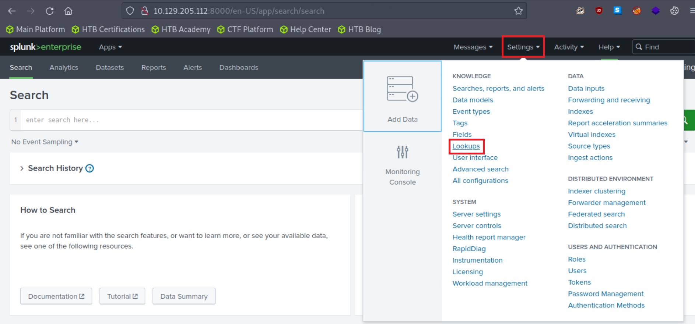
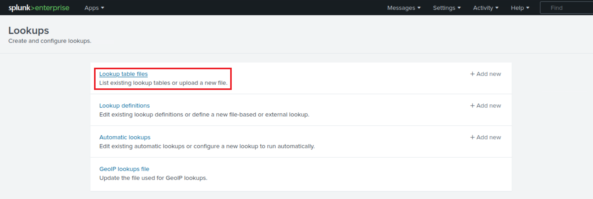
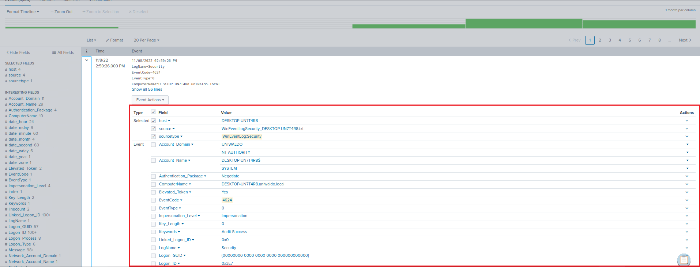
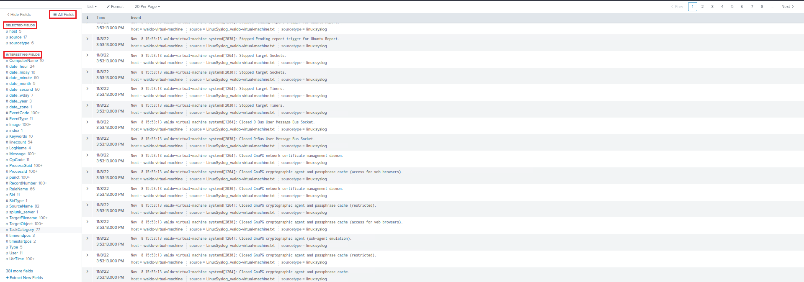
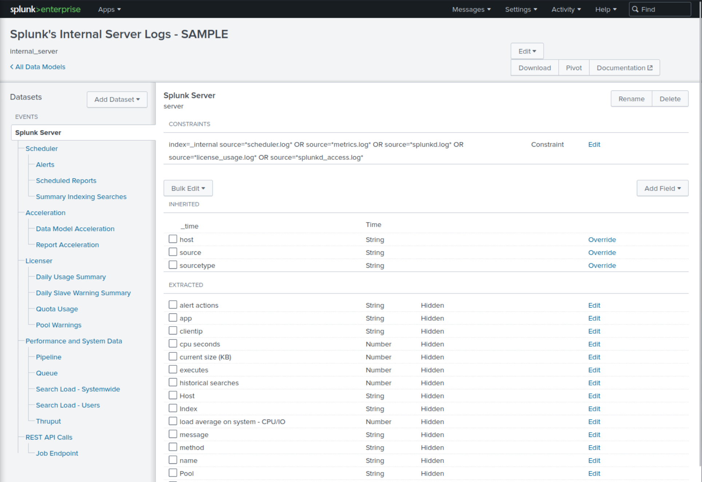
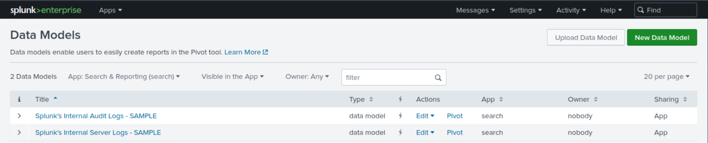
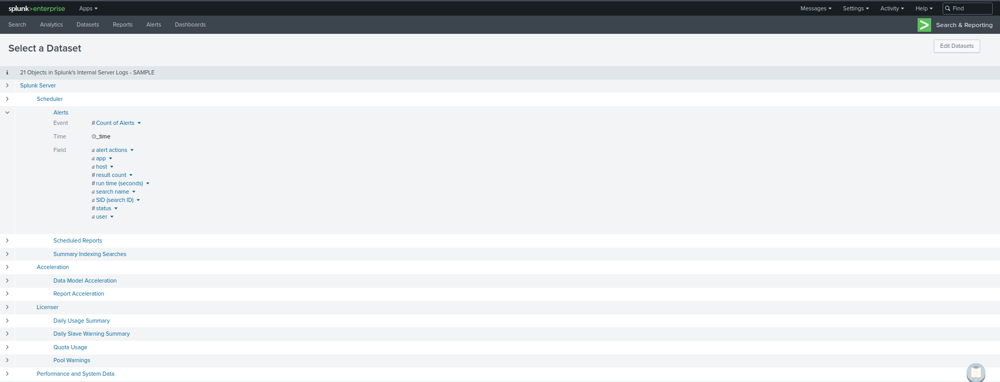

# Module 05: Understanding Log Sources & Investigating with Splunk

## Mục lục

- [Section 1/6 — Giới thiệu Splunk & SPL](#section-01)

<a id="section-01"></a>

## Section 1/6 — Giới thiệu Splunk & SPL

### Splunk là gì?

Splunk là một giải pháp phần mềm phân tích dữ liệu mạnh mẽ, linh hoạt và có khả năng mở rộng cao, được biết đến nhờ khả năng thu nạp, lập chỉ mục, phân tích và trực quan hóa lượng lớn dữ liệu do máy tạo ra. Splunk có thể hỗ trợ nhiều hoạt động khác nhau, bao gồm an ninh mạng, tuân thủ, các luồng xử lý dữ liệu, giám sát CNTT, khả năng quan sát hệ thống, cũng như quản lý CNTT và hoạt động kinh doanh nói chung.

Kiến trúc của Splunk (Splunk Enterprise) gồm nhiều lớp phối hợp với nhau để thu thập, lập chỉ mục, tìm kiếm, phân tích và trực quan hóa dữ liệu. Kiến trúc này có thể được chia thành các thành phần chính sau:

- **Forwarders:** Chịu trách nhiệm thu thập dữ liệu. Chúng thu thập dữ liệu do máy tạo ra từ nhiều nguồn khác nhau và chuyển tiếp đến các indexer. Các loại forwarder được sử dụng trong Splunk gồm:
  - **Universal Forwarder (UF):** Đây là một agent gọn nhẹ, thu thập dữ liệu và chuyển tiếp đến các indexer của Splunk mà không thực hiện bước tiền xử lý nào. Universal Forwarder là các gói phần mềm riêng biệt, có thể dễ dàng cài đặt trên các nguồn từ xa mà không ảnh hưởng đáng kể đến hiệu năng mạng hoặc máy chủ.
  - **Heavy Forwarder (HF):** Agent này dùng để thu thập dữ liệu từ các nguồn từ xa, đặc biệt cho những tác vụ tổng hợp dữ liệu chuyên sâu liên quan đến các nguồn như tường lửa hoặc các điểm định tuyến/lọc dữ liệu. Theo Splexicon, heavy forwarder khác với những loại forwarder khác ở chỗ chúng phân tích cú pháp dữ liệu trước khi chuyển tiếp, nhờ đó có thể định tuyến dữ liệu dựa trên những tiêu chí cụ thể như nguồn hoặc loại sự kiện. Chúng cũng có thể lập chỉ mục dữ liệu cục bộ đồng thời chuyển tiếp dữ liệu đó đến một indexer khác. Thông thường, Heavy Forwarder được triển khai dưới dạng các “nút thu thập dữ liệu” chuyên dụng để truy cập dữ liệu qua API/script, và chúng chỉ hỗ trợ Splunk Enterprise.

Lưu ý rằng còn có HTTP Event Collectors (HEC) để thu thập dữ liệu trực tiếp từ ứng dụng theo cách có thể mở rộng. HEC hoạt động thông qua các phương thức API dạng JSON hoặc dữ liệu thô, sử dụng token. Trong quá trình này, dữ liệu được gửi trực tiếp đến tầng Indexer để tiếp tục xử lý.

- **Indexers:** Nhận dữ liệu từ các forwarder, tổ chức và lưu trữ dữ liệu trong các index (chỉ mục). Khi lập chỉ mục dữ liệu, các indexer tạo ra những tập hợp thư mục được phân loại theo tuổi của dữ liệu; mỗi thư mục chứa dữ liệu thô đã nén và các chỉ mục tương ứng trỏ đến dữ liệu thô đó. Chúng cũng xử lý các truy vấn tìm kiếm của người dùng và trả về kết quả.
- **Search Heads:** Điều phối các tác vụ tìm kiếm, phân phối chúng đến các indexer và hợp nhất kết quả. Chúng cũng cung cấp giao diện để người dùng tương tác với Splunk. Trên Search Head, có thể tạo Knowledge Objects để trích xuất thêm các trường và thao tác dữ liệu mà không sửa đổi dữ liệu chỉ mục gốc. Search Head còn cung cấp nhiều công cụ để nâng cao trải nghiệm tìm kiếm, bao gồm báo cáo, dashboard và các hình thức trực quan hóa.
- **Deployment Server:** Quản lý cấu hình cho các forwarder, phân phối ứng dụng và bản cập nhật.
- **Cluster Master:** Điều phối hoạt động của các indexer trong môi trường cụm, bảo đảm sao chép dữ liệu và search affinity (tính gắn kết của hoạt động tìm kiếm).
- **License Master:** Quản lý thông tin giấy phép của nền tảng Splunk.

Các thành phần chủ chốt của Splunk gồm:

- **Splunk Web Interface:** Giao diện đồ họa để người dùng tương tác với Splunk, thực hiện các tác vụ như tìm kiếm, tạo cảnh báo, dashboard và báo cáo.
- **Search Processing Language (SPL):** Ngôn ngữ truy vấn của Splunk, cho phép người dùng tìm kiếm, lọc và thao tác dữ liệu đã được lập chỉ mục.
- **Apps and Add-ons:** App cung cấp các chức năng cụ thể trong Splunk, còn add-on mở rộng khả năng hoặc tích hợp với những hệ thống khác. Splunk Apps cho phép nhiều không gian làm việc cùng tồn tại trên một phiên bản Splunk đang chạy, phục vụ các use case và vai trò người dùng khác nhau. Có thể tìm những app dựng sẵn này trên Splunkbase, nơi cung cấp các chức năng bổ sung và giải pháp được cấu hình sẵn. Splunk Technology Add-ons đóng vai trò là lớp trừu tượng cho các phương thức thu thập dữ liệu. Chúng thường bao gồm các cấu hình trích xuất trường liên quan, cho phép áp dụng schema linh hoạt khi cần (schema-on-the-fly). Ngoài ra, Technology Add-ons còn chứa những tệp cấu hình liên quan (`props/transforms`) và các script hoặc tệp nhị phân hỗ trợ. Trong khi đó, có thể xem một Splunk App là giải pháp toàn diện, thường sử dụng một hoặc nhiều Technology Add-ons để tăng cường khả năng của nó.
- **Knowledge Objects:** Bao gồm các trường, tag, loại sự kiện, lookup, macro, mô hình dữ liệu và cảnh báo giúp làm giàu dữ liệu trong Splunk, khiến việc tìm kiếm và phân tích trở nên dễ dàng hơn.

### Splunk với vai trò giải pháp SIEM

Trong lĩnh vực an ninh mạng, Splunk có thể đóng vai trò quan trọng như một giải pháp quản lý log, nhưng giá trị thực sự của nó nằm ở khả năng Security Information and Event Management (SIEM — quản lý thông tin và sự kiện bảo mật) dựa trên phân tích. Với vai trò giải pháp SIEM, Splunk có thể hỗ trợ phân tích dữ liệu theo thời gian thực và dữ liệu lịch sử, giám sát an ninh mạng, ứng phó sự cố và threat hunting (săn tìm mối đe dọa). Hơn nữa, Splunk giúp các tổ chức nâng cao khả năng phát hiện thông qua User Behavior Analytics (phân tích hành vi người dùng).

Như đã đề cập, Splunk Processing Language (SPL) là một ngôn ngữ có hơn một trăm lệnh, hàm, đối số và mệnh đề. Đây là nền tảng của hoạt động phân tích dữ liệu trong Splunk, được sử dụng để tìm kiếm, lọc, biến đổi và trực quan hóa dữ liệu.

Giả sử `main` là một index chứa các log Windows Security và Sysmon, cùng những loại log khác.

#### Tìm kiếm cơ bản

Khía cạnh cơ bản nhất của SPL là tìm kiếm. Theo mặc định, một truy vấn tìm kiếm trả về tất cả sự kiện, nhưng có thể thu hẹp phạm vi bằng từ khóa, toán tử Boolean, toán tử so sánh và ký tự đại diện. Ví dụ, tìm kiếm `error` sẽ trả về tất cả sự kiện chứa từ đó.

Các toán tử Boolean `AND`, `OR` và `NOT` được sử dụng để tạo những truy vấn cụ thể hơn.

Lệnh `search` thường được ngầm hiểu ở đầu mỗi truy vấn SPL và thường không được viết ra. Tuy nhiên, dưới đây là ví dụ sử dụng cú pháp `search` tường minh:

```shellsession
search index="main" "UNKNOWN"
```

Bằng cách chỉ định index là `main`, truy vấn thu hẹp phạm vi tìm kiếm chỉ còn các sự kiện được lưu trong index `main`. Sau đó, `UNKNOWN` được dùng làm từ khóa để lọc và truy xuất các sự kiện chứa chính từ này.

Lưu ý: Ký tự đại diện (`*`) có thể thay thế cho một số lượng ký tự bất kỳ trong truy vấn tìm kiếm và giá trị trường. Ví dụ với cú pháp tìm kiếm ngầm định:

```shellsession
index="main" "*UNKNOWN*"
```

Truy vấn SPL này tìm trong index `main` những sự kiện chứa từ `UNKNOWN` ở bất kỳ vị trí nào trong dữ liệu sự kiện.

#### Các trường và toán tử so sánh

Splunk tự động nhận diện một số dữ liệu dưới dạng các trường, chẳng hạn như `source`, `sourcetype`, `host`, `EventCode`, v.v.; người dùng cũng có thể tự định nghĩa thêm các trường. Có thể sử dụng những trường này với các toán tử so sánh (`=`, `!=`, `<`, `>`, `<=`, `>=`) để tìm kiếm chính xác hơn. Ví dụ:

```shellsession
index="main" EventCode!=1
```

Truy vấn SPL (Splunk Processing Language) này được dùng để tìm trong index `main` những sự kiện có giá trị `EventCode` khác `1`.

#### Lệnh fields

Lệnh `fields` chỉ định những trường cần đưa vào hoặc loại khỏi kết quả tìm kiếm. Ví dụ:

```shellsession
index="main" sourcetype="WinEventLog:Sysmon" EventCode=1 | fields - User
```

Sau khi truy xuất tất cả sự kiện tạo tiến trình từ index `main`, lệnh `fields` loại trường `User` khỏi kết quả tìm kiếm. Vì vậy, kết quả chứa tất cả các trường thường có trong log Sysmon Event ID 1, ngoại trừ người dùng đã khởi tạo tiến trình. Lưu ý rằng việc sử dụng `sourcetype` giới hạn phạm vi chỉ còn các log sự kiện Sysmon.

#### Lệnh table

Lệnh `table` trình bày kết quả tìm kiếm dưới dạng bảng. Ví dụ:

```shellsession
index="main" sourcetype="WinEventLog:Sysmon" EventCode=1 | table _time, host, Image
```

Truy vấn này trả về các sự kiện tạo tiến trình, sau đó sắp xếp những trường được chọn (`_time`, `host` và `Image`) dưới dạng bảng. `_time` là dấu thời gian của sự kiện, `host` là tên máy nơi sự kiện xảy ra, còn `Image` là tên tệp thực thi đại diện cho tiến trình.

#### Lệnh rename

Lệnh `rename` đổi tên một trường trong kết quả tìm kiếm. Ví dụ:

```shellsession
index="main" sourcetype="WinEventLog:Sysmon" EventCode=1 | rename Image as Process
```

Lệnh này đổi tên trường `Image` thành `Process` trong kết quả tìm kiếm. Trường `Image` trong log Sysmon biểu thị tên tệp thực thi của tiến trình. Sau khi đổi tên, tất cả tham chiếu đến `Process` ở các bước tiếp theo sẽ trỏ đến trường vốn có tên là `Image`.

#### Lệnh dedup

Lệnh `dedup` loại bỏ các sự kiện trùng lặp. Ví dụ:

```shellsession
index="main" sourcetype="WinEventLog:Sysmon" EventCode=1 | dedup Image
```

Lệnh `dedup` loại bỏ các bản ghi trùng lặp dựa trên trường `Image` trong các sự kiện tạo tiến trình. Điều này có nghĩa là nếu cùng một tiến trình (`Image`) được tạo nhiều lần, nó chỉ xuất hiện một lần trong kết quả, qua đó loại bỏ sự lặp lại.

#### Lệnh sort

Lệnh `sort` sắp xếp kết quả tìm kiếm. Ví dụ:

```shellsession
index="main" sourcetype="WinEventLog:Sysmon" EventCode=1 | sort - _time
```

Lệnh này sắp xếp tất cả sự kiện tạo tiến trình trong index `main` theo thứ tự giảm dần của dấu thời gian (`_time`), tức là các sự kiện mới nhất được hiển thị trước.

#### Lệnh stats

Lệnh `stats` thực hiện các phép thống kê. Ví dụ:

```shellsession
index="main" sourcetype="WinEventLog:Sysmon" EventCode=3 | stats count by _time, Image
```

Truy vấn này trả về một bảng trong đó mỗi hàng biểu thị một tổ hợp duy nhất của dấu thời gian (`_time`) và tiến trình (`Image`). Cột `count` cho biết số sự kiện kết nối mạng xảy ra đối với tiến trình cụ thể đó tại thời điểm cụ thể đó.

Tuy nhiên, việc trực quan hóa dữ liệu này theo thời gian cho từng tiến trình khá khó khăn vì dữ liệu của mỗi tiến trình nằm xen kẽ trong toàn bộ bảng. Chúng ta cần lọc thủ công theo tiến trình (`Image`) để xem số lượng theo thời gian của từng tiến trình.

#### Lệnh chart

Lệnh `chart` tạo nội dung trực quan hóa dữ liệu dựa trên các phép thống kê. Ví dụ:

```shellsession
index="main" sourcetype="WinEventLog:Sysmon" EventCode=3 | chart count by _time, Image
```

Truy vấn này trả về một bảng trong đó mỗi hàng biểu thị một dấu thời gian (`_time`) duy nhất và mỗi cột biểu thị một tiến trình (`Image`) riêng biệt. Giá trị trong các ô cho biết số sự kiện kết nối mạng xảy ra đối với từng tiến trình tại mỗi thời điểm cụ thể.

Với lệnh `chart`, bạn có thể dễ dàng trực quan hóa dữ liệu theo thời gian cho từng tiến trình vì mỗi tiến trình có một cột riêng. Chỉ cần nhìn lướt qua, bạn có thể nhanh chóng thấy số sự kiện kết nối mạng theo thời gian của từng tiến trình.

#### Lệnh eval

Lệnh `eval` tạo hoặc định nghĩa lại các trường. Ví dụ:

```shellsession
index="main" sourcetype="WinEventLog:Sysmon" EventCode=1 | eval Process_Path=lower(Image)
```

Lệnh này tạo một trường mới tên là `Process_Path`, chứa phiên bản viết thường của trường `Image`. Nó không thay đổi trường `Image` thực tế mà tạo một trường mới, có thể dùng trong các thao tác tiếp theo hoặc để hiển thị.

#### Lệnh rex

Lệnh `rex` trích xuất các trường mới từ những trường hiện có bằng biểu thức chính quy. Ví dụ:

```shellsession
index="main" EventCode=4662 | rex max_match=0 "[^%](?<guid>{.*})" | table guid
```

- `index="main" EventCode=4662` lọc để chỉ lấy các sự kiện trong index `main` có `EventCode` bằng `4662`. Điều này thu hẹp phạm vi tìm kiếm về những sự kiện cụ thể có `EventCode` đã chỉ định.
- `rex max_match=0 "[^%](?<guid>{.*})"` sử dụng lệnh `rex` để trích xuất các giá trị khớp với mẫu từ các trường của sự kiện. Mẫu regex `{.*}` tìm những chuỗi con bắt đầu bằng `{` và kết thúc bằng `}`. Phần `[^%]` bảo đảm rằng phần khớp không bắt đầu bằng ký tự `%`. Giá trị được bắt trong dấu ngoặc nhọn được gán cho nhóm bắt có tên `guid`.
- `table guid` hiển thị các GUID đã trích xuất trong đầu ra. Lệnh này dùng để định dạng kết quả và chỉ hiển thị trường `guid`.
- Tùy chọn `max_match=0` bảo đảm rằng tất cả lần xuất hiện của mẫu đều được trích xuất từ mỗi sự kiện. Theo mặc định, lệnh `rex` chỉ trích xuất lần xuất hiện đầu tiên.

Điều này hữu ích vì GUID không được tự động trích xuất từ các log sự kiện 4662.

#### Lệnh lookup

Lệnh `lookup` làm giàu dữ liệu bằng các nguồn bên ngoài. Ví dụ:

Giả sử có tệp CSV tên là `malware_lookup.csv` với nội dung sau.

```shellsession
filename, is_malware
notepad.exe, false
cmd.exe, false
powershell.exe, false
sharphound.exe, true
randomfile.exe, true
```

Cần thêm tệp CSV này làm một bảng Lookup mới như sau.





```shellsession
index="main" sourcetype="WinEventLog:Sysmon" EventCode=1 | rex field=Image "(?P<filename>[^\\\]+)$" | eval filename=lower(filename) | lookup malware_lookup.csv filename OUTPUTNEW is_malware | table filename, is_malware
```

- `index="main" sourcetype="WinEventLog:Sysmon" EventCode=1`: Đây là tiêu chí tìm kiếm. Nó tìm các log Sysmon (được nhận diện bằng `sourcetype`) có `EventCode` là `1` (biểu thị sự kiện tạo tiến trình) trong index `main`.
- `| rex field=Image "(?P<filename>[^\\\]+)$"`: Lệnh này sử dụng biểu thức chính quy (regex) để trích xuất một phần của trường `Image`. Trường `Image` trong log Sysmon có `EventCode=1` thường chứa đường dẫn đầy đủ của tệp thực thi tiến trình. Regex này có ý nghĩa: bắt tất cả nội dung sau dấu gạch chéo ngược cuối cùng (thường chính là tên tệp) và lưu lại dưới tên `filename`.
- `| eval filename=lower(filename)`: Lệnh này lấy tên tệp vừa được trích xuất và chuyển thành chữ thường. Hàm `lower()` được sử dụng để bảo đảm việc tìm kiếm không phân biệt chữ hoa và chữ thường.
- `| lookup malware_lookup.csv filename OUTPUTNEW is_malware`: Lệnh này thực hiện thao tác tra cứu, sử dụng `filename` làm khóa. Bảng lookup (`malware_lookup.csv`) được kỳ vọng chứa danh sách tên các tệp thực thi đã biết là độc hại. Nếu tìm thấy mục khớp trong bảng lookup, trường mới `is_malware` được thêm vào sự kiện, cho biết tiến trình có được xem là độc hại hay không dựa trên bảng lookup. Lưu ý: `filename` trong phần này của truy vấn là tiêu đề cột đầu tiên trong tệp CSV.
- `| table filename, is_malware`: Lệnh này định dạng đầu ra để chỉ hiển thị các trường `filename` và `is_malware`. Nếu một hàng không có `is_malware`, điều đó có nghĩa là không tìm thấy mục khớp trong bảng lookup cho tên tệp đó.

Tóm lại, truy vấn này trích xuất tên tệp của các tiến trình mới được tạo, chuyển chúng thành chữ thường, so sánh với danh sách tên tệp đã biết là độc hại và trình bày kết quả trong một bảng.

Dưới đây là một truy vấn tương đương, đồng thời loại bỏ các bản ghi trùng lặp.

```shellsession
index="main" sourcetype="WinEventLog:Sysmon" EventCode=1 | eval filename=mvdedup(split(Image, "\\")) | eval filename=mvindex(filename, -1) | eval filename=lower(filename) | lookup malware_lookup.csv filename OUTPUTNEW is_malware | table filename, is_malware | dedup filename, is_malware
```

- `index="main" sourcetype="WinEventLog:Sysmon" EventCode=1`: Đây là tiêu chí tìm kiếm. Lệnh lấy dữ liệu từ index `main`, trong đó `sourcetype` là `WinEventLog:Sysmon` và `EventCode` là `1`. Trong Sysmon, `EventCode` bằng `1` biểu thị sự kiện tạo tiến trình.
- `| eval filename=mvdedup(split(Image, "\\"))`: Lệnh này tách trường `Image`, vốn chứa đường dẫn tệp, thành nhiều phần tử tại mỗi dấu gạch chéo ngược và biến nó thành một trường đa giá trị. Hàm `mvdedup` được dùng để loại bỏ mọi giá trị trùng lặp trong trường đa giá trị này.
- `| eval filename=mvindex(filename, -1)`: Ở đây, hàm `mvindex` được sử dụng để chọn phần tử cuối cùng của trường đa giá trị đã tạo ở bước trước. Trong ngữ cảnh đường dẫn tệp, đây thường là tên tệp thực tế.
- `| eval filename=lower(filename)`: Lệnh này lấy trường `filename` và chuyển thành chữ thường bằng hàm `lower`. Việc này nhằm bảo đảm tìm kiếm không phân biệt chữ hoa, chữ thường và chuẩn hóa dữ liệu.
- `| lookup malware_lookup.csv filename OUTPUTNEW is_malware`: Lệnh này thực hiện thao tác tra cứu. Lệnh `lookup` lấy trường `filename` và kiểm tra xem nó có khớp với mục nào trong bảng lookup `malware_lookup.csv` hay không. Nếu có, lệnh thêm trường mới `is_malware` vào sự kiện để cho biết tiến trình có bị đánh dấu là độc hại hay không.
- `| table filename, is_malware`: Lệnh `table` được dùng để định dạng đầu ra; trong trường hợp này, nó chỉ hiển thị các trường `filename` và `is_malware` dưới dạng bảng.
- `| dedup filename, is_malware`: Lệnh này loại bỏ mọi sự kiện trùng lặp dựa trên các trường `filename` và `is_malware`. Nói cách khác, nếu kết quả tìm kiếm có nhiều bản ghi giống nhau ở hai trường `filename` và `is_malware`, lệnh `dedup` chỉ giữ lần xuất hiện đầu tiên và loại bỏ tất cả bản trùng lặp xuất hiện sau đó.

Tóm lại, truy vấn SPL này tìm các sự kiện tạo tiến trình trong log Sysmon, trích xuất tên tệp từ trường `Image`, chuyển tên thành chữ thường, đối chiếu với danh sách mã độc đã biết trong tệp `malware_lookup.csv`, rồi hiển thị kết quả trong một bảng, đồng thời loại bỏ mọi bản ghi trùng lặp dựa trên các trường `filename` và `is_malware`.

#### Lệnh inputlookup

Lệnh `inputlookup` truy xuất dữ liệu từ một tệp lookup mà không kết hợp dữ liệu đó với kết quả tìm kiếm. Ví dụ:

```shellsession
| inputlookup malware_lookup.csv
```

Lệnh này truy xuất tất cả bản ghi từ tệp `malware_lookup.csv`. Kết quả không được kết hợp với bất kỳ kết quả tìm kiếm nào, nhưng có thể dùng để kiểm tra nội dung tệp lookup hoặc cho các thao tác tiếp theo như lọc hay kết hợp với những tập dữ liệu khác.

#### Khoảng thời gian

Mỗi sự kiện trong Splunk đều có một dấu thời gian. Bằng cách sử dụng bộ chọn khoảng thời gian hoặc các lệnh `earliest` và `latest`, bạn có thể giới hạn tìm kiếm trong những khoảng thời gian cụ thể. Ví dụ:

```shellsession
index="main" earliest=-7d EventCode!=1
```

Bằng cách kết hợp điều kiện `index="main"` với `earliest=-7d` và `EventCode!=1`, truy vấn sẽ truy xuất các sự kiện trong index `main` đã xảy ra trong bảy ngày gần nhất và có giá trị `EventCode` khác `1`.

#### Lệnh transaction

Trong Splunk, lệnh `transaction` được dùng để nhóm các sự kiện có đặc điểm chung thành những transaction (nhóm sự kiện liên quan), thường nhằm theo dõi các phiên hoặc hoạt động người dùng trải dài qua nhiều sự kiện. Ví dụ:

```shellsession
index="main" sourcetype="WinEventLog:Sysmon" (EventCode=1 OR EventCode=3) | transaction Image startswith=eval(EventCode=1) endswith=eval(EventCode=3) maxspan=1m | table Image |  dedup Image
```

- `index="main" sourcetype="WinEventLog:Sysmon" (EventCode=1 OR EventCode=3)`: Đây là tiêu chí tìm kiếm. Nó lấy dữ liệu từ index `main`, trong đó `sourcetype` là `WinEventLog:Sysmon` và `EventCode` là `1` hoặc `3`. Trong log Sysmon, `EventCode` bằng `1` biểu thị sự kiện tạo tiến trình, còn `EventCode` bằng `3` biểu thị sự kiện kết nối mạng.
- `| transaction Image startswith=eval(EventCode=1) endswith=eval(EventCode=3) maxspan=1m`: Lệnh `transaction` được dùng ở đây để nhóm các sự kiện dựa trên trường `Image`, biểu thị tệp thực thi hoặc script liên quan đến sự kiện. Việc nhóm tuân theo các điều kiện: transaction bắt đầu bằng một sự kiện có `EventCode` bằng `1` và kết thúc bằng một sự kiện có `EventCode` bằng `3`. Mệnh đề `maxspan=1m` giới hạn transaction trong các sự kiện xảy ra trong khoảng một phút. Lệnh `transaction` có thể liên kết các sự kiện liên quan với nhau để giúp hiểu rõ hơn chuỗi hoạt động đang diễn ra trong hệ thống.
- `| table Image`: Lệnh này định dạng đầu ra thành một bảng, chỉ hiển thị trường `Image`.
- `| dedup Image`: Cuối cùng, lệnh `dedup` loại bỏ những bản ghi trùng lặp khỏi tập kết quả. Ở đây, lệnh loại bỏ mọi giá trị `Image` trùng lặp. Nó chỉ giữ lần xuất hiện đầu tiên và loại bỏ các bản trùng lặp xuất hiện sau đó dựa trên trường `Image`.

Tóm lại, truy vấn này nhằm xác định những chuỗi hoạt động (tạo tiến trình rồi kết nối mạng) gắn với cùng một tệp thực thi hoặc script trong khoảng một phút. Nó trình bày kết quả dưới dạng bảng, bảo đảm các tệp thực thi/script được liệt kê không trùng lặp. Truy vấn có thể hữu ích trong threat hunting, đặc biệt khi tìm các chỉ báo xâm nhập như những chuỗi sự kiện tạo tiến trình và kết nối mạng diễn ra nhanh, do cùng một tệp thực thi khởi tạo.

#### Truy vấn con

Subsearch (truy vấn con) trong Splunk là một truy vấn tìm kiếm được lồng bên trong một truy vấn khác. Nó được dùng để tính toán một tập kết quả, sau đó sử dụng tập kết quả đó trong truy vấn bên ngoài. Ví dụ:

```shellsession
index="main" sourcetype="WinEventLog:Sysmon" EventCode=1 NOT [ search index="main" sourcetype="WinEventLog:Sysmon" EventCode=1 | top limit=100 Image | fields Image ] | table _time, Image, CommandLine, User, ComputerName
```

Trong truy vấn này:

- `index="main" sourcetype="WinEventLog:Sysmon" EventCode=1`: Truy vấn chính lấy các sự kiện có `EventCode=1` (tạo tiến trình).
- `NOT []`: Dấu ngoặc vuông chứa truy vấn con. Khi đặt `NOT` trước nó, truy vấn chính sẽ loại bỏ mọi kết quả do truy vấn con trả về.
- `search index="main" sourcetype="WinEventLog:Sysmon" EventCode=1 | top limit=100 Image | fields Image`: Truy vấn con lấy các sự kiện có `EventCode=1` (tạo tiến trình), sau đó sử dụng lệnh `top` để trả về 100 tên `Image` (tiến trình) phổ biến nhất.
- `table _time, Image, CommandLine, User, Computer`: Trình bày kết quả cuối cùng dưới dạng bảng, hiển thị dấu thời gian của sự kiện (`_time`), tên tiến trình (`Image`), dòng lệnh được dùng để thực thi tiến trình (`CommandLine`), người dùng đã thực thi tiến trình (`User`) và máy tính nơi sự kiện xảy ra (`ComputerName`).

Truy vấn này có thể giúp làm nổi bật những tiến trình bất thường hoặc hiếm gặp, đáng điều tra để tìm hoạt động có khả năng độc hại. Hãy điều chỉnh giới hạn trong truy vấn con khi cần để phù hợp với môi trường của bạn.

Lưu ý rằng kiểu tìm kiếm này có thể tạo ra nhiều nhiễu trong những môi trường thường xuyên tạo các tiến trình mới và riêng biệt, vì vậy việc tinh chỉnh cẩn thận và xem xét bối cảnh là rất quan trọng.

Đây mới chỉ là phần nổi của tảng băng khi nói đến SPL. Tập lệnh phong phú và cú pháp linh hoạt của nó cung cấp khả năng phân tích dữ liệu toàn diện. Giống như với bất kỳ ngôn ngữ nào, sự thành thạo đến từ thực hành và kinh nghiệm. Dưới đây là một số tài liệu hữu ích để bắt đầu:

- <https://docs.splunk.com/Documentation/SCS/current/SearchReference/Introduction>
- <https://docs.splunk.com/Documentation/SplunkCloud/latest/SearchReference/>
- <https://docs.splunk.com/Documentation/SplunkCloud/latest/Search/>

### Cách xác định dữ liệu sẵn có

#### Cách 1: Sử dụng ứng dụng Search & Reporting của Splunk (SPL) để nhận diện dữ liệu và trường

Trong bất kỳ hệ thống Security Information and Event Management (SIEM) mạnh mẽ nào như Splunk, hiểu rõ các nguồn dữ liệu sẵn có, dữ liệu chúng cung cấp và những trường bên trong là điều thiết yếu để sử dụng hệ thống hiệu quả. Trong Splunk, chúng ta chủ yếu sử dụng ứng dụng Search & Reporting để thực hiện việc này. Hãy tìm hiểu cách nhận diện các loại nguồn dữ liệu, dữ liệu và trường trong Splunk.

Splunk có thể thu nạp dữ liệu từ nhiều nguồn khác nhau. Chúng ta phân loại các nguồn dữ liệu này thành những source type (loại nguồn), quyết định cách Splunk định dạng dữ liệu đầu vào. Để xác định các source type sẵn có, chúng ta có thể chạy lệnh SPL sau sau khi chọn khoảng thời gian thích hợp trong bộ chọn thời gian của ứng dụng Search & Reporting.

```shellsession
| eventcount summarize=false index=* | table index
```

Truy vấn này sử dụng `eventcount` để đếm sự kiện trong tất cả các index, sau đó dùng `summarize=false` để hiển thị số lượng cho từng index riêng biệt, và cuối cùng sử dụng lệnh `table` để trình bày dữ liệu dưới dạng bảng.

```shellsession
| metadata type=sourcetypes
```

Truy vấn này sử dụng lệnh `metadata`, cung cấp nhiều thống kê về những trường đã được lập chỉ mục được chỉ định. Ở đây, chúng ta tập trung vào các `sourcetype`. Kết quả là danh sách tất cả `sourcetype` trong môi trường Splunk, cùng metadata bổ sung như thời điểm đầu tiên một source type được ghi nhận (`firstTime`), thời điểm cuối cùng nó được ghi nhận (`lastTime`) và số máy (`totalCount`).

Để có cách hiển thị đơn giản hơn, chúng ta có thể sử dụng truy vấn sau.

```shellsession
| metadata type=sourcetypes index=* | table sourcetype
```

Ở đây, lệnh `metadata` truy xuất metadata về dữ liệu trong các index của chúng ta. Đối số `type=sourcetypes` yêu cầu Splunk trả về metadata về các `sourcetype`. Lệnh `table` được dùng để trình bày dữ liệu dưới dạng bảng.

```shellsession
| metadata type=sources index=* | table source
```

Lệnh này trả về danh sách tất cả nguồn dữ liệu trong môi trường Splunk.

Sau khi biết các source type, chúng ta có thể tìm hiểu loại dữ liệu mà chúng chứa. Giả sử chúng ta quan tâm đến `sourcetype` có tên `WinEventLog:Security`, ta có thể dùng lệnh `table` để trình bày dữ liệu thô như sau.

```shellsession
sourcetype="WinEventLog:Security" | table _raw
```

Lệnh `table` tạo một bảng có các cột là những trường được chỉ định. Ở đây, `_raw` biểu thị dữ liệu sự kiện thô. Lệnh này sẽ trả về dữ liệu thô của source type đã chỉ định.

Splunk tự động trích xuất một tập hợp các trường mặc định cho mỗi sự kiện được lập chỉ mục, nhưng cũng có thể trích xuất thêm các trường tùy thuộc vào source type của dữ liệu. Để xem tất cả trường sẵn có trong một source type cụ thể, chúng ta có thể sử dụng lệnh `table`.

```shellsession
sourcetype="WinEventLog:Security" | table *
```

Lệnh này tạo một bảng chứa tất cả trường sẵn có trong `sourcetype` là `WinEventLog:Security`. Tuy nhiên, hãy thận trọng vì việc sử dụng `table *` có thể tạo ra một bảng rất rộng nếu các sự kiện có nhiều trường. Điều này có thể không thuận tiện về mặt hiển thị hoặc không hiệu quả cho việc phân tích dữ liệu.

Cách tốt hơn là xác định các trường bạn quan tâm bằng lệnh `fields` như đã đề cập trước đó, rồi chỉ định tên những trường này trong lệnh `table`. Ví dụ:

```shellsession
sourcetype="WinEventLog:Security" | fields Account_Name, EventCode | table Account_Name, EventCode
```

Nếu chỉ muốn xem danh sách tên trường mà không có dữ liệu, chúng ta có thể sử dụng lệnh `fieldsummary` thay thế.

```shellsession
sourcetype="WinEventLog:Security" | fieldsummary
```

Truy vấn này trả về một bảng bao gồm mọi trường tìm thấy trong các sự kiện mà truy vấn trả về (thuộc `sourcetype` đã chỉ định). Bảng bao gồm một số cột thông tin về từng trường:

- `field`: Tên trường.
- `count`: Số sự kiện có chứa trường đó.
- `distinct_count`: Số giá trị khác nhau trong trường.
- `is_exact`: Cho biết số đếm là chính xác hay ước tính.
- `max`: Giá trị lớn nhất của trường.
- `mean`: Giá trị trung bình của trường.
- `min`: Giá trị nhỏ nhất của trường.
- `numeric_count`: Số giá trị dạng số trong trường.
- `stdev`: Độ lệch chuẩn của trường.
- `values`: Các giá trị mẫu của trường.

Chúng ta cũng có thể thấy:

- `modes`: Những giá trị phổ biến nhất của trường.
- `numBuckets`: Số bucket được sử dụng để ước tính số lượng giá trị khác nhau.

Lưu ý rằng các giá trị do lệnh `fieldsummary` cung cấp được tính toán dựa trên những sự kiện mà truy vấn tìm kiếm trả về. Vì vậy, nếu muốn xem tất cả trường trong một `sourcetype` cụ thể, chúng ta cần bảo đảm khoảng thời gian đủ rộng để bao quát mọi trường có thể xuất hiện.

```shellsession
index=* sourcetype=* | bucket _time span=1d | stats count by _time, index, sourcetype | sort - _time
```

Đôi khi, chúng ta muốn biết các sự kiện phân bố theo thời gian như thế nào. Truy vấn này truy xuất tất cả dữ liệu (`index=* sourcetype=*`), sau đó sử dụng lệnh `bucket` để nhóm các sự kiện dựa trên trường `_time` thành những bucket có độ dài một ngày. Tiếp theo, lệnh `stats` đếm số sự kiện cho từng ngày (`_time`), index và `sourcetype`. Cuối cùng, lệnh `sort` sắp xếp kết quả theo thứ tự giảm dần của `_time`.

```shellsession
index=* sourcetype=* | rare limit=10 index, sourcetype
```

Lệnh `rare` có thể giúp nhận diện những loại sự kiện ít gặp, có thể là dấu hiệu của hành vi bất thường. Truy vấn này truy xuất tất cả dữ liệu và tìm 10 tổ hợp index và `sourcetype` hiếm gặp nhất.

```shellsession
index="main" | rare limit=20 useother=f ParentImage
```

Lệnh này hiển thị 20 giá trị ít phổ biến nhất của trường `ParentImage`.

```shellsession
index=* sourcetype=* | fieldsummary | where count < 100 | table field, count, distinct_count
```

Một truy vấn phức tạp hơn có thể cung cấp bản tổng hợp chi tiết về các trường. Truy vấn này hiển thị thông tin tổng hợp về tất cả trường (`fieldsummary`), lọc bỏ các trường xuất hiện trong ít hơn 100 sự kiện (`where count < 100`), rồi hiển thị một bảng (`table`) cho biết tên trường, tổng số đếm và số lượng giá trị khác nhau.

```shellsession
index=* | sistats count by index, sourcetype, source, host
```

Chúng ta cũng có thể sử dụng lệnh `sistats` để khám phá mức độ đa dạng của sự kiện. Lệnh này đếm số sự kiện theo từng index, `sourcetype`, `source` và `host`, qua đó có thể cung cấp một bức tranh rõ ràng về mức độ đa dạng và sự phân bố của dữ liệu.

```shellsession
index=* sourcetype=* | rare limit=10 field1, field2, field3
```

Lệnh `rare` cũng có thể được dùng để tìm những tổ hợp giá trị trường ít gặp. Hãy thay `field1`, `field2`, `field3` bằng các trường bạn quan tâm. Lệnh này sẽ hiển thị 10 tổ hợp hiếm gặp nhất của những trường đó.

Bằng cách kết hợp các lệnh và kỹ thuật SPL ở trên, chúng ta có thể khám phá và hiểu các loại nguồn dữ liệu, dữ liệu chúng chứa và các trường bên trong. Hiểu biết này là nền tảng để xây dựng những truy vấn tìm kiếm, báo cáo, cảnh báo và dashboard hiệu quả trong Splunk.

Cuối cùng, hãy nhớ tuân theo các chính sách quản trị dữ liệu của tổ chức khi khám phá dữ liệu và source type, nhằm bảo đảm tuân thủ mọi hướng dẫn cần thiết về quyền riêng tư và bảo mật.

#### Cách 2: Sử dụng giao diện người dùng của Splunk để nhận diện dữ liệu và trường

Khi sử dụng giao diện người dùng của ứng dụng Search & Reporting, việc nhận diện các loại nguồn dữ liệu sẵn có, dữ liệu chúng chứa và những trường bên trong đòi hỏi tương tác với nhiều phần khác nhau của giao diện. Hãy xem cách sử dụng hiệu quả giao diện Splunk Web để nhận diện những thành phần này.

- **Nguồn dữ liệu (Data Sources):** Điều đầu tiên chúng ta muốn xác định là các nguồn dữ liệu. Có thể thực hiện bằng cách mở menu `Settings`, thường nằm ở góc trên bên phải của giao diện Splunk. Trong menu thả xuống, chúng ta sẽ thấy `Data inputs`. Khi nhấp vào `Data inputs`, một danh sách các phương thức nhập dữ liệu sẽ xuất hiện, bao gồm tệp và thư mục, HTTP event collector, forwarder, script và nhiều phương thức khác. Chúng đại diện cho các nguồn khác nhau mà qua đó dữ liệu có thể được đưa vào Splunk. Nhấp vào từng mục sẽ cho chúng ta cái nhìn tổng quan về những nguồn dữ liệu đang được sử dụng.
- **Dữ liệu — sự kiện (Data — Events):** Tiếp theo, hãy xác định bản thân dữ liệu, hay nói cách khác là các sự kiện. Để làm điều này, chúng ta truy cập ứng dụng Search & Reporting. Khám phá sự kiện ở chế độ `Fast` cho phép rà nhanh dữ liệu. Trong khi đó, chế độ `Verbose` cho phép đi sâu vào chi tiết từng sự kiện, bao gồm dữ liệu sự kiện thô và tất cả trường mà Splunk đã trích xuất từ đó.

  

Trong thanh tìm kiếm, chúng ta có thể chỉ cần nhập `*` và thực hiện tìm kiếm để lấy toàn bộ dữ liệu đã được lập chỉ mục. Tuy nhiên, đây thường là lượng dữ liệu rất lớn và có thể không phải cách hiệu quả nhất. Cách tốt hơn có thể là sử dụng bộ chọn thời gian để chọn một khoảng thời gian nhỏ hơn; tuy vậy, cần thận trọng để không bỏ lỡ các log lịch sử quan trọng hoặc hữu ích.

- **Các trường (Fields):** Cuối cùng, để nhận diện những trường trong dữ liệu, hãy xem chi tiết một sự kiện. Chúng ta có thể nhấp vào bất kỳ sự kiện nào trong kết quả tìm kiếm để mở rộng nó.

  

Ở phía bên trái ứng dụng Search & Reporting, chúng ta cũng có thể thấy hai nhóm trường: `Selected Fields` và `Interesting Fields`. `Selected Fields` là những trường luôn được hiển thị trong các sự kiện (như `host`, `source` và `sourcetype`), còn `Interesting Fields` là những trường xuất hiện trong ít nhất 20% số sự kiện. Khi nhấp vào `All fields`, chúng ta có thể xem tất cả trường có trong các sự kiện.

  

- **Mô hình dữ liệu (Data Models):** Data Models cung cấp cách nhìn có tổ chức và phân cấp về dữ liệu, đơn giản hóa các tập dữ liệu phức tạp thành những cấu trúc dễ hiểu. Chúng được thiết kế để giúp tạo báo cáo, nội dung trực quan hóa và dashboard có ý nghĩa dễ dàng hơn, mà không cần hiểu sâu về các nguồn dữ liệu bên dưới hoặc viết truy vấn SPL phức tạp. Dưới đây là cách sử dụng tính năng Data Models để nhận diện và hiểu dữ liệu:
  - **Truy cập Data Models:** Nhấp vào tab `Settings` ở góc trên bên phải của giao diện Splunk Web. Sau đó, chọn `Data Models` trong phần `Knowledge`. Thao tác này đưa chúng ta đến trang quản lý Data Models. Nếu trang này trống, hãy thực hiện một truy vấn tìm kiếm rồi truy cập lại trang Data Models.
  - **Tìm hiểu các Data Model hiện có:** Trên trang quản lý Data Models, chúng ta có thể thấy danh sách các Data Model sẵn có. Chúng có thể bao gồm những mô hình do bản thân chúng ta, đội của chúng ta hoặc Splunk Apps cung cấp. Mỗi Data Model gắn với một ngữ cảnh ứng dụng cụ thể và được xây dựng để mô tả dữ liệu có cấu trúc liên quan đến mục đích của ứng dụng đó.
  - **Khám phá Data Models:** Khi nhấp vào tên một Data Model, chúng ta được đưa đến Data Model Editor. Đây là nơi thể hiện sức mạnh thực sự của Data Models. Tại đây, có thể xem cấu trúc phân cấp của mô hình dữ liệu, được chia thành các đối tượng. Mỗi đối tượng biểu thị một phần cụ thể của dữ liệu và chứa những trường liên quan đến đối tượng đó.

    

Ví dụ, nếu có một Data Model mô tả lưu lượng web, chúng ta có thể thấy các đối tượng như `Web Transactions`, `Web Errors`, v.v. Bên trong những đối tượng này là các trường như `status`, `url`, `user`, v.v.

- **Pivots:** Pivots là một tính năng rất mạnh của Splunk, cho phép tạo các báo cáo và nội dung trực quan hóa phức tạp mà không cần viết truy vấn SPL. Chúng cung cấp giao diện kéo và thả có tính tương tác để định nghĩa và tinh chỉnh các tiêu chí báo cáo dữ liệu. Vì vậy, đây cũng là công cụ rất hữu ích để nhận diện và khám phá dữ liệu cùng những trường sẵn có trong môi trường Splunk. Để bắt đầu sử dụng Pivots nhằm nhận diện dữ liệu và trường sẵn có, chúng ta có thể dùng nút `Pivot` xuất hiện khi đang xem một mô hình dữ liệu cụ thể trên trang Data Models.

  
  
