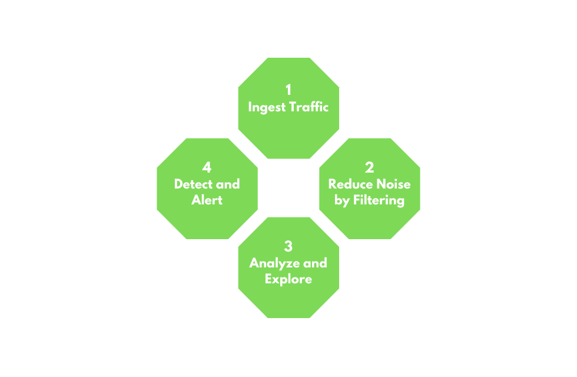
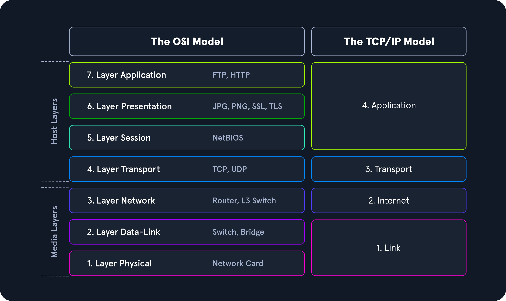
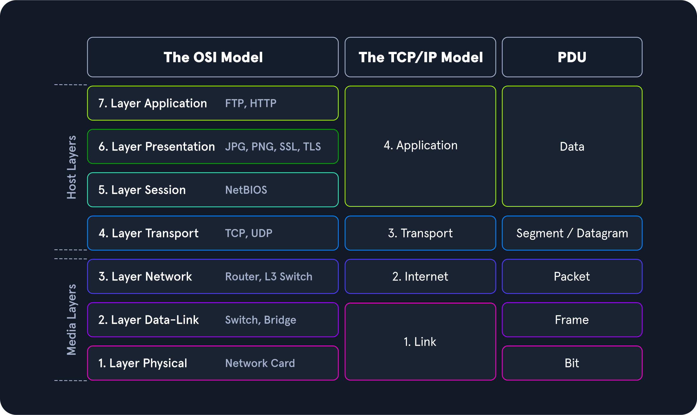
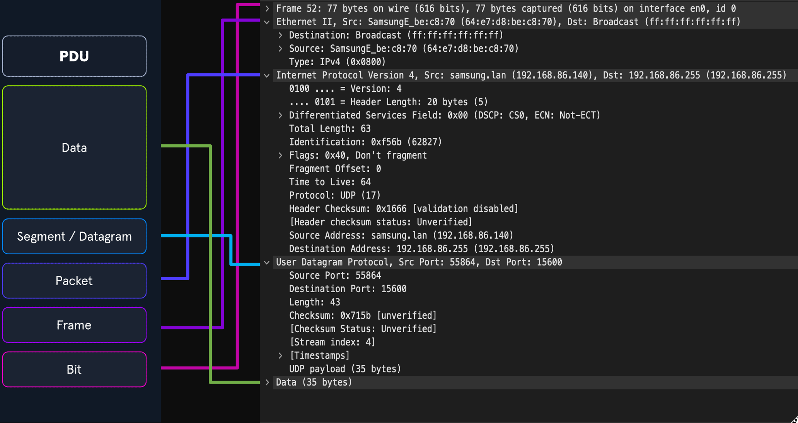
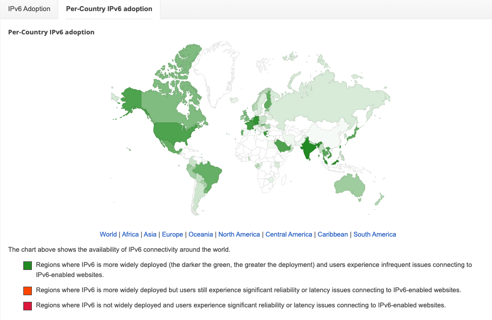
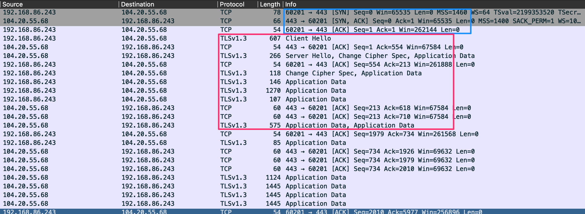
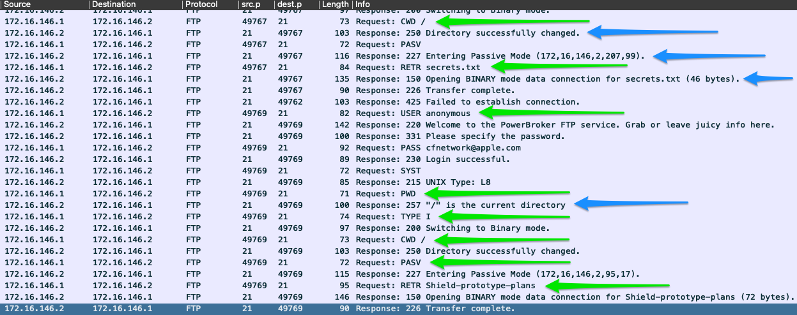

# Module 07: Intro to Network Traffic Analysis

## Mục lục

- [Section 1/15 — Phân tích lưu lượng mạng](#section-01)
- [Section 2/15 — Ôn tập kiến thức mạng: Tầng 1–4](#section-02)
- [Section 3/15 — Ôn tập kiến thức mạng: Tầng 5–7](#section-03)

<a id="section-01"></a>

## Section 1/15 — Phân tích lưu lượng mạng

Network Traffic Analysis (NTA — phân tích lưu lượng mạng) có thể được mô tả là hoạt động kiểm tra lưu lượng mạng để xác định đặc điểm của các cổng và giao thức thường được sử dụng, thiết lập baseline (mức hoạt động chuẩn) cho môi trường, giám sát và ứng phó với các mối đe dọa, đồng thời có được cái nhìn sâu sắc nhất có thể về mạng của tổ chức.

Quy trình này giúp các chuyên gia bảo mật sớm nhận diện những bất thường, bao gồm các mối đe dọa bảo mật trong mạng, và xác định chính xác các mối đe dọa một cách hiệu quả. Phân tích lưu lượng mạng cũng có thể hỗ trợ việc đáp ứng các hướng dẫn bảo mật. Kẻ tấn công thường xuyên cập nhật chiến thuật để tránh bị phát hiện và tận dụng thông tin xác thực hợp lệ cùng những công cụ được hầu hết công ty cho phép sử dụng trong mạng, khiến việc phát hiện và sau đó là ứng phó trở nên khó khăn đối với bên phòng thủ. Trong những trường hợp như vậy, phân tích lưu lượng mạng một lần nữa có thể phát huy tác dụng. Những use case thường gặp của NTA gồm:

- Thu thập lưu lượng theo thời gian thực trong mạng để phân tích các mối đe dọa sắp xuất hiện.
- Thiết lập baseline cho hoạt động giao tiếp mạng hằng ngày.
- Nhận diện và phân tích lưu lượng từ các cổng không thông dụng, các máy đáng ngờ và những vấn đề về giao thức mạng như lỗi HTTP, vấn đề với TCP hoặc các cấu hình mạng sai khác.
- Phát hiện mã độc trên đường truyền, chẳng hạn như ransomware (mã độc tống tiền), exploit (mã khai thác) và các tương tác không theo thông lệ.

NTA cũng hữu ích khi điều tra các sự cố đã xảy ra và trong quá trình threat hunting (săn tìm mối đe dọa).

Hãy hình dung một tác nhân đe dọa đang nhắm đến và xâm nhập mạng của chúng ta. Nếu muốn xâm phạm mạng, kẻ tấn công chắc chắn phải tương tác và giao tiếp với hạ tầng của chúng ta. Giao tiếp mạng diễn ra trên nhiều cổng và giao thức khác nhau, tất cả đều đang được nhân viên, thiết bị và khách hàng sử dụng đồng thời. Để phát hiện lưu lượng độc hại, chúng ta cần vận dụng hiểu biết về lưu lượng mạng thông thường trong phạm vi mạng của mình. Điều này sẽ thu hẹp phạm vi tìm kiếm, giúp nhanh chóng tìm ra và làm gián đoạn hoạt động liên lạc của đối phương.

Ví dụ, nếu phát hiện nhiều gói tin SYN trên những cổng mà chúng ta không bao giờ hoặc hiếm khi sử dụng trong mạng, ta có thể kết luận rằng nhiều khả năng có người đang cố xác định các cổng mở trên máy của chúng ta. Những hành động như vậy là dấu hiệu điển hình của port scan (quét cổng). Để thực hiện phân tích và đưa ra các kết luận như thế, cần có những kỹ năng và kiến thức cụ thể.

### Các kỹ năng và kiến thức cần có

Những kỹ năng sắp được liệt kê và mô tả đòi hỏi kiến thức lý thuyết lẫn thực hành được tích lũy theo thời gian. Chúng ta không cần thuộc lòng mọi thứ, nhưng nên biết cần tìm hiểu điều gì khi gặp những khía cạnh chưa quen thuộc trong nội dung. Điều này không chỉ áp dụng cho NTA mà còn cho hầu hết các chủ đề khác mà chúng ta sẽ tiếp cận trong an ninh mạng.

#### Bộ giao thức TCP/IP và mô hình OSI

Hiểu biết này bảo đảm chúng ta nắm được cách lưu lượng mạng và các ứng dụng trên máy tương tác với nhau.

#### Các khái niệm mạng cơ bản

Để hiểu những loại lưu lượng sẽ thấy ở mỗi tầng, cần hiểu từng tầng cấu thành mô hình TCP/IP và OSI, cũng như các khái niệm chuyển mạch và định tuyến. Nếu thu lưu lượng trên một đường trục mạng (backbone link), chúng ta sẽ thấy lượng lưu lượng lớn hơn nhiều so với thông thường, và nó sẽ rất khác với lưu lượng thu được tại một switch văn phòng.

#### Các cổng và giao thức thông dụng

Nhanh chóng nhận diện các cổng và giao thức tiêu chuẩn, đồng thời có hiểu biết thực tế về cách chúng giao tiếp, sẽ giúp chúng ta nhận diện lưu lượng mạng có khả năng độc hại hoặc sai định dạng.

#### Khái niệm về gói tin IP và các tầng con

Kiến thức nền tảng về cách TCP và UDP giao tiếp ít nhất sẽ giúp chúng ta hiểu những gì đang thấy hoặc đang tìm kiếm. Ví dụ, TCP hướng luồng và cho phép dễ dàng theo dõi một cuộc trao đổi giữa các máy. UDP nhanh nhưng không chú trọng tính đầy đủ, vì vậy việc tái dựng nội dung từ loại gói tin này sẽ khó hơn.

#### Đóng gói giao thức khi truyền tải

Mỗi tầng sẽ đóng gói dữ liệu của tầng trước đó. Khả năng đọc hoặc phân tách dữ liệu khi cách đóng gói này thay đổi sẽ giúp chúng ta xử lý dữ liệu nhanh hơn. Có thể dễ dàng nhận ra các dấu hiệu dựa trên những header đóng gói.

### Môi trường và thiết bị

Danh sách dưới đây chứa nhiều công cụ và loại thiết bị khác nhau có thể dùng để phân tích lưu lượng mạng. Mỗi loại cung cấp một cách khác nhau để bắt hoặc phân tách lưu lượng. Một số cung cấp khả năng sao chép và bắt lưu lượng, trong khi những loại khác đọc và thu nạp dữ liệu. Module này chỉ tìm hiểu một vài công cụ trong số đó, chủ yếu là Wireshark và tcpdump. Hãy nhớ rằng các công cụ này không chỉ dành cho quản trị viên. Nhiều công cụ cũng có thể được sử dụng cho mục đích độc hại.

#### Các công cụ phân tích lưu lượng thông dụng

| Công cụ | Mô tả |
|---|---|
| tcpdump | tcpdump là một tiện ích dòng lệnh, với sự hỗ trợ của LibPcap, có thể bắt và diễn giải lưu lượng mạng từ một giao diện mạng hoặc tệp chứa lưu lượng đã bắt. |
| Tshark | TShark là công cụ phân tích gói tin mạng tương tự TCPDump. Nó bắt gói tin từ mạng đang hoạt động hoặc đọc và giải mã dữ liệu từ tệp. Đây là phiên bản dòng lệnh của Wireshark. |
| Wireshark | Wireshark là công cụ phân tích lưu lượng mạng có giao diện đồ họa. Nó bắt và giải mã các frame (khung dữ liệu) trên đường truyền, cho phép xem xét sâu môi trường mạng. Nó có thể áp dụng nhiều dissector (bộ phân tích giao thức) khác nhau lên lưu lượng để xác định đặc điểm của các giao thức, ứng dụng và giúp hiểu rõ những gì đang xảy ra. |
| NGrep | NGrep là công cụ so khớp mẫu được xây dựng để thực hiện chức năng tương tự grep trên các bản phân phối Linux. Khác biệt lớn là nó làm việc với các gói lưu lượng mạng. NGrep có thể đọc lưu lượng trực tiếp hoặc lưu lượng từ tệp PCAP, đồng thời sử dụng biểu thức regex và cú pháp BPF. Công cụ này đặc biệt hữu ích khi gỡ lỗi lưu lượng của các giao thức như HTTP và FTP. |
| tcpick | tcpick là công cụ bắt gói tin dòng lệnh chuyên theo dõi và tái lắp ráp các luồng TCP. Khả năng đọc một luồng rồi tái dựng luồng đó thành tệp bằng tcpick rất hữu ích. |
| Network Taps | Tap (Gigamon, Niagra-taps) là thiết bị có khả năng tạo bản sao lưu lượng mạng và gửi đến nơi khác để phân tích. Chúng có thể được đặt trực tiếp trên đường truyền (in-line) hoặc ngoài băng (out of band). Chúng có thể chủ động bắt và phân tích lưu lượng trực tiếp, hoặc thực hiện một cách thụ động bằng cách đưa gói tin gốc trở lại đường truyền như thể không có gì thay đổi. |
| Networking Span Ports | Span Port là một cách sao chép các frame từ thiết bị mạng tầng hai hoặc tầng ba trong quá trình xử lý lưu lượng đi ra hoặc đi vào, rồi gửi đến một điểm thu thập. Thường một cổng được cấu hình mirroring để gửi những bản sao này đến máy chủ log. |
| Elastic Stack | Elastic Stack là tập hợp các công cụ có thể lấy dữ liệu từ nhiều nguồn, thu nạp và trực quan hóa dữ liệu để phục vụ tìm kiếm và phân tích. |
| SIEMS | SIEM, chẳng hạn như Splunk, là nơi tập trung phân tích và trực quan hóa dữ liệu. Cảnh báo, phân tích điều tra số và kiểm tra lưu lượng hằng ngày đều là những use case của SIEM. |
| Và các công cụ khác. | |

### Cú pháp BPF

Nhiều công cụ được đề cập ở trên có cú pháp và lệnh riêng, nhưng cú pháp Berkeley Packet Filter (BPF) là điểm chung giữa chúng. Đây là cú pháp chính mà chúng ta sẽ sử dụng. Về bản chất, BPF là công nghệ cung cấp một giao diện thô để đọc và ghi từ tầng Data-Link (liên kết dữ liệu). Với những đặc điểm đó, chúng ta quan tâm đến BPF vì khả năng lọc và giải mã mà nó cung cấp. Chúng ta sẽ sử dụng cú pháp BPF xuyên suốt module, vì vậy hiểu cơ bản về cách thiết lập một bộ lọc BPF sẽ hữu ích. Để biết thêm về cú pháp BPF, hãy xem tài liệu tham khảo được đề cập trong bản gốc.

### Thực hiện phân tích lưu lượng mạng

Việc phân tích có thể đơn giản như quan sát lưu lượng trực tiếp chạy qua cửa sổ dòng lệnh, hoặc phức tạp như bắt dữ liệu bằng tap, gửi dữ liệu về SIEM để thu nạp, rồi phân tích dữ liệu pcap nhằm tìm các dấu hiệu nhận diện và cảnh báo liên quan đến những chiến thuật, kỹ thuật phổ biến.

Tối thiểu, để lắng nghe thụ động, chúng ta cần kết nối vào phân đoạn mạng muốn quan sát. Điều này đặc biệt đúng trong môi trường chuyển mạch, nơi các VLAN và cổng switch không chuyển tiếp lưu lượng ra ngoài miền quảng bá của chúng. Vì vậy, nếu muốn bắt lưu lượng từ một VLAN cụ thể, thiết bị bắt gói tin phải được kết nối vào cùng mạng đó. Các thiết bị như network tap, những cấu hình trên switch hoặc router như span port và port mirroring có thể cho phép chúng ta lấy bản sao của mọi lưu lượng đi qua một liên kết cụ thể, bất kể lưu lượng đó thuộc phân đoạn mạng nào hoặc có đích đến ở đâu.

### Quy trình NTA

Phân tích lưu lượng không phải là một lĩnh vực có quy trình chính xác tuyệt đối. NTA có thể rất linh hoạt và không phải một vòng lặp đơn giản. Nó chịu ảnh hưởng lớn từ điều chúng ta đang tìm kiếm — lỗi mạng hay hành vi độc hại — và từ những vị trí mà chúng ta có thể quan sát mạng. Việc phân tích lưu lượng có thể được quy về một số nguyên tắc cơ bản.



#### 1. Thu nạp lưu lượng

Sau khi quyết định vị trí đặt thiết bị, hãy bắt đầu bắt lưu lượng. Sử dụng capture filter (bộ lọc khi bắt gói tin) nếu đã hình dung được điều mình đang tìm kiếm.

#### 2. Giảm nhiễu bằng bộ lọc

Bắt lưu lượng trên một liên kết, đặc biệt trong môi trường vận hành thực tế, có thể thu về rất nhiều dữ liệu gây nhiễu. Sau khi hoàn tất lần bắt ban đầu, việc lọc bỏ lưu lượng không cần thiết khỏi phần hiển thị có thể giúp phân tích dễ dàng hơn, chẳng hạn như lưu lượng Broadcast và Multicast.

#### 3. Phân tích và khám phá

Đây là lúc bắt đầu tách ra những dữ liệu liên quan đến vấn đề đang theo dõi. Hãy xem xét các máy, giao thức cụ thể, thậm chí những chi tiết như các cờ được thiết lập trong TCP header. Các câu hỏi sau sẽ giúp chúng ta:

- Lưu lượng được mã hóa hay ở dạng rõ? Lẽ ra nó nên ở dạng nào?
- Có thấy người dùng đang cố truy cập những tài nguyên mà họ không được phép truy cập không?
- Có những máy đang giao tiếp với nhau trong khi thông thường chúng không làm vậy không?

#### 4. Phát hiện và cảnh báo

- Có thấy lỗi nào không? Có thiết bị nào lẽ ra phải phản hồi nhưng lại không phản hồi không?
- Sử dụng kết quả phân tích để quyết định những gì đang thấy là lành tính hay có khả năng độc hại.
- Các công cụ khác như IDS và IPS có thể hữu ích ở bước này. Chúng có thể áp dụng các phương pháp heuristic và dấu hiệu nhận diện lên lưu lượng để xác định liệu có nội dung nào có khả năng độc hại hay không.

#### 5. Khắc phục và giám sát

Khắc phục và giám sát không thuộc vòng lặp trên, nhưng nên có trong mọi quy trình chúng ta thực hiện. Nếu thực hiện thay đổi hoặc khắc phục một vấn đề, chúng ta nên tiếp tục giám sát nguồn đó trong một thời gian để xác định vấn đề đã được giải quyết hay chưa.

<a id="section-02"></a>

## Section 2/15 — Ôn tập kiến thức mạng: Tầng 1–4

Section này giúp ôn tập nhanh kiến thức mạng và cách hoạt động của một số giao thức tiêu chuẩn mà chúng ta có thể gặp khi bắt lưu lượng. Những khái niệm này là cốt lõi của việc bắt và phân tách lưu lượng. Nếu không có hiểu biết nền tảng về luồng lưu lượng mạng thông thường, cũng như các cổng và giao thức được sử dụng, chúng ta không thể phân tích chính xác bất kỳ lưu lượng nào đã bắt. Nếu đây là lần đầu bạn gặp một số thuật ngữ hoặc khái niệm này, chúng tôi khuyến nghị hoàn thành module Introduction to Networking trước.

### Các mô hình OSI / TCP-IP



Hình phía trên cho thấy rõ mô hình Open Systems Interconnect (OSI) và mô hình Transmission Control Protocol - Internet Protocol (TCP-IP) được đặt cạnh nhau. Các mô hình là cách biểu diễn bằng hình ảnh về cách xử lý hoạt động giao tiếp giữa các máy tính nối mạng. Hãy dành chút thời gian so sánh hai mô hình:

#### So sánh đặc điểm các mô hình

| Đặc điểm | OSI | TCP-IP |
|---|---|---|
| Số tầng | Bảy | Bốn |
| Tính linh hoạt | Chặt chẽ | Linh hoạt |
| Sự phụ thuộc | Độc lập với giao thức và mang tính tổng quát | Dựa trên các giao thức truyền thông phổ biến |

Khi xem xét hai mô hình này, có thể thấy mô hình OSI được phân chia chi tiết hơn TCP-IP vì nó được tách thành những phần chức năng nhỏ. Các tầng từ một đến bốn của mô hình OSI tập trung kiểm soát việc truyền dữ liệu giữa các máy. Việc kiểm soát này bao gồm mọi thứ, từ môi trường vật lý dùng để truyền dẫn đến giao thức được sử dụng để quản lý cuộc trao đổi, hoặc việc không có cơ chế quản lý cuộc trao đổi khi truyền dữ liệu. Các tầng từ năm đến bảy xử lý việc diễn giải, quản lý và trình bày dữ liệu đã đóng gói cho người dùng cuối. Có thể xem mô hình OSI là lý thuyết đằng sau cách mọi thứ hoạt động, còn TCP-IP gần với chức năng thực tế của mạng hơn. Mô hình TCP-IP kết hợp các chức năng nhiều hơn và có những quy tắc linh hoạt hơn. TCP-IP gồm bốn tầng, trong đó các tầng năm, sáu và bảy của OSI tương ứng với tầng bốn của TCP-IP. Tầng ba đảm nhiệm truyền tải; tầng hai là tầng Internet, tương ứng với tầng Network của OSI; tầng một là tầng Link, bao quát các tầng hai và một của OSI.

Trong suốt module này, chúng ta sẽ xem xét nhiều Protocol Data Unit (PDU — đơn vị dữ liệu giao thức) khác nhau, vì vậy cần hiểu chúng được biểu diễn như thế nào cả trên lý thuyết lẫn trên đường truyền. PDU là một gói dữ liệu gồm thông tin điều khiển và dữ liệu được đóng gói từ từng tầng của mô hình OSI. Phần phân tách bên dưới sẽ cho thấy các tầng trong hai mô hình tương ứng với một PDU như thế nào.



Khi kiểm tra một PDU, cần ghi nhớ khái niệm encapsulation (đóng gói). Khi dữ liệu đi xuống bộ giao thức, mỗi tầng sẽ bọc dữ liệu của những tầng trước đó trong một lớp vỏ mới; quá trình này được gọi là đóng gói. Lớp vỏ này bổ sung thông tin cần thiết của tầng đó vào header của PDU. Thông tin có thể khác nhau tùy tầng, nhưng bao gồm nội dung do tầng trước mang theo, các cờ hoạt động, những tùy chọn cần thiết để thương lượng giao tiếp, địa chỉ IP nguồn và đích, cổng, cùng các giao thức tầng Transport và Application.



Hình phía trên cho thấy cấu tạo của một PDU đặt cạnh phần phân tách gói tin trong khung Packet Details của Wireshark. Lưu ý rằng phần phân tách trong Wireshark được hiển thị theo thứ tự ngược lại. Wireshark hiển thị PDU theo thứ tự ngược vì đó là thứ tự mà các lớp đóng gói được gỡ bỏ.

### Các cơ chế địa chỉ hóa

Sau khi xem qua những khái niệm cơ bản chi phối hoạt động của mạng, hãy dành thời gian tìm hiểu các cơ chế địa chỉ hóa giúp chuyển gói tin đến đúng máy. Chúng ta bắt đầu với địa chỉ Media Access Control.

#### Địa chỉ MAC

Mỗi giao diện logic hoặc vật lý gắn với một máy đều có địa chỉ Media Access Control (MAC). Đây là địa chỉ 48 bit, gồm sáu octet, được biểu diễn ở dạng thập lục phân. Trong hình bên dưới, mũi tên màu đỏ chỉ ra một ví dụ về địa chỉ này.


Địa chỉ MAC được sử dụng trong giao tiếp tầng hai giữa các máy — tầng Data-Link hoặc Link tùy theo mô hình đang xét. Cơ chế này hoạt động thông qua giao tiếp giữa các máy trong cùng một broadcast domain (miền quảng bá). Nếu lưu lượng tầng hai cần đi qua một giao diện tầng ba, PDU đó được gửi đến giao diện đầu ra tầng ba và được định tuyến đến đúng mạng. Ở tầng hai, điều này thể hiện như thể PDU được gửi đến địa chỉ của giao diện router; router sẽ xét địa chỉ tầng ba để quyết định gửi nó đi đâu tiếp theo. Sau khi quyết định, router loại bỏ lớp đóng gói tầng hai và thay bằng thông tin mới chỉ ra địa chỉ vật lý tiếp theo trên tuyến đường.

#### Địa chỉ IP

Internet Protocol (IP) được phát triển để chuyển dữ liệu từ máy này đến máy khác qua ranh giới các mạng. IP chịu trách nhiệm định tuyến gói tin, đóng gói dữ liệu, phân mảnh và tái lắp ráp các datagram khi chúng đến máy đích. Về bản chất, IP là giao thức không kết nối, không bảo đảm dữ liệu sẽ đến được người nhận dự kiến. Để bảo đảm độ tin cậy và xác nhận việc chuyển dữ liệu, IP dựa vào các giao thức tầng trên như TCP. Hiện có hai phiên bản IP chính: IPv4, tiêu chuẩn đang chiếm ưu thế, và IPv6, được định hướng làm phiên bản kế nhiệm IPv4.

#### IPv4

Cơ chế địa chỉ hóa phổ biến nhất mà phần lớn mọi người quen thuộc là địa chỉ Internet Protocol phiên bản 4 (IPv4). Địa chỉ IPv4 là phương thức cốt lõi để định tuyến gói tin qua các mạng đến những máy nằm ngoài phạm vi mạng lân cận trực tiếp của chúng ta. Hình bên dưới cho thấy một ví dụ về địa chỉ IPv4 ở vị trí mũi tên màu xanh lá.


Địa chỉ IPv4 là một số 32 bit, gồm bốn octet, được biểu diễn ở dạng thập phân. Trong ví dụ, chúng ta thấy địa chỉ `192.168.86.243`. Mỗi octet của địa chỉ IP có thể được biểu diễn bằng một số từ 0 đến 255. Khi kiểm tra PDU, chúng ta sẽ thấy địa chỉ IP ở tầng ba (Network) của mô hình OSI và tầng hai (Internet) của mô hình TCP-IP. Chúng ta sẽ không đi sâu vào IPv4 tại đây, nhưng trong phạm vi module này, cần hiểu những địa chỉ đó là gì, chúng có vai trò gì và được sử dụng ở tầng nào.

#### IPv6

Sau hơn một thập kỷ sử dụng IPv4, người ta nhận thấy kho địa chỉ IP có thể sử dụng đã nhanh chóng cạn kiệt. Với những khối địa chỉ lớn được dành riêng cho mục đích đặc biệt hoặc địa chỉ riêng, thế giới đã nhanh chóng sử dụng hết không gian địa chỉ sẵn có. Để giúp giải quyết vấn đề, hai biện pháp đã được thực hiện. Thứ nhất là triển khai variable-length subnet masks (VLSM — mặt nạ mạng con có độ dài thay đổi) và Classless Inter-Domain Routing (CIDR — định tuyến liên miền không phân lớp). Điều này cho phép xác định lại các địa chỉ IP có thể sử dụng trong định dạng v4 bằng cách thay đổi cách cấp địa chỉ cho người dùng. Thứ hai là tạo ra và tiếp tục phát triển IPv6 như phiên bản kế nhiệm IPv4.

IPv6 cung cấp không gian địa chỉ lớn hơn nhiều, có thể sử dụng cho mọi mục đích kết nối mạng. Địa chỉ IPv6 dài 128 bit, gồm 16 octet, được biểu diễn ở dạng thập lục phân. Trong hình bên dưới, mũi tên màu xanh dương chỉ ra một ví dụ về địa chỉ IPv6 đã được rút gọn.


Cùng với không gian địa chỉ lớn hơn nhiều, IPv6 cung cấp: khả năng hỗ trợ Multicasting tốt hơn (gửi lưu lượng từ một đến nhiều đích); địa chỉ toàn cục cho từng thiết bị; tính bảo mật ngay trong giao thức dưới dạng IPSec; header gói tin đơn giản hóa giúp xử lý dễ dàng hơn; và khả năng chuyển từ kết nối này sang kết nối khác mà không bị cấp lại địa chỉ.

IPv6 sử dụng bốn loại địa chỉ chính trong cơ chế địa chỉ hóa của nó:

##### Các loại địa chỉ IPv6

| Loại | Mô tả |
|---|---|
| Unicast | Địa chỉ dành cho một giao diện duy nhất. |
| Anycast | Địa chỉ dành cho nhiều giao diện, trong đó chỉ một giao diện nhận gói tin. |
| Multicast | Địa chỉ dành cho nhiều giao diện, trong đó tất cả đều nhận cùng một gói tin. |
| Broadcast | Không tồn tại và được thực hiện bằng địa chỉ multicast. |

Khi xem xét từng loại địa chỉ, nên nhớ rằng lưu lượng Unicast đi từ máy này đến máy khác; Multicast đi từ một đến nhiều đích; còn Anycast đi từ một đến nhiều đích trong một nhóm nhưng chỉ một đích phản hồi gói tin — hãy liên tưởng đến cân bằng tải.

Dù ở trạng thái hiện tại IPv6 mang lại nhiều ưu điểm so với IPv4, việc áp dụng IPv6 vẫn diễn ra chậm.



Tại thời điểm bài gốc được viết, theo số liệu do Google công bố, tỷ lệ áp dụng trên toàn cầu chỉ khoảng 40%.

### TCP / UDP và các cơ chế truyền tải

Tầng Transport (truyền tải) có một số cơ chế giúp bảo đảm dữ liệu được chuyển thông suốt từ nguồn đến đích. Có thể hình dung tầng Transport như một trung tâm điều khiển. Dữ liệu ứng dụng từ các tầng trên phải đi xuống bộ giao thức đến tầng Transport. Tầng này điều khiển cách lưu lượng được đóng gói và chuyển xuống các giao thức tầng dưới (IP và MAC). Khi dữ liệu đến được người nhận dự kiến, tầng Transport phối hợp với các giao thức tầng Network / Internet để tái lắp ráp dữ liệu đã đóng gói theo đúng thứ tự. Hai cơ chế được sử dụng để thực hiện nhiệm vụ này là Transmission Control (TCP) và User Datagram Protocol (UDP).

#### TCP so với UDP

Hãy dành chút thời gian xem xét hai giao thức này cạnh nhau.

##### So sánh TCP và UDP

| Đặc điểm | TCP | UDP |
|---|---|---|
| Truyền dữ liệu | Hướng kết nối | Không kết nối. Gửi rồi bỏ qua, không chờ xác nhận. |
| Thiết lập kết nối | TCP sử dụng bắt tay ba bước để bảo đảm một kết nối được thiết lập. | UDP không bảo đảm đích đang lắng nghe. |
| Chuyển dữ liệu | Các cuộc trao đổi dựa trên luồng | Từng gói riêng lẻ; nguồn không quan tâm đích có đang hoạt động hay không. |
| Nhận dữ liệu | Sử dụng Sequence number và Acknowledgement number để theo dõi dữ liệu. | UDP không quan tâm đến việc này. |
| Tốc độ | TCP có nhiều chi phí xử lý bổ sung hơn và chậm hơn do các chức năng tích hợp sẵn. | UDP nhanh nhưng không đáng tin cậy. |

Nhìn vào bảng trên, có thể thấy TCP và UDP cung cấp hai phương thức truyền dữ liệu rất khác nhau. TCP được xem là giao thức đáng tin cậy hơn vì kiểm tra lỗi và xác nhận dữ liệu là các chức năng thông thường của nó. Ngược lại, UDP là giao thức nhanh, gửi rồi bỏ qua, phù hợp nhất khi chúng ta ưu tiên tốc độ hơn chất lượng và việc xác nhận.

Để dễ hình dung, TCP được sử dụng khi truyền dữ liệu đòi hỏi tính đầy đủ hơn tốc độ. Ví dụ, khi sử dụng Secure Shell (SSH) để kết nối từ máy này sang máy khác, một kết nối được mở và duy trì hoạt động trong lúc bạn nhập lệnh và thực hiện các thao tác. Đây là một chức năng của TCP, bảo đảm cuộc trao đổi với máy từ xa không bị gián đoạn. Nếu vì lý do nào đó xảy ra gián đoạn, TCP sẽ không tái lắp ráp một phần gói tin còn thiếu rồi gửi đến ứng dụng. Nhờ vậy, chúng ta có thể tránh lỗi. Điều gì sẽ xảy ra nếu nhập lệnh như `sudo passwd user` để thay đổi mật khẩu của người dùng trên máy từ xa, nhưng trong quá trình thay đổi, một phần thông điệp bị mất? Nếu điều này diễn ra qua UDP, chúng ta sẽ không có cách nào biết phần còn lại của thông điệp đã ra sao và có thể làm hỏng mật khẩu người dùng hoặc gây hậu quả tệ hơn. TCP giúp ngăn điều này bằng cách xác nhận từng gói tin nhận được, bảo đảm máy đích đã nhận từng gói trước khi lắp ráp lệnh và gửi đến ứng dụng để thực hiện.

Mặt khác, khi cần phản hồi nhanh hoặc sử dụng ứng dụng ưu tiên tốc độ hơn tính đầy đủ, UDP là lựa chọn của chúng ta. Lấy việc phát video trực tuyến làm ví dụ. Người dùng sẽ không nhận ra nếu một hoặc hai điểm ảnh bị mất trong video đang phát. Chúng ta quan tâm nhiều hơn đến việc xem video mà không liên tục phải dừng để tải vào bộ đệm phần tiếp theo. DNS là một ví dụ khác. Khi một máy yêu cầu bản ghi cho `inlanefreight.com`, nó cần phản hồi nhanh để tiếp tục quy trình đang thực hiện. Điều tệ nhất xảy ra khi một yêu cầu DNS bị mất là yêu cầu đó được gửi lại. Không có thiệt hại gì. Người dùng sẽ không nhận dữ liệu bị hỏng vì việc mất gói này.

Lưu lượng UDP trông giống lưu lượng thông thường: đó là một gói tin đơn lẻ, không có phản hồi hoặc xác nhận rằng nó đã được gửi hay nhận, nên ở đây không có nhiều điều để minh họa. Tuy nhiên, chúng ta có thể xem xét TCP và cách nó thiết lập kết nối.

#### Bắt tay ba bước TCP

Một trong những cách TCP bảo đảm chuyển dữ liệu từ server đến client là sử dụng các phiên. Những phiên này được thiết lập thông qua quá trình gọi là three-way handshake (bắt tay ba bước). Để thực hiện, TCP sử dụng một tùy chọn trong TCP header được gọi là các cờ. Lúc này chúng ta chưa đi sâu vào các cờ TCP; chỉ cần biết những cờ thường thấy trong bắt tay ba bước là Synchronization (SYN — đồng bộ) và Acknowledgment (ACK — xác nhận). Khi một máy yêu cầu trao đổi với server qua TCP:

1. Client gửi một gói tin với cờ SYN được bật, cùng các tùy chọn khác có thể thương lượng trong TCP header.
   - Đây là gói tin đồng bộ. Cờ này chỉ được bật trong gói tin đầu tiên từ máy và server, cho phép thiết lập phiên bằng cách để hai đầu thống nhất số thứ tự dùng để bắt đầu giao tiếp.
   - Điều này rất quan trọng đối với việc theo dõi gói tin. Cùng với việc đồng bộ số thứ tự, nhiều tùy chọn khác cũng được thương lượng ở giai đoạn này, bao gồm kích thước cửa sổ, kích thước phân đoạn tối đa và xác nhận có chọn lọc.
2. Server phản hồi bằng một gói TCP có cờ SYN được bật để thương lượng số thứ tự và cờ ACK được bật để xác nhận gói SYN mà máy đã gửi trước đó.
   - Server cũng đưa những thay đổi cần thiết đối với các tùy chọn TCP vào trường options của TCP header.
3. Client phản hồi bằng một gói TCP có cờ ACK được bật, đồng ý với kết quả thương lượng.
   - Gói tin này kết thúc quá trình bắt tay ba bước và thiết lập kết nối giữa client với server.

Hãy xem nhanh quá trình này trong thực tế để làm quen trước khi nó xuất hiện trong đầu ra gói tin ở phần sau của module.


Khi kiểm tra đầu ra này, có thể thấy quá trình bắt tay bắt đầu ở dòng đầu tiên. Trong thông tin được đánh dấu bằng khung đỏ, cờ SYN ban đầu đã được bật. Nhìn vào các số cổng được gạch chân màu xanh lá, chúng ta thấy hai số `57678` và `80`. Số đầu tiên là cổng cao được chọn ngẫu nhiên mà client đang sử dụng; số thứ hai là cổng thông dụng của HTTP, được server dùng để lắng nghe những kết nối yêu cầu web đi vào. Ở dòng 2, chúng ta thấy server phản hồi client bằng gói `SYN / ACK` gửi đến cùng các cổng đó. Ở dòng 3, client xác nhận gói đồng bộ của server để thiết lập kết nối.

Gói tin 4 cho thấy yêu cầu HTTP đã được gửi và một phiên được thiết lập để truyền dữ liệu của hình ảnh được yêu cầu. Khi luồng tiếp tục, có thể thấy TCP gửi xác nhận cho từng khối dữ liệu đã gửi. Đây là một ví dụ về giao tiếp TCP thông thường.

Chúng ta đã thấy cách thiết lập một phiên TCP; bây giờ hãy xem phiên được kết thúc như thế nào.

#### Kết thúc phiên TCP


Trong hình phía trên, có thể thấy ở cuối đầu ra một nhóm gói tin tương tự quá trình bắt tay ba bước. Đây là cách TCP đóng kết nối một cách có trật tự. Một cờ khác sẽ gặp trong TCP là cờ FIN. Cờ này dùng để báo hiệu rằng việc truyền dữ liệu đã hoàn tất và bên gửi đang yêu cầu chấm dứt kết nối. Client xác nhận đã nhận dữ liệu, sau đó gửi FIN và ACK để bắt đầu kết thúc phiên. Server phản hồi bằng xác nhận FIN và gửi lại FIN của chính nó. Cuối cùng, client xác nhận phiên đã hoàn tất và đóng kết nối. Trước khi phiên chấm dứt, chúng ta sẽ thấy mẫu gói tin:

```text
FIN, ACK
FIN, ACK,
ACK
```

Nếu xem hình mô tả chi tiết một phiên ở trên, chúng ta sẽ thấy đúng như vậy. Đầu ra tương tự được xem là một kết nối đã kết thúc đúng cách.

<a id="section-03"></a>

## Section 3/15 — Ôn tập kiến thức mạng: Tầng 5–7

Chúng ta đã thấy cách mạng hoạt động ở các tầng dưới; bây giờ hãy xem một số giao thức tầng trên xử lý các ứng dụng. Cần nhiều ứng dụng và dịch vụ khác nhau để duy trì một kết nối mạng và bảo đảm có thể truyền dữ liệu giữa các máy. Section này sẽ trình bày khái quát một vài giao thức thiết yếu trong số đó.

### HTTP

Hypertext Transfer Protocol (HTTP) là giao thức tầng Application (ứng dụng) không lưu trạng thái, được sử dụng từ năm 1990. HTTP cho phép truyền dữ liệu dạng rõ giữa client và server qua TCP. Client gửi một yêu cầu HTTP đến server để yêu cầu tài nguyên. Một phiên được thiết lập và server phản hồi bằng nội dung được yêu cầu như HTML, hình ảnh, siêu liên kết hoặc video. Khi hoạt động thông thường, HTTP sử dụng cổng `80` hoặc `8000` qua TCP. Trong những trường hợp đặc biệt, nó có thể được điều chỉnh để sử dụng cổng khác, hoặc đôi khi thậm chí sử dụng UDP.

#### Các phương thức HTTP

Để thực hiện những thao tác như lấy trang web, yêu cầu nội dung để tải xuống hoặc đăng dòng tweet mới nhất, đều cần sử dụng các phương thức cụ thể. Những phương thức này xác định hành động được thực hiện khi yêu cầu một URI. Các phương thức gồm:

| Phương thức | Mô tả |
|---|---|
| HEAD | **Bắt buộc.** Đây là phương thức an toàn, yêu cầu server phản hồi tương tự yêu cầu GET nhưng không bao gồm phần thân thông điệp. Nó là cách hữu ích để thu thập thêm thông tin về server và trạng thái hoạt động của server. |
| GET | **Bắt buộc.** GET là phương thức được sử dụng phổ biến nhất. Nó yêu cầu thông tin và nội dung từ server. Ví dụ, `GET http://10.1.1.1/Webserver/index.html` yêu cầu trang `index.html` từ server dựa trên URI đã cung cấp. |
| POST | **Tùy chọn.** POST là cách gửi thông tin đến server dựa trên các trường trong yêu cầu. Ví dụ, gửi một thông điệp vào bài đăng Facebook hoặc diễn đàn trên website là thao tác POST. Hành động thực tế có thể khác nhau tùy server, vì vậy cần chú ý các mã phản hồi được gửi lại để xác nhận hành động. |
| PUT | **Tùy chọn.** PUT lấy dữ liệu được đính kèm vào thông điệp và đặt tại URI được yêu cầu. Nếu ở đó chưa có mục tương ứng, nó sẽ tạo một mục bằng dữ liệu được cung cấp. Nếu đối tượng đã tồn tại, yêu cầu PUT mới sẽ được xem là phiên bản cập nhật nhất và đối tượng sẽ được sửa đổi cho phù hợp. Cách dễ nhất để hình dung khác biệt giữa PUT và POST là: PUT tạo hoặc cập nhật một đối tượng tại URI được cung cấp, còn POST tạo các thực thể con tại URI đó. Có thể so sánh hành động này với khác biệt giữa tạo một tệp mới và viết bình luận về tệp đó trên cùng trang. |
| DELETE | **Tùy chọn.** DELETE thực hiện đúng như tên gọi: xóa đối tượng tại URI được chỉ định. |
| TRACE | **Tùy chọn.** Cho phép chẩn đoán server từ xa. Nếu phương thức TRACE được bật, server từ xa sẽ gửi lại chính yêu cầu đã nhận trong phản hồi của nó. |
| OPTIONS | **Tùy chọn.** Phương thức OPTIONS có thể thu thập thông tin về những phương thức HTTP được server hỗ trợ và nhận diện. Nhờ đó, chúng ta có thể xác định yêu cầu để tương tác với một tài nguyên hoặc server cụ thể mà không thực sự yêu cầu dữ liệu hay đối tượng từ đó. |
| CONNECT | **Tùy chọn.** CONNECT được dành cho proxy hoặc những thiết bị bảo mật khác như tường lửa. CONNECT cho phép tunneling (tạo đường hầm mạng) qua HTTP, chẳng hạn đường hầm SSL. |

Lưu ý rằng bên cạnh mỗi phương thức có ghi “bắt buộc” hoặc “tùy chọn”. Theo yêu cầu của tiêu chuẩn, GET và HEAD phải luôn tồn tại và hoạt động trong các triển khai HTTP tiêu chuẩn. Điều này chỉ đúng với hai phương thức đó. Các phương thức TRACE, OPTIONS, DELETE, PUT và POST là chức năng tùy chọn có thể cho phép sử dụng. Ví dụ là một trang web chỉ đọc như bài đăng blog. Máy client có thể yêu cầu tài nguyên từ trang nhưng không thể sửa đổi, thêm hoặc xóa tài nguyên.

Để biết thêm về giao thức HTTP hoặc cách hoạt động của nó, hãy xem `RFC:2616`.

### HTTPS

HTTP Secure (HTTPS) là phiên bản điều chỉnh của giao thức HTTP, được thiết kế để sử dụng Transport Layer Security (TLS), hoặc Secure Sockets Layer (SSL) với các ứng dụng cũ hơn, nhằm bảo mật dữ liệu. TLS được dùng như một cơ chế mã hóa để bảo vệ giao tiếp giữa client và server. TLS có thể bọc lưu lượng HTTP thông thường bên trong TLS, nghĩa là có thể mã hóa toàn bộ cuộc trao đổi chứ không chỉ dữ liệu được gửi hoặc yêu cầu. Trước khi có cơ chế TLS, chúng ta dễ bị tấn công Man-in-the-middle (người đứng giữa) và các hình thức reconnaissance (trinh sát/thu thập thông tin) hoặc chiếm đoạt khác; nghĩa là bất kỳ ai ở cùng LAN với client hoặc server đều có thể xem lưu lượng web nếu đang nghe trên đường truyền. Giờ đây, bảo mật có thể được triển khai ngay trong trình duyệt, cho phép mọi người mã hóa hoạt động duyệt web, yêu cầu tìm kiếm, các phiên hoặc việc truyền dữ liệu, giao dịch ngân hàng và nhiều hoạt động khác.

Dù về nền tảng vẫn là HTTP, HTTPS sử dụng cổng `443` và `8443` thay vì cổng tiêu chuẩn `80`. Đây là cách đơn giản để client báo cho server rằng nó muốn thiết lập kết nối bảo mật. Hãy xem đầu ra lưu lượng HTTPS và tìm hiểu nhanh cách bắt tay TLS hoạt động.

#### Bắt tay TLS qua HTTPS



Trong vài gói tin đầu tiên, có thể thấy client thiết lập phiên đến server qua cổng `443`, được đánh dấu bằng khung xanh dương. Điều này báo cho server rằng client muốn dùng HTTPS làm giao thức giao tiếp của ứng dụng.

Sau khi một phiên được khởi tạo qua TCP, thông điệp TLS `ClientHello` được gửi tiếp theo để bắt đầu bắt tay TLS. Trong quá trình bắt tay, hai bên thống nhất một số tham số, bao gồm định danh phiên, chứng chỉ x509 của bên đối diện, thuật toán nén sẽ sử dụng, thuật toán mã hóa cipher spec, khả năng tiếp tục lại phiên, cùng một master secret (bí mật chính) dài 48 byte được chia sẻ giữa client và server để xác nhận phiên.

Khi phiên đã được thiết lập, toàn bộ dữ liệu và phương thức sẽ được gửi qua kết nối TLS và xuất hiện dưới dạng `TLS Application Data`, như thấy trong khung đỏ. TLS vẫn sử dụng TCP làm giao thức truyền tải, vì vậy chúng ta vẫn sẽ thấy các gói xác nhận của luồng đi qua cổng `443`.

Tóm tắt quá trình bắt tay:

1. Client và server trao đổi các thông điệp hello để thống nhất tham số kết nối.
2. Client và server trao đổi những tham số mật mã cần thiết để thiết lập premaster secret (bí mật tiền chủ).
3. Client và server trao đổi các chứng chỉ x.509 và thông tin mật mã cho phép xác thực trong phiên.
4. Tạo master secret từ premaster secret và các giá trị ngẫu nhiên đã trao đổi.
5. Client và server chuyển các tham số bảo mật đã thương lượng đến phần record layer (tầng bản ghi) của giao thức TLS.
6. Client và server xác minh rằng bên đối diện đã tính toán ra cùng các tham số bảo mật và quá trình bắt tay diễn ra mà không bị kẻ tấn công can thiệp sửa đổi.

Bản thân mã hóa là một chủ đề phức tạp và dài, xứng đáng có một module riêng. Section này chỉ tóm tắt đơn giản cách HTTP và TLS cung cấp khả năng bảo mật trong giao thức ứng dụng HTTPS. Để biết thêm về cách HTTPS hoạt động và cách TLS thực hiện các thao tác bảo mật, hãy xem `RFC:2246`.

### FTP

File Transfer Protocol (FTP) là giao thức tầng Application cho phép truyền dữ liệu nhanh giữa các thiết bị máy tính. FTP có thể được sử dụng từ dòng lệnh, trình duyệt web hoặc thông qua ứng dụng FTP có giao diện đồ họa như FileZilla. Bản thân FTP được xem là giao thức không an toàn, và phần lớn người dùng đã chuyển sang những công cụ như SFTP để truyền tệp qua các kênh bảo mật. Một điểm cần lưu ý cho việc sử dụng về sau là phần lớn trình duyệt web hiện đại đã dần loại bỏ hỗ trợ FTP kể từ năm 2020.

Khi nghĩ về giao tiếp giữa các máy, chúng ta thường hình dung client và server trao đổi qua một socket duy nhất. Qua socket đó, cả client lẫn server gửi lệnh và dữ liệu trên cùng một liên kết. Ở khía cạnh này, FTP khác biệt vì sử dụng nhiều cổng cùng lúc. FTP sử dụng cổng `20` và `21` qua TCP. Cổng `20` dùng để truyền dữ liệu, còn cổng `21` dùng để gửi các lệnh điều khiển phiên FTP. Về xác thực, FTP hỗ trợ xác thực người dùng cũng như cho phép truy cập ẩn danh nếu được cấu hình.

FTP có thể hoạt động ở hai chế độ: active (chủ động) hoặc passive (thụ động). Active là chế độ hoạt động mặc định của FTP, nghĩa là server lắng nghe lệnh điều khiển `PORT` từ client, chỉ ra cổng nào sẽ được dùng để truyền dữ liệu. Chế độ passive cho phép truy cập các FTP server nằm sau tường lửa hoặc một liên kết bật NAT khiến việc kết nối TCP trực tiếp không thể thực hiện. Trong trường hợp này, client gửi lệnh `PASV` và chờ phản hồi từ server cho biết IP cùng cổng cần sử dụng để kết nối kênh truyền dữ liệu.

#### Ví dụ về lệnh và phản hồi FTP



Hình phía trên cho thấy một số ví dụ về yêu cầu được gửi qua kênh lệnh FTP — các mũi tên màu xanh lá — và phản hồi từ FTP server — các mũi tên màu xanh dương. Đây đều là những hoạt động khá thông thường. Hãy xem bảng bên dưới để biết từng lệnh và chức năng của nó.

Khi xem xét lưu lượng FTP, một số lệnh phổ biến có thể thấy được truyền qua cổng `21` gồm:

##### Các lệnh FTP

| Lệnh | Mô tả |
|---|---|
| USER | Chỉ định người dùng sẽ đăng nhập. |
| PASS | Gửi mật khẩu của người dùng đang cố đăng nhập. |
| PORT | Khi ở chế độ active, lệnh này thay đổi cổng dữ liệu được sử dụng. |
| PASV | Chuyển kết nối đến server từ chế độ active sang passive. |
| LIST | Hiển thị danh sách các tệp trong thư mục hiện tại. |
| CWD | Thay đổi thư mục làm việc hiện tại sang thư mục được chỉ định. |
| PWD | In ra thư mục đang làm việc. |
| SIZE | Trả về kích thước của tệp được chỉ định. |
| RETR | Lấy tệp từ FTP server. |
| QUIT | Kết thúc phiên. |

Đây chưa phải danh sách đầy đủ tất cả lệnh điều khiển FTP có thể gặp. Các lệnh có thể khác nhau tùy ứng dụng FTP hoặc shell đang sử dụng. Để biết thêm về FTP, hãy xem `RFC:959`.

### SMB

Server Message Block (SMB) là giao thức thường gặp nhất trong môi trường Windows doanh nghiệp, cho phép chia sẻ tài nguyên giữa các máy trên những kiến trúc mạng phổ biến. SMB là giao thức hướng kết nối, yêu cầu xác thực người dùng từ máy đến tài nguyên để bảo đảm người dùng có quyền thích hợp sử dụng tài nguyên đó hoặc thực hiện các thao tác. Trước đây, SMB sử dụng NetBIOS làm cơ chế truyền tải qua các cổng UDP `137` và `138`. Sau những thay đổi hiện đại, SMB hiện hỗ trợ truyền trực tiếp qua TCP trên cổng `445`, NetBIOS qua TCP trên cổng `139`, và cả giao thức QUIC.

Đối với người dùng, SMB giúp truy cập dễ dàng và thuận tiện vào các tài nguyên như máy in, ổ đĩa dùng chung, máy chủ xác thực và nhiều tài nguyên khác. Vì vậy, SMB cũng rất hấp dẫn đối với những kẻ có ý định tấn công.

Giống các ứng dụng khác dùng TCP làm cơ chế truyền tải, SMB thực hiện những chức năng tiêu chuẩn như bắt tay ba bước và xác nhận các gói tin đã nhận. Hãy dành chút thời gian xem lưu lượng SMB để làm quen.

#### SMB trên đường truyền


Nhìn vào hình phía trên, có thể thấy TCP handshake được thực hiện mỗi khi thiết lập phiên, ở các khung màu cam. Khi xem cổng nguồn và đích trong khung xanh dương, cổng `445` đang được sử dụng, cho biết đây là lưu lượng SMB qua TCP. Trong các khung màu xanh lá, trường info cho biết phần nào những gì đang diễn ra trong giao tiếp SMB. Ví dụ này có nhiều lỗi, cho thấy đây là điều cần tìm hiểu sâu hơn. Một hoặc hai lần xác thực thất bại của người dùng là tương đối phổ biến, nhưng một cụm lớn các lỗi lặp lại có thể báo hiệu một cá nhân không được phép đang cố truy cập tài khoản người dùng hoặc dùng thông tin xác thực của họ để di chuyển. Đây là chiến thuật phổ biến của kẻ tấn công: nhắm đến một người dùng đã xác thực, đánh cắp thông tin xác thực rồi sử dụng để thực hiện lateral movement (di chuyển ngang trong mạng), hoặc truy cập những tài nguyên mà thông thường chúng bị từ chối truy cập.

Đây chỉ là một ví dụ về việc sử dụng SMB. Một hoạt động phổ biến khác là truy cập các vùng chia sẻ tệp giữa server và các máy. Phần lớn đây là giao tiếp bình thường. Tuy nhiên, nếu thấy một máy truy cập các vùng chia sẻ tệp trên những máy khác, điều này không phổ biến. Hãy chú ý ai đang yêu cầu kết nối, kết nối đến đâu và đang làm gì.

### Kiểm tra độ đầy đủ

- Phạm vi đối chiếu là nội dung Section 1–3/15 do bạn cung cấp. Các quảng cáo, thanh điều hướng, tiến độ, điểm thưởng và nút giao diện của HTB Academy đã được lược bỏ khi định dạng bài học.
- Bản nguồn có chú thích và các đoạn mô tả hình, nhưng không có tệp ảnh hay đường dẫn ảnh. Đã giữ lại chú thích và toàn bộ phần mô tả; chưa thể đối chiếu nội dung bên trong hình.
- Các tham chiếu đến tài liệu BPF, module Introduction to Networking và thống kê Google không có URL trong bản dán. Các số RFC được giữ theo nguồn.
