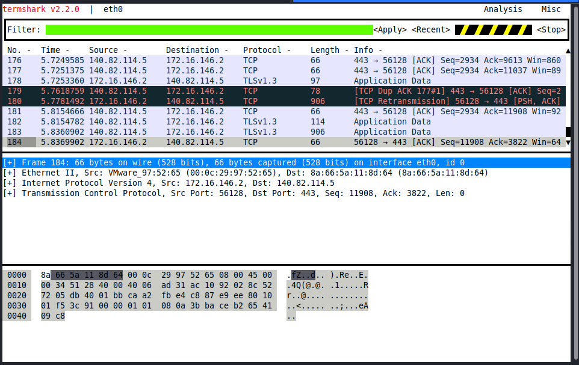
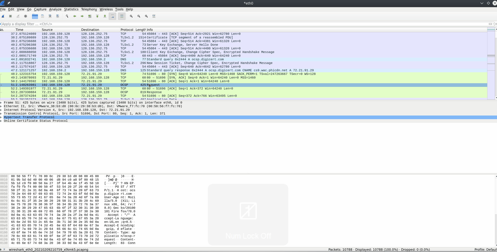
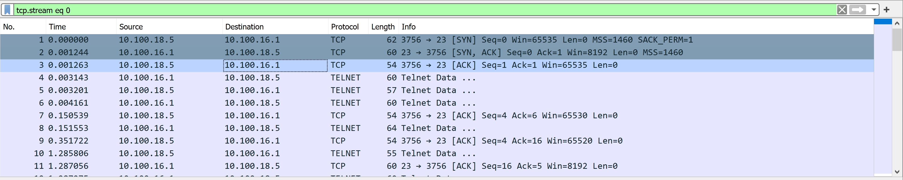
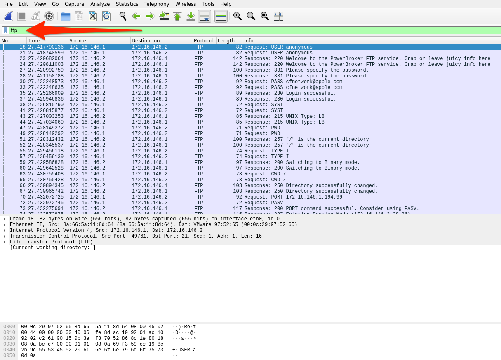
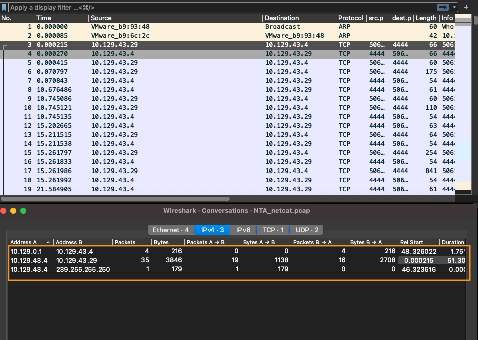
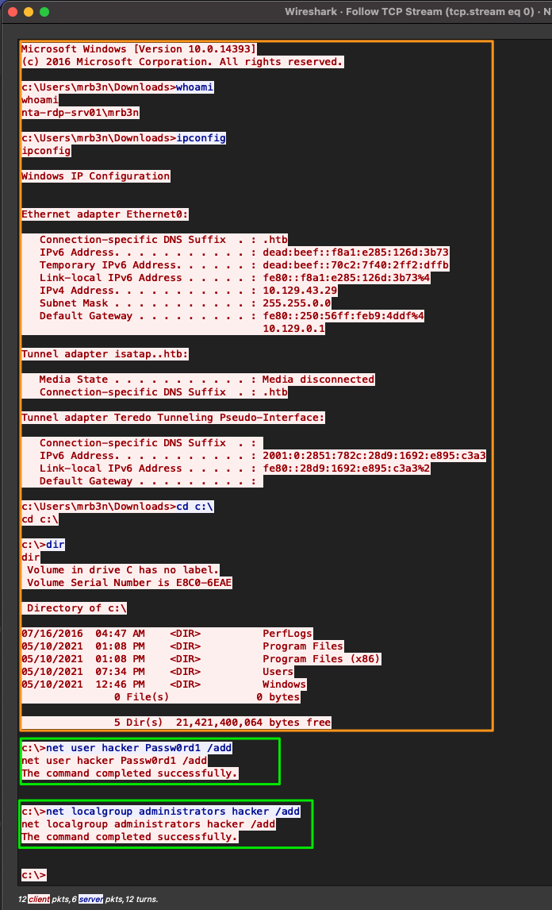
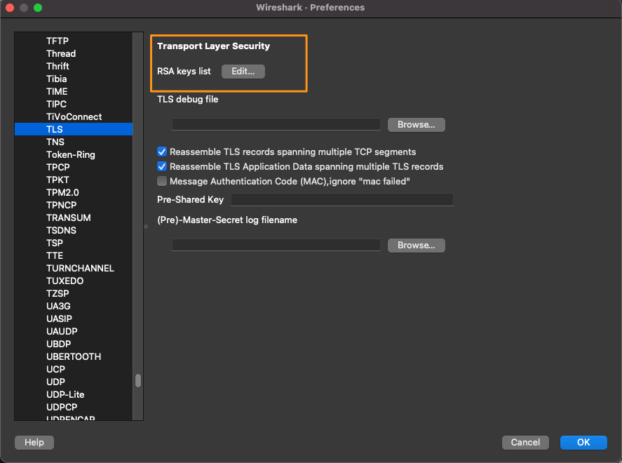
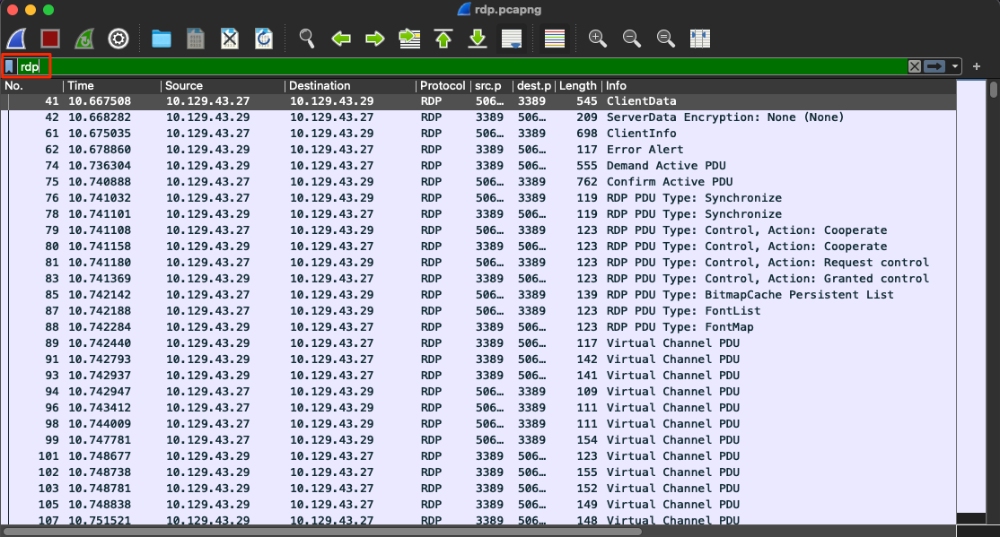

# Module 07: Intro to Network Traffic Analysis

## Mục lục

- [Section 1/15 — Phân tích lưu lượng mạng](#section-01)
- [Section 2/15 — Ôn tập kiến thức mạng: Tầng 1–4](#section-02)
- [Section 3/15 — Ôn tập kiến thức mạng: Tầng 5–7](#section-03)
- [Section 4/15 — Quy trình phân tích](#section-04)
- [Section 5/15 — Vận dụng quy trình phân tích](#section-05)
- [Section 6/15 — Kiến thức cơ bản về Tcpdump](#section-06)
- [Section 7/15 — Lab kiến thức cơ bản](#section-07)
- [Section 8/15 — Lọc gói tin bằng Tcpdump](#section-08)
- [Section 9/15 — Khảo sát lưu lượng mạng bằng bộ lọc thu thập và hiển thị](#section-09)
- [Section 10/15 — Phân tích bằng Wireshark](#section-10)
- [Section 11/15 — Làm quen với Wireshark](#section-11)
- [Section 12/15 — Sử dụng Wireshark nâng cao](#section-12)
- [Section 13/15 — Packet Inception: Phân tích lưu lượng mạng bằng Wireshark](#section-13)
- [Section 14/15 — Lab có hướng dẫn: Quy trình phân tích lưu lượng](#section-14)
- [Section 15/15 — Giải mã các kết nối RDP](#section-15)

<a id="section-01"></a>

## Section 1/15 — Phân tích lưu lượng mạng

Network Traffic Analysis (NTA — phân tích lưu lượng mạng) có thể được mô tả là hoạt động kiểm tra lưu lượng mạng để xác định đặc điểm của các cổng và giao thức thường được sử dụng, thiết lập baseline (mức hoạt động chuẩn) cho môi trường, giám sát và ứng phó với các mối đe dọa, đồng thời có được cái nhìn sâu sắc nhất có thể về mạng của tổ chức.

Quy trình này giúp các chuyên gia bảo mật sớm nhận diện những bất thường, bao gồm các mối đe dọa bảo mật trong mạng, và xác định chính xác các mối đe dọa một cách hiệu quả. Phân tích lưu lượng mạng cũng có thể hỗ trợ việc đáp ứng các hướng dẫn bảo mật. Kẻ tấn công thường xuyên cập nhật chiến thuật để tránh bị phát hiện và tận dụng thông tin xác thực hợp lệ cùng những công cụ được hầu hết công ty cho phép sử dụng trong mạng, khiến việc phát hiện và sau đó là ứng phó trở nên khó khăn đối với bên phòng thủ. Trong những trường hợp như vậy, phân tích lưu lượng mạng một lần nữa có thể phát huy tác dụng. Những use case thường gặp của NTA gồm:

- Thu thập lưu lượng theo thời gian thực trong mạng để phân tích các mối đe dọa sắp xuất hiện.
- Thiết lập baseline cho hoạt động giao tiếp mạng hằng ngày.
- Nhận diện và phân tích lưu lượng từ các cổng không thông dụng, các máy đáng ngờ và những vấn đề về giao thức mạng như lỗi HTTP, vấn đề với TCP hoặc các cấu hình mạng sai khác.
- Phát hiện mã độc trên đường truyền, chẳng hạn như ransomware (mã độc tống tiền), exploit (mã khai thác) và các tương tác không theo thông lệ.

NTA cũng hữu ích khi điều tra các sự cố đã xảy ra và trong quá trình threat hunting (săn tìm mối đe dọa).

Hãy hình dung một tác nhân đe dọa đang nhắm đến và xâm nhập mạng của chúng ta. Nếu muốn xâm phạm mạng, kẻ tấn công chắc chắn phải tương tác và giao tiếp với hạ tầng của chúng ta. Giao tiếp mạng diễn ra trên nhiều cổng và giao thức khác nhau, tất cả đều đang được nhân viên, thiết bị và khách hàng sử dụng đồng thời. Để phát hiện lưu lượng độc hại, chúng ta cần vận dụng hiểu biết về lưu lượng mạng thông thường trong phạm vi mạng của mình. Điều này sẽ thu hẹp phạm vi tìm kiếm, giúp nhanh chóng tìm ra và làm gián đoạn hoạt động liên lạc của đối phương.

Ví dụ, nếu phát hiện nhiều gói tin SYN trên những cổng mà chúng ta không bao giờ hoặc hiếm khi sử dụng trong mạng, ta có thể kết luận rằng nhiều khả năng có người đang cố xác định các cổng mở trên máy của chúng ta. Những hành động như vậy là dấu hiệu điển hình của port scan (quét cổng). Để thực hiện phân tích và đưa ra các kết luận như thế, cần có những kỹ năng và kiến thức cụ thể.

### Các kỹ năng và kiến thức cần có

Những kỹ năng sắp được liệt kê và mô tả đòi hỏi kiến thức lý thuyết lẫn thực hành được tích lũy theo thời gian. Chúng ta không cần thuộc lòng mọi thứ, nhưng nên biết cần tìm hiểu điều gì khi gặp những khía cạnh chưa quen thuộc trong nội dung. Điều này không chỉ áp dụng cho NTA mà còn cho hầu hết các chủ đề khác mà chúng ta sẽ tiếp cận trong an ninh mạng.

#### Bộ giao thức TCP/IP và mô hình OSI

Hiểu biết này bảo đảm chúng ta nắm được cách lưu lượng mạng và các ứng dụng trên máy tương tác với nhau.

#### Các khái niệm mạng cơ bản

Để hiểu những loại lưu lượng sẽ thấy ở mỗi tầng, cần hiểu từng tầng cấu thành mô hình TCP/IP và OSI, cũng như các khái niệm chuyển mạch và định tuyến. Nếu thu lưu lượng trên một đường trục mạng (backbone link), chúng ta sẽ thấy lượng lưu lượng lớn hơn nhiều so với thông thường, và nó sẽ rất khác với lưu lượng thu được tại một switch văn phòng.

#### Các cổng và giao thức thông dụng

Nhanh chóng nhận diện các cổng và giao thức tiêu chuẩn, đồng thời có hiểu biết thực tế về cách chúng giao tiếp, sẽ giúp chúng ta nhận diện lưu lượng mạng có khả năng độc hại hoặc sai định dạng.

#### Khái niệm về gói tin IP và các tầng con

Kiến thức nền tảng về cách TCP và UDP giao tiếp ít nhất sẽ giúp chúng ta hiểu những gì đang thấy hoặc đang tìm kiếm. Ví dụ, TCP hướng luồng và cho phép dễ dàng theo dõi một cuộc trao đổi giữa các máy. UDP nhanh nhưng không chú trọng tính đầy đủ, vì vậy việc tái dựng nội dung từ loại gói tin này sẽ khó hơn.

#### Đóng gói giao thức khi truyền tải

Mỗi tầng sẽ đóng gói dữ liệu của tầng trước đó. Khả năng đọc hoặc phân tách dữ liệu khi cách đóng gói này thay đổi sẽ giúp chúng ta xử lý dữ liệu nhanh hơn. Có thể dễ dàng nhận ra các dấu hiệu dựa trên những header đóng gói.

### Môi trường và thiết bị

Danh sách dưới đây chứa nhiều công cụ và loại thiết bị khác nhau có thể dùng để phân tích lưu lượng mạng. Mỗi loại cung cấp một cách khác nhau để bắt hoặc phân tách lưu lượng. Một số cung cấp khả năng sao chép và bắt lưu lượng, trong khi những loại khác đọc và thu nạp dữ liệu. Module này chỉ tìm hiểu một vài công cụ trong số đó, chủ yếu là Wireshark và tcpdump. Hãy nhớ rằng các công cụ này không chỉ dành cho quản trị viên. Nhiều công cụ cũng có thể được sử dụng cho mục đích độc hại.

#### Các công cụ phân tích lưu lượng thông dụng

| Công cụ | Mô tả |
|---|---|
| tcpdump | tcpdump là một tiện ích dòng lệnh, với sự hỗ trợ của LibPcap, có thể bắt và diễn giải lưu lượng mạng từ một giao diện mạng hoặc tệp chứa lưu lượng đã bắt. |
| Tshark | TShark là công cụ phân tích gói tin mạng tương tự TCPDump. Nó bắt gói tin từ mạng đang hoạt động hoặc đọc và giải mã dữ liệu từ tệp. Đây là phiên bản dòng lệnh của Wireshark. |
| Wireshark | Wireshark là công cụ phân tích lưu lượng mạng có giao diện đồ họa. Nó bắt và giải mã các frame (khung dữ liệu) trên đường truyền, cho phép xem xét sâu môi trường mạng. Nó có thể áp dụng nhiều dissector (bộ phân tích giao thức) khác nhau lên lưu lượng để xác định đặc điểm của các giao thức, ứng dụng và giúp hiểu rõ những gì đang xảy ra. |
| NGrep | NGrep là công cụ so khớp mẫu được xây dựng để thực hiện chức năng tương tự grep trên các bản phân phối Linux. Khác biệt lớn là nó làm việc với các gói lưu lượng mạng. NGrep có thể đọc lưu lượng trực tiếp hoặc lưu lượng từ tệp PCAP, đồng thời sử dụng biểu thức regex và cú pháp BPF. Công cụ này đặc biệt hữu ích khi gỡ lỗi lưu lượng của các giao thức như HTTP và FTP. |
| tcpick | tcpick là công cụ bắt gói tin dòng lệnh chuyên theo dõi và tái lắp ráp các luồng TCP. Khả năng đọc một luồng rồi tái dựng luồng đó thành tệp bằng tcpick rất hữu ích. |
| Network Taps | Tap (Gigamon, Niagra-taps) là thiết bị có khả năng tạo bản sao lưu lượng mạng và gửi đến nơi khác để phân tích. Chúng có thể được đặt trực tiếp trên đường truyền (in-line) hoặc ngoài băng (out of band). Chúng có thể chủ động bắt và phân tích lưu lượng trực tiếp, hoặc thực hiện một cách thụ động bằng cách đưa gói tin gốc trở lại đường truyền như thể không có gì thay đổi. |
| Networking Span Ports | Span Port là một cách sao chép các frame từ thiết bị mạng tầng hai hoặc tầng ba trong quá trình xử lý lưu lượng đi ra hoặc đi vào, rồi gửi đến một điểm thu thập. Thường một cổng được cấu hình mirroring để gửi những bản sao này đến máy chủ log. |
| Elastic Stack | Elastic Stack là tập hợp các công cụ có thể lấy dữ liệu từ nhiều nguồn, thu nạp và trực quan hóa dữ liệu để phục vụ tìm kiếm và phân tích. |
| SIEMS | SIEM, chẳng hạn như Splunk, là nơi tập trung phân tích và trực quan hóa dữ liệu. Cảnh báo, phân tích điều tra số và kiểm tra lưu lượng hằng ngày đều là những use case của SIEM. |
| Và các công cụ khác. | |

### Cú pháp BPF

Nhiều công cụ được đề cập ở trên có cú pháp và lệnh riêng, nhưng cú pháp Berkeley Packet Filter (BPF) là điểm chung giữa chúng. Đây là cú pháp chính mà chúng ta sẽ sử dụng. Về bản chất, BPF là công nghệ cung cấp một giao diện thô để đọc và ghi từ tầng Data-Link (liên kết dữ liệu). Với những đặc điểm đó, chúng ta quan tâm đến BPF vì khả năng lọc và giải mã mà nó cung cấp. Chúng ta sẽ sử dụng cú pháp BPF xuyên suốt module, vì vậy hiểu cơ bản về cách thiết lập một bộ lọc BPF sẽ hữu ích. Để biết thêm về cú pháp BPF, hãy xem tài liệu tham khảo này.

### Thực hiện phân tích lưu lượng mạng

Việc phân tích có thể đơn giản như quan sát lưu lượng trực tiếp chạy qua cửa sổ dòng lệnh, hoặc phức tạp như bắt dữ liệu bằng tap, gửi dữ liệu về SIEM để thu nạp, rồi phân tích dữ liệu pcap nhằm tìm các dấu hiệu nhận diện và cảnh báo liên quan đến những chiến thuật, kỹ thuật phổ biến.

Tối thiểu, để lắng nghe thụ động, chúng ta cần kết nối vào phân đoạn mạng muốn quan sát. Điều này đặc biệt đúng trong môi trường chuyển mạch, nơi các VLAN và cổng switch không chuyển tiếp lưu lượng ra ngoài miền quảng bá của chúng. Vì vậy, nếu muốn bắt lưu lượng từ một VLAN cụ thể, thiết bị bắt gói tin phải được kết nối vào cùng mạng đó. Các thiết bị như network tap, những cấu hình trên switch hoặc router như span port và port mirroring có thể cho phép chúng ta lấy bản sao của mọi lưu lượng đi qua một liên kết cụ thể, bất kể lưu lượng đó thuộc phân đoạn mạng nào hoặc có đích đến ở đâu.

### Quy trình NTA

Phân tích lưu lượng không phải là một lĩnh vực có quy trình chính xác tuyệt đối. NTA có thể rất linh hoạt và không phải một vòng lặp đơn giản. Nó chịu ảnh hưởng lớn từ điều chúng ta đang tìm kiếm — lỗi mạng hay hành vi độc hại — và từ những vị trí mà chúng ta có thể quan sát mạng. Việc phân tích lưu lượng có thể được quy về một số nguyên tắc cơ bản.

#### Quy trình NTA


#### 1. Thu nạp lưu lượng

Sau khi quyết định vị trí đặt thiết bị, hãy bắt đầu bắt lưu lượng. Sử dụng capture filter (bộ lọc khi bắt gói tin) nếu đã hình dung được điều mình đang tìm kiếm.

#### 2. Giảm nhiễu bằng bộ lọc

Bắt lưu lượng trên một liên kết, đặc biệt trong môi trường vận hành thực tế, có thể thu về rất nhiều dữ liệu gây nhiễu. Sau khi hoàn tất lần bắt ban đầu, việc lọc bỏ lưu lượng không cần thiết khỏi phần hiển thị có thể giúp phân tích dễ dàng hơn, chẳng hạn như lưu lượng Broadcast và Multicast.

#### 3. Phân tích và khám phá

Đây là lúc bắt đầu tách ra những dữ liệu liên quan đến vấn đề đang theo dõi. Hãy xem xét các máy, giao thức cụ thể, thậm chí những chi tiết như các cờ được thiết lập trong TCP header. Các câu hỏi sau sẽ giúp chúng ta:

- Lưu lượng được mã hóa hay ở dạng rõ? Lẽ ra nó nên ở dạng nào?
- Có thấy người dùng đang cố truy cập những tài nguyên mà họ không được phép truy cập không?
- Có những máy đang giao tiếp với nhau trong khi thông thường chúng không làm vậy không?

#### 4. Phát hiện và cảnh báo

- Có thấy lỗi nào không? Có thiết bị nào lẽ ra phải phản hồi nhưng lại không phản hồi không?
- Sử dụng kết quả phân tích để quyết định những gì đang thấy là lành tính hay có khả năng độc hại.
- Các công cụ khác như IDS và IPS có thể hữu ích ở bước này. Chúng có thể áp dụng các phương pháp heuristic và dấu hiệu nhận diện lên lưu lượng để xác định liệu có nội dung nào có khả năng độc hại hay không.

#### 5. Khắc phục và giám sát

Khắc phục và giám sát không thuộc vòng lặp trên, nhưng nên có trong mọi quy trình chúng ta thực hiện. Nếu thực hiện thay đổi hoặc khắc phục một vấn đề, chúng ta nên tiếp tục giám sát nguồn đó trong một thời gian để xác định vấn đề đã được giải quyết hay chưa.

<a id="section-02"></a>

## Section 2/15 — Ôn tập kiến thức mạng: Tầng 1–4

Section này giúp ôn tập nhanh kiến thức mạng và cách hoạt động của một số giao thức tiêu chuẩn mà chúng ta có thể gặp khi bắt lưu lượng. Những khái niệm này là cốt lõi của việc bắt và phân tách lưu lượng. Nếu không có hiểu biết nền tảng về luồng lưu lượng mạng thông thường, cũng như các cổng và giao thức được sử dụng, chúng ta không thể phân tích chính xác bất kỳ lưu lượng nào đã bắt. Nếu đây là lần đầu bạn gặp một số thuật ngữ hoặc khái niệm này, chúng tôi khuyến nghị hoàn thành module Introduction to Networking trước.

### Các mô hình OSI / TCP-IP

#### Các mô hình mạng


Hình phía trên cho thấy rõ mô hình Open Systems Interconnect (OSI) và mô hình Transmission Control Protocol - Internet Protocol (TCP-IP) được đặt cạnh nhau. Các mô hình là cách biểu diễn bằng hình ảnh về cách xử lý hoạt động giao tiếp giữa các máy tính nối mạng. Hãy dành chút thời gian so sánh hai mô hình:

#### So sánh đặc điểm các mô hình

| Đặc điểm | OSI | TCP-IP |
|---|---|---|
| Số tầng | Bảy | Bốn |
| Tính linh hoạt | Chặt chẽ | Linh hoạt |
| Sự phụ thuộc | Độc lập với giao thức và mang tính tổng quát | Dựa trên các giao thức truyền thông phổ biến |

Khi xem xét hai mô hình này, có thể thấy mô hình OSI được phân chia chi tiết hơn TCP-IP vì nó được tách thành những phần chức năng nhỏ. Các tầng từ một đến bốn của mô hình OSI tập trung kiểm soát việc truyền dữ liệu giữa các máy. Việc kiểm soát này bao gồm mọi thứ, từ môi trường vật lý dùng để truyền dẫn đến giao thức được sử dụng để quản lý cuộc trao đổi, hoặc việc không có cơ chế quản lý cuộc trao đổi khi truyền dữ liệu. Các tầng từ năm đến bảy xử lý việc diễn giải, quản lý và trình bày dữ liệu đã đóng gói cho người dùng cuối. Có thể xem mô hình OSI là lý thuyết đằng sau cách mọi thứ hoạt động, còn TCP-IP gần với chức năng thực tế của mạng hơn. Mô hình TCP-IP kết hợp các chức năng nhiều hơn và có những quy tắc linh hoạt hơn. TCP-IP gồm bốn tầng, trong đó các tầng năm, sáu và bảy của OSI tương ứng với tầng bốn của TCP-IP. Tầng ba đảm nhiệm truyền tải; tầng hai là tầng Internet, tương ứng với tầng Network của OSI; tầng một là tầng Link, bao quát các tầng hai và một của OSI.

Trong suốt module này, chúng ta sẽ xem xét nhiều Protocol Data Unit (PDU — đơn vị dữ liệu giao thức) khác nhau, vì vậy cần hiểu chúng được biểu diễn như thế nào cả trên lý thuyết lẫn trên đường truyền. PDU là một gói dữ liệu gồm thông tin điều khiển và dữ liệu được đóng gói từ từng tầng của mô hình OSI. Phần phân tách bên dưới sẽ cho thấy các tầng trong hai mô hình tương ứng với một PDU như thế nào.

#### Ví dụ về PDU


Khi kiểm tra một PDU, cần ghi nhớ khái niệm encapsulation (đóng gói). Khi dữ liệu đi xuống bộ giao thức, mỗi tầng sẽ bọc dữ liệu của những tầng trước đó trong một lớp vỏ mới; quá trình này được gọi là đóng gói. Lớp vỏ này bổ sung thông tin cần thiết của tầng đó vào header của PDU. Thông tin có thể khác nhau tùy tầng, nhưng bao gồm nội dung do tầng trước mang theo, các cờ hoạt động, những tùy chọn cần thiết để thương lượng giao tiếp, địa chỉ IP nguồn và đích, cổng, cùng các giao thức tầng Transport và Application.

#### Phân tích gói tin PDU


Hình phía trên cho thấy cấu tạo của một PDU đặt cạnh phần phân tách gói tin trong khung Packet Details của Wireshark. Lưu ý rằng phần phân tách trong Wireshark được hiển thị theo thứ tự ngược lại. Wireshark hiển thị PDU theo thứ tự ngược vì đó là thứ tự mà các lớp đóng gói được gỡ bỏ.

### Các cơ chế địa chỉ hóa

Sau khi xem qua những khái niệm cơ bản chi phối hoạt động của mạng, hãy dành thời gian tìm hiểu các cơ chế địa chỉ hóa giúp chuyển gói tin đến đúng máy. Chúng ta bắt đầu với địa chỉ Media Access Control.

#### Địa chỉ MAC

Mỗi giao diện logic hoặc vật lý gắn với một máy đều có địa chỉ Media Access Control (MAC). Đây là địa chỉ 48 bit, gồm sáu octet, được biểu diễn ở dạng thập lục phân. Trong hình bên dưới, mũi tên màu đỏ chỉ ra một ví dụ về địa chỉ này.

#### Địa chỉ MAC


Địa chỉ MAC được sử dụng trong giao tiếp tầng hai giữa các máy — tầng Data-Link hoặc Link tùy theo mô hình đang xét. Cơ chế này hoạt động thông qua giao tiếp giữa các máy trong cùng một broadcast domain (miền quảng bá). Nếu lưu lượng tầng hai cần đi qua một giao diện tầng ba, PDU đó được gửi đến giao diện đầu ra tầng ba và được định tuyến đến đúng mạng. Ở tầng hai, điều này thể hiện như thể PDU được gửi đến địa chỉ của giao diện router; router sẽ xét địa chỉ tầng ba để quyết định gửi nó đi đâu tiếp theo. Sau khi quyết định, router loại bỏ lớp đóng gói tầng hai và thay bằng thông tin mới chỉ ra địa chỉ vật lý tiếp theo trên tuyến đường.

#### Địa chỉ IP

Internet Protocol (IP) được phát triển để chuyển dữ liệu từ máy này đến máy khác qua ranh giới các mạng. IP chịu trách nhiệm định tuyến gói tin, đóng gói dữ liệu, phân mảnh và tái lắp ráp các datagram khi chúng đến máy đích. Về bản chất, IP là giao thức không kết nối, không bảo đảm dữ liệu sẽ đến được người nhận dự kiến. Để bảo đảm độ tin cậy và xác nhận việc chuyển dữ liệu, IP dựa vào các giao thức tầng trên như TCP. Hiện có hai phiên bản IP chính: IPv4, tiêu chuẩn đang chiếm ưu thế, và IPv6, được định hướng làm phiên bản kế nhiệm IPv4.

#### IPv4

Cơ chế địa chỉ hóa phổ biến nhất mà phần lớn mọi người quen thuộc là địa chỉ Internet Protocol phiên bản 4 (IPv4). Địa chỉ IPv4 là phương thức cốt lõi để định tuyến gói tin qua các mạng đến những máy nằm ngoài phạm vi mạng lân cận trực tiếp của chúng ta. Hình bên dưới cho thấy một ví dụ về địa chỉ IPv4 ở vị trí mũi tên màu xanh lá.

#### Địa chỉ IP


Địa chỉ IPv4 là một số 32 bit, gồm bốn octet, được biểu diễn ở dạng thập phân. Trong ví dụ, chúng ta thấy địa chỉ `192.168.86.243`. Mỗi octet của địa chỉ IP có thể được biểu diễn bằng một số từ 0 đến 255. Khi kiểm tra PDU, chúng ta sẽ thấy địa chỉ IP ở tầng ba (Network) của mô hình OSI và tầng hai (Internet) của mô hình TCP-IP. Chúng ta sẽ không đi sâu vào IPv4 tại đây, nhưng trong phạm vi module này, cần hiểu những địa chỉ đó là gì, chúng có vai trò gì và được sử dụng ở tầng nào.

#### IPv6

Sau hơn một thập kỷ sử dụng IPv4, người ta nhận thấy kho địa chỉ IP có thể sử dụng đã nhanh chóng cạn kiệt. Với những khối địa chỉ lớn được dành riêng cho mục đích đặc biệt hoặc địa chỉ riêng, thế giới đã nhanh chóng sử dụng hết không gian địa chỉ sẵn có. Để giúp giải quyết vấn đề, hai biện pháp đã được thực hiện. Thứ nhất là triển khai variable-length subnet masks (VLSM — mặt nạ mạng con có độ dài thay đổi) và Classless Inter-Domain Routing (CIDR — định tuyến liên miền không phân lớp). Điều này cho phép xác định lại các địa chỉ IP có thể sử dụng trong định dạng v4 bằng cách thay đổi cách cấp địa chỉ cho người dùng. Thứ hai là tạo ra và tiếp tục phát triển IPv6 như phiên bản kế nhiệm IPv4.

IPv6 cung cấp không gian địa chỉ lớn hơn nhiều, có thể sử dụng cho mọi mục đích kết nối mạng. Địa chỉ IPv6 dài 128 bit, gồm 16 octet, được biểu diễn ở dạng thập lục phân. Trong hình bên dưới, mũi tên màu xanh dương chỉ ra một ví dụ về địa chỉ IPv6 đã được rút gọn.

#### Địa chỉ IPv6


Cùng với không gian địa chỉ lớn hơn nhiều, IPv6 cung cấp: khả năng hỗ trợ Multicasting tốt hơn (gửi lưu lượng từ một đến nhiều đích); địa chỉ toàn cục cho từng thiết bị; tính bảo mật ngay trong giao thức dưới dạng IPSec; header gói tin đơn giản hóa giúp xử lý dễ dàng hơn; và khả năng chuyển từ kết nối này sang kết nối khác mà không bị cấp lại địa chỉ.

IPv6 sử dụng bốn loại địa chỉ chính trong cơ chế địa chỉ hóa của nó:

##### Các loại địa chỉ IPv6

| Loại | Mô tả |
|---|---|
| Unicast | Địa chỉ dành cho một giao diện duy nhất. |
| Anycast | Địa chỉ dành cho nhiều giao diện, trong đó chỉ một giao diện nhận gói tin. |
| Multicast | Địa chỉ dành cho nhiều giao diện, trong đó tất cả đều nhận cùng một gói tin. |
| Broadcast | Không tồn tại và được thực hiện bằng địa chỉ multicast. |

Khi xem xét từng loại địa chỉ, nên nhớ rằng lưu lượng Unicast đi từ máy này đến máy khác; Multicast đi từ một đến nhiều đích; còn Anycast đi từ một đến nhiều đích trong một nhóm nhưng chỉ một đích phản hồi gói tin — hãy liên tưởng đến cân bằng tải.

Dù ở trạng thái hiện tại IPv6 mang lại nhiều ưu điểm so với IPv4, việc áp dụng IPv6 vẫn diễn ra chậm.

#### Mức độ áp dụng IPv6


Tại thời điểm bài gốc được viết, theo số liệu do Google công bố, tỷ lệ áp dụng trên toàn cầu chỉ khoảng 40%.

### TCP / UDP và các cơ chế truyền tải

Tầng Transport (truyền tải) có một số cơ chế giúp bảo đảm dữ liệu được chuyển thông suốt từ nguồn đến đích. Có thể hình dung tầng Transport như một trung tâm điều khiển. Dữ liệu ứng dụng từ các tầng trên phải đi xuống bộ giao thức đến tầng Transport. Tầng này điều khiển cách lưu lượng được đóng gói và chuyển xuống các giao thức tầng dưới (IP và MAC). Khi dữ liệu đến được người nhận dự kiến, tầng Transport phối hợp với các giao thức tầng Network / Internet để tái lắp ráp dữ liệu đã đóng gói theo đúng thứ tự. Hai cơ chế được sử dụng để thực hiện nhiệm vụ này là Transmission Control (TCP) và User Datagram Protocol (UDP).

#### TCP so với UDP

Hãy dành chút thời gian xem xét hai giao thức này cạnh nhau.

##### So sánh TCP và UDP

| Đặc điểm | TCP | UDP |
|---|---|---|
| Truyền dữ liệu | Hướng kết nối | Không kết nối. Gửi rồi bỏ qua, không chờ xác nhận. |
| Thiết lập kết nối | TCP sử dụng bắt tay ba bước để bảo đảm một kết nối được thiết lập. | UDP không bảo đảm đích đang lắng nghe. |
| Chuyển dữ liệu | Các cuộc trao đổi dựa trên luồng | Từng gói riêng lẻ; nguồn không quan tâm đích có đang hoạt động hay không. |
| Nhận dữ liệu | Sử dụng Sequence number và Acknowledgement number để theo dõi dữ liệu. | UDP không quan tâm đến việc này. |
| Tốc độ | TCP có nhiều chi phí xử lý bổ sung hơn và chậm hơn do các chức năng tích hợp sẵn. | UDP nhanh nhưng không đáng tin cậy. |

Nhìn vào bảng trên, có thể thấy TCP và UDP cung cấp hai phương thức truyền dữ liệu rất khác nhau. TCP được xem là giao thức đáng tin cậy hơn vì kiểm tra lỗi và xác nhận dữ liệu là các chức năng thông thường của nó. Ngược lại, UDP là giao thức nhanh, gửi rồi bỏ qua, phù hợp nhất khi chúng ta ưu tiên tốc độ hơn chất lượng và việc xác nhận.

Để dễ hình dung, TCP được sử dụng khi truyền dữ liệu đòi hỏi tính đầy đủ hơn tốc độ. Ví dụ, khi sử dụng Secure Shell (SSH) để kết nối từ máy này sang máy khác, một kết nối được mở và duy trì hoạt động trong lúc bạn nhập lệnh và thực hiện các thao tác. Đây là một chức năng của TCP, bảo đảm cuộc trao đổi với máy từ xa không bị gián đoạn. Nếu vì lý do nào đó xảy ra gián đoạn, TCP sẽ không tái lắp ráp một phần gói tin còn thiếu rồi gửi đến ứng dụng. Nhờ vậy, chúng ta có thể tránh lỗi. Điều gì sẽ xảy ra nếu nhập lệnh như `sudo passwd user` để thay đổi mật khẩu của người dùng trên máy từ xa, nhưng trong quá trình thay đổi, một phần thông điệp bị mất? Nếu điều này diễn ra qua UDP, chúng ta sẽ không có cách nào biết phần còn lại của thông điệp đã ra sao và có thể làm hỏng mật khẩu người dùng hoặc gây hậu quả tệ hơn. TCP giúp ngăn điều này bằng cách xác nhận từng gói tin nhận được, bảo đảm máy đích đã nhận từng gói trước khi lắp ráp lệnh và gửi đến ứng dụng để thực hiện.

Mặt khác, khi cần phản hồi nhanh hoặc sử dụng ứng dụng ưu tiên tốc độ hơn tính đầy đủ, UDP là lựa chọn của chúng ta. Lấy việc phát video trực tuyến làm ví dụ. Người dùng sẽ không nhận ra nếu một hoặc hai điểm ảnh bị mất trong video đang phát. Chúng ta quan tâm nhiều hơn đến việc xem video mà không liên tục phải dừng để tải vào bộ đệm phần tiếp theo. DNS là một ví dụ khác. Khi một máy yêu cầu bản ghi cho `inlanefreight.com`, nó cần phản hồi nhanh để tiếp tục quy trình đang thực hiện. Điều tệ nhất xảy ra khi một yêu cầu DNS bị mất là yêu cầu đó được gửi lại. Không có thiệt hại gì. Người dùng sẽ không nhận dữ liệu bị hỏng vì việc mất gói này.

Lưu lượng UDP trông giống lưu lượng thông thường: đó là một gói tin đơn lẻ, không có phản hồi hoặc xác nhận rằng nó đã được gửi hay nhận, nên ở đây không có nhiều điều để minh họa. Tuy nhiên, chúng ta có thể xem xét TCP và cách nó thiết lập kết nối.

#### Bắt tay ba bước TCP

Một trong những cách TCP bảo đảm chuyển dữ liệu từ server đến client là sử dụng các phiên. Những phiên này được thiết lập thông qua quá trình gọi là three-way handshake (bắt tay ba bước). Để thực hiện, TCP sử dụng một tùy chọn trong TCP header được gọi là các cờ. Lúc này chúng ta chưa đi sâu vào các cờ TCP; chỉ cần biết những cờ thường thấy trong bắt tay ba bước là Synchronization (SYN — đồng bộ) và Acknowledgment (ACK — xác nhận). Khi một máy yêu cầu trao đổi với server qua TCP:

1. Client gửi một gói tin với cờ SYN được bật, cùng các tùy chọn khác có thể thương lượng trong TCP header.
   - Đây là gói tin đồng bộ. Cờ này chỉ được bật trong gói tin đầu tiên từ máy và server, cho phép thiết lập phiên bằng cách để hai đầu thống nhất số thứ tự dùng để bắt đầu giao tiếp.
   - Điều này rất quan trọng đối với việc theo dõi gói tin. Cùng với việc đồng bộ số thứ tự, nhiều tùy chọn khác cũng được thương lượng ở giai đoạn này, bao gồm kích thước cửa sổ, kích thước phân đoạn tối đa và xác nhận có chọn lọc.
2. Server phản hồi bằng một gói TCP có cờ SYN được bật để thương lượng số thứ tự và cờ ACK được bật để xác nhận gói SYN mà máy đã gửi trước đó.
   - Server cũng đưa những thay đổi cần thiết đối với các tùy chọn TCP vào trường options của TCP header.
3. Client phản hồi bằng một gói TCP có cờ ACK được bật, đồng ý với kết quả thương lượng.
   - Gói tin này kết thúc quá trình bắt tay ba bước và thiết lập kết nối giữa client với server.

Hãy xem nhanh quá trình này trong thực tế để làm quen trước khi nó xuất hiện trong đầu ra gói tin ở phần sau của module.

#### Bắt tay ba bước TCP


Khi kiểm tra đầu ra này, có thể thấy quá trình bắt tay bắt đầu ở dòng đầu tiên. Trong thông tin được đánh dấu bằng khung đỏ, cờ SYN ban đầu đã được bật. Nhìn vào các số cổng được gạch chân màu xanh lá, chúng ta thấy hai số `57678` và `80`. Số đầu tiên là cổng cao được chọn ngẫu nhiên mà client đang sử dụng; số thứ hai là cổng thông dụng của HTTP, được server dùng để lắng nghe những kết nối yêu cầu web đi vào. Ở dòng 2, chúng ta thấy server phản hồi client bằng gói `SYN / ACK` gửi đến cùng các cổng đó. Ở dòng 3, client xác nhận gói đồng bộ của server để thiết lập kết nối.

Gói tin 4 cho thấy yêu cầu HTTP đã được gửi và một phiên được thiết lập để truyền dữ liệu của hình ảnh được yêu cầu. Khi luồng tiếp tục, có thể thấy TCP gửi xác nhận cho từng khối dữ liệu đã gửi. Đây là một ví dụ về giao tiếp TCP thông thường.

Chúng ta đã thấy cách thiết lập một phiên TCP; bây giờ hãy xem phiên được kết thúc như thế nào.

#### Kết thúc phiên TCP


Trong hình phía trên, có thể thấy ở cuối đầu ra một nhóm gói tin tương tự quá trình bắt tay ba bước. Đây là cách TCP đóng kết nối một cách có trật tự. Một cờ khác sẽ gặp trong TCP là cờ FIN. Cờ này dùng để báo hiệu rằng việc truyền dữ liệu đã hoàn tất và bên gửi đang yêu cầu chấm dứt kết nối. Client xác nhận đã nhận dữ liệu, sau đó gửi FIN và ACK để bắt đầu kết thúc phiên. Server phản hồi bằng xác nhận FIN và gửi lại FIN của chính nó. Cuối cùng, client xác nhận phiên đã hoàn tất và đóng kết nối. Trước khi phiên chấm dứt, chúng ta sẽ thấy mẫu gói tin:

```text
FIN, ACK
FIN, ACK,
ACK
```

Nếu xem hình mô tả chi tiết một phiên ở trên, chúng ta sẽ thấy đúng như vậy. Đầu ra tương tự được xem là một kết nối đã kết thúc đúng cách.

<a id="section-03"></a>

## Section 3/15 — Ôn tập kiến thức mạng: Tầng 5–7

Chúng ta đã thấy cách mạng hoạt động ở các tầng dưới; bây giờ hãy xem một số giao thức tầng trên xử lý các ứng dụng. Cần nhiều ứng dụng và dịch vụ khác nhau để duy trì một kết nối mạng và bảo đảm có thể truyền dữ liệu giữa các máy. Section này sẽ trình bày khái quát một vài giao thức thiết yếu trong số đó.

### HTTP

Hypertext Transfer Protocol (HTTP) là giao thức tầng Application (ứng dụng) không lưu trạng thái, được sử dụng từ năm 1990. HTTP cho phép truyền dữ liệu dạng rõ giữa client và server qua TCP. Client gửi một yêu cầu HTTP đến server để yêu cầu tài nguyên. Một phiên được thiết lập và server phản hồi bằng nội dung được yêu cầu như HTML, hình ảnh, siêu liên kết hoặc video. Khi hoạt động thông thường, HTTP sử dụng cổng `80` hoặc `8000` qua TCP. Trong những trường hợp đặc biệt, nó có thể được điều chỉnh để sử dụng cổng khác, hoặc đôi khi thậm chí sử dụng UDP.

#### Các phương thức HTTP

Để thực hiện những thao tác như lấy trang web, yêu cầu nội dung để tải xuống hoặc đăng dòng tweet mới nhất, đều cần sử dụng các phương thức cụ thể. Những phương thức này xác định hành động được thực hiện khi yêu cầu một URI. Các phương thức gồm:

| Phương thức | Mô tả |
|---|---|
| HEAD | **Bắt buộc.** Đây là phương thức an toàn, yêu cầu server phản hồi tương tự yêu cầu GET nhưng không bao gồm phần thân thông điệp. Nó là cách hữu ích để thu thập thêm thông tin về server và trạng thái hoạt động của server. |
| GET | **Bắt buộc.** GET là phương thức được sử dụng phổ biến nhất. Nó yêu cầu thông tin và nội dung từ server. Ví dụ, `GET http://10.1.1.1/Webserver/index.html` yêu cầu trang `index.html` từ server dựa trên URI đã cung cấp. |
| POST | **Tùy chọn.** POST là cách gửi thông tin đến server dựa trên các trường trong yêu cầu. Ví dụ, gửi một thông điệp vào bài đăng Facebook hoặc diễn đàn trên website là thao tác POST. Hành động thực tế có thể khác nhau tùy server, vì vậy cần chú ý các mã phản hồi được gửi lại để xác nhận hành động. |
| PUT | **Tùy chọn.** PUT lấy dữ liệu được đính kèm vào thông điệp và đặt tại URI được yêu cầu. Nếu ở đó chưa có mục tương ứng, nó sẽ tạo một mục bằng dữ liệu được cung cấp. Nếu đối tượng đã tồn tại, yêu cầu PUT mới sẽ được xem là phiên bản cập nhật nhất và đối tượng sẽ được sửa đổi cho phù hợp. Cách dễ nhất để hình dung khác biệt giữa PUT và POST là: PUT tạo hoặc cập nhật một đối tượng tại URI được cung cấp, còn POST tạo các thực thể con tại URI đó. Có thể so sánh hành động này với khác biệt giữa tạo một tệp mới và viết bình luận về tệp đó trên cùng trang. |
| DELETE | **Tùy chọn.** DELETE thực hiện đúng như tên gọi: xóa đối tượng tại URI được chỉ định. |
| TRACE | **Tùy chọn.** Cho phép chẩn đoán server từ xa. Nếu phương thức TRACE được bật, server từ xa sẽ gửi lại chính yêu cầu đã nhận trong phản hồi của nó. |
| OPTIONS | **Tùy chọn.** Phương thức OPTIONS có thể thu thập thông tin về những phương thức HTTP được server hỗ trợ và nhận diện. Nhờ đó, chúng ta có thể xác định yêu cầu để tương tác với một tài nguyên hoặc server cụ thể mà không thực sự yêu cầu dữ liệu hay đối tượng từ đó. |
| CONNECT | **Tùy chọn.** CONNECT được dành cho proxy hoặc những thiết bị bảo mật khác như tường lửa. CONNECT cho phép tunneling (tạo đường hầm mạng) qua HTTP, chẳng hạn đường hầm SSL. |

Lưu ý rằng bên cạnh mỗi phương thức có ghi “bắt buộc” hoặc “tùy chọn”. Theo yêu cầu của tiêu chuẩn, GET và HEAD phải luôn tồn tại và hoạt động trong các triển khai HTTP tiêu chuẩn. Điều này chỉ đúng với hai phương thức đó. Các phương thức TRACE, OPTIONS, DELETE, PUT và POST là chức năng tùy chọn có thể cho phép sử dụng. Ví dụ là một trang web chỉ đọc như bài đăng blog. Máy client có thể yêu cầu tài nguyên từ trang nhưng không thể sửa đổi, thêm hoặc xóa tài nguyên.

Để biết thêm về giao thức HTTP hoặc cách hoạt động của nó, hãy xem `RFC:2616`.

### HTTPS

HTTP Secure (HTTPS) là phiên bản điều chỉnh của giao thức HTTP, được thiết kế để sử dụng Transport Layer Security (TLS), hoặc Secure Sockets Layer (SSL) với các ứng dụng cũ hơn, nhằm bảo mật dữ liệu. TLS được dùng như một cơ chế mã hóa để bảo vệ giao tiếp giữa client và server. TLS có thể bọc lưu lượng HTTP thông thường bên trong TLS, nghĩa là có thể mã hóa toàn bộ cuộc trao đổi chứ không chỉ dữ liệu được gửi hoặc yêu cầu. Trước khi có cơ chế TLS, chúng ta dễ bị tấn công Man-in-the-middle (người đứng giữa) và các hình thức reconnaissance (trinh sát/thu thập thông tin) hoặc chiếm đoạt khác; nghĩa là bất kỳ ai ở cùng LAN với client hoặc server đều có thể xem lưu lượng web nếu đang nghe trên đường truyền. Giờ đây, bảo mật có thể được triển khai ngay trong trình duyệt, cho phép mọi người mã hóa hoạt động duyệt web, yêu cầu tìm kiếm, các phiên hoặc việc truyền dữ liệu, giao dịch ngân hàng và nhiều hoạt động khác.

Dù về nền tảng vẫn là HTTP, HTTPS sử dụng cổng `443` và `8443` thay vì cổng tiêu chuẩn `80`. Đây là cách đơn giản để client báo cho server rằng nó muốn thiết lập kết nối bảo mật. Hãy xem đầu ra lưu lượng HTTPS và tìm hiểu nhanh cách bắt tay TLS hoạt động.

#### Bắt tay TLS qua HTTPS


Trong vài gói tin đầu tiên, có thể thấy client thiết lập phiên đến server qua cổng `443`, được đánh dấu bằng khung xanh dương. Điều này báo cho server rằng client muốn dùng HTTPS làm giao thức giao tiếp của ứng dụng.

Sau khi một phiên được khởi tạo qua TCP, thông điệp TLS `ClientHello` được gửi tiếp theo để bắt đầu bắt tay TLS. Trong quá trình bắt tay, hai bên thống nhất một số tham số, bao gồm định danh phiên, chứng chỉ x509 của bên đối diện, thuật toán nén sẽ sử dụng, thuật toán mã hóa cipher spec, khả năng tiếp tục lại phiên, cùng một master secret (bí mật chính) dài 48 byte được chia sẻ giữa client và server để xác nhận phiên.

Khi phiên đã được thiết lập, toàn bộ dữ liệu và phương thức sẽ được gửi qua kết nối TLS và xuất hiện dưới dạng `TLS Application Data`, như thấy trong khung đỏ. TLS vẫn sử dụng TCP làm giao thức truyền tải, vì vậy chúng ta vẫn sẽ thấy các gói xác nhận của luồng đi qua cổng `443`.

Tóm tắt quá trình bắt tay:

1. Client và server trao đổi các thông điệp hello để thống nhất tham số kết nối.
2. Client và server trao đổi những tham số mật mã cần thiết để thiết lập premaster secret (bí mật tiền chủ).
3. Client và server trao đổi các chứng chỉ x.509 và thông tin mật mã cho phép xác thực trong phiên.
4. Tạo master secret từ premaster secret và các giá trị ngẫu nhiên đã trao đổi.
5. Client và server chuyển các tham số bảo mật đã thương lượng đến phần record layer (tầng bản ghi) của giao thức TLS.
6. Client và server xác minh rằng bên đối diện đã tính toán ra cùng các tham số bảo mật và quá trình bắt tay diễn ra mà không bị kẻ tấn công can thiệp sửa đổi.

Bản thân mã hóa là một chủ đề phức tạp và dài, xứng đáng có một module riêng. Section này chỉ tóm tắt đơn giản cách HTTP và TLS cung cấp khả năng bảo mật trong giao thức ứng dụng HTTPS. Để biết thêm về cách HTTPS hoạt động và cách TLS thực hiện các thao tác bảo mật, hãy xem `RFC:2246`.

### FTP

File Transfer Protocol (FTP) là giao thức tầng Application cho phép truyền dữ liệu nhanh giữa các thiết bị máy tính. FTP có thể được sử dụng từ dòng lệnh, trình duyệt web hoặc thông qua ứng dụng FTP có giao diện đồ họa như FileZilla. Bản thân FTP được xem là giao thức không an toàn, và phần lớn người dùng đã chuyển sang những công cụ như SFTP để truyền tệp qua các kênh bảo mật. Một điểm cần lưu ý cho việc sử dụng về sau là phần lớn trình duyệt web hiện đại đã dần loại bỏ hỗ trợ FTP kể từ năm 2020.

Khi nghĩ về giao tiếp giữa các máy, chúng ta thường hình dung client và server trao đổi qua một socket duy nhất. Qua socket đó, cả client lẫn server gửi lệnh và dữ liệu trên cùng một liên kết. Ở khía cạnh này, FTP khác biệt vì sử dụng nhiều cổng cùng lúc. FTP sử dụng cổng `20` và `21` qua TCP. Cổng `20` dùng để truyền dữ liệu, còn cổng `21` dùng để gửi các lệnh điều khiển phiên FTP. Về xác thực, FTP hỗ trợ xác thực người dùng cũng như cho phép truy cập ẩn danh nếu được cấu hình.

FTP có thể hoạt động ở hai chế độ: active (chủ động) hoặc passive (thụ động). Active là chế độ hoạt động mặc định của FTP, nghĩa là server lắng nghe lệnh điều khiển `PORT` từ client, chỉ ra cổng nào sẽ được dùng để truyền dữ liệu. Chế độ passive cho phép truy cập các FTP server nằm sau tường lửa hoặc một liên kết bật NAT khiến việc kết nối TCP trực tiếp không thể thực hiện. Trong trường hợp này, client gửi lệnh `PASV` và chờ phản hồi từ server cho biết IP cùng cổng cần sử dụng để kết nối kênh truyền dữ liệu.

#### Ví dụ về lệnh và phản hồi FTP


Hình phía trên cho thấy một số ví dụ về yêu cầu được gửi qua kênh lệnh FTP — các mũi tên màu xanh lá — và phản hồi từ FTP server — các mũi tên màu xanh dương. Đây đều là những hoạt động khá thông thường. Hãy xem bảng bên dưới để biết từng lệnh và chức năng của nó.

Khi xem xét lưu lượng FTP, một số lệnh phổ biến có thể thấy được truyền qua cổng `21` gồm:

##### Các lệnh FTP

| Lệnh | Mô tả |
|---|---|
| USER | Chỉ định người dùng sẽ đăng nhập. |
| PASS | Gửi mật khẩu của người dùng đang cố đăng nhập. |
| PORT | Khi ở chế độ active, lệnh này thay đổi cổng dữ liệu được sử dụng. |
| PASV | Chuyển kết nối đến server từ chế độ active sang passive. |
| LIST | Hiển thị danh sách các tệp trong thư mục hiện tại. |
| CWD | Thay đổi thư mục làm việc hiện tại sang thư mục được chỉ định. |
| PWD | In ra thư mục đang làm việc. |
| SIZE | Trả về kích thước của tệp được chỉ định. |
| RETR | Lấy tệp từ FTP server. |
| QUIT | Kết thúc phiên. |

Đây chưa phải danh sách đầy đủ tất cả lệnh điều khiển FTP có thể gặp. Các lệnh có thể khác nhau tùy ứng dụng FTP hoặc shell đang sử dụng. Để biết thêm về FTP, hãy xem `RFC:959`.

### SMB

Server Message Block (SMB) là giao thức thường gặp nhất trong môi trường Windows doanh nghiệp, cho phép chia sẻ tài nguyên giữa các máy trên những kiến trúc mạng phổ biến. SMB là giao thức hướng kết nối, yêu cầu xác thực người dùng từ máy đến tài nguyên để bảo đảm người dùng có quyền thích hợp sử dụng tài nguyên đó hoặc thực hiện các thao tác. Trước đây, SMB sử dụng NetBIOS làm cơ chế truyền tải qua các cổng UDP `137` và `138`. Sau những thay đổi hiện đại, SMB hiện hỗ trợ truyền trực tiếp qua TCP trên cổng `445`, NetBIOS qua TCP trên cổng `139`, và cả giao thức QUIC.

Đối với người dùng, SMB giúp truy cập dễ dàng và thuận tiện vào các tài nguyên như máy in, ổ đĩa dùng chung, máy chủ xác thực và nhiều tài nguyên khác. Vì vậy, SMB cũng rất hấp dẫn đối với những kẻ có ý định tấn công.

Giống các ứng dụng khác dùng TCP làm cơ chế truyền tải, SMB thực hiện những chức năng tiêu chuẩn như bắt tay ba bước và xác nhận các gói tin đã nhận. Hãy dành chút thời gian xem lưu lượng SMB để làm quen.

#### SMB trên đường truyền


Nhìn vào hình phía trên, có thể thấy TCP handshake được thực hiện mỗi khi thiết lập phiên, ở các khung màu cam. Khi xem cổng nguồn và đích trong khung xanh dương, cổng `445` đang được sử dụng, cho biết đây là lưu lượng SMB qua TCP. Trong các khung màu xanh lá, trường info cho biết phần nào những gì đang diễn ra trong giao tiếp SMB. Ví dụ này có nhiều lỗi, cho thấy đây là điều cần tìm hiểu sâu hơn. Một hoặc hai lần xác thực thất bại của người dùng là tương đối phổ biến, nhưng một cụm lớn các lỗi lặp lại có thể báo hiệu một cá nhân không được phép đang cố truy cập tài khoản người dùng hoặc dùng thông tin xác thực của họ để di chuyển. Đây là chiến thuật phổ biến của kẻ tấn công: nhắm đến một người dùng đã xác thực, đánh cắp thông tin xác thực rồi sử dụng để thực hiện lateral movement (di chuyển ngang trong mạng), hoặc truy cập những tài nguyên mà thông thường chúng bị từ chối truy cập.

Đây chỉ là một ví dụ về việc sử dụng SMB. Một hoạt động phổ biến khác là truy cập các vùng chia sẻ tệp giữa server và các máy. Phần lớn đây là giao tiếp bình thường. Tuy nhiên, nếu thấy một máy truy cập các vùng chia sẻ tệp trên những máy khác, điều này không phổ biến. Hãy chú ý ai đang yêu cầu kết nối, kết nối đến đâu và đang làm gì.

<a id="section-04"></a>

## Section 4/15 — Quy trình phân tích

Phân tích lưu lượng mạng là một quy trình linh hoạt, có thể thay đổi tùy theo các công cụ sẵn có, quyền hạn được tổ chức cấp và mức độ quan sát được mạng của chúng ta. Mục tiêu ở đây là đưa ra một quy trình có thể lặp lại để bắt đầu áp dụng khi phân tích lưu lượng.

Phân tích lưu lượng là việc xem xét chi tiết một sự kiện hoặc quy trình, xác định nguồn gốc và tác động của nó; kết quả có thể được dùng để đưa ra những biện pháp phòng ngừa và/hoặc hành động cụ thể nhằm hỗ trợ hoặc ngăn chặn những lần xảy ra trong tương lai. Đối với lưu lượng mạng, điều này có nghĩa là chia dữ liệu thành những phần có thể hiểu được, kiểm tra để tìm bất kỳ điều gì lệch khỏi lưu lượng mạng thông thường, những lưu lượng có khả năng độc hại như giao tiếp từ xa trái phép từ Internet qua RDP, SSH hoặc Telnet, hay các sự kiện khác thường xuất hiện trước khi xảy ra vấn đề mạng. Trong quá trình phân tích, chúng ta cũng xem xét các xu hướng trong lưu lượng và xác định liệu chúng có khớp với baseline (mức hoạt động chuẩn) của lưu lượng vận hành thông thường hay không.

Phân tích lưu lượng là một công cụ rất linh hoạt và thiết yếu trong bộ công cụ phòng thủ. Không có khả năng giám sát lưu lượng, chúng ta sẽ thiếu một phần rất lớn của bức tranh tổng thể. Phân tích mức sử dụng mạng, các máy và server trao đổi nhiều dữ liệu nhất, cùng hoạt động giao tiếp nội bộ đều là những thành phần quan trọng, giúp quản trị viên và bên phòng thủ nhận diện, khắc phục vấn đề trước hoặc ngay sau khi chúng xảy ra. Khả năng quan sát có lẽ là lợi ích lớn nhất mà phân tích lưu lượng mang lại. Với khả năng này, chúng ta có thể bắt lưu lượng trong nhiều khoảng thời gian để thiết lập baseline cho môi trường. Baseline giúp dễ nhận ra khi có thay đổi. Trong những triển khai NTA nâng cao có kết hợp các công cụ khác như IDS/IPS, tường lửa, log máy và log mạng, cùng thông tin bổ sung được đưa vào những công cụ như Splunk hoặc ELK Stack, khả năng giám sát lưu lượng là vô cùng giá trị. Các công cụ giúp nhanh chóng đưa ra cảnh báo về những hành động độc hại đang diễn ra. Nhiều công cụ phòng thủ đã có sẵn các dấu hiệu nhận diện cho phần lớn những cuộc tấn công và bộ công cụ tấn công phổ biến.

Có năng lực phòng thủ phù hợp là điều thiết yếu với mọi người, nhưng còn hoạt động vận hành hằng ngày thì sao? NTA có thể giúp gì? Quan sát lưu lượng mạng trực tiếp có thể giúp dễ dàng xử lý sự cố kết nối hoặc xác định hạ tầng và các giao thức tương ứng có hoạt động đúng hay không. Nếu thấy được lưu lượng đang đi đâu, chúng ta có thể xác định liệu có vấn đề hay không.

Cuối cùng, đây là một kỹ năng cần linh hoạt, và việc sử dụng công cụ tự động để hỗ trợ là hoàn toàn phù hợp. Chỉ cần đừng phụ thuộc hoàn toàn vào chúng. Hãy vận dụng kỹ năng của mình và thực hiện cả những bước kiểm tra thủ công. Điều này giúp chúng ta trực tiếp quan sát mạng. Con người và công cụ sẽ kiểm tra, đối chiếu lẫn nhau, bởi công cụ có thể bị vượt qua. Các tác nhân độc hại luôn tìm cách vượt qua những biện pháp bảo mật. Khả năng quan sát của con người vẫn là nguồn lực tốt nhất để tìm ra hoạt động xấu.

### Các điều kiện cần cho việc phân tích

Việc bắt và phân tích lưu lượng có thể được thực hiện theo hai cách: active (chủ động) hoặc passive (thụ động). Mỗi cách có những điều kiện riêng. Với cách thụ động, chúng ta chỉ sao chép dữ liệu có thể quan sát được mà không tương tác trực tiếp với các gói tin. Đối với việc bắt và phân tích lưu lượng chủ động, yêu cầu có phần khác biệt. Bắt lưu lượng chủ động đòi hỏi chúng ta can thiệp trực tiếp hơn. Quy trình này còn có thể được gọi là bắt lưu lượng in-line, tức đặt trực tiếp trên đường truyền. Với cả hai cách, phương pháp phân tích dữ liệu do chúng ta lựa chọn. Có thể bắt lưu lượng rồi phân tích sau khi hoàn tất, hoặc phân tích theo thời gian thực trong khi lưu lượng đang được truyền. Bảng dưới đây trình bày các điều kiện cần cho từng cách.

#### Các điều kiện cần để bắt lưu lượng

| Điều kiện | Thụ động | Chủ động | Mô tả |
|---|---|---|---|
| Sự cho phép | ☑ | ☑ | Tùy tổ chức đang làm việc, việc bắt dữ liệu có thể trái với chính sách, hoặc thậm chí trái pháp luật trong một số lĩnh vực nhạy cảm như y tế hay ngân hàng. Luôn bảo đảm có sự cho phép bằng văn bản từ người có thẩm quyền cấp phép. Chúng ta có thể tự xem mình là hacker, nhưng vẫn cần hành động đúng pháp luật và đạo đức. |
| Cổng được cấu hình mirroring | ☑ | ☐ | Một giao diện mạng trên switch hoặc router được cấu hình để sao chép dữ liệu từ các nguồn khác đến giao diện đó, cùng khả năng đưa NIC (card giao tiếp mạng) vào promiscuous mode (chế độ nhận mọi gói tin). Việc gói tin được sao chép đến cổng của chúng ta cho phép kiểm tra lưu lượng hướng đến những liên kết khác mà bình thường không thể quan sát. Vì VLAN và cổng switch không chuyển tiếp lưu lượng ra ngoài miền quảng bá, chúng ta phải kết nối vào phân đoạn đó hoặc sao chép lưu lượng đến cổng cụ thể của mình. Với mạng không dây, việc bắt thụ động có thể phức tạp hơn một chút. Chúng ta phải kết nối vào SSID muốn bắt lưu lượng. Chỉ thụ động lắng nghe sóng vô tuyến xung quanh sẽ thu được nhiều thông điệp quảng bá SSID, nhưng không có nhiều dữ liệu khác. |
| Công cụ bắt lưu lượng | ☑ | ☑ | Cần một phương tiện thu nạp lưu lượng. Một máy tính có thể sử dụng các công cụ như TCPDump, Wireshark, Netminer hoặc công cụ khác là đủ. Hãy nhớ rằng các tệp dữ liệu PCAP có thể nhanh chóng trở nên rất lớn. Mỗi lần áp dụng bộ lọc lên chúng trong những công cụ như Wireshark, ứng dụng phải phân tích lại dữ liệu. Quá trình này có thể tiêu tốn nhiều tài nguyên, vì vậy cần bảo đảm máy có đủ tài nguyên. |
| Vị trí đặt trực tiếp trên đường truyền | ☐ | ☑ | Đặt một tap trực tiếp trên đường truyền đòi hỏi thay đổi cấu trúc liên kết của mạng đang làm việc. Máy nguồn và đích sẽ không nhận thấy khác biệt trong lưu lượng, nhưng xét về định tuyến và chuyển mạch, đây sẽ là một chặng kế tiếp vô hình mà lưu lượng đi qua trên đường đến đích. |
| Network tap hoặc máy có nhiều NIC | ☐ | ☑ | Cần một máy tính có hai NIC hoặc thiết bị như network tap để dữ liệu đang được kiểm tra vẫn tiếp tục lưu thông. Có thể hình dung như thêm một router vào giữa một liên kết. Để bắt lưu lượng chủ động, chúng ta sao chép dữ liệu trực tiếp từ các nguồn. Vị trí tốt nhất để đặt tap là trên một liên kết tầng ba giữa các phân đoạn chuyển mạch. Nó cho phép bắt mọi lưu lượng được định tuyến ra ngoài mạng cục bộ. Cổng chuyển mạch hoặc việc phân đoạn VLAN không giới hạn góc nhìn của chúng ta tại đây. |
| Dung lượng lưu trữ và năng lực xử lý | ☑ | ☑ | Bạn sẽ cần nhiều dung lượng lưu trữ và năng lực xử lý để bắt lưu lượng từ tap. Lưu lượng đi qua một liên kết tầng ba lớn hơn nhiều so với lưu lượng chỉ bên trong một LAN chuyển mạch. Hãy hình dung như sau: bắt lưu lượng thụ động trong LAN giống như rót nước từ vòi nước uống vào cốc. Dòng nước đều và có thể kiểm soát. Chủ động thu lưu lượng từ một liên kết được định tuyến lại giống dùng vòi phun nước để đổ đầy một tách trà. Áp lực của dòng chảy lớn hơn nhiều, và lượng dữ liệu có thể rất lớn đối với khả năng xử lý, lưu trữ của máy. |

Điều kiện cuối cùng thiên về khuyến nghị hơn là yêu cầu bắt buộc, nhưng chúng tôi cho rằng vẫn cần đề cập. Hiểu cách lưu lượng hằng ngày di chuyển là yếu tố quan trọng để thành công. Có thể phân tích lưu lượng khi chưa có hiểu biết này, nhưng sẽ khó hơn và tốn thời gian hơn nhiều. Baseline cho phép nhanh chóng lọc bỏ lưu lượng thông thường của mạng trong quá trình phân tích. Nhờ đó, có thể đẩy nhanh quy trình và phát hiện những điểm bất thường hoặc vấn đề sớm hơn nhiều. Hãy xem tình huống sau:

Bạn là quản trị viên mạng của một tập đoàn lớn có vài nghìn nhân viên làm việc tại khuôn viên công ty. Bạn được báo rằng một phân đoạn mạng đang gặp vấn đề kết nối. Một số máy trong đó có độ trễ rất cao, đồng thời xuất hiện các tệp mới trên desktop. Để bắt đầu hình dung chuyện gì đang xảy ra, bạn kết nối một máy tính vào phân đoạn đó và bắt đầu bắt lưu lượng. Sau vài phút, bạn dừng bắt và bắt đầu phân tích.

Bây giờ hãy cân nhắc: nếu không có baseline của lưu lượng mạng hằng ngày, làm sao biết điều gì là bình thường đối với mạng đó? Chúng ta đã thu được rất nhiều thông tin trong khoảng thời gian bắt lưu lượng và cần loại bớt một phần. Quá trình này có thể mất nhiều thời gian vì phải kiểm tra từng cuộc trao đổi để bảo đảm nó bình thường, xác định các máy quan sát được có thuộc mạng hay là tài sản không được phép, cùng nhiều việc khác. Quá trình nhanh chóng trở thành một nhiệm vụ khó khăn, đúng không?

Trong tình huống này, nếu có baseline mạng, chúng ta có thể nhanh chóng loại bỏ những giao tiếp đã biết là hợp lệ. Sử dụng các công cụ phân tích dữ liệu như chức năng thống kê những máy trao đổi nhiều dữ liệu nhất trong Wireshark có thể giúp xác định các máy đang gửi lượng dữ liệu lớn. Có thể đối chiếu với baseline thông thường của máy để xác định hành vi đó có khác thường hay không. Một cách khác là xem các kết nối giữa những máy nội bộ hoặc các cổng phổ biến và ít gặp. Sau khi loại bớt dữ liệu khỏi phần hiển thị, giờ đây chúng ta thấy một số máy người dùng kết nối qua các cổng `8080` và `445`. Bản thân các cổng không có gì lạ, nhưng việc hai máy tính người dùng giao tiếp với nhau qua những cổng này thì có. Lưu lượng web thường đi từ một máy đến webserver được lưu trữ bên ngoài hoặc webserver nội bộ cung cấp ứng dụng doanh nghiệp. Lưu lượng SMB cũng tương tự. Việc thấy hai máy giao tiếp với nhau qua cổng này rất đáng ngờ. Với những gì đã biết, giờ đây chúng ta có thể nhanh chóng gửi phiếu báo sự cố để yêu cầu hỗ trợ xử lý một vụ xâm nhập tiềm tàng.

Khi nói đến xâm nhập mạng, càng sớm có được khả năng quan sát thì thiệt hại tiềm tàng đối với mạng càng ít. Hãy bảo đảm hiểu rõ cách lưu lượng di chuyển trong mạng và cách các giao thức thường hoạt động.

<a id="section-05"></a>

## Section 5/15 — Vận dụng quy trình phân tích

Section trước đã định nghĩa phân tích lưu lượng mạng, các điều kiện cần để thực hiện và tầm quan trọng của hoạt động này. Section này sẽ phân tách một quy trình phân tích lưu lượng thành từng phần, giúp chúng ta làm quen với các thành phần chính.

Đây không phải là một lĩnh vực có quy trình chính xác tuyệt đối. Nó có thể rất linh hoạt và không phải một vòng lặp đơn giản. Quy trình chịu ảnh hưởng lớn từ điều chúng ta đang tìm kiếm — lỗi mạng hay hành vi độc hại — và những vị trí mà chúng ta có thể quan sát mạng. Tuy nhiên, việc phân tích vẫn có thể được quy về một số nguyên tắc cơ bản.

### Phân tích mô tả

Descriptive analysis (phân tích mô tả) là một bước thiết yếu trong mọi hoạt động phân tích dữ liệu. Nó dùng để mô tả một tập dữ liệu dựa trên các đặc điểm riêng lẻ, giúp phát hiện những sai sót có thể có trong quá trình thu thập dữ liệu và/hoặc những điểm ngoại lệ trong tập dữ liệu.

1. **Vấn đề là gì?**
   - Nghi ngờ có xâm nhập? Vấn đề mạng?
2. **Xác định phạm vi và mục tiêu.** Chúng ta đang tìm gì? Trong khoảng thời gian nào?
   - Đối tượng cần điều tra: nhiều máy có khả năng đang tải tệp độc hại từ `bad.example.com`.
   - Thời gian: trong 48 giờ vừa qua và thêm 2 giờ kể từ hiện tại.
   - Thông tin hỗ trợ: tên/loại tệp `'superbad.exe'`, `'new-crypto-miner.exe'`.
3. **Xác định các đối tượng cần phân tích:** mạng, máy, giao thức.
   - Phạm vi: mạng `192.168.100.0/24`, các giao thức được sử dụng là HTTP và FTP.

Sử dụng quy trình này, chúng ta sẽ xác định vấn đề, điều đang tìm kiếm, thời gian và nơi tìm kiếm. Phân tích mô tả bao quát những khái niệm then chốt này trong hoạt động phân tích.

### Phân tích chẩn đoán

Diagnostic analysis (phân tích chẩn đoán) làm rõ nguyên nhân, ảnh hưởng và sự tương tác giữa các điều kiện. Qua đó, nó cung cấp những hiểu biết thu được thông qua tương quan và diễn giải. Đặc trưng ở đây là góc nhìn hồi cứu, giống với phân tích mô tả có liên quan chặt chẽ, nhưng khác biệt nhỏ là nó cố tìm ra nguyên nhân của các sự kiện và diễn biến.

1. **Bắt lưu lượng mạng.**
   - Kết nối vào một liên kết có thể truy cập mạng `192.168.100.0/24` để bắt lưu lượng trực tiếp, nhằm cố thu được một trong các tệp thực thi trong lúc truyền. Kiểm tra xem quản trị viên có thể lấy dữ liệu PCAP và/hoặc netflow từ SIEM để có dữ liệu lịch sử hay không.
2. **Xác định những thành phần lưu lượng mạng cần thiết — lọc dữ liệu.**
   - Khi đã có lưu lượng, lọc bỏ các gói tin không cần cho cuộc điều tra, bao gồm mọi lưu lượng khớp với baseline thông thường; giữ lại những gì liên quan đến phạm vi điều tra. Ví dụ: HTTP và FTP từ mạng con, mọi lưu lượng đang truyền hoặc chứa yêu cầu GET đối với các tệp thực thi đáng ngờ.
3. **Hiểu lưu lượng mạng đã bắt.**
   - Sau khi lọc bỏ nhiễu, đã đến lúc đi sâu tìm các đối tượng cần điều tra. Lọc theo những mục như `ftp-data` để tìm các tệp được truyền và tái dựng chúng. Với HTTP, có thể lọc bằng `http.request.method == "GET"` để xem các yêu cầu GET khớp với tên tệp đang tìm kiếm. Điều này có thể cho biết ai đã nhận các tệp và có thể cả những lần truyền khác trong nội bộ mạng qua cùng các giao thức.

Bằng cách bắt lưu lượng quanh nguồn phát sinh vấn đề, loại bỏ dữ liệu đã biết là hợp lệ, rồi dành thời gian kiểm tra và hiểu những gì còn lại, chúng ta có thể xác định liệu chúng có phải nguyên nhân gây ra vấn đề hay không. Làm như vậy chính là thực hiện phân tích chẩn đoán. Chúng ta đang xác minh nguyên nhân của các vấn đề và xem xét những sự kiện xung quanh chúng.

### Phân tích dự đoán

Thông qua đánh giá dữ liệu lịch sử và hiện tại, predictive analysis (phân tích dự đoán) tạo ra mô hình dự đoán về các khả năng trong tương lai. Dựa trên kết quả phân tích mô tả và chẩn đoán, phương pháp phân tích dữ liệu này cho phép nhận diện xu hướng, phát hiện sớm độ lệch so với các giá trị kỳ vọng và dự đoán những sự kiện tương lai chính xác nhất có thể.

1. **Ghi chép và lập sơ đồ tư duy cho các kết quả tìm được.**
   - Ghi lại mọi việc đã làm, quan sát được hoặc tìm thấy trong suốt cuộc điều tra là rất quan trọng. Hãy bảo đảm ghi chép đầy đủ, bao gồm:
     - Những khoảng thời gian đã bắt lưu lượng.
     - Các máy đáng ngờ trong mạng.
     - Những cuộc trao đổi chứa các tệp đang được điều tra, bao gồm dấu thời gian và số thứ tự gói tin.
2. **Tổng hợp kết quả phân tích: chúng ta đã tìm thấy gì?**
   - Cuối cùng, tổng hợp những gì đã tìm thấy và giải thích các chi tiết liên quan để cấp trên có thể quyết định cách ly những máy bị ảnh hưởng hoặc triển khai hoạt động ứng phó sự cố ở quy mô lớn hơn.
   - Kết quả phân tích sẽ ảnh hưởng đến các quyết định được đưa ra, vì vậy cần trình bày rõ ràng và súc tích nhất có thể.

Khi đánh giá dữ liệu đã tìm được, so sánh với lưu lượng baseline và dữ liệu đã biết là độc hại, chẳng hạn các dấu hiệu xâm nhập hoặc khai thác như dấu hiệu nhận diện virus và những công cụ tấn công khác, chúng ta đang thực hiện phân tích dự đoán. Trong quá trình này, chúng ta xây dựng một bức tranh rõ ràng để có thể đưa ra những hành động ứng phó phù hợp.

### Phân tích đề xuất hành động

Prescriptive analysis (phân tích đề xuất hành động) nhằm xác định cụ thể những hành động cần thực hiện để loại bỏ hoặc ngăn ngừa một vấn đề trong tương lai, hoặc kích hoạt một hoạt động hay quy trình cụ thể. Sử dụng kết quả của quy trình, chúng ta có thể đưa ra quyết định có cơ sở về các hành động cần thiết để giải quyết vấn đề và ngăn nó tái diễn. Đề xuất giải pháp là kết quả cuối cùng của quy trình này. Sau khi hoàn tất và giải quyết được vấn đề, nên nhìn lại toàn bộ quá trình để rút ra bài học. Khi được ghi lại, những bài học này sẽ giúp củng cố quy trình: ghi rõ việc gì đã làm đúng, hành động nào không mang lại hiệu quả và những gì có thể cải thiện.

Quy trình này là ví dụ về cách bắt đầu phân tích lưu lượng đã thu thập. Ở trên, chúng ta đã chia nó thành từng phần để giải thích mỗi phần nằm ở đâu trong quy trình và thuộc loại phân tích nào. Dưới đây là toàn bộ quy trình một lần nữa để có thể dùng làm mẫu.

1. **Vấn đề là gì?**
   - Nghi ngờ có xâm nhập? Vấn đề mạng?
2. **Xác định phạm vi và mục tiêu:** chúng ta đang tìm gì, trong khoảng thời gian nào?
   - Đối tượng cần điều tra: nhiều máy có khả năng đang tải tệp độc hại từ `bad.example.com`.
   - Thời gian: trong 48 giờ vừa qua và thêm 2 giờ kể từ hiện tại.
   - Thông tin hỗ trợ: tên/loại tệp `'superbad.exe'`, `'new-crypto-miner.exe'`.
3. **Xác định các đối tượng cần phân tích:** mạng, máy, giao thức.
   - Phạm vi: mạng `192.168.100.0/24`, các giao thức được sử dụng là HTTP và FTP.
4. **Bắt lưu lượng mạng.**
   - Kết nối vào một liên kết có thể truy cập mạng `192.168.100.0/24` để bắt lưu lượng trực tiếp, nhằm cố thu được một trong các tệp thực thi trong lúc truyền. Kiểm tra xem quản trị viên có thể lấy dữ liệu PCAP và/hoặc netflow từ SIEM để có dữ liệu lịch sử hay không.
5. **Xác định những thành phần lưu lượng mạng cần thiết — lọc dữ liệu.**
   - Khi đã có lưu lượng, lọc bỏ mọi lưu lượng không cần cho cuộc điều tra, bao gồm những gì khớp với baseline thông thường; giữ lại mọi thứ liên quan đến phạm vi điều tra. Cụ thể là HTTP và FTP từ mạng con, mọi lưu lượng đang truyền hoặc chứa yêu cầu GET đối với các tệp thực thi đáng ngờ.
6. **Hiểu lưu lượng mạng đã bắt.**
   - Sau khi lọc bỏ nhiễu, đã đến lúc đi sâu tìm các đối tượng cần điều tra. Lọc theo những mục như `ftp-data` để tìm các tệp được truyền và tái dựng chúng. Với HTTP, có thể lọc bằng `http.request.method == "GET"` để xem các yêu cầu GET khớp với tên tệp đang tìm kiếm. Điều này có thể cho biết ai đã nhận các tệp và có thể cả những lần truyền khác trong nội bộ mạng qua cùng các giao thức.
7. **Ghi chép và lập sơ đồ tư duy cho các kết quả tìm được.**
   - Ghi lại mọi việc đã làm, quan sát được hoặc tìm thấy trong suốt cuộc điều tra là rất quan trọng. Hãy bảo đảm ghi chép đầy đủ, bao gồm:
     - Những khoảng thời gian đã bắt lưu lượng.
     - Các máy đáng ngờ trong mạng.
     - Những cuộc trao đổi chứa các tệp đang được điều tra, bao gồm dấu thời gian và số thứ tự gói tin.
8. **Tổng hợp kết quả phân tích: chúng ta đã tìm thấy gì?**
   - Cuối cùng, tổng hợp những gì đã tìm thấy, giải thích các chi tiết liên quan để cấp trên có thể đưa ra quyết định có cơ sở về việc cách ly các máy bị ảnh hưởng hoặc triển khai hoạt động ứng phó sự cố ở quy mô lớn hơn.
   - Kết quả phân tích sẽ ảnh hưởng đến các quyết định được đưa ra, vì vậy cần trình bày rõ ràng và súc tích nhất có thể.

Thông thường, quy trình này không phải chỉ thực hiện một lần là xong. Nó thường có tính lặp lại, và chúng ta sẽ cần thực hiện lại các bước dựa trên kết quả phân tích lần bắt lưu lượng ban đầu để xây dựng bức tranh tổng thể hơn. Cuộc tấn công có thể lớn hơn nhiều so với những gì thể hiện trong các ví dụ. Giả sử cần triển khai ứng phó sự cố toàn diện. Khi đó, chẳng hạn, có thể phải phân tích lại PCAP đã bắt trước đó để xem những cuộc trao đổi liên quan đến các máy bị ảnh hưởng trong khoảng vài phút quanh thời điểm truyền tệp thực thi, nhằm bảo đảm sự xâm nhập không lan rộng qua một con đường khác.

### Các thành phần chính của một hoạt động phân tích hiệu quả

#### 1. Hiểu môi trường của mình

Có một số thành phần then chốt để phân tích lưu lượng hiệu quả. Đầu tiên là hiểu môi trường. Nếu không chắc một máy có thuộc mạng hay không, làm sao xác định nó có phải máy không được phép hiện diện hay không? Duy trì danh mục tài sản và sơ đồ mạng là điều thiết yếu. Chúng sẽ hỗ trợ quá trình phân tích.

#### 2. Vị trí đặt công cụ là yếu tố then chốt

Tiếp theo, vị trí đặt máy dùng để bắt lưu lượng là điều rất quan trọng. Vị trí lý tưởng của công cụ bắt lưu lượng là càng gần nguồn phát sinh vấn đề càng tốt. Nếu lưu lượng đang điều tra đến từ Internet, lắng nghe trên các liên kết đi vào là một cách tốt để có được bức tranh đầy đủ. Đó là vị trí gần nguồn nhất mà chúng ta, với vai trò quản trị viên, có thể tiếp cận. Nếu vấn đề dường như chỉ giới hạn ở một máy trong mạng nội bộ, hãy thử đặt công cụ bắt lưu lượng trong cùng phân đoạn với máy gặp vấn đề và xem lưu lượng nào đang diễn ra trong phân đoạn đó.

#### 3. Sự kiên trì

Sự kiên trì là thành phần quan trọng tiếp theo. Vấn đề không phải lúc nào cũng dễ phát hiện. Nó thậm chí có thể không phải sự kiện thường xuyên trong mạng. Ví dụ, máy chủ Command and Control (C2 — chỉ huy và điều khiển) của kẻ tấn công có thể chỉ liên lạc với các máy nạn nhân theo chu kỳ vài giờ một lần, hoặc thậm chí mỗi ngày một lần hay ít hơn. Điều này có nghĩa là nếu không bắt được ngay lần đầu, có thể phải chờ một thời gian trước khi nó xuất hiện trong log. Đừng mất động lực tìm ra vấn đề. Sự kiên trì có thể tạo nên khác biệt giữa việc chặn được kẻ tấn công và một vụ xâm phạm trên diện rộng, chẳng hạn tấn công ransomware.

### Cách tiếp cận phân tích

Chúng ta đã dành thời gian thảo luận về quy trình phân tích và cách bắt đầu một quy trình cơ bản khi thực hiện công việc. Hãy dành chút thời gian nói về những cách dễ đem lại kết quả khi xem lưu lượng và tìm vấn đề.

Hãy bắt đầu với các giao thức tiêu chuẩn, rồi dần đi sâu vào những giao thức ít gặp và chỉ có ở tổ chức. Phần lớn cuộc tấn công sẽ đến từ Internet, vì vậy bằng cách nào đó chúng phải truy cập mạng nội bộ. Điều này có nghĩa là sẽ có lưu lượng được tạo ra và log ghi lại hoạt động đó. HTTP/S, FTP, email cùng lưu lượng TCP và UDP cơ bản là những loại phổ biến nhất đi vào từ bên ngoài. Bắt đầu với chúng và lọc bỏ những gì không cần thiết cho cuộc điều tra. Sau đó, kiểm tra các giao thức tiêu chuẩn cho phép giao tiếp giữa các mạng như SSH, RDP hoặc Telnet. Khi tìm những bất thường kiểu này, hãy chú ý đến chính sách bảo mật của mạng. Kế hoạch bảo mật và cách triển khai của tổ chức có cho phép các phiên RDP được khởi tạo từ bên ngoài doanh nghiệp không? Còn việc sử dụng Telnet thì sao?

Hãy tìm các mẫu lặp lại. Có máy hoặc nhóm máy cụ thể nào liên lạc với một địa chỉ trên Internet vào cùng thời điểm mỗi ngày không? Đây là kiểu cấu hình hoạt động Command and Control điển hình, có thể dễ dàng phát hiện bằng cách tìm các mẫu lặp trong dữ liệu lưu lượng.

Kiểm tra mọi giao tiếp giữa các máy trong mạng. Trong một cấu hình thông thường, các máy người dùng hiếm khi giao tiếp trực tiếp với nhau. Vì vậy, hãy nghi ngờ những lưu lượng như thế. Thông thường, các máy sẽ liên lạc với hạ tầng để được cấp phát địa chỉ IP, gửi yêu cầu DNS, sử dụng dịch vụ doanh nghiệp và tìm đường ra ngoài mạng. Chúng ta cũng sẽ thấy các máy giao tiếp với webserver cục bộ, các vùng chia sẻ tệp và hạ tầng quan trọng khác giúp môi trường hoạt động, chẳng hạn domain controller và ứng dụng xác thực.

Hãy tìm những sự kiện khác thường. Một máy thường truy cập một website cụ thể mười lần mỗi ngày nhưng thay đổi thói quen và chỉ truy cập một lần là điều đáng chú ý. Thấy chuỗi `User-Agent` khác lạ, không khớp với các ứng dụng hoặc các máy của chúng ta đang giao tiếp với server trên Internet, cũng là điều cần quan tâm. Một cổng ngẫu nhiên chỉ được bind một hoặc hai lần trên một máy cũng đáng lưu ý. Đây có thể là điểm mở cho những hoạt động như kết nối gọi về C2, ai đó mở cổng để thực hiện việc không theo thông lệ, hoặc một ứng dụng có hành vi bất thường. Trong môi trường lớn, việc có các mẫu hoạt động lặp lại là điều được kỳ vọng, nên bất cứ điều gì nổi bật khác thường đều cần xem xét.

Đừng ngại yêu cầu trợ giúp. Điều này có thể nghe như nhấn mạnh quá mức một việc hiển nhiên, nhưng sau một thời gian nhìn vào các bản bắt gói tin, mọi thứ có thể trở nên lẫn lộn và chúng ta không còn thấy được toàn bộ bức tranh. Có thêm một người xem dữ liệu có thể giúp ích rất nhiều trong việc phát hiện những chi tiết dễ bị bỏ qua.

Tóm lại, quy trình phân tích là một công việc rất linh hoạt và không ngày nào giống ngày nào. Hãy tiếp tục học hỏi, hiểu những gì đang diễn ra xung quanh; khi kỹ năng phát triển, khả năng phát hiện mối đe dọa cũng tăng lên. Quy trình này không chỉ dựa vào các công cụ như tcpdump và Wireshark. Nhiều công cụ hữu ích như Snort, Security Onion, tường lửa và SIEM có thể giúp hiểu môi trường sâu hơn và bảo vệ tốt hơn. Đừng ngại sử dụng chúng trong các cuộc điều tra.

<a id="section-06"></a>

## Section 6/15 — Kiến thức cơ bản về Tcpdump

Tcpdump là một packet sniffer (công cụ bắt gói tin) chạy trên dòng lệnh, có thể trực tiếp thu thập và diễn giải các frame (khung dữ liệu) từ tệp hoặc giao diện mạng. Công cụ được xây dựng để sử dụng trên mọi hệ điều hành tương tự Unix và từng có một phiên bản tương ứng trên Windows mang tên WinDump. Đây là công cụ mạnh mẽ, đơn giản, được sử dụng trên phần lớn hệ thống dựa trên Unix. Tcpdump không cần GUI và có thể sử dụng qua bất kỳ terminal hoặc kết nối từ xa nào, chẳng hạn SSH. Tuy vậy, lúc đầu công cụ có thể khiến chúng ta choáng ngợp vì có nhiều chức năng và bộ lọc khác nhau. Khi đã nắm được những chức năng thiết yếu, chúng ta sẽ thấy việc sử dụng công cụ hiệu quả dễ dàng hơn nhiều. Để thu thập lưu lượng mạng trực tiếp trên đường truyền, tcpdump sử dụng các thư viện `pcap` và `libpcap`, kết hợp với giao diện ở promiscuous mode (chế độ thu nhận mọi gói tin) để lắng nghe dữ liệu. Điều này cho phép chương trình nhìn thấy và thu thập các gói tin xuất phát từ hoặc gửi đến bất kỳ thiết bị nào trong mạng cục bộ, chứ không chỉ các gói tin gửi đến máy của chúng ta.

TCPDump có sẵn cho phần lớn hệ thống Unix và các hệ thống phát sinh từ Unix, chẳng hạn AIX, BSD, Linux, Solaris; nhiều nhà cung cấp đã tích hợp sẵn công cụ trong hệ thống. Vì công cụ truy cập trực tiếp phần cứng, chúng ta cần quyền root hoặc quản trị viên để chạy. Với chúng ta, điều đó có nghĩa là phải dùng `sudo` để thực thi TCPDump như các ví dụ bên dưới. TCPDump thường được cài sẵn trên phần lớn hệ điều hành Linux.

Cần lưu ý rằng Windows từng có một bản chuyển thể của TCPDump tên là Windump. Việc hỗ trợ windump đã chấm dứt. Một phương án thay thế là chạy bản phân phối Linux như Parrot hoặc Ubuntu trong Windows Subsystem for Linux. Đây có thể là cách đơn giản để có một máy Linux ảo ngay trên máy tính, cho phép sử dụng TCPDump và nhiều công cụ khác được xây dựng cho Linux.

### Xác định vị trí Tcpdump

Để kiểm tra gói phần mềm có tồn tại trên máy hay không, dùng lệnh sau:

```shellsession
lnkhangg1706@htb[/htb]$ which tcpdump
```

Thông thường, có thể tìm thấy công cụ tại `/usr/sbin/tcpdump`. Tuy nhiên, nếu chưa có gói phần mềm, chúng ta có thể cài đặt bằng:

#### Cài đặt Tcpdump

```shellsession
lnkhangg1706@htb[/htb]$ sudo apt install tcpdump 
```

Chúng ta có thể chạy gói `tcpdump` với tùy chọn `--version` để kiểm tra việc cài đặt và phiên bản hiện tại của gói, qua đó xác nhận đã cài đặt thành công.

#### Kiểm tra phiên bản Tcpdump

```shellsession
lnkhangg1706@htb[/htb]$ sudo tcpdump --version

tcpdump version 4.9.3
libpcap version 1.9.1 (with TPACKET_V3)
OpenSSL 1.1.1f  31 Mar 2020
```

### Thu thập lưu lượng bằng Tcpdump

Vì công cụ có nhiều chức năng và bộ lọc khác nhau, trước hết chúng ta nên làm quen với những tính năng thiết yếu. Hãy cùng xem một số tùy chọn TCPDump cơ bản, minh họa vài lệnh và tìm hiểu cách lưu lưu lượng vào tệp PCAP cũng như đọc dữ liệu từ những tệp này.

#### Các tùy chọn thu thập cơ bản

Bảng dưới đây liệt kê những tùy chọn Tcpdump cơ bản có thể dùng để điều chỉnh cách thu thập lưu lượng. Có thể kết hợp các tùy chọn này để định hình cách hiển thị đầu ra trên STDOUT và nội dung được lưu vào tệp capture (tệp lưu các gói tin đã thu thập). Đây chưa phải danh sách đầy đủ; còn nhiều tùy chọn khác, nhưng những tùy chọn dưới đây phổ biến và hữu ích nhất.

| Tùy chọn lệnh | Kết quả |
|---|---|
| `D` | Hiển thị các giao diện có thể dùng để thu thập lưu lượng. |
| `i` | Chọn giao diện để thu thập lưu lượng, ví dụ `-i eth0`. |
| `n` | Không chuyển đổi địa chỉ, chẳng hạn địa chỉ máy, số cổng, v.v., thành tên. |
| `e` | Thu thập header Ethernet cùng với dữ liệu ở các tầng trên. |
| `X` | Hiển thị nội dung gói tin ở dạng hex và ASCII. |
| `XX` | Giống `X`, nhưng còn hiển thị header Ethernet, tương tự sử dụng `Xe`. |
| `v, vv, vvv` | Tăng mức độ chi tiết của đầu ra được hiển thị và lưu lại. |
| `c` | Thu thập một số lượng gói tin cụ thể, sau đó thoát chương trình. |
| `s` | Xác định lượng dữ liệu cần lấy từ mỗi gói tin. |
| `S` | Chuyển số thứ tự tương đối trong phần hiển thị capture thành số thứ tự tuyệt đối (`13248765839` thay vì `101`). |
| `q` | In ít thông tin giao thức hơn. |
| `r file.pcap` | Đọc từ tệp. |
| `w file.pcap` | Ghi vào tệp. |

#### Sử dụng trang hướng dẫn man

Để xem danh sách tùy chọn đầy đủ, chúng ta có thể dùng các trang `man`:

##### Trang man của Tcpdump

```shellsession
lnkhangg1706@htb[/htb]$ man tcpdump
```

Dưới đây là một số ví dụ sử dụng tùy chọn Tcpdump cơ bản, kèm mô tả những gì đang diễn ra:

#### Liệt kê các giao diện khả dụng

```shellsession
lnkhangg1706@htb[/htb]$ sudo tcpdump -D

1.eth0 [Up, Running, Connected]
2.any (Pseudo-device that captures on all interfaces) [Up, Running]
3.lo [Up, Running, Loopback]
4.bluetooth0 (Bluetooth adapter number 0) [Wireless, Association status unknown]
5.bluetooth-monitor (Bluetooth Linux Monitor) [Wireless]
6.nflog (Linux netfilter log (NFLOG) interface) [none]
7.nfqueue (Linux netfilter queue (NFQUEUE) interface) [none]
8.dbus-system (D-Bus system bus) [none]
9.dbus-session (D-Bus session bus) [none]
```

Lệnh trên gọi tcpdump bằng quyền `sudo` và liệt kê những giao diện mạng có thể sử dụng. Chúng ta có thể chọn một trong những giao diện này và chỉ định cho tcpdump biết cần lắng nghe trên giao diện nào.

#### Chọn giao diện để thu thập lưu lượng

```shellsession
lnkhangg1706@htb[/htb]$ sudo tcpdump -i eth0

tcpdump: verbose output suppressed, use -v[v]... for full protocol decode
listening on eth0, link-type EN10MB (Ethernet), snapshot length 262144 bytes
10:58:33.719241 IP 172.16.146.2.55260 > 172.67.1.1.https: Flags [P.], seq 1953742992:1953743073, ack 2034210498, win 501, length 81
10:58:33.747853 IP 172.67.1.1.https > 172.16.146.2.55260: Flags [.], ack 81, win 158, length 0
10:58:33.750393 IP 172.16.146.2.52195 > 172.16.146.1.domain: 7579+ PTR? 1.1.67.172.in-addr.arpa. (41)
```

Trong terminal này, chúng ta gọi tcpdump và chọn giao diện `eth0` để thu thập lưu lượng. Sau khi thực thi lệnh, tcpdump bắt đầu bắt lưu lượng và chúng ta sẽ thấy những gói tin đầu tiên đi qua giao diện. Bằng cách thêm các tùy chọn `-nn` như bên dưới, chúng ta yêu cầu TCPDump không phân giải địa chỉ IP và số cổng thành tên máy và tên cổng thông dụng tương ứng. Trong cách biểu diễn này, octet cuối cùng là cổng mà kết nối đi từ hoặc đi đến.

#### Tắt phân giải tên

```shellsession
lnkhangg1706@htb[/htb]$ sudo tcpdump -i eth0 -nn

tcpdump: verbose output suppressed, use -v[v]... for full protocol decode
listening on eth0, link-type EN10MB (Ethernet), snapshot length 262144 bytes
11:02:35.580449 IP 172.16.146.2.48402 > 52.31.199.148.443: Flags [P.], seq 988167196:988167233, ack 1512376150, win 501, options [nop,nop,TS val 214282239 ecr 77421665], length 37
11:02:35.588695 IP 172.16.146.2.55272 > 172.67.1.1.443: Flags [P.], seq 940648841:940648916, ack 4248406693, win 501, length 75
11:02:35.654368 IP 172.67.1.1.443 > 172.16.146.2.55272: Flags [.], ack 75, win 70, length 0
11:02:35.728889 IP 52.31.199.148.443 > 172.16.146.2.48402: Flags [P.], seq 1:34, ack 37, win 118, options [nop,nop,TS val 77434740 ecr 214282239], length 33
11:02:35.728988 IP 172.16.146.2.48402 > 52.31.199.148.443: Flags [.], ack 34, win 501, options [nop,nop,TS val 214282388 ecr 77434740], length 0
11:02:35.729073 IP 52.31.199.148.443 > 172.16.146.2.48402: Flags [P.], seq 34:65, ack 37, win 118, options [nop,nop,TS val 77434740 ecr 214282239], length 31
11:02:35.729081 IP 172.16.146.2.48402 > 52.31.199.148.443: Flags [.], ack 65, win 501, options [nop,nop,TS val 214282388 ecr 77434740], length 0
11:02:35.729348 IP 52.31.199.148.443 > 172.16.146.2.48402: Flags [F.], seq 65, ack 37, win 118, options [nop,nop,TS val 77434740 ecr 214282239], length 0
```

Khi sử dụng tùy chọn `-e`, chúng ta yêu cầu tcpdump đưa header Ethernet vào đầu ra của capture cùng với nội dung thông thường. Có thể kiểm tra điều này bằng cách xem đầu ra. Thông thường, trường thứ nhất và thứ hai lần lượt là timestamp (dấu thời gian) và phần bắt đầu của header IP. Giờ đây, chúng lần lượt là timestamp và địa chỉ MAC nguồn của máy.

#### Hiển thị header Ethernet

```shellsession
lnkhangg1706@htb[/htb]$ sudo tcpdump -i eth0 -e

tcpdump: verbose output suppressed, use -v[v]... for full protocol decode
listening on eth0, link-type EN10MB (Ethernet), snapshot length 262144 bytes
11:05:45.982115 00:0c:29:97:52:65 (oui Unknown) > 8a:66:5a:11:8d:64 (oui Unknown), ethertype IPv4 (0x0800), length 103: 172.16.146.2.57142 > ec2-99-80-22-207.eu-west-1.compute.amazonaws.com.https: Flags [P.], seq 922951468:922951505, ack 1842875143, win 501, options [nop,nop,TS val 1368272062 ecr 65637925], length 37
11:05:45.989652 00:0c:29:97:52:65 (oui Unknown) > 8a:66:5a:11:8d:64 (oui Unknown), ethertype IPv4 (0x0800), length 129: 172.16.146.2.55272 > 172.67.1.1.https: Flags [P.], seq 940656124:940656199, ack 4248413119, win 501, length 75
11:05:46.047731 00:0c:29:97:52:65 (oui Unknown) > 8a:66:5a:11:8d:64 (oui Unknown), ethertype IPv4 (0x0800), length 85: 172.16.146.2.54006 > 172.16.146.1.domain: 31772+ PTR? 207.22.80.99.in-addr.arpa. (43)
11:05:46.049134 8a:66:5a:11:8d:64 (oui Unknown) > 00:0c:29:97:52:65 (oui Unknown), ethertype IPv4 (0x0800), length 147: 172.16.146.1.domain > 172.16.146.2.54006: 31772 1/0/0 PTR ec2-99-80-22-207.eu-west-1.compute.amazonaws.com. (105)
```

Bằng cách thêm tùy chọn `-X`, giờ đây chúng ta có thể nhìn gói tin rõ hơn một chút. Đầu ra ASCII ở bên phải giúp diễn giải những nội dung dạng văn bản rõ, tương ứng với đầu ra thập lục phân ở bên trái.

#### Bổ sung đầu ra ASCII và hex

```shellsession
lnkhangg1706@htb[/htb]$ sudo tcpdump -i eth0 -X

tcpdump: verbose output suppressed, use -v[v]... for full protocol decode
listening on eth0, link-type EN10MB (Ethernet), snapshot length 262144 bytes
11:10:34.972248 IP 172.16.146.2.57170 > ec2-99-80-22-207.eu-west-1.compute.amazonaws.com.https: Flags [P.], seq 2612172989:2612173026, ack 3165195759, win 501, options [nop,nop,TS val 1368561052 ecr 65712142], length 37
    0x0000:  4500 0059 4352 4000 4006 3f1b ac10 9202  E..YCR@.@.?.....
    0x0010:  6350 16cf df52 01bb 9bb2 98bd bca9 0def  cP...R..........
    0x0020:  8018 01f5 b87d 0000 0101 080a 5192 959c  .....}......Q...
    0x0030:  03ea b00e 1703 0300 2000 0000 0000 0000  ................
    0x0040:  0adb 84ac 34b4 910a 0fb4 2f49 9865 eb45  ....4...../I.e.E
    0x0050:  883c eafd 8266 3e23 88                   .<...f>#.
11:10:34.984582 IP 172.16.146.2.38732 > 172.16.146.1.domain: 22938+ A? app.hackthebox.eu. (35)
    0x0000:  4500 003f 2e6b 4000 4011 901e ac10 9202  E..?.k@.@.......
    0x0010:  ac10 9201 974c 0035 002b 7c61 599a 0100  .....L.5.+|aY...
    0x0020:  0001 0000 0000 0000 0361 7070 0a68 6163  .........app.hac
    0x0030:  6b74 6865 626f 7802 6575 0000 0100 01    kthebox.eu.....
11:10:35.055497 IP 172.16.146.2.43116 > 172.16.146.1.domain: 6524+ PTR? 207.22.80.99.in-addr.arpa. (43)
    0x0000:  4500 0047 2e72 4000 4011 900f ac10 9202  E..G.r@.@.......
    0x0010:  ac10 9201 a86c 0035 0033 7c69 197c 0100  .....l.5.3|i.|..
    0x0020:  0001 0000 0000 0000 0332 3037 0232 3202  .........207.22.
    0x0030:  3830 0239 3907 696e 2d61 6464 7204 6172  80.99.in-addr.ar
    0x0040:  7061 0000 0c00 01                        pa.....
```

Hãy chú ý mức độ chi tiết trong đầu ra trên. Chúng ta sẽ thấy thông tin về các tùy chọn của header IP như time to live, offset và những cờ khác, cũng như thông tin chi tiết hơn về các giao thức tầng trên. Bên dưới, chúng ta kết hợp các tùy chọn để định hình đầu ra theo ý muốn.

#### Kết hợp các tùy chọn Tcpdump

```shellsession
lnkhangg1706@htb[/htb]$ sudo tcpdump -i eth0 -nnvXX

tcpdump: listening on eth0, link-type EN10MB (Ethernet), snapshot length 262144 bytes
11:13:59.149599 IP (tos 0x0, ttl 64, id 24075, offset 0, flags [DF], proto TCP (6), length 89)
    172.16.146.2.42454 > 54.77.251.34.443: Flags [P.], cksum 0x6fce (incorrect -> 0xb042), seq 671020720:671020757, ack 3699222968, win 501, options [nop,nop,TS val 1154433101 ecr 1116647414], length 37
    0x0000:  8a66 5a11 8d64 000c 2997 5265 0800 4500  .fZ..d..).Re..E.
    0x0010:  0059 5e0b 4000 4006 6d11 ac10 9202 364d  .Y^.@.@.m.....6M
    0x0020:  fb22 a5d6 01bb 27fe f6b0 dc7d a9b8 8018  ."....'....}....
    0x0030:  01f5 6fce 0000 0101 080a 44cf 404d 428e  ..o.......D.@MB.
    0x0040:  aff6 1703 0300 2000 0000 0000 0000 09bb  ................
    0x0050:  38d9 d89a 2d70 73d5 a01e 9df7 2c48 5b8a  8...-ps.....,H[.
    0x0060:  d64d 8e42 2ccc 43                        .M.B,.C
11:13:59.157113 IP (tos 0x0, ttl 64, id 31823, offset 0, flags [DF], proto UDP (17), length 63)
    172.16.146.2.55351 > 172.16.146.1.53: 26460+ A? app.hackthebox.eu. (35)
    0x0000:  8a66 5a11 8d64 000c 2997 5265 0800 4500  .fZ..d..).Re..E.
    0x0010:  003f 7c4f 4000 4011 423a ac10 9202 ac10  .?|O@.@.B:......
    0x0020:  9201 d837 0035 002b 7c61 675c 0100 0001  ...7.5.+|ag\....
    0x0030:  0000 0000 0000 0361 7070 0a68 6163 6b74  .......app.hackt
    0x0040:  6865 626f 7802 6575 0000 0100 01         hebox.eu.....
11:13:59.158029 IP (tos 0x0, ttl 64, id 20784, offset 0, flags [none], proto UDP (17), length 111)
    172.16.146.1.53 > 172.16.146.2.55351: 26460 3/0/0 app.hackthebox.eu. A 104.20.55.68, app.hackthebox.eu. A 172.67.1.1, app.hackthebox.eu. A 104.20.66.68 (83)
    0x0000:  000c 2997 5265 8a66 5a11 8d64 0800 4500  ..).Re.fZ..d..E.
    0x0010:  006f 5130 0000 4011 ad29 ac10 9201 ac10  .oQ0..@..)......
    0x0020:  9202 0035 d837 005b 9d2e 675c 8180 0001  ...5.7.[..g\....
    0x0030:  0003 0000 0000 0361 7070 0a68 6163 6b74  .......app.hackt
    0x0040:  6865 626f 7802 6575 0000 0100 01c0 0c00  hebox.eu........
    0x0050:  0100 0100 0000 ab00 0468 1437 44c0 0c00  .........h.7D...
    0x0060:  0100 0100 0000 ab00 04ac 4301 01c0 0c00  ..........C.....
    0x0070:  0100 0100 0000 ab00 0468 1442 44         .........h.BD
11:13:59.158335 IP (tos 0x0, ttl 64, id 20242, offset 0, flags [DF], proto TCP (6), length 60)
    172.16.146.2.55416 > 172.67.1.1.443: Flags [S], cksum 0xeb85 (incorrect -> 0x72f7), seq 3766489491, win 64240, options [mss 1460,sackOK,TS val 508232750 ecr 0,nop,wscale 7], length 0
    0x0000:  8a66 5a11 8d64 000c 2997 5265 0800 4500  .fZ..d..).Re..E.
    0x0010:  003c 4f12 4000 4006 0053 ac10 9202 ac43  .<O.@.@..S.....C
    0x0020:  0101 d878 01bb e080 1193 0000 0000 a002  ...x............
    0x0030:  faf0 eb85 0000 0204 05b4 0402 080a 1e4b  ...............K
    0x0040:  042e 0000 0000 0103 0307                 ..........
```

Khi sử dụng các tùy chọn, cách làm được khuyến nghị là kết hợp chúng với nhau như ví dụ trên.

### Đầu ra của Tcpdump

Đầu ra của TCPDump có thể hơi choáng ngợp khi mới nhìn vào. Chỉ riêng những tùy chọn cơ bản vừa xem đã cho chúng ta nhiều cách hiển thị khác nhau. Hãy dành ít thời gian phân tích đầu ra đó và giải thích những gì đang thấy. Hình và bảng bên dưới xác định từng trường. Hãy nhớ rằng mức độ chi tiết chúng ta yêu cầu càng cao thì càng nhiều thông tin từ mỗi header được hiển thị.

#### Phân tích đầu ra Tcpdump trong shell


| Trường | Kết quả |
|---|---|
| Dấu thời gian (Timestamp) | **Màu vàng:** Trường dấu thời gian xuất hiện đầu tiên và có thể cấu hình để hiển thị ngày giờ theo định dạng dễ tiếp nhận. |
| Giao thức (Protocol) | **Màu cam:** Phần này cho biết header của tầng trên là gì. Trong ví dụ, nó hiển thị IP. |
| IP.cổng nguồn và đích (Source & Destination IP.Port) | **Màu cam:** Hiển thị nguồn và đích của gói tin cùng số cổng dùng để kết nối. Định dạng == `IP.port == 172.16.146.2.21`. |
| Các cờ (Flags) | **Màu xanh lá:** Phần này hiển thị những cờ đang được sử dụng. |
| Số thứ tự và số xác nhận (Sequence and Acknowledgement Numbers) | **Màu đỏ:** Hiển thị số thứ tự và số xác nhận dùng để theo dõi TCP segment. Ví dụ sử dụng các số nhỏ, từ đó có thể suy ra rằng số thứ tự và số xác nhận tương đối đang được hiển thị. |
| Các tùy chọn giao thức (Protocol Options) | **Màu xanh dương:** Hiển thị những giá trị TCP được thương lượng giữa client và server, chẳng hạn kích thước cửa sổ, selective acknowledgment (xác nhận có chọn lọc), hệ số mở rộng cửa sổ và các giá trị khác. |
| Ghi chú / Header tiếp theo (Notes / Next Header) | **Màu trắng:** Những ghi chú khác do dissector (bộ phân tích giao thức) tìm thấy xuất hiện ở đây. Vì lưu lượng đang xem được đóng gói, chúng ta có thể thấy thêm thông tin header của các giao thức khác. Trong ví dụ, dissector của TCPDump nhận ra lưu lượng FTP bên trong phần đóng gói và hiển thị cho chúng ta. |

Còn nhiều tùy chọn và thông tin khác có thể hiển thị. Thông tin này thay đổi tùy theo mức độ chi tiết được bật. Để hiểu rõ hơn về header IP và những giao thức khác, hãy xem Networking Primer trong section 2 hoặc module Networking Foundations.

Hiểu cách mạng hoạt động và cách sử dụng những bộ lọc TCPDump cung cấp mang lại lợi thế lớn. Nhờ đó, chúng ta có thể xem lưu lượng mạng, phân tích để tìm vấn đề và nhanh chóng nhận diện các tương tác mạng đáng ngờ. Về lý thuyết, có thể dùng tcpdump để tạo một hệ thống IDS/IPS bằng cách cho một script Bash phân tích các gói tin thu được theo mẫu cụ thể. Sau đó, chúng ta có thể đặt điều kiện, chẳng hạn chặn một địa chỉ IP đã gửi quá nhiều yêu cầu ICMP echo trong một khoảng thời gian nhất định.

### Đọc và ghi tệp bằng Tcpdump

Sử dụng `-w` sẽ ghi capture vào tệp. Hãy nhớ rằng khi thu thập lưu lượng trực tiếp trên đường truyền, chúng ta có thể nhanh chóng dùng hết dung lượng đĩa còn trống và gặp vấn đề về lưu trữ nếu không cẩn thận. Phân đoạn mạng càng lớn thì dung lượng lưu trữ càng nhanh bị sử dụng hết. Những tùy chọn đã minh họa ở trên có thể giúp điều chỉnh lượng dữ liệu lưu trong các tệp PCAP.

#### Lưu đầu ra PCAP vào tệp

```shellsession
lnkhangg1706@htb[/htb]$ sudo tcpdump -i eth0 -w ~/output.pcap

tcpdump: listening on eth0, link-type EN10MB (Ethernet), snapshot length 262144 bytes
10 packets captured
131 packets received by filter
0 packets dropped by kernel
```

Capture trên sẽ ghi đầu ra vào tệp tên `output.pcap`. Khi chạy tcpdump theo cách này, đầu ra không cuộn liên tục trên terminal như thông thường. Toàn bộ đầu ra của tcpdump được chuyển hướng vào tệp đã chỉ định cho capture.

#### Đọc đầu ra từ tệp

```shellsession
lnkhangg1706@htb[/htb]$ sudo tcpdump -r ~/output.pcap

reading from file /home/trey/output.pcap, link-type EN10MB (Ethernet), snapshot length 262144
11:15:40.321509 IP 172.16.146.2.57236 > ec2-99-80-22-207.eu-west-1.compute.amazonaws.com.https: Flags [P.], seq 2751910362:2751910399, ack 946558143, win 501, options [nop,nop,TS val 1368866401 ecr 65790024], length 37
11:15:40.337302 IP 172.16.146.2.55416 > 172.67.1.1.https: Flags [P.], seq 3766493458:3766493533, ack 4098207917, win 501, length 75
11:15:40.398103 IP 172.67.1.1.https > 172.16.146.2.55416: Flags [.], ack 75, win 73, length 0
11:15:40.457416 IP ec2-99-80-22-207.eu-west-1.compute.amazonaws.com.https > 172.16.146.2.57236: Flags [.], ack 37, win 118, options [nop,nop,TS val 65799068 ecr 1368866401], length 0
11:15:40.458582 IP ec2-99-80-22-207.eu-west-1.compute.amazonaws.com.https > 172.16.146.2.57236: Flags [P.], seq 34:65, ack 37, win 118, options [nop,nop,TS val 65799068 ecr 1368866401], length 31
11:15:40.458599 IP 172.16.146.2.57236 > ec2-99-80-22-207.eu-west-1.compute.amazonaws.com.https: Flags [.], ack 1, win 501, options [nop,nop,TS val 1368866538 ecr 65799068,nop,nop,sack 1 {34:65}], length 0
11:15:40.458643 IP ec2-99-80-22-207.eu-west-1.compute.amazonaws.com.https > 172.16.146.2.57236: Flags [P.], seq 1:34, ack 37, win 118, options [nop,nop,TS val 65799068 ecr 1368866401], length 33
11:15:40.458655 IP 172.16.146.2.57236 > ec2-99-80-22-207.eu-west-1.compute.amazonaws.com.https: Flags [.], ack 65, win 501, options [nop,nop,TS val 1368866538 ecr 65799068], length 0
11:15:40.458915 IP 172.16.146.2.57236 > ec2-99-80-22-207.eu-west-1.compute.amazonaws.com.https: Flags [P.], seq 37:68, ack 65, win 501, options [nop,nop,TS val 1368866539 ecr 65799068], length 31
11:15:40.458964 IP 172.16.146.2.57236 > ec2-99-80-22-207.eu-west-1.compute.amazonaws.com.https: Flags [F.], seq 68, ack 65, win 501, options [nop,nop,TS val 1368866539 ecr 65799068], length 0
```

Lệnh này đọc capture được lưu trong `output.pcap`. Hãy chú ý rằng đầu ra đã trở lại dạng hiển thị cơ bản. Để lấy thông tin chi tiết hơn từ tệp capture, hãy áp dụng lại các tùy chọn của chúng ta.

<a id="section-07"></a>

## Section 7/15 — Lab kiến thức cơ bản

Mục đích của bài lab này là giúp chúng ta tiếp cận tcpdump và có thời gian làm quen với terminal cũng như việc sử dụng công cụ trong terminal. Chúng ta sẽ thực hành những thao tác tcpdump cơ bản như đọc và ghi tệp, sử dụng các tùy chọn cơ bản và xác định vị trí tệp trong terminal. Trong khi hoàn thành các bài lab, chúng ta có thể khám phá và luyện tập những tùy chọn, chức năng khác nhau của tcpdump. Khi đã quen, hãy dành thời gian thử xem mình có thể nhận diện những lưu lượng nào đang xuất hiện trên mạng.

Hãy nhớ rằng kiểu công việc này thường được dùng để kiểm tra kỹ hơn những máy và server cụ thể, tìm hiểu chúng tương tác với những ai. Quy trình này cũng có thể dùng để xác định các backdoor (cửa hậu) hoặc những vụ xâm nhập tiềm tàng khác. Chúng ta có thể giám sát và ghi lại toàn bộ giao tiếp của một server để phân tích các gói tin gửi và nhận. Trong quá trình phân tích, chúng ta dùng nhiều bộ lọc và mẫu khác nhau để lọc ra những gói tin đáng ngờ. Nội dung này sẽ được tìm hiểu trong một section khác.

Là quản trị viên mạng mới của công ty, chúng ta được giao thu thập lưu lượng mạng để hỗ trợ thiết lập baseline và xác minh mạng của công ty. Để thử nghiệm, chúng ta bắt đầu dùng tcpdump thu thập một ít lưu lượng trong broadcast domain (miền quảng bá) cục bộ, bảo đảm thiết bị thu thập đáp ứng được nhiệm vụ. Chúng ta cần bảo đảm các công cụ và thành phần phụ thuộc cần thiết đã được cài đặt, đồng thời kiểm tra khả năng đọc lưu lượng và lưu vào tệp.

> Nếu bạn muốn tiếp cận bài lab theo hướng tự khám phá hơn, tôi đã liệt kê những nhiệm vụ tổng quát cần hoàn thành. Để xem hướng dẫn chi tiết hơn về cách hoàn thành từng bước, hãy xem ô lời giải bên dưới mỗi nhiệm vụ.

### Các nhiệm vụ

#### Nhiệm vụ #1

Xác minh Tcpdump đã được cài đặt trên máy.

Trước khi bắt đầu, hãy bảo đảm đã cài tcpdump. Chúng ta dùng lệnh nào để xác định tcpdump đã được cài trên Linux hay chưa?

<details>
<summary>Nhấp để xem đáp án</summary>

Để xác định tcpdump đã được cài hay chưa, chúng ta có thể dùng lệnh sau trên Linux, hoặc nhấn phím Windows rồi bắt đầu gõ `tcpdump` trên Windows.

```shellsession
lnkhangg1706@htb[/htb]$ which tcpdump
```

</details>

#### Nhiệm vụ #2

Bắt đầu thu thập lưu lượng.

Khi đã biết tcpdump được cài đặt, chúng ta sẵn sàng bắt đầu lần thu thập đầu tiên. Nếu chưa chắc có những giao diện nào để lắng nghe, chúng ta có thể dùng một tùy chọn tích hợp để liệt kê tất cả.

Tùy chọn tcpdump nào hiển thị tất cả giao diện có thể lắng nghe?

<details>
<summary>Nhấp để xem đáp án</summary>

Bước một: Liệt kê các giao diện có thể thu thập lưu lượng.

```shellsession
lnkhangg1706@htb[/htb]$ tcpdump -D
```

Bước hai: Bắt đầu thu thập.

```shellsession
lnkhangg1706@htb[/htb]$ tcpdump -i [interface name or #]
```

</details>

#### Nhiệm vụ #3

Sử dụng các bộ lọc thu thập cơ bản.

Giờ đây chúng ta đã có thể thu thập lưu lượng, hãy thay đổi cách trình bày thông tin. Chúng ta sẽ tăng mức độ chi tiết của đầu ra và hiển thị nội dung ở dạng ASCII và hex. Sau khi hoàn thành nhiệm vụ, hãy thử lại bằng những tùy chọn khác.

Một thử thách khác là tắt phân giải tên và hiển thị số thứ tự tương đối.

<details>
<summary>Nhấp để xem đáp án</summary>

```shellsession
lnkhangg1706@htb[/htb]$ tcpdump -i [interface name or #] -vX
```

</details>

#### Nhiệm vụ #4

Lưu capture vào tệp .PCAP.

Giờ đây, cách thu thập và xem đầu ra là do chúng ta lựa chọn. Hãy nhớ rằng sử dụng bộ lọc thu thập sẽ thay đổi dữ liệu nhận được. Hãy lấy bản capture đầy đủ đầu tiên trực tiếp từ đường truyền và lưu vào tệp PCAP. Đây sẽ là một mẫu dùng để thiết lập baseline cho mạng doanh nghiệp.

<details>
<summary>Nhấp để xem đáp án</summary>

```shellsession
lnkhangg1706@htb[/htb]$ tcpdump -i [interface name or #] -nvw [/path/of/filename.pcap]
```

</details>

#### Nhiệm vụ #5

Đọc capture từ tệp .PCAP.

Các thành viên trong nhóm đã đưa cho chúng ta một PCAP thu thập khi khảo sát một khu vực khác của doanh nghiệp. Hãy đọc tệp PCAP bằng tcpdump và điều chỉnh cách hiển thị để xác định điều gì đang diễn ra. Chúng ta có thể tắt phân giải tên máy và cổng cho đơn giản, đồng thời bảo đảm mọi số thứ tự và số xác nhận TCP được hiển thị ở dạng tuyệt đối. Trong phạm vi bài lab, hãy dùng tệp PCAP đã tạo ở bước trước cho nhiệm vụ này.

<details>
<summary>Nhấp để xem đáp án</summary>

```shellsession
lnkhangg1706@htb[/htb]$ tcpdump -nnSXr [file/to/read.pcap]
```

Các tùy chọn trên không phân giải tên máy hoặc số cổng, sử dụng số thứ tự tuyệt đối và hiển thị nội dung ở dạng hex cùng ASCII khi đọc từ tệp PCAP.

</details>

Khi hoàn thành các nhiệm vụ trên, hãy trả lời những câu hỏi ở cuối section để kiểm tra mức độ hiểu bài.

<a id="section-08"></a>

## Section 8/15 — Lọc gói tin bằng Tcpdump

Tcpdump cung cấp một cách mạnh mẽ và hiệu quả để phân tích dữ liệu trong các capture thông qua bộ lọc gói tin. Section này sẽ tìm hiểu những bộ lọc đó và xem chúng thay đổi đầu ra của capture như thế nào.

### Lọc và các tùy chọn cú pháp nâng cao

Sử dụng những tùy chọn lọc nâng cao như bên dưới cho phép chúng ta thu hẹp lượng lưu lượng được in ra đầu ra hoặc ghi vào tệp. Giảm lượng thông tin thu thập và ghi xuống đĩa giúp giảm dung lượng cần thiết để lưu tệp, đồng thời giúp bộ đệm xử lý dữ liệu nhanh hơn. Các bộ lọc rất hữu ích khi kết hợp với những tùy chọn cú pháp tcpdump thông thường. Chúng ta có thể thu thập trên phạm vi rộng tùy ý, hoặc chỉ định rất cụ thể để chỉ thu thập các gói tin từ một máy nhất định, hay thậm chí những gói có một bit cụ thể trong header TCP được bật. Chúng ta rất nên khám phá những bộ lọc nâng cao hơn và tìm các cách kết hợp khác nhau.

Các bộ lọc và toán tử nâng cao này hoàn toàn chưa phải danh sách đầy đủ. Chúng được chọn vì được sử dụng thường xuyên nhất và giúp chúng ta nhanh chóng bắt đầu. Khi áp dụng, những bộ lọc này kiểm tra các gói tin thu thập được, tìm những giá trị đã cho trong header giao thức để đối chiếu.

#### Những bộ lọc TCPDump hữu ích

| Bộ lọc | Kết quả |
|---|---|
| `host` | Giới hạn lưu lượng hiển thị ở những gì liên quan đến máy được chỉ định, theo cả hai chiều. |
| `src / dest` | `src` và `dest` là các từ bổ nghĩa, dùng để chỉ định máy hoặc cổng nguồn hay đích. |
| `net` | Hiển thị lưu lượng xuất phát từ hoặc gửi đến mạng được chỉ định. Sử dụng ký hiệu `/`. |
| `proto` | Lọc theo một loại giao thức cụ thể, chẳng hạn ether, TCP, UDP và ICMP. |
| `port` | Có tác dụng theo cả hai chiều. Hiển thị mọi lưu lượng có cổng được chỉ định là cổng nguồn hoặc cổng đích. |
| `portrange` | Cho phép chỉ định một dải cổng, chẳng hạn `0-1024`. |
| `less / greater`, `< >` | Có thể dùng `less` và `greater` để tìm gói tin hoặc tùy chọn giao thức có kích thước cụ thể. |
| `and / &&` | Có thể dùng `and` và `&&` để kết hợp hai bộ lọc khác nhau, chẳng hạn `src host AND port`. |
| `or` | Cho phép khớp một trong hai điều kiện, không bắt buộc phải đáp ứng cả hai. Việc sử dụng có thể hơi khó nắm bắt. |
| `not` | Từ bổ nghĩa mang ý nghĩa mọi thứ ngoại trừ x, chẳng hạn `not UDP`. |

Với những bộ lọc này, chúng ta có thể lọc lưu lượng mạng theo phần lớn thuộc tính để hỗ trợ phân tích. Hãy xem một số ví dụ về chúng và đầu ra khi sử dụng. Với bộ lọc `host`, địa chỉ IP chúng ta nhập sẽ được tìm trong trường IP nguồn hoặc IP đích. Điều này thể hiện trong đầu ra bên dưới.

#### Bộ lọc host

```shellsession
lnkhangg1706@htb[/htb]$ ### Syntax: host [IP]
lnkhangg1706@htb[/htb]$ sudo tcpdump -i eth0 host 172.16.146.2

tcpdump: verbose output suppressed, use -v[v]... for full protocol decode
listening on eth0, link-type EN10MB (Ethernet), snapshot length 262144 bytes
14:50:53.072536 IP 172.16.146.2.48738 > ec2-52-31-199-148.eu-west-1.compute.amazonaws.com.https: Flags [P.], seq 3400465007:3400465044, ack 254421756, win 501, options [nop,nop,TS val 220968655 ecr 80852594], length 37
14:50:53.108740 IP 172.16.146.2.55606 > 172.67.1.1.https: Flags [P.], seq 4227143181:4227143273, ack 1980233980, win 21975, length 92
14:50:53.173084 IP 172.67.1.1.https > 172.16.146.2.55606: Flags [.], ack 92, win 69, length 0
14:50:53.175017 IP 172.16.146.2.35744 > 172.16.146.1.domain: 55991+ PTR? 148.199.31.52.in-addr.arpa. (44)
14:50:53.175714 IP 172.16.146.1.domain > 172.16.146.2.35744: 55991 1/0/0 PTR ec2-52-31-199-148.eu-west-1.compute.amazonaws.com. (107) 
```

[Dịch chú thích trong code: Cú pháp: `host [IP]` — chỉ định địa chỉ IP của máy.]

Bộ lọc này thường được dùng khi chỉ muốn kiểm tra một máy hoặc server cụ thể. Nhờ đó, chúng ta có thể xác định máy hoặc server đó giao tiếp với ai và theo cách nào. Dựa trên cấu hình mạng, chúng ta sẽ hiểu kết nối đó có hợp lệ hay không. Nếu giao tiếp có vẻ bất thường, có thể dùng những bộ lọc và tùy chọn khác để xem nội dung chi tiết hơn. Ngoài từng máy riêng lẻ, chúng ta còn có thể xác định máy nguồn cũng như máy đích. Chúng ta cũng có thể xác định cả mạng và các cổng của mạng đó.

#### Bộ lọc nguồn/đích

```shellsession
lnkhangg1706@htb[/htb]$ ### Syntax: src/dst [host|net|port] [IP|Network Range|Port]
lnkhangg1706@htb[/htb]$ sudo tcpdump -i eth0 src host 172.16.146.2
  
tcpdump: verbose output suppressed, use -v[v]... for full protocol decode
listening on eth0, link-type EN10MB (Ethernet), snapshot length 262144 bytes
14:53:36.199628 IP 172.16.146.2.48766 > ec2-52-31-199-148.eu-west-1.compute.amazonaws.com.https: Flags [P.], seq 1428378231:1428378268, ack 3778572066, win 501, options [nop,nop,TS val 221131782 ecr 80889856], length 37
14:53:36.203166 IP 172.16.146.2.55606 > 172.67.1.1.https: Flags [P.], seq 4227144035:4227144103, ack 1980235221, win 21975, length 68
14:53:36.267059 IP 172.16.146.2.36424 > 172.16.146.1.domain: 40873+ PTR? 148.199.31.52.in-addr.arpa. (44)
14:53:36.267880 IP 172.16.146.2.51151 > 172.16.146.1.domain: 10032+ PTR? 2.146.16.172.in-addr.arpa. (43)
14:53:36.276425 IP 172.16.146.2.46588 > 172.16.146.1.domain: 28357+ PTR? 1.1.67.172.in-addr.arpa. (41)
14:53:36.337722 IP 172.16.146.2.48766 > ec2-52-31-199-148.eu-west-1.compute.amazonaws.com.https: Flags [.], ack 34, win 501, options [nop,nop,TS val 221131920 ecr 80899875], length 0
14:53:36.338841 IP 172.16.146.2.48766 > ec2-52-31-199-148.eu-west-1.compute.amazonaws.com.https: Flags [.], ack 65, win 501, options [nop,nop,TS val 221131921 ecr 80899875], length 0
14:53:36.339273 IP 172.16.146.2.48766 > ec2-52-31-199-148.eu-west-1.compute.amazonaws.com.https: Flags [P.], seq 37:68, ack 66, win 501, options [nop,nop,TS val 221131922 ecr 80899875], length 31
14:53:36.339334 IP 172.16.146.2.48766 > ec2-52-31-199-148.eu-west-1.compute.amazonaws.com.https: Flags [F.], seq 68, ack 66, win 501, options [nop,nop,TS val 221131922 ecr 80899875], length 0
14:53:36.370791 IP 172.16.146.2.32972 > 172.16.146.1.domain: 3856+ PTR? 1.146.16.172.in-addr.arpa. (43)
```

[Dịch chú thích trong code: Cú pháp: `src/dst [host|net|port] [IP|Network Range|Port]` — nguồn/đích, máy/mạng/cổng, địa chỉ IP/dải mạng/cổng.]

Nguồn và đích cho phép chúng ta làm việc với hướng giao tiếp. Ví dụ, trong đầu ra vừa rồi, chúng ta chỉ định máy nguồn là `172.16.146.2`, nên chỉ những gói tin được gửi từ máy này mới được thu thập. Cũng có thể làm như vậy với cổng và dải mạng. Ví dụ sử dụng `src port #` sẽ có dạng như sau:

#### Kết hợp nguồn với cổng làm bộ lọc

```shellsession
lnkhangg1706@htb[/htb]$ sudo tcpdump -i eth0 tcp src port 80

06:17:08.222534 IP 65.208.228.223.http > dialin-145-254-160-237.pools.arcor-ip.net.3372: Flags [S.], seq 290218379, ack 951057940, win 5840, options [mss 1380,nop,nop,sackOK], length 0
06:17:08.783340 IP 65.208.228.223.http > dialin-145-254-160-237.pools.arcor-ip.net.3372: Flags [.], ack 480, win 6432, length 0
06:17:08.993643 IP 65.208.228.223.http > dialin-145-254-160-237.pools.arcor-ip.net.3372: Flags [.], seq 1:1381, ack 480, win 6432, length 1380: HTTP: HTTP/1.1 200 OK
06:17:09.123830 IP 65.208.228.223.http > dialin-145-254-160-237.pools.arcor-ip.net.3372: Flags [.], seq 1381:2761, ack 480, win 6432, length 1380: HTTP
06:17:09.754737 IP 65.208.228.223.http > dialin-145-254-160-237.pools.arcor-ip.net.3372: Flags [.], seq 2761:4141, ack 480, win 6432, length 1380: HTTP
06:17:09.864896 IP 65.208.228.223.http > dialin-145-254-160-237.pools.arcor-ip.net.3372: Flags [P.], seq 4141:5521, ack 480, win 6432, length 1380: HTTP
06:17:09.945011 IP 65.208.228.223.http > dialin-145-254-160-237.pools.arcor-ip.net.3372: Flags [.], seq 5521:6901, ack 480, win 6432, length 1380: HTTP
```

Bạn có nhận thấy giờ đây chúng ta chỉ thấy một phía của cuộc hội thoại không? Đó là vì chúng ta lọc theo cổng nguồn `80` (HTTP). Khi dùng theo cách này, `net` sẽ lấy mọi thứ khớp với ký hiệu `/` của một mạng. Trong ví dụ, chúng ta tìm mọi thứ được gửi đến mạng `172.16.146.0/24`.

#### Kết hợp đích với bộ lọc net

```shellsession
lnkhangg1706@htb[/htb]$ sudo tcpdump -i eth0 dest net 172.16.146.0/24

tcpdump: verbose output suppressed, use -v[v]... for full protocol decode
listening on eth0, link-type EN10MB (Ethernet), snapshot length 262144 bytes
16:33:14.376003 IP 64.233.177.103.443 > 172.16.146.2.36050: Flags [.], ack 1486880537, win 316, options [nop,nop,TS val 2311579424 ecr 263866084], length 0
16:33:14.442123 IP 64.233.177.103.443 > 172.16.146.2.36050: Flags [P.], seq 0:385, ack 1, win 316, options [nop,nop,TS val 2311579493 ecr 263866084], length 385
16:33:14.442188 IP 64.233.177.103.443 > 172.16.146.2.36050: Flags [P.], seq 385:1803, ack 1, win 316, options [nop,nop,TS val 2311579493 ecr 263866084], length 1418
16:33:14.442223 IP 64.233.177.103.443 > 172.16.146.2.36050: Flags [.], seq 1803:4639, ack 1, win 316, options [nop,nop,TS val 2311579494 ecr 263866084], length 2836
16:33:14.443161 IP 64.233.177.103.443 > 172.16.146.2.36050: Flags [P.], seq 4639:5817, ack 1, win 316, options [nop,nop,TS val 2311579495 ecr 263866084], length 1178
16:33:14.443199 IP 64.233.177.103.443 > 172.16.146.2.36050: Flags [.], seq 5817:8653, ack 1, win 316, options [nop,nop,TS val 2311579495 ecr 263866084], length 2836
16:33:14.444407 IP 64.233.177.103.443 > 172.16.146.2.36050: Flags [.], seq 8653:10071, ack 1, win 316, options [nop,nop,TS val 2311579497 ecr 263866084], length 1418
16:33:14.445479 IP 64.233.177.103.443 > 172.16.146.2.36050: Flags [.], seq 10071:11489, ack 1, win 316, options [nop,nop,TS val 2311579497 ecr 263866084], length 1418
16:33:14.445531 IP 64.233.177.103.443 > 172.16.146.2.36050: Flags [.], seq 11489:12907, ack 1, win 316, options [nop,nop,TS val 2311579498 ecr 263866084], length 1418
16:33:14.446955 IP 64.233.177.103.443 > 172.16.146.2.36050: Flags [.], seq 12907:14325, ack 1, win 316, options [nop,nop,TS val 2311579498 ecr 263866084], length 1418
```

Bộ lọc giao thức có thể sử dụng tên giao thức thông dụng hoặc số giao thức cho bất kỳ giao thức IP, IPv6 hoặc Ethernet nào. Những ví dụ phổ biến gồm `tcp[6]`, `udp[17]` hoặc `icmp[1]`. Trong các đầu ra bên dưới, chúng ta sử dụng cả tên thông dụng (phía trên) lẫn số giao thức (phía dưới). Có thể thấy chúng tạo ra cùng một đầu ra. Phần lớn trường hợp, hai cách này có thể thay thế cho nhau, nhưng `proto` sẽ hữu ích hơn khi bắt đầu phân tích một phần cụ thể của header IP hoặc header giao thức khác. Điều này sẽ rõ hơn ở phần sau của section, khi chúng ta tìm các cờ TCP. Chúng ta có thể xem tài nguyên này để tham khảo danh sách số giao thức hữu ích.

#### Bộ lọc giao thức — Tên thông dụng

```shellsession
lnkhangg1706@htb[/htb]$ ### Syntax: [tcp/udp/icmp]
lnkhangg1706@htb[/htb]$ sudo tcpdump -i eth0 udp

06:17:09.864896 IP dialin-145-254-160-237.pools.arcor-ip.net.3009 > 145.253.2.203.domain: 35+ A? pagead2.googlesyndication.com. (47)
06:17:10.225414 IP 145.253.2.203.domain > dialin-145-254-160-237.pools.arcor-ip.net.3009: 35 4/0/0 CNAME pagead2.google.com., CNAME pagead.google.akadns.net., A 216.239.59.104, A 216.239.59.99 (146)
```

[Dịch chú thích trong code: Cú pháp: `[tcp/udp/icmp]`.]

#### Bộ lọc giao thức — Số giao thức

```shellsession
lnkhangg1706@htb[/htb]$ ### Syntax: proto [protocol number]
lnkhangg1706@htb[/htb]$ sudo tcpdump -i eth0 proto 17

06:17:09.864896 IP dialin-145-254-160-237.pools.arcor-ip.net.3009 > 145.253.2.203.domain: 35+ A? pagead2.googlesyndication.com. (47)
06:17:10.225414 IP 145.253.2.203.domain > dialin-145-254-160-237.pools.arcor-ip.net.3009: 35 4/0/0 CNAME pagead2.google.com., CNAME pagead.google.akadns.net., A 216.239.59.104, A 216.239.59.99 (146)
```

[Dịch chú thích trong code: Cú pháp: `proto [protocol number]` — số giao thức.]

Khi dùng bộ lọc `port`, chúng ta nên ghi nhớ mình đang tìm gì và giao thức đó hoạt động ra sao. Một số giao thức tiêu chuẩn như HTTP hoặc HTTPS chỉ dùng các cổng `80` và `443` với giao thức truyền tải TCP. Từ đó, hãy hình dung cổng là một cách đơn giản để thiết lập kết nối, còn những giao thức như TCP và UDP giúp xác định liệu chúng có sử dụng một phương thức đã được thiết lập hay không. Bản thân cổng có thể được dùng cho bất kỳ mục đích gì, nên lọc theo cổng `80` sẽ hiển thị mọi lưu lượng đi qua số cổng đó. Tuy nhiên, nếu muốn thu thập toàn bộ lưu lượng HTTP, sử dụng `tcp port 80` sẽ bảo đảm chúng ta chỉ thấy lưu lượng HTTP.

Với những giao thức dùng cả TCP và UDP cho các chức năng khác nhau, chẳng hạn DNS, chúng ta có thể lọc riêng cổng `53` TCP/UDP hoặc lọc theo `port 53`. Với cách sau, chúng ta sẽ thấy mọi lưu lượng sử dụng cổng đó, bất kể giao thức truyền tải.

#### Bộ lọc cổng

```shellsession
lnkhangg1706@htb[/htb]$ ### Syntax: port [port number]
lnkhangg1706@htb[/htb]$ sudo tcpdump -i eth0 tcp port 443

06:17:07.311224 IP dialin-145-254-160-237.pools.arcor-ip.net.3372 > 65.208.228.223.http: Flags [S], seq 951057939, win 8760, options [mss 1460,nop,nop,sackOK], length 0
06:17:08.222534 IP 65.208.228.223.http > dialin-145-254-160-237.pools.arcor-ip.net.3372: Flags [S.], seq 290218379, ack 951057940, win 5840, options [mss 1380,nop,nop,sackOK], length 0
06:17:08.222534 IP dialin-145-254-160-237.pools.arcor-ip.net.3372 > 65.208.228.223.http: Flags [.], ack 1, win 9660, length 0
06:17:08.222534 IP dialin-145-254-160-237.pools.arcor-ip.net.3372 > 65.208.228.223.http: Flags [P.], seq 1:480, ack 1, win 9660, length 479: HTTP: GET /download.html HTTP/1.1
06:17:08.783340 IP 65.208.228.223.http > dialin-145-254-160-237.pools.arcor-ip.net.3372: Flags [.], ack 480, win 6432, length 0
06:17:08.993643 IP 65.208.228.223.http > dialin-145-254-160-237.pools.arcor-ip.net.3372: Flags [.], seq 1:1381, ack 480, win 6432, length 1380: HTTP: HTTP/1.1 200 OK
06:17:09.123830 IP dialin-145-254-160-237.pools.arcor-ip.net.3372 > 65.208.228.223.http: Flags [.], ack 1381, win 9660, length 0
06:17:09.123830 IP 65.208.228.223.http > dialin-145-254-160-237.pools.arcor-ip.net.3372: Flags [.], seq 1381:2761, ack 480, win 6432, length 1380: HTTP
06:17:09.324118 IP dialin-145-254-160-237.pools.arcor-ip.net.3372 > 65.208.228.223.http: Flags [.], ack 2761, win 9660, length 0
06:17:09.754737 IP 65.208.228.223.http > dialin-145-254-160-237.pools.arcor-ip.net.3372: Flags [.], seq 2761:4141, ack 480, win 6432, length 1380: HTTP
06:17:09.864896 IP 65.208.228.223.http > dialin-145-254-160-237.pools.arcor-ip.net.3372: Flags [P.], seq 4141:5521, ack 480, win 6432, length 1380: HTTP
06:17:09.864896 IP dialin-145-254-160-237.pools.arcor-ip.net.3372 > 65.208.228.223.http: Flags [.], ack 5521, win 9660, length 0
06:17:09.945011 IP 65.208.228.223.http > dialin-145-254-160-237.pools.arcor-ip.net.3372: Flags [.], seq 5521:6901, ack 480, win 6432, length 1380: HTTP
06:17:10.125270 IP dialin-145-254-160-237.pools.arcor-ip.net.3372 > 65.208.228.223.http: Flags [.], ack 6901, win 9660, length 0
06:17:10.205385 IP 65.208.228.223.http > dialin-145-254-160-237.pools.arcor-ip.net.3372: Flags [.], seq 6901:8281, ack 480, win 6432, length 1380: HTTP
06:17:10.295515 IP dialin-145-254-160-237.pools.arcor-ip.net.3371 > 216.239.59.99.http: Flags [P.], seq 918691368:918692089, ack 778785668, win 8760, length 721: HTTP: GET /pagead/ads?client=ca-pub-2309191948673629&random=1084443430285&lmt=1082467020&format=468x60_as&output=html&url=http%3A%2F%2Fwww.ethereal.com%2Fdownload.html&color_bg=FFFFFF&color_text=333333&color_link=000000&color_url=666633&color_border=666633 HTTP/1.1
```

[Dịch chú thích trong code: Cú pháp: `port [port number]` — số cổng.]

Ngoài từng cổng riêng lẻ, chúng ta còn có thể xác định những dải cổng cụ thể để TCPdump lắng nghe. Lắng nghe một dải cổng đặc biệt hữu ích khi thấy lưu lượng mạng từ những cổng không khớp với các dịch vụ đang chạy trên server. Ví dụ, nếu có một web server đang chạy trên các cổng TCP `80` và `443` trong một phân đoạn mạng, rồi đột nhiên xuất hiện lưu lượng đi ra từ cổng TCP `10000` hoặc những cổng khác, thì điều đó rất đáng ngờ.

Bộ lọc `portrange` bên dưới cho phép xem mọi thứ nằm trong dải cổng. Trong ví dụ, chúng ta thấy một ít lưu lượng DNS cùng với một số yêu cầu web HTTP.

#### Bộ lọc dải cổng

```shellsession
lnkhangg1706@htb[/htb]$ ### Syntax: portrange [portrange 0-65535]
lnkhangg1706@htb[/htb]$ sudo tcpdump -i eth0 portrange 0-1024

tcpdump: verbose output suppressed, use -v[v]... for full protocol decode
listening on eth0, link-type EN10MB (Ethernet), snapshot length 262144 bytes
13:10:35.092477 IP 172.16.146.1.domain > 172.16.146.2.32824: 47775 1/0/0 CNAME autopush.prod.mozaws.net. (81)
13:10:35.093217 IP 172.16.146.2.48078 > 172.16.146.1.domain: 30234+ A? ocsp.pki.goog. (31)
13:10:35.093334 IP 172.16.146.2.48078 > 172.16.146.1.domain: 32024+ AAAA? ocsp.pki.goog. (31)
13:10:35.136255 IP 172.16.146.1.domain > 172.16.146.2.48078: 32024 2/0/0 CNAME pki-goog.l.google.com., AAAA 2607:f8b0:4002:c09::5e (94)
13:10:35.137348 IP 172.16.146.1.domain > 172.16.146.2.48078: 30234 2/0/0 CNAME pki-goog.l.google.com., A 172.217.164.67 (82)
13:10:35.137989 IP 172.16.146.2.55074 > atl26s18-in-f3.1e100.net.http: Flags [S], seq 1146136517, win 64240, options [mss 1460,sackOK,TS val 1337520268 ecr 0,nop,wscale 7], length 0
13:10:35.174443 IP atl26s18-in-f3.1e100.net.http > 172.16.146.2.55074: Flags [S.], seq 345110814, ack 1146136518, win 65535, options [mss 1430,sackOK,TS val 1000152427 ecr 1337520268,nop,wscale 8], length 0
13:10:35.174481 IP 172.16.146.2.55074 > atl26s18-in-f3.1e100.net.http: Flags [.], ack 1, win 502, options [nop,nop,TS val 1337520304 ecr 1000152427], length 0
13:10:35.174716 IP 172.16.146.2.55074 > atl26s18-in-f3.1e100.net.http: Flags [P.], seq 1:379, ack 1, win 502, options [nop,nop,TS val 1337520305 ecr 1000152427], length 378: HTTP: POST /gts1o1core HTTP/1.1
13:10:35.208007 IP atl26s18-in-f3.1e100.net.http > 172.16.146.2.55074: Flags [.], ack 379, win 261, options [nop,nop,TS val 1000152462 ecr 1337520305], length 0
```

[Dịch chú thích trong code: Cú pháp: `portrange [portrange 0-65535]` — dải cổng từ 0 đến 65535.]

Tiếp theo, chúng ta tìm những gói tin nhỏ hơn `64` byte. Từ đầu ra sau, có thể thấy trong capture này, những gói đó chủ yếu là SYN, FIN hoặc KeepAlive. Các điều kiện nhỏ hơn và lớn hơn là một nhóm từ bổ nghĩa hữu ích. Ví dụ, giả sử chúng ta muốn thu thập lưu lượng có chứa hoạt động truyền một tệp hoặc một tập hợp tệp. Chúng ta biết những tệp này sẽ lớn hơn lưu lượng thông thường. Để minh họa, có thể dùng `greater 500` (hoặc `'>500'`), chỉ hiển thị các gói tin lớn hơn `500` byte. Cách này loại khỏi phần hiển thị tất cả những gói tin thừa mà chúng ta đã biết là không quan tâm.

#### Bộ lọc less/greater

```shellsession
lnkhangg1706@htb[/htb]$ ### Syntax: less/greater [size in bytes]
lnkhangg1706@htb[/htb]$ sudo tcpdump -i eth0 less 64

06:17:07.311224 IP dialin-145-254-160-237.pools.arcor-ip.net.3372 > 65.208.228.223.http: Flags [S], seq 951057939, win 8760, options [mss 1460,nop,nop,sackOK], length 0
06:17:08.222534 IP 65.208.228.223.http > dialin-145-254-160-237.pools.arcor-ip.net.3372: Flags [S.], seq 290218379, ack 951057940, win 5840, options [mss 1380,nop,nop,sackOK], length 0
06:17:08.222534 IP dialin-145-254-160-237.pools.arcor-ip.net.3372 > 65.208.228.223.http: Flags [.], ack 1, win 9660, length 0
06:17:08.783340 IP 65.208.228.223.http > dialin-145-254-160-237.pools.arcor-ip.net.3372: Flags [.], ack 480, win 6432, length 0
06:17:09.123830 IP dialin-145-254-160-237.pools.arcor-ip.net.3372 > 65.208.228.223.http: Flags [.], ack 1381, win 9660, length 0
06:17:09.324118 IP dialin-145-254-160-237.pools.arcor-ip.net.3372 > 65.208.228.223.http: Flags [.], ack 2761, win 9660, length 0
06:17:09.864896 IP dialin-145-254-160-237.pools.arcor-ip.net.3372 > 65.208.228.223.http: Flags [.], ack 5521, win 9660, length 0
06:17:10.125270 IP dialin-145-254-160-237.pools.arcor-ip.net.3372 > 65.208.228.223.http: Flags [.], ack 6901, win 9660, length 0
06:17:10.325558 IP dialin-145-254-160-237.pools.arcor-ip.net.3372 > 65.208.228.223.http: Flags [.], ack 8281, win 9660, length 0
06:17:10.806249 IP dialin-145-254-160-237.pools.arcor-ip.net.3372 > 65.208.228.223.http: Flags [.], ack 11041, win 9660, length 0
06:17:10.956465 IP 216.239.59.99.http > dialin-145-254-160-237.pools.arcor-ip.net.3371: Flags [.], ack 918692089, win 31460, length 0
06:17:11.126710 IP dialin-145-254-160-237.pools.arcor-ip.net.3372 > 65.208.228.223.http: Flags [.], ack 12421, win 9660, length 0
06:17:11.266912 IP dialin-145-254-160-237.pools.arcor-ip.net.3371 > 216.239.59.99.http: Flags [.], ack 1590, win 8760, length 0
06:17:11.527286 IP dialin-145-254-160-237.pools.arcor-ip.net.3372 > 65.208.228.223.http: Flags [.], ack 13801, win 9660, length 0
06:17:11.667488 IP dialin-145-254-160-237.pools.arcor-ip.net.3372 > 65.208.228.223.http: Flags [.], ack 16561, win 9660, length 0
06:17:11.807689 IP dialin-145-254-160-237.pools.arcor-ip.net.3372 > 65.208.228.223.http: Flags [.], ack 17941, win 9660, length 0
06:17:12.088092 IP dialin-145-254-160-237.pools.arcor-ip.net.3371 > 216.239.59.99.http: Flags [.], ack 1590, win 8760, length 0
06:17:12.328438 IP dialin-145-254-160-237.pools.arcor-ip.net.3372 > 65.208.228.223.http: Flags [.], ack 18365, win 9236, length 0
06:17:25.216971 IP 65.208.228.223.http > dialin-145-254-160-237.pools.arcor-ip.net.3372: Flags [F.], seq 18365, ack 480, win 6432, length 0
06:17:25.216971 IP dialin-145-254-160-237.pools.arcor-ip.net.3372 > 65.208.228.223.http: Flags [.], ack 18366, win 9236, length 0
06:17:37.374452 IP dialin-145-254-160-237.pools.arcor-ip.net.3372 > 65.208.228.223.http: Flags [F.], seq 480, ack 18366, win 9236, length 0
06:17:37.704928 IP 65.208.228.223.http > dialin-145-254-160-237.pools.arcor-ip.net.3372: Flags [.], ack 481, win 6432, length 0
```

[Dịch chú thích trong code: Cú pháp: `less/greater [size in bytes]` — nhỏ hơn/lớn hơn, kích thước tính bằng byte.]

Trên đây là một ví dụ rõ ràng về việc sử dụng `less`. Chúng ta có thể dùng từ bổ nghĩa `greater 500` để chỉ hiển thị các gói tin từ `500` byte trở lên. Kết quả trả về có một phản hồi đặc biệt trong phần ASCII. Chúng ta có thể nhận ra điều gì đã xảy ra ở đây không?

#### Sử dụng greater

```shellsession
lnkhangg1706@htb[/htb]$ sudo tcpdump -i eth0 greater 500

21:12:43.548353 IP 192.168.0.1.telnet > 192.168.0.2.1550: Flags [P.], seq 401695766:401696254, ack 2579866052, win 17376, options [nop,nop,TS val 2467382 ecr 10234152], length 488
E...;...@.................d.......C........
.%.6..)(Warning: no Kerberos tickets issued.
OpenBSD 2.6-beta (OOF) #4: Tue Oct 12 20:42:32 CDT 1999

Welcome to OpenBSD: The proactively secure Unix-like operating system.

Please use the sendbug(1) utility to report bugs in the system.
Before reporting a bug, please try to reproduce it with the latest
version of the code.  With bug reports, please try to ensure that
enough information to reproduce the problem is enclosed, and if a
known fix for it exists, include that as well.
```

Từ bổ nghĩa `AND` hiển thị mọi thứ đáp ứng cả hai yêu cầu đã đặt. Ví dụ, `host 10.12.1.122 and tcp port 80` tìm lưu lượng từ máy nguồn có chứa cổng TCP `80`; hoặc chúng ta có thể lọc lưu lượng UDP trên một cổng cụ thể. Cả hai tiêu chí đều phải được đáp ứng để bộ lọc thu thập gói tin. Có thể thấy cách hoạt động này bên dưới. Ở đây, chúng ta dùng `host 192.168.0.1 and port 23` làm bộ lọc. Vì vậy, chúng ta chỉ thấy lưu lượng từ máy cụ thể này và chỉ lưu lượng cổng `23`.

#### Bộ lọc AND

```shellsession
lnkhangg1706@htb[/htb]$ ### Syntax: and [requirement]
lnkhangg1706@htb[/htb]$ sudo tcpdump -i eth0 host 192.168.0.1 and port 23

21:12:38.387203 IP 192.168.0.2.1550 > 192.168.0.1.telnet: Flags [S], seq 2579865836, win 32120, options [mss 1460,sackOK,TS val 10233636 ecr 0,nop,wscale 0], length 0
21:12:38.389728 IP 192.168.0.1.telnet > 192.168.0.2.1550: Flags [S.], seq 401695549, ack 2579865837, win 17376, options [mss 1448,nop,wscale 0,nop,nop,TS val 2467372 ecr 10233636], length 0
21:12:38.389775 IP 192.168.0.2.1550 > 192.168.0.1.telnet: Flags [.], ack 1, win 32120, options [nop,nop,TS val 10233636 ecr 2467372], length 0
21:12:38.391363 IP 192.168.0.2.1550 > 192.168.0.1.telnet: Flags [P.], seq 1:28, ack 1, win 32120, options [nop,nop,TS val 10233636 ecr 2467372], length 27 [telnet DO SUPPRESS GO AHEAD, WILL TERMINAL TYPE, WILL NAWS, WILL TSPEED, WILL LFLOW, WILL LINEMODE, WILL NEW-ENVIRON, DO STATUS, WILL XDISPLOC]
21:12:38.537538 IP 192.168.0.1.telnet > 192.168.0.2.1550: Flags [P.], seq 1:4, ack 28, win 17349, options [nop,nop,TS val 2467372 ecr 10233636], length 3 [telnet DO AUTHENTICATION]
```

[Dịch chú thích trong code: Cú pháp: `and [requirement]` — và điều kiện.]

Những từ bổ nghĩa khác, `OR` và `NOT`, cho phép chỉ định nhiều điều kiện hoặc phủ định một điều gì đó. Hãy thử chúng một chút. Chúng ta nhận thấy gì trong đầu ra này?

#### Thu thập cơ bản không có bộ lọc

```shellsession
lnkhangg1706@htb[/htb]$ sudo tcpdump -i eth0

tcpdump: verbose output suppressed, use -v[v]... for full protocol decode
listening on eth0, link-type EN10MB (Ethernet), snapshot length 262144 bytes
14:39:51.224071 IP 172.16.146.2 > dns.google: ICMP echo request, id 19623, seq 72, length 64
14:39:51.251635 IP dns.google > 172.16.146.2: ICMP echo reply, id 19623, seq 72, length 64
14:39:51.329340 IP 172.16.146.2.39003 > 172.16.146.1.domain: 8231+ PTR? 8.8.8.8.in-addr.arpa. (38)
14:39:51.330334 IP 172.16.146.1.domain > 172.16.146.2.39003: 8231 1/0/0 PTR dns.google. (62)
14:39:51.330613 IP 172.16.146.2.50633 > 172.16.146.1.domain: 65266+ PTR? 2.146.16.172.in-addr.arpa. (43)
14:39:51.331461 IP 172.16.146.1.domain > 172.16.146.2.50633: 65266 NXDomain* 0/0/0 (43)
14:39:51.399970 IP 172.16.146.2.54742 > 72.21.91.29.http: Flags [.], ack 358742210, win 501, options [nop,nop,TS val 1924174236 ecr 1068405332], length 0
14:39:51.420559 IP 72.21.91.29.http > 172.16.146.2.54742: Flags [.], ack 1, win 131, options [nop,nop,TS val 1068415563 ecr 1924143536], length 0
14:39:51.432107 IP 172.16.146.2.41928 > 172.16.146.1.domain: 7232+ PTR? 1.146.16.172.in-addr.arpa. (43)
14:39:51.432795 IP 172.16.146.1.domain > 172.16.146.2.41928: 7232 NXDomain* 0/0/0 (43)
14:39:51.433048 IP 172.16.146.2.47075 > 172.16.146.1.domain: 18932+ PTR? 29.91.21.72.in-addr.arpa. (42)
14:39:51.434374 IP 172.16.146.1.domain > 172.16.146.2.47075: 18932 NXDomain 0/1/0 (113)
14:39:52.225941 IP 172.16.146.2 > dns.google: ICMP echo request, id 19623, seq 73, length 64
14:39:52.252523 IP dns.google > 172.16.146.2: ICMP echo reply, id 19623, seq 73, length 64
14:39:52.683881 IP 172.16.146.2.47004 > 151.139.128.14.http: Flags [.], ack 2006616877, win 501, options [nop,nop,TS val 1585722998 ecr 2103316650], length 0
14:39:52.712283 IP 151.139.128.14.http > 172.16.146.2.47004: Flags [.], ack 1, win 507, options [nop,nop,TS val 2103326900 ecr 1585692473], length 0
```

Chúng ta có nhiều nguồn và đích khác nhau, cùng nhiều loại giao thức. Nếu dùng từ bổ nghĩa `OR` (hoặc `||`), chẳng hạn chúng ta có thể yêu cầu lưu lượng từ một máy cụ thể hoặc lưu lượng ICMP. Hãy chạy lại và thêm `OR`.

#### Bộ lọc OR

```shellsession
lnkhangg1706@htb[/htb]$ ### Syntax: or/|| [requirement]
lnkhangg1706@htb[/htb]$ sudo tcpdump -r sus.pcap icmp or host 172.16.146.1

reading from file sus.pcap, link-type EN10MB (Ethernet), snapshot length 262144
14:54:03.659163 IP 172.16.146.2 > dns.google: ICMP echo request, id 51661, seq 21, length 64
14:54:03.691278 IP dns.google > 172.16.146.2: ICMP echo reply, id 51661, seq 21, length 64
14:54:03.879882 ARP, Request who-has 172.16.146.1 tell 172.16.146.2, length 28
14:54:03.880266 ARP, Reply 172.16.146.1 is-at 8a:66:5a:11:8d:64 (oui Unknown), length 46
14:54:04.661179 IP 172.16.146.2 > dns.google: ICMP echo request, id 51661, seq 22, length 64
14:54:04.687120 IP dns.google > 172.16.146.2: ICMP echo reply, id 51661, seq 22, length 64
14:54:05.663097 IP 172.16.146.2 > dns.google: ICMP echo request, id 51661, seq 23, length 64
14:54:05.686092 IP dns.google > 172.16.146.2: ICMP echo reply, id 51661, seq 23, length 64
14:54:06.664174 IP 172.16.146.2 > dns.google: ICMP echo request, id 51661, seq 24, length 64
14:54:06.697469 IP dns.google > 172.16.146.2: ICMP echo reply, id 51661, seq 24, length 64
14:54:07.666273 IP 172.16.146.2 > dns.google: ICMP echo request, id 51661, seq 25, length 64
14:54:07.701475 IP dns.google > 172.16.146.2: ICMP echo reply, id 51661, seq 25, length 64
14:54:08.668364 IP 172.16.146.2 > dns.google: ICMP echo request, id 51661, seq 26, length 64
14:54:08.694948 IP dns.google > 172.16.146.2: ICMP echo reply, id 51661, seq 26, length 64
14:54:09.670523 IP 172.16.146.2 > dns.google: ICMP echo request, id 51661, seq 27, length 64
14:54:09.694974 IP dns.google > 172.16.146.2: ICMP echo reply, id 51661, seq 27, length 64
14:54:10.672858 IP 172.16.146.2 > dns.google: ICMP echo request, id 51661, seq 28, length 64
14:54:10.697834 IP dns.google > 172.16.146.2: ICMP echo reply, id 51661, seq 28, length 64
```

[Dịch chú thích trong code: Cú pháp: `or/|| [requirement]` — hoặc điều kiện.]

Lưu lượng giờ đây hơi khác. Đó là vì nhiều gói tin khớp điều kiện ICMP, còn một số khớp điều kiện host. Vì vậy, trong đầu ra này, chúng ta thấy một ít lưu lượng ARP và ICMP. Bộ lọc hoạt động vì `172.16.146.2` khớp điều kiện còn lại và xuất hiện với vai trò máy ở trường nguồn hoặc đích. Vậy điều gì xảy ra nếu dùng từ bổ nghĩa `NOT` (hoặc `!`)?

#### Bộ lọc NOT

```shellsession
lnkhangg1706@htb[/htb]$ ### Syntax: not/! [requirement]
lnkhangg1706@htb[/htb]$ sudo tcpdump -r sus.pcap not icmp

14:54:03.879882 ARP, Request who-has 172.16.146.1 tell 172.16.146.2, length 28
14:54:03.880266 ARP, Reply 172.16.146.1 is-at 8a:66:5a:11:8d:64 (oui Unknown), length 46
14:54:16.541657 IP 172.16.146.2.55592 > ec2-52-211-164-46.eu-west-1.compute.amazonaws.com.https: Flags [P.], seq 3569937476:3569937513, ack 2948818703, win 501, options [nop,nop,TS val 713252991 ecr 12282469], length 37
14:54:16.568659 IP 172.16.146.2.53329 > 172.16.146.1.domain: 24866+ A? app.hackthebox.eu. (35)
14:54:16.616032 IP 172.16.146.1.domain > 172.16.146.2.53329: 24866 3/0/0 A 172.67.1.1, A 104.20.66.68, A 104.20.55.68 (83)
14:54:16.616396 IP 172.16.146.2.56204 > 172.67.1.1.https: Flags [S], seq 2697802378, win 64240, options [mss 1460,sackOK,TS val 533261003 ecr 0,nop,wscale 7], length 0
14:54:16.637895 IP 172.67.1.1.https > 172.16.146.2.56204: Flags [S.], seq 752000032, ack 2697802379, win 65535, options [mss 1400,nop,nop,sackOK,nop,wscale 10], length 0
14:54:16.637937 IP 172.16.146.2.56204 > 172.67.1.1.https: Flags [.], ack 1, win 502, length 0
14:54:16.644551 IP 172.16.146.2.56204 > 172.67.1.1.https: Flags [P.], seq 1:514, ack 1, win 502, length 513
14:54:16.667236 IP 172.67.1.1.https > 172.16.146.2.56204: Flags [.], ack 514, win 66, length 0
14:54:16.668307 IP 172.67.1.1.https > 172.16.146.2.56204: Flags [P.], seq 1:2766, ack 514, win 66, length 2765
14:54:16.668319 IP 172.16.146.2.56204 > 172.67.1.1.https: Flags [.], ack 2766, win 496, length 0
14:54:16.670536 IP ec2-52-211-164-46.eu-west-1.compute.amazonaws.com.https > 172.16.146.2.55592: Flags [P.], seq 1:34, ack 37, win 114, options [nop,nop,TS val 12294021 ecr 713252991], length 33
14:54:16.670559 IP 172.16.146.2.55592 > ec2-52-211-164-46.eu-west-1.compute.amazonaws.com.https: Flags [.], ack 34, win 501, options [nop,nop,TS val 713253120 ecr 12294021], length 0
```

[Dịch chú thích trong code: Cú pháp: `not/! [requirement]` — phủ định điều kiện.]

Đầu ra giờ đã khác nhiều. Chúng ta chỉ thấy một ít lưu lượng ARP, sau đó là lưu lượng HTTPS mà trước đây chưa thấy. Đó là vì chúng ta đã dùng `not icmp` để loại mọi lưu lượng ICMP khỏi phần hiển thị.

### Bộ lọc trước khi thu thập và xử lý sau khi thu thập

Khi sử dụng bộ lọc, chúng ta có thể áp dụng trực tiếp trong lúc thu thập hoặc khi đọc một tệp capture. Nếu áp dụng trong lúc thu thập, mọi lưu lượng không khớp bộ lọc sẽ bị loại bỏ. Điều này giảm lượng dữ liệu trong capture và có thể loại cả lưu lượng cần dùng sau này, vì vậy chỉ nên dùng khi tìm một thứ cụ thể, chẳng hạn khắc phục sự cố kết nối mạng. Khi áp dụng bộ lọc cho capture đọc từ tệp, bộ lọc sẽ phân tích tệp và loại khỏi đầu ra terminal những gì không khớp điều kiện đã chỉ định. Dùng bộ lọc theo cách này giúp điều tra trong khi vẫn giữ lại dữ liệu có thể có giá trị trong capture. Nó không thay đổi vĩnh viễn tệp capture; muốn đổi hoặc xóa bộ lọc khỏi đầu ra, chúng ta cần chạy lại lệnh với cú pháp đã điều chỉnh.

### Mẹo diễn giải đầu ra

Tùy chọn `-S` hiển thị số thứ tự tuyệt đối, có thể rất dài. Thông thường, tcpdump hiển thị số thứ tự tương đối, dễ theo dõi và đọc hơn. Tuy nhiên, nếu tìm những giá trị này trong công cụ hoặc log khác, chúng ta chỉ tìm được gói tin dựa trên số thứ tự tuyệt đối. Ví dụ, `13245768092588` so với `100`.

Những tùy chọn `-v`, `-X` và `-e` giúp tăng lượng dữ liệu được thu thập, trong khi `-c`, `-n`, `-s`, `-S` và `-q` giúp giảm và điều chỉnh lượng dữ liệu được ghi và hiển thị.

Hai tùy chọn hữu ích nhưng không phải lúc nào cũng trực tiếp có giá trị với mọi người là `-A` và `-l`. `A` chỉ hiển thị văn bản ASCII sau dòng thông tin gói tin, thay vì cả ASCII lẫn hex. `L` yêu cầu tcpdump xuất gói tin theo một chế độ khác: đệm theo từng dòng thay vì gom lại rồi đẩy ra theo từng khối. Điều này cho phép chuyển đầu ra trực tiếp đến công cụ khác như `grep` thông qua pipe `|`.

#### Các mẹo sử dụng

```shellsession
lnkhangg1706@htb[/htb]$sudo tcpdump -Ar telnet.pcap

21:12:43.528695 IP 192.168.0.1.telnet > 192.168.0.2.1550: Flags [P.], seq 157:217, ack 216, win 17376, options [nop,nop,TS val 2467382 ecr 10234022], length 60
E..p;...@..p..............c.......C........
.%.6..(.Last login: Sat Nov 27 20:11:43 on ttyp2 from bam.zing.org

21:12:43.546441 IP 192.168.0.2.1550 > 192.168.0.1.telnet: Flags [.], ack 217, win 32120, options [nop,nop,TS val 10234152 ecr 2467382], length 0
E..4FP@.@.s...................d...}x.......
..)(.%.6
21:12:43.548353 IP 192.168.0.1.telnet > 192.168.0.2.1550: Flags [P.], seq 217:705, ack 216, win 17376, options [nop,nop,TS val 2467382 ecr 10234152], length 488
E...;...@.................d.......C........
.%.6..)(Warning: no Kerberos tickets issued.
OpenBSD 2.6-beta (OOF) #4: Tue Oct 12 20:42:32 CDT 1999

Welcome to OpenBSD: The proactively secure Unix-like operating system.

Please use the sendbug(1) utility to report bugs in the system.
Before reporting a bug, please try to reproduce it with the latest
version of the code.  With bug reports, please try to ensure that
enough information to reproduce the problem is enclosed, and if a
known fix for it exists, include that as well.


21:12:43.566442 IP 192.168.0.2.1550 > 192.168.0.1.telnet: Flags [.], ack 705, win 32120, options [nop,nop,TS val 10234154 ecr 2467382], length 0
E..4FQ@.@.s...................e...}x.0.....
..)*.%.6
```

Hãy chú ý các giá trị ASCII được hiển thị dưới từng dòng đầu ra nhờ việc sử dụng `-A`. Điều này hữu ích khi cần nhanh chóng tìm một nội dung con người có thể đọc được trong đầu ra.

#### Chuyển capture qua pipe đến Grep

```shellsession
lnkhangg1706@htb[/htb]$ sudo tcpdump -Ar http.cap -l | grep 'mailto:*'

reading from file http.cap, link-type EN10MB (Ethernet), snapshot length 65535
  <a href="mailto:ethereal-web[AT]ethereal.com">ethereal-web[AT]ethereal.com</a>
  <a href="mailto:free-support[AT]thewrittenword.com">free-support[AT]thewrittenword.com</a>
  <a href="mailto:ethereal-users[AT]ethereal.com">ethereal-users[AT]ethereal.com</a>
  <a href="mailto:ethereal-web[AT]ethereal.com">ethereal-web[AT]ethereal.com</a>
```

Dùng `-l` theo cách này cho phép nhanh chóng kiểm tra capture và dùng `grep` tìm những từ khóa hoặc định dạng mà chúng ta nghi ngờ có thể xuất hiện. Trong trường hợp này, chúng ta dùng `-l` để chuyển đầu ra đến `grep`, tìm mọi lần xuất hiện của cụm `mailto:*`. Cách này hiển thị mọi dòng có nội dung tìm kiếm; có thể thấy kết quả ở trên. Dùng các từ bổ nghĩa và chuyển hướng đầu ra có thể là cách nhanh chóng để thu thập địa chỉ email, quy tắc đặt tên và nhiều thông tin khác từ website.

Chúng ta có thể đi sâu vào các gói tin đã thu thập đến mức tùy ý. Tuy nhiên, điều này đòi hỏi một chút kiến thức về cấu trúc giao thức. Ví dụ, nếu chỉ muốn thấy các gói tin có cờ TCP SYN được bật, chúng ta có thể dùng lệnh sau:

#### Tìm các cờ của giao thức TCP

```shellsession
lnkhangg1706@htb[/htb]$ tcpdump -i eth0 'tcp[13] &2 != 0'
```

Biểu thức này đếm đến byte thứ `13` trong cấu trúc và kiểm tra bit thứ `2`. Nếu bit đó bằng `1` hoặc ON thì cờ SYN đã được bật.

#### Tìm cờ SYN

```shellsession
lnkhangg1706@htb[/htb]$ sudo tcpdump -i eth0 'tcp[13] &2 != 0'

tcpdump: verbose output suppressed, use -v[v]... for full protocol decode
listening on eth0, link-type EN10MB (Ethernet), snapshot length 262144 bytes
15:18:14.630993 IP 172.16.146.2.56244 > 172.67.1.1.https: Flags [S], seq 122498858, win 64240, options [mss 1460,sackOK,TS val 534699017 ecr 0,nop,wscale 7], length 0
15:18:14.654698 IP 172.67.1.1.https > 172.16.146.2.56244: Flags [S.], seq 3728841459, ack 122498859, win 65535, options [mss 1400,nop,nop,sackOK,nop,wscale 10], length 0
15:18:15.017464 IP 172.16.146.2.60202 > a23-54-168-81.deploy.static.akamaitechnologies.com.https: Flags [S], seq 777468939, win 64240, options [mss 1460,sackOK,TS val 1348555130 ecr 0,nop,wscale 7], length 0
15:18:15.021329 IP 172.16.146.2.49652 > 104.16.88.20.https: Flags [S], seq 1954080833, win 64240, options [mss 1460,sackOK,TS val 274098564 ecr 0,nop,wscale 7], length 0
15:18:15.022640 IP 172.16.146.2.45214 > 104.18.22.52.https: Flags [S], seq 1072203471, win 64240, options [mss 1460,sackOK,TS val 1445124063 ecr 0,nop,wscale 7], length 0
15:18:15.042399 IP 104.18.22.52.https > 172.16.146.2.45214: Flags [S.], seq 215464563, ack 1072203472, win 65535, options [mss 1400,nop,nop,sackOK,nop,wscale 10], length 0
15:18:15.043646 IP a23-54-168-81.deploy.static.akamaitechnologies.com.https > 172.16.146.2.60202: Flags [S.], seq 1390108870, ack 777468940, win 28960, options [mss 1460,sackOK,TS val 3405787409 ecr 1348555130,nop,wscale 7], length 0
15:18:15.044764 IP 104.16.88.20.https > 172.16.146.2.49652: Flags [S.], seq 2086758283, ack 1954080834, win 65535, options [mss 1400,nop,nop,sackOK,nop,wscale 10], length 0
15:18:16.131983 IP 172.16.146.2.45684 > ec2-34-255-145-175.eu-west-1.compute.amazonaws.com.https: Flags [S], seq 4017793011, win 64240, options [mss 1460,sackOK,TS val 933634389 ecr 0,nop,wscale 7], length 0
15:18:16.261855 IP ec2-34-255-145-175.eu-west-1.compute.amazonaws.com.https > 172.16.146.2.45684: Flags [S.], seq 106675091, ack 4017793012, win 26847, options [mss 1460,sackOK,TS val 12653884 ecr 933634389,nop,wscale 8], length 0
```

Như thấy ở trên, kết quả chỉ gồm các gói tin có cờ TCP SYN được bật.

TCPDump có thể là công cụ mạnh mẽ nếu chúng ta hiểu hệ thống mạng và cách các máy tương tác với nhau. Hãy dành thời gian tìm hiểu cấu trúc header giao thức thông thường để nhận ra bất thường khi cần. Dưới đây là một số liên kết để tiếp tục tìm hiểu các giao thức tiêu chuẩn và cấu trúc của chúng. Ngoại trừ liên kết Wikipedia, mỗi liên kết sẽ đưa chúng ta thẳng đến RFC xác lập tiêu chuẩn cho giao thức tương ứng.

#### Các liên kết RFC về giao thức

| Liên kết | Mô tả |
|---|---|
| Giao thức IP | RFC 791 mô tả IP và chức năng của giao thức này. |
| Giao thức ICMP | RFC 792 mô tả ICMP và chức năng của giao thức này. |
| Giao thức TCP | RFC 793 mô tả giao thức TCP và cách hoạt động. |
| Giao thức UDP | RFC 768 mô tả UDP và cách hoạt động. |
| Các liên kết nhanh tới RFC | Bài viết Wikipedia này chứa một danh sách lớn các giao thức, kèm RFC giải thích cách triển khai từng giao thức. |

<a id="section-09"></a>

## Section 9/15 — Khảo sát lưu lượng mạng bằng bộ lọc thu thập và hiển thị

Bài lab này giúp chúng ta làm quen với việc khảo sát lưu lượng mạng và thực hành áp dụng bộ lọc gói tin. Chúng ta sẽ sử dụng các bộ lọc như máy, cổng, giao thức và nhiều loại khác để thay đổi cách hiển thị trong khi phân tích một tệp `.PCAP`.

Sau khi chứng minh được khả năng thu thập lưu lượng mạng cho công ty, chúng ta được ban quản lý giao phân tích nhanh lưu lượng mà nhóm đã thu thập khi khảo sát mạng. Mục tiêu là xác định những server nào đang trả lời yêu cầu DNS và HTTP/S trong mạng cục bộ.

> Nếu bạn muốn tiếp cận bài lab theo hướng tự khám phá hơn, tôi đã liệt kê những nhiệm vụ tổng quát cần hoàn thành. Để xem hướng dẫn chi tiết hơn về cách hoàn thành từng bước, hãy xem ô lời giải bên dưới mỗi nhiệm vụ.

### Các nhiệm vụ

Sử dụng `TCPDump-lab-2.zip` trong phần tài nguyên tùy chọn và thực hiện bài lab tốt nhất có thể. Mục tiêu không phải là tìm được mọi thứ ngay trong lần đầu tiên. Điều quan trọng nhất là hiểu các khái niệm. Khi lặp lại những thao tác này nhiều lần, chúng sẽ trở nên dễ dàng hơn.

#### Nhiệm vụ #1

Đọc capture từ tệp mà không áp dụng bộ lọc.

Để bắt đầu, hãy kiểm tra pcap này khi chưa áp dụng bộ lọc nào.

<details>
<summary>Nhấp để xem đáp án</summary>

```shellsession
lnkhangg1706@htb[/htb]$ tcpdump -r (file.pcap)
```

</details>

#### Nhiệm vụ #2

Xác định các loại lưu lượng quan sát được.

Ghi lại những loại lưu lượng có thể thấy: các cổng được sử dụng, giao thức và mọi thông tin khác mà bạn cho là liên quan. Chúng ta có thể dùng những bộ lọc nào để làm nhiệm vụ này dễ hơn?

- Chúng ta thấy loại lưu lượng nào?
- Các giao thức phổ biến:
- Các cổng được sử dụng:

<details>
<summary>Nhấp để xem các đáp án</summary>

Chúng ta thấy loại lưu lượng nào?

- Các giao thức phổ biến: Chúng ta sẽ nhận thấy nhiều lưu lượng DNS, HTTP và HTTPS.
- Các cổng được sử dụng: `53 80 443`.

</details>

#### Nhiệm vụ #3

Xác định các cuộc hội thoại.

Chúng ta đã xem những đặc điểm cơ bản của lưu lượng này; giờ hãy xác định xem có nhận ra mẫu nào trong lưu lượng hay không.

- Bạn có nhận thấy những kết nối thường gặp giữa một server và một máy không? Nếu có, đó là những máy nào?
- Số cổng client và server được sử dụng trong lần bắt tay ba bước TCP đầy đủ đầu tiên là gì?
- Những máy nào là server trong các cuộc hội thoại này? Làm sao biết được?
- Những máy nào nhận dữ liệu?

<details>
<summary>Nhấp để xem đáp án</summary>

Để việc này dễ hơn, bật số thứ tự tuyệt đối bằng `-S` sẽ rất hữu ích khi xác định các cuộc hội thoại.

Chúng ta cũng có thể kiểm tra những máy tham gia. Server thường giao tiếp qua số cổng thông dụng được gán cho giao thức, chẳng hạn `80` cho HTTP, `443` cho HTTPS. Máy hoặc bên nhận trong cuộc hội thoại thường dùng một số cổng cao ngẫu nhiên.

</details>

#### Nhiệm vụ #4

Diễn giải capture chuyên sâu.

Sau khi đã phần nào quen với tệp pcap, hãy tiến hành phân tích. Sử dụng bất kỳ cú pháp cần thiết nào để trả lời các câu hỏi bên dưới.

- Timestamp của cuộc hội thoại được thiết lập đầu tiên trong tệp pcap là gì?
- Địa chỉ IP của `apache.org` trong các phản hồi từ DNS server là gì?
- Giao thức nào được dùng trong cuộc hội thoại đầu tiên đó? Cho biết tên/số giao thức.

<details>
<summary>Nhấp để xem đáp án</summary>

Để xác định đúng timestamp: đọc tệp bằng `-r`, sau đó kiểm tra các cuộc hội thoại. Tìm cuộc hội thoại được thiết lập đầu tiên, với lần bắt tay TCP đầy đủ `Syn / SYN-ACK / ACK`, rồi xem trường đầu tiên trong đầu ra để tìm timestamp.

Để tìm IP của máy `( )`, chúng ta có thể lọc lưu lượng để chỉ xem các cuộc hội thoại xuất phát từ máy đó bằng `src 'name-of-host'`, rồi tắt phân giải tên bằng `-n`.

Để xác định giao thức được sử dụng trong cuộc hội thoại đầu tiên, hãy tìm số cổng thông dụng khi đã tắt phân giải tên máy và tên cổng bằng `-nn`; hoặc bỏ `-nn` để đầu ra cho biết tên giao thức.

</details>

#### Nhiệm vụ #5

Lọc bỏ lưu lượng.

Đã đến lúc loại bớt dữ liệu. Nạp lại tệp pcap và lọc bỏ mọi lưu lượng không phải DNS. Bạn thấy gì?

- DNS server của phân đoạn mạng này là máy nào?
- Những tên miền nào được yêu cầu trong tệp pcap?
- Có thể thấy những loại bản ghi DNS nào?

<details>
<summary>Nhấp để xem đáp án</summary>

Để loại bỏ mọi thứ không phải DNS, chúng ta có thể dùng:

```shellsession
lnkhangg1706@htb[/htb]$ sudo tcpdump -r (file.pcap) udp and port 53
```

Hãy nhớ DNS sử dụng cả UDP và TCP cho những chức năng khác nhau. Điều đó có nghĩa chúng ta có thể phải lọc cả hai để bảo đảm không bỏ sót gì.

Nếu dùng tùy chọn `-X`, chúng ta có đầu ra hex và ASCII để xem những tên ở dạng văn bản rõ trong đầu ra.

Hiểu yêu cầu và phản hồi của giao thức DNS sẽ giúp xác định loại bản ghi đang được yêu cầu. Trường thông tin riêng của giao thức thường chứa câu trả lời.

</details>

Giờ đây, khi chỉ còn thấy lưu lượng DNS và đã hiểu rõ hơn cách gói tin được hiển thị, hãy thử trả lời những câu hỏi sau về phân giải tên trong doanh nghiệp:

- Máy nào yêu cầu bản ghi A cho `apache.org`? Cho biết tên máy hoặc IP.
- Bản ghi A cung cấp thông tin gì?
- DNS server trả lời trong pcap là máy nào? Cho biết tên máy hoặc IP.

#### Nhiệm vụ #6

Lọc lưu lượng TCP.

Sau khi đã xác định rõ DNS server, hãy tìm những web server hiện diện. Lọc phần hiển thị để chỉ thấy lưu lượng liên quan đến HTTP hoặc HTTPS.

- Những trang web nào được yêu cầu?
- Những phương thức yêu cầu HTTP phổ biến nhất trong PCAP này là gì?
- Phản hồi HTTP phổ biến nhất trong PCAP này là gì?

<details>
<summary>Nhấp để xem đáp án</summary>

Lọc theo cổng `80` OR `443` là một khởi đầu phù hợp. Bạn cũng có thể lọc theo tên giao thức HTTP OR HTTPS.

Hãy nhớ cổng mang tính quy ước định hướng. Chúng ta có thể chạy web server trên bất kỳ cổng mở nào có thể được gán, chẳng hạn `8080` hoặc `8001`.

</details>

#### Nhiệm vụ #7

Xác định những gì có thể biết về server trong cuộc hội thoại đầu tiên.

Hãy xem kỹ hơn. Có thể xác định được gì về web server trong cuộc hội thoại đầu tiên? Có điều gì nổi bật không?

Để nhìn rõ hơn, hãy bảo đảm phần hiển thị pcap có cả đầu ra hex và ASCII.

Chúng ta có thể xác định ứng dụng nào đang vận hành web server không?

<details>
<summary>Nhấp để xem đáp án</summary>

Web server thường đưa những thông tin liên quan như hệ điều hành hoặc tên web server vào các phản hồi POST. Bạn cũng có thể xác định dịch vụ nào đang vận hành web server dựa trên những phản hồi đó. Thực hiện nhiệm vụ này bằng tcpdump hơi khó vì phải xem phần ASCII của các phản hồi HTTP. Trong những section sau, khi chuyển sang Wireshark, việc này sẽ dễ hơn nhiều.

</details>

### Tổng kết

Qua bài lab này, chúng ta mở rộng kiến thức khi dùng TCPDump để phân tích lưu lượng PCAP. Chúng ta đã học cách sử dụng hiệu quả bộ lọc thu thập và hiển thị, phân tích lưu lượng để xác định các giao thức đang hoạt động trong môi trường, thậm chí thu được một số thông tin quan trọng về các phân đoạn mạng doanh nghiệp, DNS và web server. Hãy tiếp tục tự khám phá để xem có thể đi sâu đến đâu. Bạn có thể thu thập lưu lượng trong mạng gia đình và trả lời những câu hỏi tương tự không?

### Mẹo phân tích

Dưới đây là danh sách câu hỏi chúng ta có thể tự đặt ra trong quá trình phân tích để giữ đúng hướng:

- Bạn thấy loại lưu lượng nào: giao thức, cổng, v.v.?
- Có nhiều hơn một cuộc hội thoại không? Có bao nhiêu?
- Có bao nhiêu máy khác nhau?
- Timestamp của cuộc hội thoại đầu tiên trong pcap, xét lưu lượng TCP, là gì?
- Có thể lọc bỏ lưu lượng nào để phần hiển thị gọn hơn?
- Những máy nào là server trong PCAP, trả lời trên các cổng thông dụng như `53`, `80`, v.v.?
- Những bản ghi nào được yêu cầu hoặc những phương thức nào được dùng, chẳng hạn GET, POST, bản ghi DNS A, v.v.?

<a id="section-10"></a>

## Section 10/15 — Phân tích bằng Wireshark

Wireshark là công cụ phân tích lưu lượng mạng miễn phí và mã nguồn mở, tương tự tcpdump nhưng có giao diện đồ họa. Wireshark hỗ trợ nhiều nền tảng, có khả năng thu thập dữ liệu trực tiếp từ nhiều loại giao diện khác nhau, bao gồm WiFi, USB và Bluetooth, đồng thời lưu lưu lượng theo nhiều định dạng. Wireshark cho phép người dùng đi sâu hơn nhiều vào việc kiểm tra gói tin mạng so với các công cụ khác. Điều khiến Wireshark thực sự mạnh mẽ là khả năng phân tích mà nó cung cấp, giúp hiểu chi tiết lưu lượng.

Tùy vào máy đang sử dụng, không phải lúc nào chúng ta cũng có GUI để dùng Wireshark theo cách thông thường. May mắn là có một số biến thể cho phép sử dụng từ dòng lệnh.

### Tính năng và khả năng

- Kiểm tra sâu gói tin của hàng trăm giao thức khác nhau.
- Có giao diện đồ họa và giao diện TTY.
- Có thể chạy trên phần lớn hệ điều hành.
- Hỗ trợ Ethernet, IEEE 802.11, PPP/HDLC, ATM, Bluetooth, USB, Token Ring, Frame Relay, FDDI cùng nhiều loại khác.
- Có khả năng giải mã IPsec, ISAKMP, Kerberos, SNMPv3, SSL/TLS, WEP và WPA/WPA2.
- Còn rất nhiều tính năng khác...

### Yêu cầu sử dụng

Wireshark có những yêu cầu sử dụng sau:

#### Windows

- Universal C Runtime. Thành phần này có sẵn trong Windows 10 và Windows Server 2019, đồng thời được tự động cài đặt trên những phiên bản cũ hơn nếu Microsoft Windows Update được bật. Nếu không, phải cài đặt KB2999226 hoặc KB3118401.
- Bộ xử lý AMD64/x86-64 64 bit hoặc x86 32 bit hiện đại bất kỳ.
- RAM khả dụng 500 MB. Tệp capture lớn hơn cần nhiều RAM hơn.
- Dung lượng đĩa khả dụng 500 MB. Các tệp capture cần thêm dung lượng đĩa.
- Màn hình hiện đại bất kỳ. Độ phân giải khuyến nghị là 1280 × 1024 trở lên. Wireshark tận dụng độ phân giải HiDPI hoặc Retina nếu có. Người dùng nâng cao sẽ thấy việc có nhiều màn hình hữu ích.
- Card mạng được hỗ trợ để thu thập lưu lượng:
  - Ethernet: mọi card được Windows hỗ trợ đều có thể hoạt động.
  - 802.11: xem trang wiki của Wireshark. Việc thu thập thông tin 802.11 thô có thể khó khăn nếu không có thiết bị chuyên dụng.
- Để cài đặt, tải tệp thực thi từ `wireshark.org`, xác minh hash và cài đặt.

#### Linux

- Wireshark chạy trên phần lớn nền tảng UNIX và tương tự UNIX, bao gồm Linux và phần lớn biến thể BSD. Yêu cầu hệ thống sẽ tương đương các thông số đã nêu cho Windows.
- Có các gói nhị phân cho phần lớn bản phân phối Unix và Linux.
- Để kiểm tra gói phần mềm có tồn tại trên máy hay không, dùng lệnh sau:

#### Xác định vị trí Wireshark

```shellsession
lnkhangg1706@htb[/htb]$ which wireshark
```

Nếu chưa có gói phần mềm (thường có thể tìm thấy tại `/usr/sbin/wireshark`), bạn có thể cài đặt bằng:

#### Cài đặt Wireshark trên Linux

```shellsession
lnkhangg1706@htb[/htb]$ sudo apt install wireshark 
```

### TShark và Wireshark — Terminal và GUI

Cả hai lựa chọn đều có ưu điểm riêng. TShark là công cụ dành riêng cho terminal, được xây dựng dựa trên Wireshark. TShark có nhiều tính năng giống Wireshark, thậm chí dùng chung cú pháp và tùy chọn. TShark rất phù hợp cho những máy có môi trường desktop hạn chế hoặc không có desktop, đồng thời dễ dàng chuyển thông tin capture nhận được sang công cụ khác qua dòng lệnh. Wireshark là lựa chọn GUI giàu tính năng để thu thập và phân tích lưu lượng. Nếu muốn trải nghiệm đầy đủ tính năng và đang làm việc trên máy có môi trường desktop, GUI của Wireshark là lựa chọn phù hợp.

#### Những tùy chọn TShark cơ bản

| Tùy chọn lệnh | Kết quả |
|---|---|
| `D` | Hiển thị các giao diện có thể dùng để thu thập lưu lượng, sau đó thoát. |
| `L` | Liệt kê những loại phương tiện tầng liên kết có thể thu thập lưu lượng, chẳng hạn Ethernet, sau đó thoát. |
| `i` | Chọn giao diện để thu thập lưu lượng (`-i eth0`). |
| `f` | Bộ lọc gói tin theo cú pháp libpcap, sử dụng trong lúc thu thập. |
| `c` | Lấy một số lượng gói tin cụ thể rồi thoát chương trình. Xác định một điều kiện dừng. |
| `a` | Xác định điều kiện tự động dừng: sau một khoảng thời gian, khi đạt kích thước tệp cụ thể hoặc sau một số lượng gói tin nhất định. |
| `r (pcap-file)` | Đọc từ tệp. |
| `W (pcap-file)` | Ghi vào tệp theo định dạng pcapng. |
| `P` | In thông tin tóm tắt gói tin trong khi ghi vào tệp (`-W`). |
| `x` | Bổ sung đầu ra hex và ASCII vào capture. |
| `h` | Xem menu trợ giúp. |

Để xem danh sách đầy đủ các tùy chọn có thể sử dụng:

#### Trợ giúp TShark

```shellsession
lnkhangg1706@htb[/htb]$ tshark -h
```

### Sử dụng TShark cơ bản

TShark có thể sử dụng bộ lọc cho giao thức, những đối tượng thông dụng như máy và cổng, thậm chí đi sâu hơn vào gói tin để phân tích từng trường riêng lẻ.

#### Xác định vị trí TShark

```shellsession
lnkhangg1706@htb[/htb]$ which tshark

/usr/local/bin/tshark

lnkhangg1706@htb[/htb]$ tshark -D

1. en0 (Wi-Fi)
2. awdl0
3. llw0
4. utun0
5. utun1
6. lo0 (Loopback)
7. bridge0 (Thunderbolt Bridge)
8. en1 (Thunderbolt 0)
9. en2 (Thunderbolt 0)
10. en3 (Thunderbolt 1)
11. en4 (Thunderbolt 2)
12. gif0
13. stf0
14. ap1
15. ciscodump (Cisco remote capture)
16. randpkt (Random packet generator)
17. sshdump (SSH remote capture)
18. udpdump (UDP Listener remote capture)

lnkhangg1706@htb[/htb]$ tshark -i 1 -w /tmp/test.pcap

Capturing on 'Wi-Fi: en0'
484
```

Với chuỗi lệnh cơ bản ở trên, chúng ta dùng TShark để thu thập lưu lượng trên `en0`, được chỉ định bằng cờ `-i`, và dùng tùy chọn `-w` để lưu capture vào tệp đầu ra đã chỉ định. TShark rất giống TCPDump về các bộ lọc và tùy chọn có thể sử dụng. Cả hai công cụ đều dùng cú pháp BPF. Để đọc capture, có thể truyền tùy chọn `-r` cho `tshark`, giống TCPDump; hoặc truyền tùy chọn `-P` để `tshark` in thông tin tóm tắt gói tin trong khi ghi vào tệp. Ví dụ bên dưới bắt đầu thu thập trực tiếp trên `eth0` và lưu vào `/tmp/test.pcap`:

#### Chọn giao diện và ghi vào tệp

```shellsession
lnkhangg1706@htb[/htb]$ sudo tshark -i eth0 -w /tmp/test.pcap
```

#### Áp dụng bộ lọc

```shellsession
lnkhangg1706@htb[/htb]$ sudo tshark -i eth0 -f "host 172.16.146.2"

Capturing on 'eth0'
    1 0.000000000 172.16.146.2 → 172.16.146.1 DNS 70 Standard query 0x0804 A github.com
    2 0.258861645 172.16.146.1 → 172.16.146.2 DNS 86 Standard query response 0x0804 A github.com A 140.82.113.4
    3 0.259866711 172.16.146.2 → 140.82.113.4 TCP 74 48256 → 443 [SYN] Seq=0 Win=64240 Len=0 MSS=1460 SACK_PERM=1 TSval=1321417850 TSecr=0 WS=128
    4 0.299681376 140.82.113.4 → 172.16.146.2 TCP 74 443 → 48256 [SYN, ACK] Seq=0 Ack=1 Win=65535 Len=0 MSS=1436 SACK_PERM=1 TSval=3885991869 TSecr=1321417850 WS=1024
    5 0.299771728 172.16.146.2 → 140.82.113.4 TCP 66 48256 → 443 [ACK] Seq=1 Ack=1 Win=64256 Len=0 TSval=1321417889 TSecr=3885991869
    6 0.306888828 172.16.146.2 → 140.82.113.4 TLSv1 579 Client Hello
    7 0.347570701 140.82.113.4 → 172.16.146.2 TLSv1.3 2785 Server Hello, Change Cipher Spec, Application Data, Application Data, Application Data, Application Data
    8 0.347653593 172.16.146.2 → 140.82.113.4 TCP 66 48256 → 443 [ACK] Seq=514 Ack=2720 Win=63488 Len=0 TSval=1321417937 TSecr=3885991916
    9 0.358887130 172.16.146.2 → 140.82.113.4 TLSv1.3 130 Change Cipher Spec, Application Data
   10 0.359781588 172.16.146.2 → 140.82.113.4 TLSv1.3 236 Application Data
   11 0.360037927 172.16.146.2 → 140.82.113.4 TLSv1.3 758 Application Data
   12 0.360482668 172.16.146.2 → 140.82.113.4 TLSv1.3 258 Application Data
   13 0.397331368 140.82.113.4 → 172.16.146.2 TLSv1.3 145 Application Data 
```

`-f` cho phép áp dụng bộ lọc vào quá trình thu thập. Trong ví dụ, chúng ta dùng `host`, nhưng có thể dùng gần như mọi bộ lọc Wireshark nhận diện được. Sau khi đã tìm hiểu một chút về TShark, hãy xem một công cụ tiện lợi tên là Termshark.

### Termshark

Termshark là ứng dụng có Text-based User Interface (TUI — giao diện người dùng dạng văn bản), cung cấp giao diện tương tự Wireshark ngay trong cửa sổ terminal.

#### Termshark



Có thể tìm thấy Termshark tại trang Termshark. Chúng ta có thể biên dịch từ mã nguồn bằng cách clone repo, hoặc tải một trong những bản phát hành ổn định hiện có từ [các bản phát hành Termshark](https://github.com/gcla/termshark/releases), giải nén tệp và bắt đầu sử dụng.

Để được trợ giúp về cách điều hướng trong TUI này, hãy xem hình bên dưới.

#### Trợ giúp Termshark


Để khởi động Termshark, sử dụng những chuỗi lệnh tương tự TShark hoặc tcpdump. Chúng ta có thể chỉ định giao diện cần thu thập lưu lượng, bộ lọc và các thiết lập khác từ terminal. Cửa sổ Termshark sẽ không mở cho đến khi phát hiện lưu lượng khớp bộ lọc thu thập. Vì vậy, nếu chưa có gì xảy ra, hãy chờ một chút.

### Tìm hiểu GUI của Wireshark

Sau khi dành thời gian học cách thu thập gói tin từ dòng lệnh, hãy chuyển sang Wireshark. Chúng ta sẽ dành vài phút kiểm tra những gì xuất hiện trong đầu ra bên dưới. Hãy phân tích giao diện GUI này của Wireshark.

#### GUI của Wireshark


#### Ba khung chính — Xem hình phía trên

**Packet List — Màu cam**

Trong cửa sổ này, mỗi gói tin có một dòng tóm tắt, mặc định gồm những trường bên dưới. Chúng ta có thể thêm hoặc bỏ cột để thay đổi thông tin được trình bày.

- **Number:** Thứ tự gói tin đến Wireshark.
- **Time:** Thời gian theo định dạng Unix.
- **Source:** IP nguồn.
- **Destination:** IP đích.
- **Protocol:** Giao thức được sử dụng, chẳng hạn TCP, UDP, DNS, v.v.
- **Information:** Thông tin về gói tin. Trường này có thể thay đổi tùy loại giao thức bên trong. Chẳng hạn với gói tin DNS, nó hiển thị loại truy vấn.

**Packet Details — Màu xanh dương**

Cửa sổ Packet Details cho phép đi sâu vào gói tin để kiểm tra các giao thức chi tiết hơn. Nó chia gói tin thành những phần như chúng ta mong đợi khi tham chiếu mô hình OSI thông thường. Gói tin được phân tích thành các tầng đóng gói khác nhau để kiểm tra.

Hãy nhớ rằng Wireshark hiển thị phần đóng gói theo thứ tự đảo ngược: lớp đóng gói ở tầng thấp nằm phía trên cửa sổ, còn các tầng cao hơn nằm phía dưới.

**Packet Bytes — Màu xanh lá**

Cửa sổ Packet Bytes cho phép xem nội dung gói tin ở dạng ASCII hoặc hex. Khi chọn một trường trong các cửa sổ phía trên, trường đó sẽ được tô nổi bật trong Packet Bytes, cho biết bit hoặc byte đó nằm ở đâu trong toàn bộ gói tin.

Đây là cách hữu ích để xác minh rằng những gì xuất hiện trong khung Details là chính xác và cách Wireshark diễn giải khớp với dữ liệu gói tin.

Mỗi dòng đầu ra chứa offset dữ liệu, mười sáu byte ở dạng thập lục phân và mười sáu byte ở dạng ASCII. Những byte không in được được thay bằng dấu chấm trong phần ASCII.

#### Những tính năng đáng chú ý khác

Khi nhìn giao diện Wireshark, chúng ta sẽ thấy một số khu vực tùy chọn và nút chọn khác nhau. Đây là những điểm điều khiển cho phép thay đổi giao diện và cách xem các gói tin trong capture hiện tại. Xem hình bên dưới.

#### Menu Wireshark

### Thực hiện lần thu thập đầu tiên trong Wireshark

Bắt đầu thu thập bằng Wireshark khá đơn giản. Ảnh GIF bên dưới minh họa các bước.

#### Các bước bắt đầu thu thập

Hãy nhớ rằng mỗi khi thay đổi tùy chọn thu thập, Wireshark sẽ khởi động lại quá trình ghi nhận lưu lượng. Tương tự TCPDump, Wireshark có các tùy chọn bộ lọc thu thập và bộ lọc hiển thị để sử dụng.

### Những thao tác cơ bản

#### Thanh công cụ

Thanh công cụ của Wireshark là nơi tập trung để quản lý nhiều tính năng của chương trình. Từ đây, chúng ta có thể bắt đầu và dừng thu thập, đổi giao diện, mở và lưu tệp `.pcap`, áp dụng các bộ lọc hoặc tiện ích phân tích khác nhau.

#### Cách lưu capture

Giả sử chúng ta cần lưu những gì đang có trong cửa sổ để khắc phục sự cố về sau. Việc lưu capture rất đơn giản:

- Chọn **File ⇢ save**; hoặc
- Từ thanh công cụ, chọn tùy chọn tệp, rồi chọn vị trí lưu và định dạng tệp.

Lưu ý rằng Wireshark có thể lưu capture theo nhiều định dạng. Hãy chọn định dạng phù hợp với tình huống; hiện tại, chúng ta sẽ dùng `.pcap`.

### Xử lý và lọc trước, sau khi thu thập

Khi thu thập lưu lượng bằng Wireshark, chúng ta có một số lựa chọn về cách thức và thời điểm lọc lưu lượng. Điều này được thực hiện bằng Capture filter (bộ lọc thu thập) và Display filter (bộ lọc hiển thị). Loại thứ nhất được thiết lập trước khi bắt đầu thu thập, còn loại thứ hai được dùng trong hoặc sau khi hoàn tất thu thập. Mặc dù Wireshark có nhiều chức năng tích hợp hữu ích, công cụ gặp một chút khó khăn khi xử lý capture lớn. Càng thu thập nhiều gói tin, Wireshark càng mất nhiều thời gian để chạy bộ lọc hiển thị hoặc phân tích trên capture. Quá trình này có thể mất từ vài giây đến vài phút, nếu nó có thể hoàn tất. Nếu đang làm việc với tệp pcap lớn, tốt hơn là chia thành những phần nhỏ hơn trước.

### Capture filter

Capture filter được nhập trước khi bắt đầu thu thập. Chúng sử dụng cú pháp BPF, chẳng hạn `host 214.15.2.30`, tương tự TCPDump. Cách này có ít tùy chọn lọc hơn; bộ lọc thu thập loại bỏ tất cả lưu lượng không đáp ứng rõ ràng những tiêu chí đã đặt. Đây là cách hữu ích để giảm dữ liệu ghi xuống đĩa khi khắc phục sự cố kết nối, chẳng hạn chỉ thu thập các cuộc hội thoại giữa hai máy.

Dưới đây là bảng những bộ lọc thu thập phổ biến, hữu ích và mô tả tương ứng:

| Bộ lọc thu thập | Kết quả |
|---|---|
| `host x.x.x.x` | Chỉ thu thập lưu lượng liên quan đến một máy cụ thể. |
| `net x.x.x.x/24` | Thu thập lưu lượng đến hoặc đi từ một mạng cụ thể, dùng ký hiệu dấu gạch chéo để chỉ định subnet mask. |
| `src/dst net x.x.x.x/24` | Dùng `src` hoặc `dst net` chỉ thu thập lưu lượng xuất phát từ mạng được chỉ định hoặc gửi đến mạng đích. |
| `port #` | Lọc bỏ mọi lưu lượng ngoại trừ cổng được chỉ định. |
| `not port #` | Thu thập mọi thứ ngoại trừ cổng được chỉ định. |
| `port # and #` | AND kết hợp các cổng được chỉ định. |
| `portrange x-x` | Chỉ lấy lưu lượng từ tất cả các cổng trong dải. |
| `ip / ether / tcp` | Những bộ lọc này chỉ lấy lưu lượng có header giao thức được chỉ định. |
| `broadcast / multicast / unicast` | Lấy một loại lưu lượng cụ thể: một đến một, một đến nhiều hoặc một đến tất cả. |

#### Áp dụng capture filter

Trước khi áp dụng capture filter, hãy xem những bộ lọc tích hợp sẵn. Để làm vậy: nhấp **Capture** ở đầu cửa sổ Wireshark → chọn **Capture Filters** trong menu thả xuống.

#### Danh sách bộ lọc

Từ đây, chúng ta có thể sửa các bộ lọc hiện có hoặc thêm bộ lọc riêng.

Để áp dụng bộ lọc vào capture: nhấp **Capture** ở đầu cửa sổ Wireshark → chọn **Options** trong menu thả xuống → trong cửa sổ mới, chọn menu thả xuống **Capture filter for selected interfaces** hoặc nhập bộ lọc muốn dùng. Vị trí này nằm dưới mũi tên đỏ trong hình bên dưới.

#### Áp dụng capture filter

### Display filter

Display filter được dùng trong khi đang thu thập và sau khi đã dừng thu thập. Đây là những bộ lọc riêng của Wireshark, cung cấp nhiều tùy chọn khác nhau cho gần như mọi giao thức.

Dưới đây là bảng những bộ lọc hiển thị phổ biến, hữu ích và mô tả tương ứng:

| Bộ lọc hiển thị | Kết quả |
|---|---|
| `ip.addr == x.x.x.x` | Chỉ lấy lưu lượng liên quan đến một máy cụ thể. Đây là một biểu thức OR. |
| `ip.addr == x.x.x.x/24` | Lấy lưu lượng liên quan đến một mạng cụ thể. Đây là một biểu thức OR. |
| `ip.src/dst == x.x.x.x` | Lấy lưu lượng đến hoặc đi từ một máy cụ thể. |
| `dns / tcp / ftp / arp / ip` | Lọc lưu lượng theo giao thức cụ thể. Còn nhiều tùy chọn khác. |
| `tcp.port == x` | Lọc theo một cổng TCP cụ thể. |
| `tcp.port / udp.port != x` | Lấy mọi thứ ngoại trừ cổng được chỉ định. |
| `and / or / not` | AND kết hợp điều kiện; OR tìm một trong hai lựa chọn; NOT loại trừ lựa chọn được nhập. |

Hãy nhớ rằng khi dùng Display filter, lưu lượng được xử lý để chỉ hiển thị những gì được yêu cầu, nhưng phần còn lại của tệp capture không bị ghi đè. Áp dụng Display filter và các tùy chọn phân tích sẽ khiến Wireshark xử lý lại dữ liệu pcap để áp dụng chúng.

#### Áp dụng display filter

Áp dụng display filter còn dễ hơn capture filter. Từ cửa sổ capture chính của Wireshark, chỉ cần chọn biểu tượng dấu trang trên thanh công cụ → chọn một tùy chọn trong menu thả xuống. Hoặc đặt con trỏ vào ô văn bản → nhập bộ lọc muốn dùng. Nếu ô chuyển sang màu xanh lá, bộ lọc hợp lệ, như hình bên dưới.

#### Áp dụng display filter

Khi dùng capture filter và display filter, hãy nhớ rằng những gì chúng ta chỉ định được hiểu theo nghĩa đen. Ví dụ, lọc lưu lượng cổng `80` không giống lọc HTTP. Hãy coi cổng và giao thức là những quy ước định hướng hơn là quy tắc cứng nhắc. Cổng có thể được gán và dùng cho những mục đích khác với mục đích ban đầu. Chẳng hạn, lọc HTTP sẽ tìm những dấu hiệu đặc trưng mà giao thức sử dụng, như yêu cầu GET/POST, rồi hiển thị kết quả dựa trên chúng. Lọc theo cổng `80` hiển thị mọi thứ được gửi hoặc nhận qua cổng đó, bất kể giao thức truyền tải.

Trong section tiếp theo, chúng ta sẽ làm việc với một số tính năng nâng cao hơn của Wireshark.

<a id="section-11"></a>

## Section 11/15 — Làm quen với Wireshark

Bài lab này giúp chúng ta làm quen với Wireshark ở mức cơ bản và sử dụng giao diện đồ họa để thu thập lưu lượng. Chúng ta sẽ dành thời gian dùng bộ lọc thu thập và hiển thị, đồng thời làm quen với những dạng đầu ra khác nhau của công cụ.

Một người dùng mang laptop đến helpdesk, phàn nàn rằng thời gian tải trang dài bất thường khi duyệt web. Họ nói cảm giác như mạng bị quá tải và máy tính đang tạo nhiều kết nối khác nhau. Chúng ta được giao xác minh máy tính hoạt động bình thường. Để làm điều đó, chúng ta kết nối máy vào mạng và bắt đầu thu thập gói tin trong khi duyệt web. Hãy phân tích những gì xuất hiện trong đầu ra để xác định có điều gì bất thường không. Hiện tại, chúng ta chỉ quan tâm đến laptop này, vì vậy hãy lọc bỏ mọi lưu lượng không xuất phát từ hoặc gửi đến nó.

> Nếu bạn muốn tiếp cận bài lab theo hướng tự khám phá hơn, tôi đã liệt kê những nhiệm vụ tổng quát cần hoàn thành. Để xem hướng dẫn chi tiết hơn về cách hoàn thành từng bước, hãy xem ô lời giải bên dưới mỗi nhiệm vụ.

### Các nhiệm vụ

#### Nhiệm vụ #1

Xác minh Wireshark đã được cài đặt, mở Wireshark và làm quen với các cửa sổ, thanh công cụ trong GUI.

Hãy dành một chút thời gian khám phá GUI của Wireshark. Bảo đảm biết những tùy chọn nào nằm trong từng tab của các menu lệnh. Đặc biệt chú ý tab **Capture** và các tùy chọn bên trong.

#### Nhiệm vụ #2

Chọn giao diện để thu thập và tạo capture filter chỉ hiển thị lưu lượng đến, đi từ IP máy của bạn.

Chọn giao diện đang hoạt động, chẳng hạn `eth0` hoặc card WiFi, để thu thập lưu lượng.

<details>
<summary>Nhấp để xem đáp án</summary>

Từ màn hình chính, chọn giao diện muốn thu thập trong menu thả xuống. Bạn cũng có thể nhấp **Capture → Options → Interface**, rồi chọn giao diện phù hợp.

</details>

#### Nhiệm vụ #3

Tạo capture filter.

Tiếp theo, chúng ta muốn tạo và áp dụng capture filter để chỉ hiển thị lưu lượng xuất phát từ hoặc gửi đến địa chỉ IP của mình.

<details>
<summary>Nhấp để xem đáp án</summary>

Để làm điều đó, từ màn hình chính, chọn các tùy chọn thu thập và nhập bộ lọc `host X.X.X.X`, thay bằng IP trên giao diện của bạn.

Khi capture filter đã đúng, chọn **Start**.

</details>

#### Nhiệm vụ #4

Truy cập một trang web để tạo lưu lượng.

Mở trình duyệt web và truy cập `pepsi.com`. Lặp lại bước này với `http://apache.org`. Trong khi trang đang tải, chuyển về cửa sổ Wireshark. Chúng ta sẽ thấy lưu lượng chạy qua cửa sổ capture. Khi trang đã tải xong, dừng thu thập bằng cách nhấp ô vuông màu đỏ có nhãn **Stop** trên thanh thao tác.

#### Nhiệm vụ #5

Dùng kết quả capture để trả lời các câu hỏi sau.

- Có nhiều phiên được thiết lập giữa máy và web server không? Làm sao bạn biết?
- Những giao thức tầng ứng dụng nào xuất hiện trong kết quả?
- Có thể đọc được nội dung nào ở dạng văn bản rõ không? Đó là gì?

<details>
<summary>Nhấp để xem đáp án</summary>

Khi truy cập `pepsi.com` và `http://apache.org`, bạn sẽ nhận được một số luồng khác nhau và nhiều giao thức: DNS để yêu cầu bản ghi cho các trang, HTTP cho trang `apache.org`, HTTPS cho `Pepsi.com`, cùng mọi lưu lượng khác đang diễn ra trong phân đoạn mạng lúc đó.

Nếu nhận thấy sự khác biệt giữa các lưu lượng, bạn đang đi đúng hướng. Đầu ra từ `apache.org` sẽ ở dạng văn bản rõ. Điều này xảy ra vì HTTP không được mã hóa. Tuy nhiên, lưu lượng HTTPS sẽ rất khác.

</details>

Đừng dừng ở đây. Hãy dành thời gian làm quen với đầu ra Wireshark cung cấp và cách biến đổi cách hiển thị. Chúng ta cũng có thể dùng các tệp PCAP mẫu tại [SampleCaptures của Wireshark](https://wiki.wireshark.org/SampleCaptures) để phân tích những giao thức khác nhau, thậm chí lưu lượng ICS SCADA và virus. Nếu đang kết nối mạng Academy để làm bài lab này, hãy dành thời gian thu thập lưu lượng trên giao diện được cung cấp. Bạn có thể tìm thấy những lưu lượng mạng thú vị nếu quan sát đủ kỹ.

### Tổng kết

Đến cuối bài lab, chúng ta sẽ quen với Wireshark, hình thức và cách hoạt động của GUI. Chúng ta đã làm quen với thanh lệnh, thanh thao tác và nội dung trong từng tab tương ứng. Chúng ta cần hiểu cách chọn giao diện thu thập và bắt đầu thu thập thành công khi đã áp dụng bộ lọc. Hãy thử một vài bộ lọc tự thiết kế để xem có thể kết hợp như thế nào và chúng thay đổi kết quả ra sao.

<a id="section-12"></a>

## Section 12/15 — Sử dụng Wireshark nâng cao

Trong section này, chúng ta sẽ tìm hiểu một số cách sử dụng Wireshark nâng cao. Các nhà phát triển dự án đã tích hợp nhiều khả năng khác nhau, từ theo dõi cuộc hội thoại TCP đến bẻ khóa thông tin xác thực mạng không dây. Việc tích hợp nhiều plugin khiến Wireshark trở thành một trong những công cụ phân tích lưu lượng tốt nhất.

### Plugin

Các menu **Analyze** và **Statistics** cung cấp rất nhiều plugin để chạy trên capture. Trong section này, chúng ta sẽ tìm hiểu một vài plugin. Chúng tôi muốn trình bày toàn bộ những gì Wireshark cung cấp, nhưng tiếc là điều đó không khả thi trong một module nhập môn. Tôi khuyến khích mọi người thử nghiệm và khám phá trong suốt hành trình này.

### Các tab Statistics và Analyze

Các tab **Statistics** và **Analyze** có thể giúp chúng ta hiểu sâu về dữ liệu đang kiểm tra. Từ đây, chúng ta có thể sử dụng nhiều plugin tích hợp của Wireshark.

Những plugin ở đây có thể cung cấp báo cáo chi tiết về lưu lượng mạng đang được sử dụng. Chúng có thể cho thấy mọi thứ, từ những máy giao tiếp nhiều nhất trong môi trường đến từng cuộc hội thoại cụ thể, thậm chí phân tách theo IP và giao thức.

#### Tab Statistics


#### Analyze

Từ tab **Analyze**, chúng ta có thể dùng các plugin để thực hiện những việc như theo dõi luồng TCP, lọc theo loại cuộc hội thoại, chuẩn bị bộ lọc gói tin mới và kiểm tra thông tin chuyên gia do Wireshark tạo ra về lưu lượng. Dưới đây là một vài ví dụ về cách sử dụng những plugin này.

#### Tab Analyze


### Theo dõi luồng TCP

Wireshark có thể ghép các gói tin TCP lại với nhau để tái tạo toàn bộ luồng ở định dạng có thể đọc được. Khả năng này cũng cho phép lấy dữ liệu như hình ảnh, tệp, v.v. từ capture. Nó hoạt động với gần như mọi giao thức sử dụng TCP làm cơ chế truyền tải.

Để sử dụng tính năng này:

1. Nhấp chuột phải vào một gói tin thuộc luồng muốn tái tạo.
2. Chọn **Follow → TCP**.
3. Một cửa sổ mới mở ra với luồng đã được ghép lại. Từ đây, chúng ta có thể xem toàn bộ cuộc hội thoại.

#### Theo dõi một luồng qua GUI



Ngoài ra, chúng ta có thể dùng bộ lọc `tcp.stream eq #` để tìm và theo dõi những cuộc hội thoại được thu thập trong tệp pcap.

#### Lọc một luồng TCP cụ thể



Hãy chú ý ba gói tin đầu tiên trong hình phía trên tạo thành một quá trình bắt tay TCP đầy đủ. Sau những gói tin đó, chúng ta có thể thấy luồng đang truyền dữ liệu. Bằng cách dùng bộ lọc, chúng ta đã loại khỏi phần hiển thị mọi thứ không liên quan và giờ có thể xem cuộc hội thoại theo đúng thứ tự.

### Trích xuất dữ liệu và tệp từ capture

Wireshark có thể khôi phục nhiều loại dữ liệu khác nhau từ các luồng. Điều kiện là chúng ta phải thu thập được toàn bộ cuộc hội thoại. Nếu không, tính năng này sẽ không thể ghép lại một datagram không đầy đủ. Nếu muốn hiểu sâu hơn về cách hoạt động của khả năng này, hãy xem module Network Foundations hoặc tìm hiểu về TCP/IP fragmentation (phân mảnh TCP/IP).

Để trích xuất tệp từ một luồng:

1. Dừng quá trình thu thập.
2. Chọn **File → Export**, sau đó chọn định dạng giao thức cần trích xuất, chẳng hạn DICOM, HTTP, SMB, v.v.

#### Trích xuất tệp từ GUI


Một cách thú vị khác để lấy dữ liệu từ tệp pcap liên quan đến FTP. File Transfer Protocol truyền dữ liệu giữa server và máy, cho phép chúng ta lấy dữ liệu từ các byte thô và tái tạo tệp, chẳng hạn hình ảnh hoặc tài liệu văn bản. FTP sử dụng TCP làm giao thức truyền tải và dùng các cổng `20` và `21` để hoạt động. Cổng TCP `20` dùng để truyền dữ liệu giữa server và máy, còn cổng `21` là cổng điều khiển FTP. Những lệnh như đăng nhập, liệt kê tệp, yêu cầu tải xuống hoặc tải lên đều đi qua cổng này. Để thực hiện việc trích xuất, chúng ta cần xem những display filter FTP khác nhau trong Wireshark. Có thể tìm thấy danh sách đầy đủ các bộ lọc này tại đây. Hiện tại, chúng ta sẽ xem ba bộ lọc:

- `ftp`: Hiển thị mọi thông tin về giao thức FTP.

Chúng ta có thể sử dụng bộ lọc này để hình dung những máy/server nào đang truyền dữ liệu qua FTP.

#### Dissector FTP



- `ftp.request.command`: Hiển thị những lệnh được gửi qua kênh điều khiển FTP (`port 21`).

Với bộ lọc này, chúng ta có thể tìm thông tin như tên người dùng và mật khẩu. Nó cũng có thể cho thấy tên tệp của những nội dung được yêu cầu.

#### Bộ lọc FTP-Request-Command


- `ftp-data`: Hiển thị dữ liệu được truyền qua kênh dữ liệu (`port 20`).

Nếu lọc theo một cuộc hội thoại và dùng `ftp-data`, chúng ta có thể lấy mọi thứ được gửi trong cuộc hội thoại đó. Có thể tái tạo mọi nội dung đã truyền bằng cách đưa dữ liệu thô vào một tệp mới và đặt tên thích hợp.

#### Bộ lọc FTP-Data


Vì FTP sử dụng TCP làm cơ chế truyền tải, chúng ta có thể dùng chức năng **Follow TCP Stream** đã sử dụng ở phần trước của section để nhóm bất kỳ cuộc hội thoại nào muốn khám phá. Các bước cơ bản để phân tích dữ liệu FTP từ một tệp pcap như sau:

1. Xác định lưu lượng FTP bằng display filter `ftp`.
2. Xem các lệnh điều khiển được gửi giữa server và các máy bằng bộ lọc `ftp.request.command` để xác định có nội dung nào được truyền hay không và ai đã truyền.
3. Chọn một tệp, sau đó lọc theo `ftp-data`. Chọn gói tin tương ứng với tệp quan tâm và theo dõi luồng TCP liên quan.
4. Sau đó, đổi **Show and save data as** thành **Raw**, rồi lưu nội dung với tên tệp gốc.
5. Xác minh việc trích xuất bằng cách kiểm tra loại tệp.

<a id="section-13"></a>

## Section 13/15 — Packet Inception: Phân tích lưu lượng mạng bằng Wireshark

Mục đích của bài lab này là giúp chúng ta có kinh nghiệm phân tích lưu lượng trong Wireshark. Chúng ta sẽ có cơ hội trích xuất các đối tượng từ lưu lượng mạng đã thu thập trước đó, đồng thời lấy dữ liệu từ lưu lượng trực tiếp.

Chúng ta được cung cấp một tệp capture chứa dữ liệu từ một phiên web không mã hóa. Có một hình ảnh được nhúng bên trong cần được dùng làm bằng chứng về việc sử dụng mạng không đúng quy định. Quản lý bảo mật cho rằng người dùng đang gửi những thông điệp ẩn trong hình ảnh. Hãy dùng Wireshark và áp dụng bộ lọc để xác định vị trí, trích xuất bằng chứng.

> Nếu bạn muốn tiếp cận bài lab theo hướng tự khám phá hơn, tôi đã liệt kê những nhiệm vụ tổng quát cần hoàn thành. Để xem hướng dẫn chi tiết hơn về cách hoàn thành từng bước, hãy xem ô lời giải bên dưới mỗi nhiệm vụ.

### Các nhiệm vụ

Sử dụng `Wireshark-lab-2.zip` trong phần tài nguyên tùy chọn và thực hiện bài lab tốt nhất có thể.

#### Nhiệm vụ #1

Mở tệp đã thu thập trước đó để trích xuất HTTP.

Trong Wireshark, chọn **File → Open**, rồi duyệt đến `Wireshark-lab-2.pcap`. Mở tệp.

#### Nhiệm vụ #2

Lọc kết quả.

Khi đã mở tệp pcap trong Wireshark, chúng ta thấy khá nhiều lưu lượng bên trong. Tệp có tổng cộng khoảng `1171` gói tin, nhưng chưa đến `20` gói là HTTP. Hãy dành một chút thời gian kiểm tra tệp pcap, làm quen với những cuộc hội thoại đang diễn ra và suy nghĩ về nhiệm vụ cần hoàn thành. Mục tiêu là trích xuất những hình ảnh có thể được nhúng bên trong để làm bằng chứng. Dựa trên yêu cầu đã nhận, hãy làm gọn phần hiển thị bằng cách chỉ lọc lưu lượng HTTP.

Áp dụng bộ lọc chỉ bao gồm các yêu cầu HTTP (`80/TCP`).

<details>
<summary>Nhấp để xem đáp án</summary>

Bước một: Nhấp vào thanh **Display Filter** ở đầu màn hình và nhập `HTTP`. Nếu đúng, thanh sẽ chuyển sang màu xanh lá.

</details>

Hãy chú ý cách thao tác này loại những datagram TCP hoặc IP khác khỏi cửa sổ, cho phép tập trung riêng vào giao tiếp HTTP. Từ đây, chúng ta thấy một số datagram HTTP cơ bản có phương thức GET và phản hồi `200 OK`. Chúng đáng chú ý vì giờ đây có thể thấy client đã yêu cầu một số tệp và server trả lời OK. Nếu chọn một phản hồi OK, chúng ta có thể theo dõi luồng và xem việc truyền dữ liệu qua TCP. Hãy thử làm điều đó.

#### Nhiệm vụ #3

Theo dõi luồng và trích xuất những đối tượng tìm thấy.

Sau khi xác định có lưu lượng HTTP trong tệp capture này, hãy thử lấy một số đối tượng bên trong theo yêu cầu. Điều đầu tiên cần làm là theo dõi luồng của một lần truyền tệp. Giữ bộ lọc `http` đang áp dụng, tìm một dòng mà web server trả lời bằng thông điệp `200 OK`, đóng vai trò xác nhận/biên nhận cho yêu cầu GET của người dùng. Sau đó chọn gói tin và theo dõi luồng TCP.

<details>
<summary>Nhấp để xem đáp án</summary>

Bước một: Chọn gói tin có `200 OK` trong trường **Info**. Nhấp chuột phải vào gói tin.

Bước hai: Trong menu xuất hiện, chọn **Follow → TCP Stream**. Một cửa sổ mới sẽ mở ra, chứa toàn bộ luồng TCP. Thao tác này cũng áp dụng display filter `tcp.stream eq #`.

Bước ba: Dành một chút thời gian xem dữ liệu để xác nhận rằng tệp có vẻ đã được truyền.

</details>

Khi đã xác minh việc truyền dữ liệu xảy ra, Wireshark giúp trích xuất tệp từ lưu lượng HTTP rất dễ dàng. Chúng ta có thể kiểm tra xem một tệp ảnh đã được tải xuống hay chưa bằng cách tìm định dạng JFIF trong các gói tin. JPEG File Interchange Format, hay JFIF, cho biết sự hiện diện của các tệp ảnh JPEG. Chúng ta tìm định dạng này vì đây là một trong những loại tệp ảnh phổ biến nhất, bên cạnh png. Do đó, trong cuộc điều tra, khả năng cao chúng ta sẽ thấy hình ảnh ở định dạng này.

Kiểm tra sự hiện diện của tệp JFIF trong lưu lượng HTTP.

<details>
<summary>Nhấp để xem đáp án</summary>

Xóa display filter trước đó và áp dụng `http && image-jfif` làm display filter.

Áp dụng bộ lọc `http && image-jfif` để chỉ bao gồm các gói tin HTTP (`80/TCP`), kết hợp điều kiện chỉ bao gồm tệp JPEG, sẽ thu hẹp kết quả xuống còn vài gói tin, khoảng `3` gói.

</details>

Giờ đây, khi đã chắc chắn các tệp ảnh được truyền giữa máy đáng ngờ và server, hãy lấy chúng từ capture. Để làm điều này, chúng ta cần xuất các đối tượng từ lưu lượng HTTP.

<details>
<summary>Nhấp để xem đáp án</summary>

Để xuất hình ảnh:

Chọn **File → Export Objects → HTTP → file.JPG**.

Thao tác này yêu cầu Wireshark lấy các đối tượng được chỉ định từ lưu lượng HTTP. Chúng ta có thể lưu một bản sao của tệp trên máy cục bộ.

</details>

Đến đây, chúng ta đã có những tệp ảnh mà quản lý bảo mật yêu cầu thu thập, nếu chúng tồn tại. Giờ họ có thể kiểm tra tệp để xác định liệu có dữ liệu nào được giấu bên trong hay không.

### Thu thập và phân tích trực tiếp

Trong tình huống trên, chúng ta thực hành lọc trên tệp đã được thu thập trước đó. Giờ đã đến lúc thu thập gói tin trực tiếp. Chúng ta sẽ kết nối với lab Academy và bắt lưu lượng trực tiếp từ một máy trong mạng để hoàn thành phần này.

Sau khi chúng ta phân tích lưu lượng pcap, quản lý bảo mật quay lại xác nhận người dùng đã lén đưa dữ liệu ra khỏi mạng thông qua hình ảnh. Ông ấy yêu cầu chúng ta thu thập lưu lượng để xác định còn điều gì khác đang diễn ra từ máy `172.16.10.2` của người dùng. Chúng ta cần bắt đầu thu thập, phân loại, lọc dữ liệu và trích xuất mọi thứ có ý nghĩa với cuộc điều tra.

### Kết nối với lab

Cách truy cập môi trường để hoàn thành phần này của bài lab hơi khác. Chúng ta dùng XfreeRDP để truy cập desktop của máy ảo lab, từ đó sử dụng Wireshark ngay trong môi trường.

Chúng ta sẽ kết nối với lab Academy như thông thường, dùng máy ảo riêng với khóa HTB Academy VPN hoặc Pwnbox tích hợp trong section của module. Sau khi target được khởi tạo, bạn có thể khởi chạy client FreeRDP trên Pwnbox bằng cách nhập lệnh sau trong shell:

```bash
xfreerdp /v:<target IP> /u:htb-student /p:HTB_@cademy_stdnt!
```

Bạn có thể tìm IP target, tên người dùng và mật khẩu cần thiết bên dưới:

Nhấp bên dưới, trong phần Questions, để khởi tạo máy target và nhận địa chỉ IP.

IP ==

Username == `htb-student`

Password == `HTB_@cademy_stdnt!`

### Bắt đầu thu thập bằng Wireshark

Chúng ta sẽ bắt lưu lượng từ máy đã đăng nhập qua máy ảo riêng hoặc Pwnbox. Dùng giao diện `ENS224` trong Wireshark, để quá trình thu thập chạy vài phút rồi dừng lại. Mục tiêu là xác định có hoạt động nào giữa máy người dùng và một máy khác trong mạng công ty hoặc mạng bên ngoài hay không.

### Tự phân tích

Trước khi làm theo những nhiệm vụ bên dưới, hãy dành thời gian tự kiểm tra lưu lượng pcap mà không xem hướng dẫn. Sử dụng các kỹ năng đã thực hành, chẳng hạn theo dõi luồng, phân tích cuộc hội thoại và những kỹ năng khác để xác định điều gì đang diễn ra. Ghi nhớ những câu hỏi sau trong lúc phân tích:

- Có thể thấy bao nhiêu cuộc hội thoại?
- Chúng ta có xác định được client và server không?
- Những giao thức nào đang được sử dụng?
- Có điều gì đáng chú ý đang xảy ra không, chẳng hạn sử dụng sai mục đích cổng, lưu lượng hoặc thông tin xác thực dạng văn bản rõ, v.v.?

Trong bài lab này, chúng ta quan tâm đến các máy `172.16.10.2` và `172.16.10.20` khi thực hiện các bước sau. Trong quá trình phân tích, chúng ta sẽ nhận thấy một ít lưu lượng web giữa những máy này và một ít lưu lượng FTP. Hãy tìm hiểu sâu hơn.

### Phân tích FTP

Khi kiểm tra lưu lượng đã thu thập, bạn có nhận thấy lưu lượng nào liên quan đến FTP không?

- Máy nào đóng vai trò server cho lưu lượng đó?
- Có xác định được những thao tác này do người dùng đã xác thực thực hiện hay là truy cập ẩn danh không?

#### Lọc kết quả

Sau khi thấy một số lưu lượng đáng chú ý, hãy thử lấy tệp trực tiếp từ dữ liệu trên đường truyền.

Kiểm tra các lệnh FTP để xác định nội dung cần xem, sau đó trích xuất tệp từ `ftp-data` và ghép lại.

<details>
<summary>Nhấp để xem đáp án</summary>

1. Xác định lưu lượng FTP bằng display filter `ftp`.
2. Xem các lệnh điều khiển được gửi giữa server và các máy bằng bộ lọc `ftp.request.command` để xác định có nội dung nào được truyền hay không và ai đã truyền.
3. Chọn một tệp, rồi lọc theo `ftp-data`. Chọn gói tin tương ứng với tệp quan tâm và theo dõi luồng TCP liên quan.
4. Sau đó, đổi **Show and save data as** thành **Raw** và lưu nội dung với tên tệp gốc.
5. Xác minh việc trích xuất bằng cách kiểm tra loại tệp.

</details>

### Phân tích HTTP

Chúng ta cũng sẽ thấy một ít lưu lượng HTTP. Bạn có thấy như vậy không?

- Nếu có, chúng ta có xác định được web server là máy nào không?
- Ứng dụng nào đang vận hành web server?
- Những phương thức yêu cầu phổ biến nhất bạn thấy là gì?

#### Theo dõi luồng và trích xuất những đối tượng tìm thấy

Giờ hãy thử theo dõi luồng HTTP và xác định có nội dung nào có thể trích xuất hay không.

<details>
<summary>Nhấp để xem đáp án</summary>

1. Áp dụng bộ lọc `http && image-jfif` để chỉ bao gồm các gói tin HTTP (`80/TCP`), kết hợp điều kiện chỉ bao gồm JPEG File Interchange Format, tức các tệp JPEG.
2. Tìm dòng mà web server trả lời bằng thông điệp `200 OK`, đóng vai trò xác nhận/biên nhận cho yêu cầu GET của người dùng.
3. Chọn **File > Export Objects > HTTP > file.JPG**.

</details>

### Tổng kết

Đến cuối bài lab, chúng ta sẽ có thể mở các tệp `.pcap` đã thu thập trước đó, áp dụng display filter, theo dõi luồng và trích xuất đối tượng từ tệp capture. Hãy thử các cách thu thập lưu lượng mới và áp dụng bộ lọc để tìm lưu lượng cụ thể. Để kiểm tra mức độ hiểu bài, trả lời những câu hỏi bên dưới dựa trên lưu lượng bạn tự thu thập.

#### Kiểm tra mức độ hiểu bài

- Bạn đã dùng những bộ lọc hoặc biểu thức nào? Chúng có hiệu quả không?
- Những bộ lọc đó ảnh hưởng thế nào đến lưu lượng bạn có thể thấy trong capture?
- Việc sử dụng các tính năng này có thể giúp ích thế nào cho bạn và nhiệm vụ của bạn?
- Bạn sẽ dùng bộ lọc nào nếu chỉ muốn thấy lưu lượng TCP từ client?

<a id="section-14"></a>

## Section 14/15 — Lab có hướng dẫn: Quy trình phân tích lưu lượng

Một quản trị viên đồng nghiệp nhận thấy kết nối lạ từ máy của Bob, có IP `172.16.10.90`, khi phân tích những bản capture baseline mà chúng ta đã thu thập. Anh ấy nhờ chúng ta kiểm tra và đưa ra nhận định về điều đang diễn ra.

Hãy thử vận dụng các khái niệm trong những section về quy trình phân tích để hoàn thành việc phân tích `guided-analysis.zip` trong phần tài nguyên tùy chọn và lưu lượng trực tiếp từ mạng Academy. Khi hoàn thành, bạn có thể kiểm tra bài làm bằng đáp án có hướng dẫn được đính kèm cùng PCAP trong tệp zip.

### Các nhiệm vụ

#### Nhiệm vụ #1

Kết nối với máy đang hoạt động để thu thập lưu lượng.

**Hướng dẫn kết nối**

Để truy cập môi trường lab và hoàn thành những nhiệm vụ sau, chúng ta cần dùng XfreeRDP nhằm truy cập GUI của máy ảo, từ đó sử dụng Wireshark trong môi trường.

Chúng ta sẽ kết nối với lab Academy như thông thường, dùng máy ảo riêng với khóa HTB Academy VPN hoặc Pwnbox tích hợp trong section của module. Sau khi target được khởi tạo, bạn có thể khởi chạy client FreeRDP trên Pwnbox bằng cách nhập lệnh sau trong shell:

```bash
xfreerdp /v:<target IP> /u:htb-student /p:HTB_@cademy_stdnt!
```

Bạn có thể tìm IP target, tên người dùng và mật khẩu cần thiết bên dưới:

Nhấp bên dưới, trong phần Questions, để khởi tạo máy target và nhận địa chỉ IP.

IP ==

Username == `htb-student`

Password == `HTB_@cademy_stdnt!`

Sau khi kết nối, mở Wireshark và bắt đầu thu thập trên giao diện `ENS224`.

### Phân tích

Làm theo mẫu quy trình này và kiểm tra lưu lượng đáng ngờ. Mục tiêu là xác định điều gì đang xảy ra với máy đang được xem xét.

#### Vấn đề là gì?

Tóm tắt ngắn gọn vấn đề.

#### Xác định phạm vi và mục tiêu — Chúng ta tìm gì, trong khoảng thời gian nào?

- **Phạm vi:** Chúng ta tìm gì, ở đâu?
- **Thời điểm vấn đề bắt đầu:**
- **Thông tin hỗ trợ:** Tệp, nguồn dữ liệu và mọi thứ hữu ích.

#### Xác định đối tượng cần phân tích — Mạng, máy, giao thức

**Các máy cần phân tích:** Mạng hoặc địa chỉ của các máy.

#### Thu thập lưu lượng mạng hoặc đọc PCAP đã thu thập trước đó

Thực hiện những thao tác cần thiết để phân tích lưu lượng và tìm dấu hiệu xâm nhập.

#### Xác định những thành phần lưu lượng mạng cần thiết — Lọc

Sau khi có lưu lượng, lọc bỏ mọi phần không cần thiết cho cuộc điều tra, bao gồm lưu lượng khớp với baseline thông thường; giữ lại mọi thứ liên quan đến phạm vi điều tra.

#### Hiểu lưu lượng mạng đã thu thập

Khi đã lọc bỏ nhiễu, đến lúc tìm những đối tượng cần phân tích. Bắt đầu từ phạm vi rộng và dần thu hẹp quanh phạm vi đã xác định.

#### Ghi chú hoặc lập sơ đồ tư duy về kết quả tìm được

Ghi lại mọi việc chúng ta làm, thấy hoặc tìm được trong suốt cuộc điều tra là rất quan trọng. Bảo đảm ghi chú đầy đủ, bao gồm:

- Các khoảng thời gian chúng ta thu thập lưu lượng.
- Những máy/cổng đáng ngờ trong mạng.
- Các cuộc hội thoại chứa bất kỳ điều gì đáng ngờ, bao gồm timestamp, số gói tin, tệp, v.v.

#### Tổng kết phân tích — Chúng ta đã tìm được gì?

Cuối cùng, tổng kết những gì đã tìm được và giải thích các chi tiết liên quan để cấp trên quyết định cách ly những máy bị ảnh hưởng hoặc tiến hành một hoạt động ứng phó sự cố ở mức cao hơn.

Phân tích của chúng ta sẽ ảnh hưởng đến những quyết định được đưa ra, vì vậy cần trình bày rõ ràng và ngắn gọn nhất có thể.

Trước tiên, hãy tự thực hiện một lượt để kiểm tra và làm theo quy trình, sau đó xem walkthrough (hướng dẫn từng bước) của bài lab bên dưới.

<details>
<summary>Nhấp để xem hướng dẫn từng bước</summary>

Nhiệm vụ này phù hợp nhất khi thực hiện bằng tệp PCAP được cung cấp cho bài học.

Theo các bước trong quy trình, chúng ta điền thông tin và tiến hành phân tích.

#### Vấn đề là gì?

Lưu lượng đáng ngờ xuất phát từ bên trong mạng.

#### Xác định phạm vi và mục tiêu — Chúng ta tìm gì, trong khoảng thời gian nào?

- **Đối tượng:** Lưu lượng xuất phát từ `10.129.43.4`.
- **Thời gian:** Trong `48` giờ gần nhất. Thu thập lưu lượng để xác định hoạt động có còn tiếp diễn không.
- **Thông tin hỗ trợ:** Tệp `NTA-guided.pcap`.

#### Xác định đối tượng cần phân tích — Mạng, máy, giao thức

**Phạm vi:** `10.129.43.4` và mọi máy có kết nối với nó. Giao thức chưa xác định trên cổng `4444`.

#### Thu thập lưu lượng mạng

Kết nối vào một đường truyền có quyền truy cập mạng `10.129.43.0/24` để thu thập lưu lượng trực tiếp, thử xem có hoạt động nào đang diễn ra không.

Chúng ta được cung cấp một PCAP chứa dữ liệu lịch sử, trong đó có một phần lưu lượng bị nghi ngờ. Chúng ta sẽ kiểm tra tệp này để phân tích vấn đề.

#### Xác định những thành phần lưu lượng mạng cần thiết — Lọc

Trước hết, chúng ta lọc bỏ mọi thứ không có kết nối với `10.129.43.4`, vì hiện tại đây là máy đáng ngờ chính.

#### Các cuộc hội thoại



Sau khi kiểm tra plugin Conversations trong hình phía trên, có thể thấy tệp pcap này chỉ ghi lại `3` cuộc hội thoại và tất cả đều liên quan đến máy đáng ngờ. Tiếp theo, chúng ta xem plugin Protocol Hierarchy để xác định lưu lượng thuộc những loại nào.

#### Thống kê giao thức


Ở đây có thể thấy PCAP chủ yếu chứa lưu lượng TCP, cùng một ít UDP. Vì lưu lượng UDP ít hơn TCP, hãy xem UDP trước.

Sau khi lọc bỏ nhiễu, đến lúc tìm những điều bất thường. Trước tiên, chúng ta sẽ lọc bỏ mọi thứ ngoại trừ lưu lượng UDP.

#### UDP


Khi chỉ lọc lưu lượng UDP, chúng ta thấy `9` gói tin: `4` gói ARP, `4` gói Network Address Translation (NAT) và `1` gói Simple Service Discovery Protocol (SSDP). Dựa vào loại gói tin và thông tin bên trong, chúng ta xác định đây là lưu lượng mạng thông thường, không có gì đáng lo ngại.

Giờ chuyển sang xem lưu lượng TCP. Ở đây sẽ có nhiều dữ liệu hơn để sàng lọc. Chúng ta dùng display filter `!udp && !arp`. Bộ lọc này loại bỏ những gì đã phân tích.

#### TCP


Sau khi làm gọn phần hiển thị, có thể thấy những gói còn lại đều là TCP và dường như cùng thuộc một cuộc hội thoại giữa các máy `10.129.43.4` và `10.129.43.29`. Chúng ta xác định điều này nhờ thấy phiên được thiết lập qua lần bắt tay ba bước ở gói số `3`, và những gói còn lại trong đầu ra bên dưới đều dùng cùng các cổng.

#### Thiết lập phiên TCP


Điểm đáng chú ý là chúng ta không thấy quá trình kết thúc phiên TCP trong tệp PCAP. Điều này có thể có nghĩa phiên vẫn đang hoạt động và chưa kết thúc. Chúng ta cho rằng như vậy vì cũng không thấy gói Reset nào.

Chúng ta cũng có thể kiểm tra cuộc hội thoại bằng cách theo dõi luồng TCP từ gói số `3` để xác định nội dung bên trong.

#### Theo dõi luồng TCP



Sau khi theo dõi luồng TCP, chúng ta cần đặc biệt cảnh giác. Toàn bộ cuộc hội thoại giữa hai máy có thể đọc được ở dạng văn bản rõ, và dường như có người đang thực hiện nhiều thao tác khác nhau trên máy.

Nhìn hình phía trên, có vẻ người nào đó đang thực hiện reconnaissance (trinh sát/thu thập thông tin) cơ bản trên máy. Họ chạy các lệnh như `whoami`, `ipconfig`, `dir`. Có vẻ họ đang cố tìm hiểu môi trường và xác định mình có quyền của người dùng nào trên máy. Phần này được tô màu cam trong hình phía trên.

Điều thực sự đáng báo động là giờ đây chúng ta thấy có người đã tạo tài khoản `hacker` và thêm tài khoản đó vào nhóm `administrators` trên máy. Hoặc đây là một trò đùa của một quản trị viên kém năng lực, hoặc có người đã xâm nhập hạ tầng công ty.

#### Ghi chú hoặc lập sơ đồ tư duy về kết quả tìm được

Ghi lại mọi việc chúng ta làm, thấy hoặc tìm được trong suốt cuộc điều tra là rất quan trọng. Nếu cần, hãy vẽ hình mô tả trình tự các hành động.

Với quy trình mẫu này, chúng ta đã ghi lại các thao tác và đính kèm ảnh chụp màn hình của mọi nội dung đưa vào phân tích. Chúng sẽ hỗ trợ việc đưa ra quyết định ứng phó.

#### Tổng kết phân tích — Chúng ta đã tìm được gì?

Dựa trên phân tích, chúng ta xác định một tác nhân độc hại đã xâm nhập ít nhất một máy trong mạng. Máy `10.129.43.29` có dấu hiệu có người thực thi lệnh, bao gồm tạo người dùng và gán quyền quản trị viên cục bộ thông qua các lệnh `net`. Có vẻ tác nhân đã dùng máy Bob để thực hiện những hành động đó. Vì Bob trước đó đã bị điều tra về việc đưa bí mật công ty ra ngoài rồi ngụy trang thành lưu lượng web, chúng ta có cơ sở cho rằng vấn đề đã lan rộng hơn. Những ảnh chụp màn hình đính kèm tài liệu này thể hiện luồng lưu lượng và các lệnh được sử dụng.

Theo nhận định của chúng ta, cần triển khai đầy đủ quy trình Incident Response (IR — ứng phó sự cố) để ngăn mối đe dọa tiếp tục lan rộng. Có thể phân bổ nguồn lực nhằm loại bỏ sự hiện diện độc hại và làm sạch những máy bị ảnh hưởng.

</details>

### Tổng kết

Sau khi phân tích các hành động đã diễn ra, nhóm IR xác định tác nhân đã trở nên lười biếng và quyết định sử dụng một Netcat shell để tương tác trực tiếp với máy Bob trong khi thu thập thêm thông tin. Trong quá trình đó, hắn dùng RDP từ máy Bob đến một desktop Windows khác trong môi trường để cố thiết lập thêm foothold (điểm bám ban đầu). May mắn là nhóm IR đã thu được một số PCAP của lưu lượng RDP. Máy Bob được cách ly và hoạt động ứng phó sự cố được khởi động để xác định những gì đã bị lấy đi cùng các máy khác có khả năng bị xâm phạm. Bạn đã làm tốt khi phát hiện vụ xâm nhập này.

<a id="section-15"></a>

## Section 15/15 — Giải mã các kết nối RDP

Mục đích của bài lab này là cho thấy phần nào sức mạnh của Wireshark. Trong bài lab, chúng ta sẽ làm việc với lưu lượng RDP. Nếu có khóa cần thiết mà hai máy đã dùng để mã hóa lưu lượng, Wireshark có thể giúp làm rõ nội dung lưu lượng đó.

Trong quá trình ứng phó sự cố (IR) và phân tích máy của Bob, nhóm IR đã thu thập một số PCAP của lưu lượng RDP mà họ phát hiện từ máy Bob đến một máy khác trong mạng. Trưởng nhóm yêu cầu chúng ta điều tra sự việc. Khi rà soát máy Bob để tìm thêm bằng chứng, bạn tìm thấy một khóa RDP được giấu trong một cụm thư mục (folder hive) trên máy Bob. Sau khi tìm hiểu, chúng ta nhận ra có thể sử dụng khóa đó để giải mã và kiểm tra lưu lượng RDP.

Hãy thử vận dụng các khái niệm trong những section về quy trình phân tích để hoàn thành việc phân tích `RDP-analysis.zip` được cung cấp.

### Các nhiệm vụ

#### Nhiệm vụ #1

Mở tệp rdp.pcapng trong Wireshark.

Giải nén tệp zip trong phần tài nguyên tùy chọn và mở tệp trong Wireshark.

#### Nhiệm vụ #2

Phân tích lưu lượng bên trong.

Hãy dành một chút thời gian quan sát lưu lượng. Chú ý rằng ở đây có rất nhiều thông tin. Chúng ta biết trọng tâm là RDP, vì vậy hãy lọc theo `rdp` để xem kết quả trả về.

#### Bộ lọc RDP


Ở trạng thái hiện tại, chúng ta không thấy được nhiều, đúng không? Đó là vì mặc định RDP sử dụng TLS để mã hóa dữ liệu, nên chúng ta không thể thấy những gì đã xảy ra trong lưu lượng RDP. Làm sao xác minh nó tồn tại trong tệp này? Một cách là lọc theo cổng thông dụng mà RDP thường sử dụng.

Lọc theo cổng `3389` để xác định có lưu lượng RDP, được mã hóa hoặc không, hay không.

<details>
<summary>Nhấp để xem đáp án</summary>

Sử dụng display filter `tcp.port == 3389`.

#### Lọc cổng TCP 3389

</details>

Ít nhất chúng ta có thể xác minh rằng một phiên đã được thiết lập giữa hai máy qua cổng TCP `3389`.

#### Nhiệm vụ #3

Cung cấp khóa RDP cho Wireshark để giải mã lưu lượng.

Giờ hãy tiến thêm một bước, dùng khóa đã tìm được để thử giải mã lưu lượng.

Để áp dụng khóa trong Wireshark:

1. Vào **Edit → Preferences → Protocols → TLS**.
2. Trên trang TLS, chọn **Edit** bên cạnh **RSA keys list**; một cửa sổ mới sẽ mở ra.

   

Làm theo các bước bên dưới để nhập khóa RSA của server.

#### Nhập khóa RDP

#### Các bước

1. Nhấp **+** để thêm khóa mới.
2. Nhập địa chỉ IP của RDP server: `10.129.43.29`.
3. Nhập cổng được sử dụng: `3389`.
4. Đặt trường **Protocol** thành `tpkt` hoặc để trống.
5. Duyệt đến tệp `server.key` và thêm vào phần tệp khóa.
6. Lưu và làm mới tệp pcap.

#### Các bước nhập khóa


Khi lọc lại theo RDP, chúng ta sẽ thấy lưu lượng xuất hiện trong phần hiển thị.

#### RDP ở dạng rõ



Từ đây, chúng ta có thể phân tích lưu lượng RDP. Giờ có thể theo dõi luồng TCP, xuất những đối tượng có thể tìm thấy và thực hiện các thao tác khác cần thiết cho cuộc điều tra. Cách này hoạt động vì chúng ta đã lấy được khóa RSA dùng để mã hóa phiên RDP. Các bước lấy khóa khá dài, nhưng nói ngắn gọn, nếu lấy được chứng chỉ RDP từ server, OpenSSL có thể trích xuất khóa riêng từ đó.

### Phân tích lưu lượng đã giải mã

Giờ đây, sau khi đưa RDP ra khỏi đường hầm TLS, chúng ta có thể tìm được gì? Hãy thực hiện các bước phân tích và thử trả lời những câu hỏi bên dưới.

#### Các câu hỏi

**Máy nào đã khởi tạo phiên RDP với server của chúng ta?**

<details>
<summary>Nhấp để xem đáp án</summary>

Nếu chú ý gói tin đầu tiên của lần bắt tay ba bước, tức gói số `8`, chúng ta thấy máy khởi tạo kết nối là `10.129.43.27`.

</details>

**Tài khoản người dùng nào được dùng để khởi tạo kết nối RDP?**

<details>
<summary>Nhấp để xem đáp án</summary>

Khi lọc theo `tcp.port == 3389`, chúng ta thấy một bản ghi có nhãn **Ignored Unknown Record**. Kiểm tra phần ASCII sẽ cho thấy tên người dùng.

#### Người dùng


</details>

### Tổng kết

Bài lab này minh họa những gì Wireshark có thể làm với dữ liệu đã thu thập và các plugin. Wireshark có khả năng mạnh mẽ trong việc tiếp nhận thông tin và làm rõ những nội dung khó nhìn thấy. Khả năng giải mã dữ liệu sau khi tiếp nhận rất hữu ích. Có thể áp dụng khái niệm này với bất kỳ giao thức nào sử dụng mã hóa, miễn là có khóa được dùng để thiết lập các kết nối.
